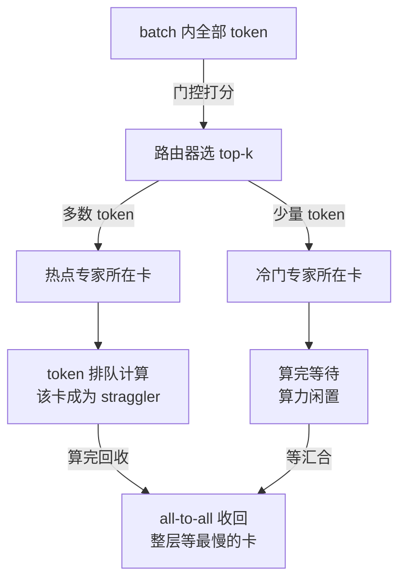
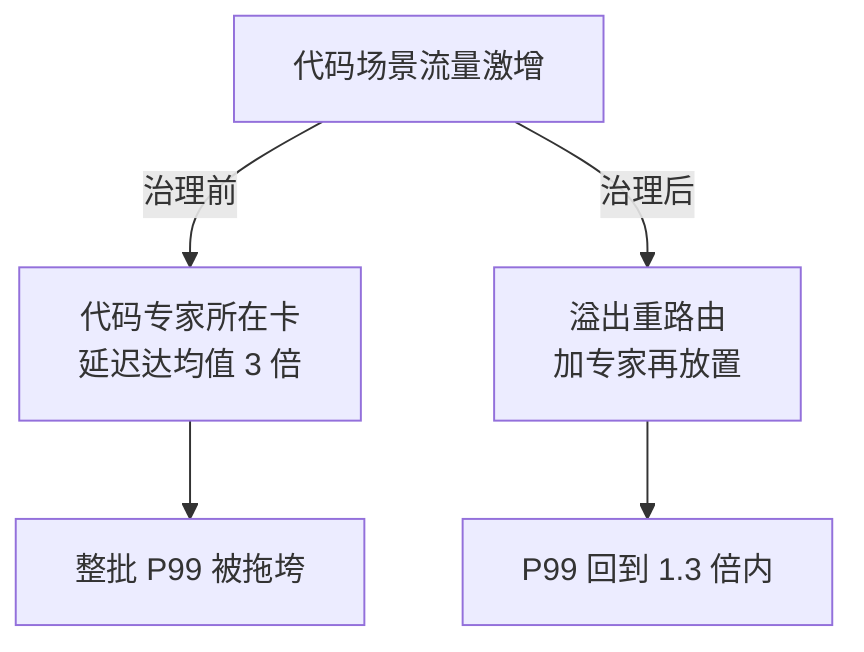

# MoE路由的工程问题：负载不均与显存碎片

## MoE 部署到底要收拾哪些工程麻烦？

这篇讲 MoE（Mixture of Experts，混合专家）模型部署期的三个工程麻烦——**负载不均、显存碎片、带宽瓶颈**：读完你能判断一个 MoE 服务为什么贵、卡在哪。MoE 模型把大模型里负责"消化每段文字"的大计算层 FFN（前馈网络）替换为多个并列的小计算单元即专家，每个 token（模型处理的最小文字单元）由一个打分小网络即路由器挑选评分最高的少数几个 top-k 来做计算。

激活参数少、推理算力便宜，但总参数多、显存占用大——**用显存换算力**。这个交换有前提：显存与带宽都充裕时才成立，任一吃紧时这层交换就失效（见后文的总账与失效节）。

要解决的问题就是这三关：训练时的负载不均——专家被偏爱、其余闲置；推理时的显存碎片——专家参数分布在多卡；批处理时的专家带宽瓶颈。本文写这三关的机制与解法，这是现代大模型成本结构（成本模型见 [[工程知识/AI 系统工程：从模型能力到生产能力/推理服务与平台/推理服务的单位请求成本从token定价推出来.md]]）的架构侧支柱。

## 专家为什么会被偏爱：路由的偏食从哪来

打个比方：MoE 像一家医院的分诊台——每个病人即 token 被分到某几位专家即子网络手上；如果分诊总把人往同几个专家那儿送，那几位排长队、其余的闲着，而且每个专家的诊室还得按可能来的最多人数备着（显存预留）。这个比喻到"为什么会不均、为什么要预留"为止：路由怎么算、容量因子怎么设、碎片怎么收拾，要看正文。

**负载不均的第一推动力是路由本身**。可以拿食堂打饭理解 MoE 的结构：普通模型（稠密模型）是一个大厨包揽所有菜，MoE 则是开了一排打饭窗口（专家），每个学生（token，模型处理的最小文字单元）进门先看菜单评价（路由器打分），只去评分最高的两三个窗口打菜。

好处是每个学生只动用两三个窗口的人手（激活参数少，推理算力便宜），但代价是**整个食堂所有窗口都得开着、原料都得备齐**（总参数多，显存占用大）——这就是 MoE 的交换：用显存换算力。这个比喻到"窗口打分"为止——食堂窗口的菜是固定几个菜，专家窗口处理的却是按输入变化的一套计算，打分本身是模型学出来的，这也是负载不均的根源：路由器可能学着学着就偏爱某几个窗口——训练数据里某些 token 模式更常见，路由器反复强化这几条路径，冷门模式对应的专家拿不到训练信号，打分于是集中到少数专家，**专家没有失能，路由在偏食**。


*图源：智源社区《50 张图，直观理解混合专家（MoE）大模型》负载均衡（把请求分摊到多台服务器、避免单点过载）目标一节，CC BY-SA 4.0，https://hub.baai.ac.cn/view/41455。*


**路由器怎么把 token 分给专家？**每层一个路由器（小线性层），对每个 token 输出专家概率分布，选 top-k（k 通常 2）专家加权求和。训练目标里路由不均衡：梯度偏爱某几个专家（自增强），其他专家没数据可学。经典解法是辅助负载均衡损失（auxiliary loss，Switch Transformer 2021：按专家被选中的频率与分到的 token 比例之积惩罚路由集中）。**训练侧的均衡是学出来的，推理侧的均衡靠系统**（批调度与专家放置）。

Switch Transformer 论文的路由动态图把"token 怎么流经专家"画在一张图里。图中对比了容量因子 1.0 与 1.5 两种配置：每个专家按（批大小 tokens_per_batch / 专家总数 num_experts）× capacity_factor 计算可处理的 token 上限，放大容量因子就是为路由溢出预留缓冲：

（图源：Switch Transformer 论文 Figure 3，arxiv.org/html/2101.03961v2）

**推理时显存为什么总不够？**全部专家参数驻留显存（每个 token 只激活 top-k，但下个 token 可能选别的专家，**专家无法按需加载**）。Mixtral 8×7B（每层 8 个专家、每 token 激活 2 个）总参数 ~47B：单卡放不下，多卡切分后每张卡都存全部专家的 1/N。显存碎片：**专家参数的放置策略（EP， expert parallelism）决定每卡显存的形状**——专家均匀放置 vs 按负载加权放置，后者要求路由统计的前置知识：要先知道哪几个专家是热点，才能把权重往它们那里倾斜（数据或负载集中到少数节点）。

**all-to-all 通信（每张卡同时向其余所有卡发送并接收数据的集合通信模式）为什么卡住吞吐？**token 要发给它的专家所在卡（all-to-all 通信），计算完再收回。batch 大时 all-to-all 的消息量随 batch 线性涨，**通信与计算重叠的调度是 MoE 推理的核心工程**。deepseek 系（V3 类）的节点内 NVLink（NVIDIA 卡间高速互联，带宽远高于 PCIe） + 节点间 InfiniBand（高性能计算常用的低延迟专用网络） 分层设计把 all-to-all 的带宽分层利用：NVLink 是节点内显卡之间的高速直连，InfiniBand 是节点之间的网络，两者带宽差一个数量级；高频的小消息走 NVLink，跨节点的大流量走 InfiniBand。EP（Expert Parallelism，专家并行：每卡只存部分专家）与 TP（Tensor Parallelism，张量并行：把单层的参数切成多份分到多卡）的复合并行策略决定通信拓扑——EP 切专家、TP 切单层：EP 让每卡只存部分专家，TP 让每卡只存单层参数的一份，两道切分叠加，单卡同时减少专家与层参数的存储，显存因此下降，但通信路径也更复杂。

**批里不同 token 怎么把热点卡拖垮？**批内不同 token 选不同专家，每专家的输入量不均（热点专家吃 3-5 倍 token）。continuous batching[[工程知识/AI 系统工程：从模型能力到生产能力/推理服务与平台/推理批处理的两难：吞吐与延迟的调度天平.md]]的调度层如果不管专家负载，**热点专家所在卡成为 straggler（长尾卡），整层等待**。Expert choice routing（专家反向选 token）与容量因子（capacity factor，超容 token 丢弃或溢出）是均衡手段。



图：为什么单卡变慢全体买单——all-to-all 的收回要等全部专家返回，**热点卡的长尾（少数请求耗时远高于其余大部分）就是整层的延迟**——这里的「全体」指同一层的所有 GPU：all-to-all 是同步操作，任何一张卡没算完，下一层拿不到数据就只能空转。这就是调度层必须按专家负载调批的原因。

## 均衡要付什么代价？

最直接的纠偏手段是 KeepTopK：给路由加上可训练的噪声，把前 k 名之外的专家权重**压到负无穷**，迫使选择散开。


*图源：同上（智源社区《50 张图，直观理解混合专家（MoE）大模型》）KeepTopK 纠偏一节。*


MoE 起于 1991（Jacobs et al. 的混合专家与分而治之学习），现代形态是 GShard/Switch Transformer（2020-2021，Google）确立的 top-k 路由 + 负载均衡损失 + 容量因子框架。Mixtral 8×7B证明开源 MoE 可行，DeepSeek-V3（2024）把细粒度专家（256 选 8）+ 共享专家（每 token 必经）推成新默认。**共享专家是结构性的减负**：高频公共知识进共享专家，路由专家只学残差（输入减去共享专家输出后剩下的差异部分）。公共知识被共享专家吸收后，路由专家只处理差异化内容，各专家的数据量趋于均匀，**路由分布自然更均衡**。

**容量因子把「负载不均」从训练问题变成工程参数**。capacity factor 决定每专家每批可处理的 token 上限，超过则溢出（drop 或溢出到下一层）。这个参数把路由的不均衡性变成显式的容量约束：CF=1（严格均衡假设）训练快但丢 token 伤精度，CF>1（冗余容量）保精度但训练慢。推理时 CF 更敏感：**丢 token 是直接的输出错误**（句子中途语义断裂），推理的 CF 通常更高或用 Expert choice 保证零溢出。代价：MoE 的「激活参数少」只在 batch 小时兑现——batch 大时多个 token 命中同一专家，专家计算串行化（热点专家的 GEMM——General Matrix Multiply，通用矩阵乘法，模型算力的核心运算——变大但不并行），**算力优势随 batch 增长衰减**；显存占用是全参数的（总参数 × 每卡份数），8×7B 显存近似 4× 单 7B 稠密模型，见 [[工程知识/AI 系统工程：从模型能力到生产能力/模型与上下文/KV缓存与上下文长度的显存账：为什么长上下文贵]]——KV（Key-Value，注意力机制里缓存的键值对）缓存；MoE 的显存账是 KV 之外的另一笔大头，总账是：MoE 便宜的前提是**显存充裕 + 通信带宽充裕**，两者任一吃紧，MoE 反而比稠密模型贵。

## 这套说法在哪儿会失效

- **训练与推理的路由不均是两个问题**。训练侧靠辅助损失学均衡（慢、不彻底），推理侧靠系统调度（快、按负载统计）。**两个侧面的解法不能混用**：训练侧的均衡不保证推理分布的均衡（数据分布变化后热点漂移）。
- **Expert choice 路由的因果倒置有代价**。专家选 token保证负载绝对均衡，但**破坏 token 级因果**（同一句话的 token 被不同专家处理，语义连贯性受损）。学术基准上可用，开放域生成有质量争议。
- **细粒度专家的通信放大**。专家数从 64 到 256，每 token 的路由开销与 all-to-all 消息数涨到 4 倍（top-k 从 2 到 8）。**细粒度的均衡收益与通信代价同涨**，只有节点内高速互连（NVLink 域）扛得住这个量，所以它是细粒度的前提。
- **部署形态决定专家放置**。单机多卡（EP 节点内）与多机（EP 跨节点）的专家放置策略完全不同：跨节点 all-to-all 走网络（慢），**专家复制（热点专家多卡副本）换通信**：把热点专家在多卡各存一份副本，token 不必跨节点取参数，跨节点流量因此降下来；代价是**每多一个副本就多占一份显存**，只在热点集中、副本数少时才划算。部署前按路由统计（哪几个专家高频）预放置，而不是**均匀盲放**。

## 怎么自己动手验证

- **路由分布观测**：加载开源 MoE 模型（Mixtral/DeepSeek 类），真实负载前向统计每专家的 token 命中分布。预期：分布显著不均（少数专家吃多数 token），长尾专家稀疏命中。直方图（把数值按区间分桶统计、看分布形态）是负载不均的直接证据。
- **容量因子实验**：不同 CF（1.0/1.25/1.5）下训练或推理的吞吐与输出质量（评测分数）对比。预期：CF 升吞吐降、质量升，权衡曲线是参数选型依据。
- **批规模与算力收益实验**：稠密模型 vs MoE（同激活参数量级）在不同 batch 下的吞吐对比。预期：小 batch MoE 优势显著（激活参数少），大 batch 优势衰减（热点串行 + 通信占比上升）。衰减曲线是「激活参数省算力」边界的量化证据。

## 账怎么算？

压到负无穷之后，这些专家在 SoftMax（把一组打分归一化成总和为 1 的概率分布的函数，分数越低概率越接近 0）上的概率就变成了 0，**等于这一轮里彻底不参与**——稀疏就是这样被强制出来的。


*图源：同上（智源社区《50 张图，直观理解混合专家（MoE）大模型》）压零效果一节。*


```text
MoE 推理批次的负载推演账（通用形态）：

理想账：N 个专家、每 token 选 top-2 → 每专家应分到 2/N 的 token
  现实账：路由器有偏 → 热门专家收到 5 倍于均值的 token
    热门专家所在卡算力打满，其余卡等它 → 整批延迟由最热卡决定
  均衡手段账：辅助负载均衡损失（训练期）、token 丢弃/溢出重路由（推理期）、
    专家放置再平衡（把热门专家按卡摊开）
  显存碎片账：专家权重按卡静态放置 → 请求分布漂移后冷专家占着显存，
    热专家想扩容没地方 → 显存有量但用不上
```

案例回流的第一段画成治理前后两条链，热专家怎么拖垮整批、均衡手段怎么收回来：



碎片占着位置的案例（这个比方到「冷专家占着显存、热专家扩不动」为止，其余机制看正文）——扩容时报"显存不足"，实际 30% 显存被长尾冷专家占用；**专家放置按流量定期再平衡后扩容恢复可用**。负载均衡思想的同源对照：数据分片（把数据按规则切开存到不同节点）的热点治理用一致性哈希（节点增减时只迁移少量数据的分片路由）摊移动量[[工程知识/数据系统：在并发与故障中保存事实/事务与存储/一致性哈希把再平衡的数据移动量压到平均槽位.md]]，**MoE 的专家放置是同一问题在 GPU 卡上的形态**。容量与显存的总账见 [[工程知识/AI 系统工程：从模型能力到生产能力/推理服务与平台/GPU显存管理决定服务容量上限.md]]、单请求成本与路由效率的联动见 [[工程知识/AI 系统工程：从模型能力到生产能力/推理服务与平台/推理服务的单位请求成本从token定价推出来.md]]。

## 接着读哪几篇：MoE 在成本模型中的架构侧

- [[工程知识/AI 系统工程：从模型能力到生产能力/推理服务与平台/推理服务的单位请求成本从token定价推出来.md]] —— MoE 在成本模型中的架构侧
- [[工程知识/AI 系统工程：从模型能力到生产能力/推理服务与平台/推理批处理的两难：吞吐与延迟的调度天平.md]] —— 批调度与专家负载的交互
- [[工程知识/AI 系统工程：从模型能力到生产能力/模型基础与训练/GPU执行模型与显存层级：SIMT与合并访存.md]] —— 显存与带宽的物理层级
