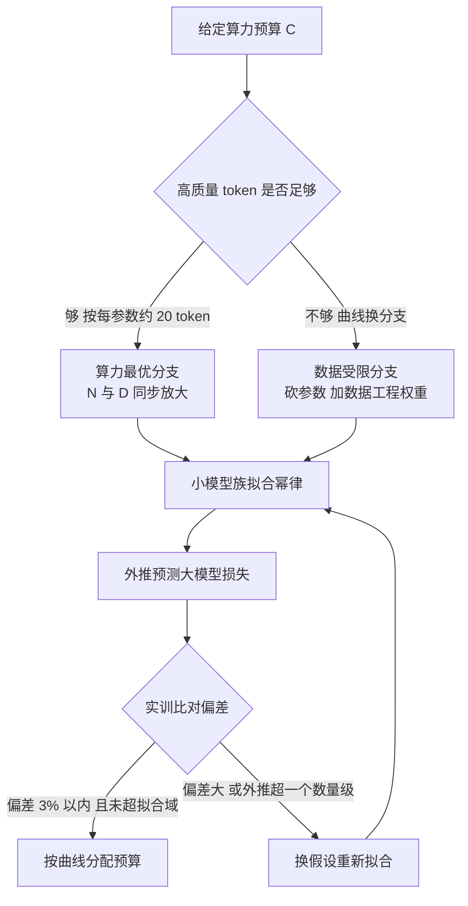

# Scaling Law 把训练预算分配成可测量假设

**这篇回答训练预算有限时，参数、数据和算力怎么分配**。Scaling law（缩放定律，描述模型规模与性能之间数量关系的经验规律）解决的就是这个问题；**读完你能照着把一笔训练预算写成可测量的假设，并在外推前确认前提没有变**。Hoffmann 等人给出的趋势模型覆盖的是受控实验内的损失曲线（训练损失，模型在训练目标上的误差），其本质是**拟合出的幂律**（损失随规模扩大按固定指数下降的关系），**不承诺下游事实性、安全性、工具使用或线上延迟；外推前必须确认数据质量、架构和任务分布没有改变结论**。

**Scaling law 观察模型规模、训练 token（模型训练时处理的文本切分单位）和计算量与验证损失（模型在未见数据上的误差，用于判断过拟合）之间的统计关系，帮助判断有限算力应该增加参数、数据还是训练步数**。**它给出的是「预算怎么分」的量化关系，不保证下游质量、事实性、推理成本和产品价值**。

## 要解决的问题：趋势模型在哪些条件下成立

**训练预算有限，参数规模、数据量与计算量三者之间怎样分配缺少依据，凭经验堆参数或堆数据都会在预算耗尽之后才发现方向偏离**。本篇回答：趋势模型在什么条件下成立、外推之前要确认哪些前提没有变化、它对下游事实性与安全性的结论边界在哪里，以及怎样把预算分配写成可测量的假设。

## 什么条件下趋势模型的结论会改变？

**打个比方：Scaling Law 像装修前的用料估算表——它告诉你"面积翻一倍，大概要多买多少料、效果能好多少"，于是有限的预算该加在数据上还是参数上，就变成了能算的题而不是拍脑袋**。这个比喻到"估算能指导分配"为止：具体的幂律系数怎么拟合、什么时候会偏离、小模型上外推为什么危险，要看正文。

**早期实验可能在固定 token 下扩大模型；Chinchilla（DeepMind 2022 年的研究，结论是同等算力下模型参数和训练数据要按相近比例一起加大）说明在计算预算固定时，模型和训练 token 需要共同增长**。**数据质量、去重、配比、优化器、上下文长度、架构和后训练会改变曲线——这些因素改变的是有效数据规模或单位算力的损失下降速度，同一条幂律的系数随之失效，不能把一个公开模型的拟合系数直接搬到自己的领域**。

**幂律形态的原始证据来自 Kaplan 等人的第一次系统测量：验证损失对算力、数据量、参数量三个因子在对数坐标上都是直线，指数分别为 0.050、0.095、0.076，跨越多个数量级没有饱和迹象**。**Chinchilla 之后修正的是配比系数，幂律本身在这些实测里保持成立**：

**最佳的参数与数据配比在固定算力预算下逐点测出来的，而不是一次拟合出的定值**。**Kaplan 论文把「同一笔算力怎么分」画成两条曲线：一条是达到给定损失所需的算力，参数越多所需算力越低；另一条是同预算下的实际损失，随参数增加先降后升，两条线的形状解释了为什么最优参数规模存在**：


*图源：Scaling Laws for Neural Language Models（arXiv:2001.08361）Figure 5 与 Figure 4，arXiv 论文默认许可，https://arxiv.org/abs/2001.08361。*


*图源：同上（Scaling Laws for Neural Language Models），（arXiv:2001.08361）Figure 1。*

## 工程上怎么用它来分配预算？

预算分配要拆到能单独调整的一层。协议栈的分法给了个参照：应用层、传输层、网际层、网络接口层各管各的，改一层不必动其他层。这个类比只到「分层互不牵连」为止：协议栈各层职责固定，而 scaling 里参数与数据会互相挤占同一笔算力，不能真的逐层独立调。

1. **先定义可测目标：预训练（用海量文本先训练出通用语言能力、之后再适配下游任务） loss、目标任务质量、训练/推理成本和硬件约束**。
2. **用多个小规模配置拟合趋势，保留数据分布和训练配方**。
3. **检查拐点、过拟合（模型把训练数据的噪声也记住、在新数据上表现变差的现象）、污染、能力突变和后训练收益**。
4. **用独立任务、长尾（少数请求耗时远高于其余大部分）、安全和线上负载验证放大后的结论**。

**这些趋势今天走到了什么量级，Epoch AI 的公开仪表盘按季度更新：前沿语言模型的训练算力自 2020 年以来每年约 5 倍（90% 置信区间 4× 到 6×），AI 芯片存量算力每年 3.4 倍，最大已建 AI 数据中心折合 110 万块 H100——外推预算假设时，行业层面的这些实测增速就是外推域的现实背景**：


*图源：[Epoch AI — Trends in AI](https://epoch.ai/trends)（页面截图，2026-09-27，Updated Feb 5, 2026）。幂律告诉你「给定预算怎么分」，这张仪表盘告诉你「预算本身每年涨多少」——两者相乘才是真实的规划输入；引用时以卡片上的 90% 置信区间为准，不取单点。*

同一笔预算先撞上一个分叉——高质量 token 够不够决定走算力最优还是数据受限，两条分支最后都要回到同一条外推验证回路：



**分叉决定配比，回路决定这条曲线能不能用；偏差超范围就换假设重拟合**。可测量假设与押注的区别在于**：假设能被数据推翻并修正**，押注不能——**这就是为什么要留验证回路，预算分配才算得上可测量**。

**外推要与小规模实测对账——预写用百分之一预算拟合的曲线预测大模型损失的偏差范围，超出偏差范围就说明该曲线不能用于外推**。

## 这套说法在哪些条件下会失效？

**更大的模型参数更多，单次推理算力与显存（GPU 上的内存、模型参数与计算中间结果都存这里）占用随之上升，可能提升能力却超出延迟、显存或预算；更多数据可能增加重复、版权和噪声**；**蒸馏（用大模型的输出教小模型）、MoE（ mixture of experts，稀疏激活的专家混合架构）、量化（降低数值精度换显存）和检索会改变参数与计算的关系——量化降低了数值精度、MoE 只激活部分参数，参数量不再等比决定推理算力，所以沿用旧 scaling 结论前要先重新测量**。**任何 scaling 结论都要带实验范围和不确定性**。

**最小实验：固定数据配方与评测集，训练至少三档模型规模或三档有效 token，记录 FLOPs（浮点运算次数，衡量训练算力的基本单位）、验证损失、目标任务质量和 wall-clock（墙钟时间：真实流逝的挂钟时间，区别于 GPU 纯计算时间），再用未参与拟合的保留集检验外推**。**若收益只出现在训练分布或单一 benchmark（基准评测集），结论应标为分布内趋势**。

关系：[[工程知识/AI 系统工程：从模型能力到生产能力/模型基础与训练/预训练数据决定模型能力上限]] · [[工程知识/AI 系统工程：从模型能力到生产能力/推理服务与平台/推理服务的核心矛盾是延迟、吞吐、显存与质量]]

## 参数、数据、算力各在什么数量级？

**Chinchilla 型算力分配的实用账：算力 C ≈ 6ND（参数量乘 token 数），最优配比 D/N ≈ 20（每参数约 20 token）**。**10^23 FLOPs 预算的两种分法：70B 参数 × 2T token，或 40B × 4T token——后者在这条等算力曲线上更接近谷底配比，所以 Chinchilla 论文实测损失更低**。每条 isoFLOP（同一算力预算下、损失随参数规模变化的一条等算力曲线）曲线的谷底位于哪个参数规模，论文原图一眼说清：


来源：Hoffmann et al.，[Training Compute-Optimal Large Language Models](https://arxiv.org/abs/2203.15556)（Figure 3）。**谷底就是「这笔预算该买多大模型」的答案：预算翻倍后同等配比下参数与数据都能放大，最优参数规模随之增大，谷底右移，配比保持约 20 token/参数（该数值来自 Chinchilla 论文 Figure 3 的等算力曲线族）；推理成本再把账改写——训练省下的参数量在推理期每次请求都要付（参数量正比推理算力），因为推理算力按请求次数反复支付，长期高流量下推理的总账会超过训练省下的部分，所以宁可训练时少投参数、多投数据**。**长期高流量的服务朝"训练欠拟合、推理省钱"方向移动，这是 Llama 系列长期训练的经济学：参数量低于 Chinchilla 最优解，token 数按其配比准则（约 20 token/参数）的数倍投入，把成本从训练端移到推理端省回来**。

## 真实案例里假设先行是怎么衔接的？

**Scaling Law 的工程用法与 [[工程知识/AI 系统工程：从模型能力到生产能力/质量与运营/Agent评估系统的设计约定]] 的评估约定同构：都要求"先定义可测量的判据，再花大钱"**。**训练侧的判据是损失曲线的外推拟合（用 1% 算力的小模型拟合幂律，外推大模型损失，外推误差控制在个位数百分比），评估侧的判据是测试集对分布的代表性与 leakage（数据泄漏：测试集被训练数据污染，分数虚高）检查**，[[工程知识/AI 系统工程：从模型能力到生产能力/数据与MLOps/训练数据治理：来源、许可与污染决定语料的长期价值]] 里的 n-gram 污染检测（n 元文法：按连续 n 个词做统计的最小切分单位）直接可用——**两条线共用一个纪律：大额支出前的假设必须便宜地验证过**。

## 动手跑一遍能看到怎样的预算账？

可运行示例：一份训练预算（10^23 FLOPs）怎么变成假设检验：

```text
Chinchilla 型假设（公开结论）：token 数 ≈ 20 × 参数数 时单位算力损失最低
  10^23 FLOPs ≈ 6ND
  → N ≈ 6e10 / (20) ... 具体解：N ≈ 40B 参数、D ≈ 800B tokens 附近（6×40B×800B ≈ 1.9e23）

预算内两种分法的对照（同在约 2e23 FLOPs 内）：
  偏参数侧：N=56B × D=0.6T → 6ND ≈ 2e23，D/N ≈ 11
  贴近谷底：N=29B × D=0.6T → 6ND ≈ 1.05e23，D/N ≈ 21
  判读：Chinchilla 等算力曲线的实测损失在 D/N≈20 的配比附近最低，偏参数侧同预算损失更高

假设的验证路径（小模型外推）：
  用 1/100 的预算训一族小模型（N=70M/160M/400M/1B，D 按 20N 同步放大）
  拟合 L(N, D) = A/N^α + B/D^β + E 的幂律参数
  用拟合曲线预测 50B 模型的损失 → 真训 50B 验证预测偏差
  偏差小于 3%（小模型族到中型模型的常见实测区间）→ 曲线可信，后续预算分配按曲线走；偏差大 → 换假设重新拟合

数据约束的修正：高质量 token 不够 1T 时，
  曲线从"算力最优"切到"数据受限"分支（多训 epoch 的边际收益递减），
  预算分配随之改变：加数据工程权重，砍参数规模
```

**Scaling Law 用错的实录形态——把幂律拟合外推三个数量级以上（小模型 1B 的曲线直接外推到 1T），外推超出拟合域的预测偏差不可控，公开复现的经验是外推每多一个数量级、预测误差放大数倍；数据配比变化后不重拟合（换了数据管线还用旧曲线），预测整体失真**。**同源纪律见 [[工程知识/性能工程：从用户等待到资源瓶颈/观测与诊断/基准测试必须先定义负载和测量误差.md]]——假设要可证伪、拟合要报误差、外推要声明边界，两个域用的是同一条测量纪律**。

## 怎么自己动手验证拟合是否可靠？

1. **反向验证：先用约百分之一的预算训练一族小模型拟合幂律参数，用曲线预测大模型损失，再实训比对偏差，实测与曲线预期对不上时禁止外推，偏差在百分之三以内方可外推**。
2. **外推边界：确认预测没有超出拟合域一个数量级以上；数据配比变化后重新拟合**。
3. **数据受限分支：高质量 token 不足时切换到数据受限分支，确认预算分配随之降低参数规模、提高数据工程权重**。

