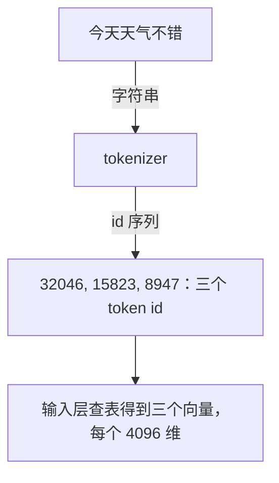
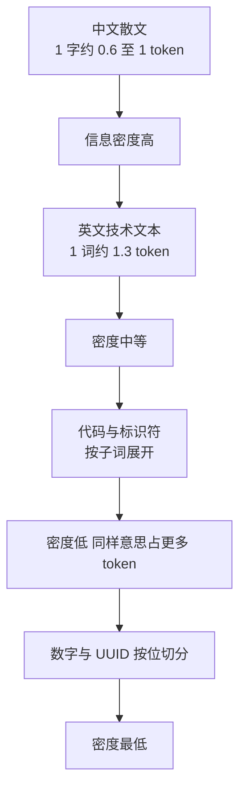
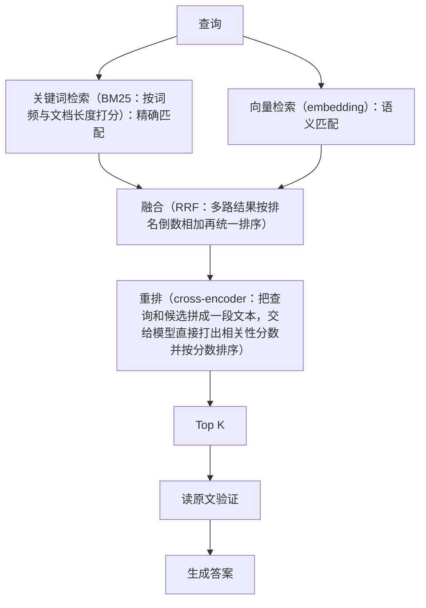

# Token、Embedding 与表示学习连接数据和模型

模型看不见"文字"，只看见**数字**。这一页讲三件事：文本怎么变成数字（token）、对象怎么变成可比较的向量（embedding，把文字、图片等内容转成一串数字向量，机器靠向量距离算相似度）、以及这些向量里的结构从哪来（表示学习）。读完你能估算 token 成本与索引内存、设计检索方案，并排查"为什么搜不到"类问题。

这三个概念常被混为一谈，导致对上下文容量、token 成本、索引内存、RAG（检索增强生成，指先从知识库检索相关材料，再让模型基于检索结果作答）召回质量的判断同时出错。理解它们的差别，是估算成本、设计检索、排查"为什么搜不到"的前提。

## 三个概念怎么连接数据与模型：机制与本质

先把形状说成一件事：三个概念像图书馆的三道工序——Token 是"按目录规则把书拆成条目"（切分决定哪些词能被单独检索）；Embedding 是"给每本书编坐标贴上书架"（向量决定谁跟谁挨着）；表示学习是"根据借阅记录不断重排书架"（训练把常一起借的书挪近）。哪道工序出了错，"搜不到"就发生在那一道。这个比喻到"重排书架"为止——现实里三道工序各自的机制，下面分节展开。

**三层机制各管什么？**文本被切分成 token（离散单元）、token 被映射成 embedding（稠密向量）、训练把语义相近的向量拉近——每一层的表达边界决定模型能利用什么信息；机制清楚后，"搜不到"类问题才能从玄学变成可检查的路径。

## 一个搜不到的 bug 说明了哪些事：背景与要解决的问题

一个企业知识库检索系统，用户搜「怎么申请生产环境权限」，返回的全是"开发环境权限"的文档。

这次排查走了三步：

1. 先看召回：文档确实在库里，但**余弦相似度（衡量两个向量方向接近程度的分数，约 0 到 1，越接近 1 越相似）排在第 47 位**
2. 看向量：「怎么申请生产环境权限」和「生产环境权限申请流程」的相似度只有 **0.61**
3. 而「怎么申请开发环境权限」是 **0.78** —— 因为"怎么申请...权限"这几个字几乎一样

原因在 embedding 模型一侧：它对"生产"和"开发"这两个词的区分度不够，它们在向量空间里太近了。

这个 bug 牵出三个层面的问题，可以一层一层对着查：

| 层面 | 问题 |
| --- | --- |
| Token 层 | 中文是怎么被切开的？"生产环境"是一个 token 还是三个？ |
| Embedding 层 | 相似度 0.61 意味着什么？为什么语义不同的句子分数很高？ |
| 表示学习层 | 向量空间的结构从哪来？为什么"生产"和"开发"会靠得近？ |


来源：[阿里云开发者社区《图文详解 RAG 技术和流程》语义距离一图](https://developer.aliyun.com/article/1670698)（CC 4.0 BY-SA）


再一处图源：[阿里云开发者社区《图文详解 RAG 技术和流程》向量入库一图](https://developer.aliyun.com/article/1670698)（CC 4.0 BY-SA）


## Token 是什么：从零开始

### 为什么模型只认识数字



  **Token 是模型处理文本的最小单位。** 它不等于"字"，也不等于"词"。模型不认识文字，只认识编号——像一本只收编号不收字形的字典，查进去的必须是编号，出来的必须是编号；编号本身不带笔画，笔画在编号之外的世界里。比喻到"进出都是编号"为止：编号怎么切出来、切法为什么重要，看下面的机制。

### 切分规则怎么定：子词（Subword）

现代 tokenizer 用 BPE（Byte Pair Encoding，字节对编码：把文本拆成高频子词的算法）/Unigram（两种从语料里统计出高频子片段的切词算法）算法，把文本切成**子词**：

| 输入 | 切分结果 | token 数 |
| --- | --- | --- |
| 英文 unbelievable | un / believ / able | 3 |
| 中文 生产环境权限 | 生产 / 环境 / 权限 | 3（常见情况） |
| 代码 getUserById | get / User / By / Id | 4 |
| 数字 1234567 | 123 / 456 / 7 | 3（通常情况） |

**关键：切分规则是训练出来的，没有语言学规则可循。** 不同的模型 tokenizer 不同，同一份文本让 GPT 系、Claude 系、开源模型各数一遍 token，结果彼此能差一倍（下文"换模型要重新测"给出了实测数字）。切法像各家的词典收词不同：同一个词，有的词典整词收录、有的要拆成词根查——查出来的"条目数"不同，账就不同；计量（计费、窗口）认词典不认字典里的语言学规则。比喻到「各家收词不同导致条目数不同」为止，词典的编排与查询速度和 tokenizer 无关。

### 这对工程意味着哪些事

**1. 成本直接由 token 数决定**

```
输入 100 万 token × 单价 = 成本
```

中文通常 1 个字 ≈ 0.6-1 个 token。**成本估算要按 token 数算，按"字数"估会算错**。

**2. 上下文窗口（模型一次能读入的最大文本长度）是 token 数，不是字数**

"支持 200K 上下文" = 20 万个 token ≈ **15 万汉字**（按 1.3 token/字算）。**不是 20 万字**。

**3. 代码和数字的 token 密度很高**

```python
# 这行看起来很短，但可能是 15 个 token
df.loc[df['user_id']==8821, 'amount'].sum()
```

**代码比自然语言"费" token**，这是代码 Agent（能替人读代码、写代码、跑命令的自动化程序）成本高的原因之一。同样是表达一个意思，不同内容类型的 token 密度差别很大：



这张图解释了代码 Agent 为什么贵：函数命名越长、标识符越多，切分密度越低，**同样的逻辑占的 token 就越多**，token 数乘以单价就是成本；数字和 UUID（通用唯一识别码，一种 32 位十六进制随机编号）按位切开后，一个 32 位 UUID 可能占十几个 token。做上下文预算时**按类型估算，比统一按字数折算更接近实际**。

**4. 换模型要重新测**

同样是这份文档，让三家 tokenizer 各切一遍，token 数摆开差距：
- GPT 系 tokenizer：12,400 token
- Claude 系 tokenizer：11,800 token
- 某个开源模型：18,200 token

**不要沿用旧的估算。** 用目标模型的 tokenizer 实测。

### 数字为什么会让模型算错？

```
"1000" 和 "1001" 在模型眼里可能差别很大
因为它们被切成不同的子词组合
```

  这解释了为什么**大模型做算术容易错**：算术要按位值和进位规则运算，而数字被切成子词后，模型拿到的是片段组合，**片段之间没有数值大小关系**，进位规则在 token 层面不存在。token 编号相邻只说明编号连续，**编号之间没有"加一就是下一个"的承诺**，位值进位在 token 层面同样不作数。

## Embedding 是什么：从零开始

### Embedding 到底是什么

**Embedding 就是把一个对象（文本/图片/代码）映射成一个固定长度的向量**。向量是一组有序数字，可以理解为高维空间里的坐标；这里的高维空间是数学上的多维坐标系，不是物理空间。训练让"语义相近"的对象在向量空间里距离变近，所以**坐标挨得近就代表内容相似**。

| 文本 | 向量（前几维，1024 维） | 与查询的距离 |
| --- | --- | --- |
| 如何申请生产权限 | 0.21, -0.33, 0.87, ... | 查询本身 |
| 生产权限申请流程 | 0.19, -0.31, 0.85, ... | 很接近 |
| 今天午餐吃什么 | -0.72, 0.44, -0.11, ... | 很远 |


*图示：词向量在语义空间中的相对位置关系。图源：Wikimedia Commons《Word embedding illustration》，作者 Fschwarzentruber，CC BY-SA 4.0，https://commons.wikimedia.org/wiki/File:Word_embedding_illustration.svg。上面那张表是这图的具体数字：前两行挨着，第三行在另一侧。*

### 相似度怎么算

  **余弦相似度**（最常用）：两个向量的夹角。它**只比向量的方向、不比长度**：把两个向量除以各自的模长归一化后点积，方向越接近分数越高，长度本身不进分数。比喻到"量夹角"为止：分数怎么读、为什么不能跨模型比，看下面的表。

```python
similarity = cos(θ) = (q · x) / (|q| × |x|)
```

取值范围 -1 到 1（归一化后通常 0 到 1）。

| 分数 | 含义（通用模型，仅供参考） |
| --- | --- |
| > 0.85 | 几乎同义 |
| 0.7-0.85 | 语义相关 |
| 0.5-0.7 | 主题相关但细节不同 |
| < 0.5 | 基本无关 |

**绝对分数只在同一模型内有可比性，跨模型与跨任务都要看相对排序**。不同模型的分数分布完全不同，判断"是否相关"要靠 top-k（取相似度排在前 k 名的结果）排序，**固定阈值给不出可靠答案**。

### 关于 Embedding 有哪些常见误解？

对 embedding 的认识里最容易出错的是下面几条，误解与事实对照着看：

| 误解 | 事实 |
| --- | --- |
| "相似度 0.9 就是正确答案" | 只说明**表述相近**，不说明事实正确 |
| "向量库里能查到就能回答" | 查到的是**候选**，还要读原文验证 |
| "embedding 理解了语义" | 它学到的是**训练目标下的统计规律** |
| "可以用它判断权限" | 向量相近不代表权限相同（**这是安全漏洞**）——相似度只度量文本表面语义的距离，不携带身份与授权信息 |

**最危险的误解是最后一条**：用"向量相似度"做权限控制或内容过滤，会被绕过：攻击者只要把敏感内容的措辞改成与目标权限内容相似的表述，向量就贴近而被误判为同权限——**相似度不携带身份与授权信息**。

### 三种常被混淆的"向量"怎么区分

| 类型 | 产生位置 | 用途 | 特点 |
| --- | --- | --- | --- |
| **token embedding** | 模型输入层 | 给 Transformer（以注意力机制——让每个词动态参考上下文里其他词——为核心的神经网络结构）提供初始表示 | **上下文无关**："苹果"在"吃苹果"和"苹果公司"里是同一个向量 |
| **hidden state** | 模型中间层 | 可用于分类、特征提取 | **上下文相关**：同一个词在不同句子里向量不同 |
| **句子/文档 embedding** | 专门的编码器或对向量做池化（把一串向量压缩成一个向量的操作） | 检索、聚类、去重 | 为"整段语义相似度"优化 |

几类 embedding 的关键区别在**取哪一层向量**：

- 拿**输入层的 token embedding** 做检索 → 效果很差（上下文无关）
- 拿**生成模型的 hidden state** 做检索 → 通常不如专门的 embedding 模型
- **专门的 embedding 模型**（如 bge、gte、E5）在检索任务上明显更好——它们在检索任务的目标上训练过，向量专门优化「整段语义是否相关」；**生成模型的隐层向量优化的是预测下一个词，目标不同所以检索效果差**

## 表示学习学的是什么：从零开始

### 向量空间的结构从哪来

向量空间的结构来自训练。模型通过训练任务，学会把"相似的东西"放近。

对比学习（Contrastive Learning）的典型做法是拿样本对做拉推训练：

```
正样本：「如何申请权限」↔「权限申请流程」  → 拉近
负样本：「如何申请权限」↔「今天天气不错」  → 推远
```

训练数据决定了"什么算相似"，**不同数据学到的相似各不相同**，对照见下表：

| 训练数据 | 学到的"相似" |
| --- | --- |
| 通用网页文本 | 主题相似 |
| 问答对 | 问题和能回答它的段落相似 |
| 代码 + 注释 | 代码和描述它的文字相似 |
| 同义句对 | 语义相同 |

**这解释了开篇那个 bug**：训练目标把相似上下文里的词拉到相近的向量，"生产环境"和"开发环境"在训练数据里经常出现在同样的句式里（怎么申请……权限），于是学到几乎一样的向量——**但业务上它们完全不同**。

### 领域偏移怎么应对

**通用 embedding 模型在专业领域表现会明显下降。**

通用 embedding 模型在哪些场景里会露怯，按场景摆开：

| 场景 | 通用模型表现 |
| --- | --- |
| 通用百科问答 | 好 |
| 内部业务术语 | 差（"开单" vs "下单" vs "建单" 分不清） |
| 代码检索 | 差（需要代码专用模型） |
| 多语言混合 | 中等（跨语言能力依赖训练数据） |

**解决**：领域微调（用领域数据继续训练模型，让它适应专业术语与表达），或者用更好的检索策略（**混合检索 + 重排**）。通用模型在专业领域像没进过病房的医学毕业生：普通问诊（百科问答）没问题，一进专科病房就分不清"窦性心律不齐"和"房颤"（内部术语）——要么进专科规培（领域微调），要么查房时带上专科主任把过关（混合检索加重排）。比喻到「通用训练对比专科能力缺口」为止，医学生的学习能力与知识广度不在类比范围内。

## 生产里怎么用：要点

### 检索链路的完整形态长什么样



**单用向量检索是最常见的错误**——它擅长语义，**不擅长精确匹配（ID、报错码、专有名词）**。完整链路像一轮招聘筛选：简历库全量初筛（向量检索，看大体匹配）、按岗位硬性条件过一遍（关键词检索，证书与工龄精确核对）、两路名单合并后由面试官面谈定名次（重排），最后才进 offer（生成答案）——只按"感觉匹配"发 offer（单用向量），要证没证的人就进来了。详细见 [[工程知识/AI 系统工程：从模型能力到生产能力/知识与检索/RAG的核心是选择可引用证据]]。

### 向量库容量怎么估算

```
内存 ≈ 向量数 × 维度 × 每维字节数 × 索引开销
```

可以把它当成停车场的账：车位总数 = 向量数，每个车位的尺寸 = 维度乘每维字节数，索引是在场外加的导视牌和多层坡道——牌子和坡道本身也要占面积，且建法不同占得不一样。比喻到"车位乘尺寸加导视"为止：具体倍数按索引类型实测，看下表。

| 配置项 | 例子 |
| --- | --- |
| 100 万条 × 1024 维 × float32 | 4 GB（原始向量） |
| 加 HNSW 索引开销（HNSW：一种用多层图结构加速近邻搜索的向量索引，内存占用随参数增长） | HNSW 原论文报告内存随 M 参数增长，预留量按「原始向量 4 GB 乘以索引参数再实测」的方式定，先按 6-8 GB 预算留量 |
| 量化（int8 / 二值：用更少的比特数表示向量数值，牺牲部分精度换内存） | 可降到 1/4 - 1/32，但有精度损失 |

**维度不是越大越好**：1024 维够用；维度涨到覆盖语义所需的自由度后，**再加的维度大多是在记训练噪声**，召回不再明显上升，反而更费内存和计算。

### 版本管理怎么做（最容易漏的工程问题）

**换 embedding 模型 = 整个向量空间变了，旧向量全部失效。**

**本质是坐标系换了**：同一文档在两个模型里坐标完全不同，文档没变、向量空间变了。新旧向量混用，"距离近"就不再代表任何语义关系。

```
v1 模型的向量：A(0.2, 0.3), B(0.5, 0.1)
v2 模型的向量：A(0.8, -0.1), B(0.1, 0.9)   ← 同一个文档，完全不同的坐标
```

**新旧向量混在一起，检索结果无法解释。**

迁移要做的有三件，另有一件要提前规划：

1. **向量里记录模型版本**
2. **换模型时全量重建**（不是增量）
3. **重建期间双写（同时写新旧两套向量）或双索引（并行保留两套索引）**，切换时用开关控制流量
4. **重建是耗时操作**（百万级可能几小时），提前规划时间

嵌入（把文字或对象映射成向量、语义越近向量距离越近）质量要用下游任务实测：相似度排序与业务判断对不上时，**先检查预处理是否把信号抹掉了**——常见情况是同义词被切成不同 token、大小写或标点没有统一，然后再考虑加数据或调整训练目标。

## 动手验证前要准备什么

- **token 数用目标模型的 tokenizer 实测**，不要按字数估算
- **按内容类型分桶测**：中文、代码、数字、混合语言的 token 密度差异很大
- **检索质量用 Recall@k衡量**，不是看向量分布图
- **构造难例测试**：否定（"不含 X"）、近义词、专有名词、多语言
- **相似度阈值不要跨模型复用**
- **删除/撤权的文档要验证真的检索不到**（向量库删除可能不彻底）

## 哪些认识一看就错：常见错误

**错误 1：按字数估算 token 和成本**

中文 1 字 ≈ 0.6-1.5 token，代码更高。**必须实测。**

**错误 2：用输入层 embedding 做检索**

上下文无关，效果差。**用专门的 embedding 模型。**

**错误 3：用固定相似度阈值过滤**

不同模型分数分布不同。**用 top-k 排序，不用绝对阈值。**

**错误 4：换 embedding 模型不重建索引**

新旧向量混用 → 召回结果混乱。**必须全量重建。**

**错误 5：以为向量相似 = 语义相同 = 可以回答**

相似只是候选。**必须读原文，检查权限，再生成答案。**

**错误 6：用 embedding 做权限控制**

"这段内容和那段内容向量相近，所以可见性相同" —— **这是安全漏洞，绝对不能这么做。**

关系：[[工程知识/AI 系统工程：从模型能力到生产能力/知识与检索/RAG数据管道从文档到可引用证据]] · [[工程知识/AI 系统工程：从模型能力到生产能力/知识与检索/向量数据库不是RAG本身]] · [[工程知识/AI 系统工程：从模型能力到生产能力/知识与检索/RAG的核心是选择可引用证据]]

## 想自己验一遍怎么动手：验证

最小验证：用目标模型的分词器对四类文本实测 token 密度（中文、代码、数字、混合语言），断言实测值与按字数估算的结果存在差距，并以实测值计算成本。再构造五组难例（否定表述、近义词、专有名词、多语言、标识符与报错码）测 Recall@k，断言单用向量检索在这几组上召回下降，加装关键词检索与重排后回升。做衣服量体裁衣是同一动作：不问身高报多少（按字数估），拿尺子量（分词器实测），量出来的才是打版（计费与窗口）的依据。比喻到「先量再定尺寸」为止，裁缝的工艺与布料选择和 token 估算无关。

版本验证：在向量中记录模型版本，切换模型后断言旧向量不再被检索命中，全量重建完成前后双索引切换不出现空窗。

## 这套解释在哪儿会失效：边界

- 相似度分数不能跨模型比较：不同模型的分数分布不同，固定阈值只在同一模型内成立。
- 向量相近只说明表述接近：能否回答取决于原文内容与访问权限，检索结果只是候选。
- 领域偏移无法靠调节阈值解决：通用模型在内部术语与代码上的区分度下降，需要微调或改换检索策略。
- 输入层的 token embedding 与句子级 embedding 不可互换：前者上下文无关，直接用于检索效果差。
- 更换 embedding 模型必须全量重建：新旧向量共存时距离不可比较，召回结果无法解释。

## 收益从哪来、付什么价：效果与代价

按向量检索组织候选，收益是语义相近的内容能被找到；代价是换 embedding 模型时整个向量空间要重新计算、索引要重建，还要额外负担存储与索引开销。两者一起核算：重建成本按语料规模与索引类型计算，缺少版本管理时召回结果无法解释，排查成本更高。这笔账与整栋楼换锁芯同构：换芯后安全性上去了（语义检索收益），但全楼几千把钥匙要重配（全量重建），配钥匙的柜子也要换（索引重建）——换一次的代价与钥匙数成正比，所以选锁（模型）要先想清楚能用几年，别年年换。

