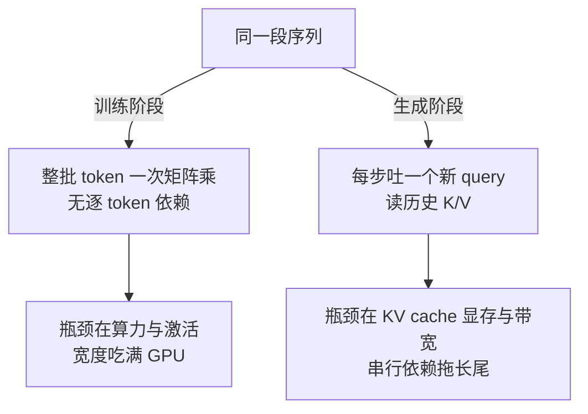

# Transformer 如何把序列建模成可扩展计算

打个比方：逐个往后传的传话游戏，队伍越长传得越慢、走样越厉害；把所有人拉进同一个群聊，任何一条消息都同时可见，相隔再远也是一步直达。Transformer 要解决的问题，是**序列关系建模中「逐步处理难以并行、局部状态难以跨距离传递」**。

它用全局注意力（模型为每个词分配权重、聚焦上下文中最相关部分的机制）交换位置间的信息，用逐位置前馈网络变换表示；**训练阶段适合矩阵并行，生成阶段却受 KV cache（Key-Value 缓存）、显存（GPU 上的内存、模型参数与计算中间结果都存这里）和逐 token（模型处理文本的最小单位，约相当于一个词或半个词） 依赖限制**。读完你会知道注意力怎么在位置间交换信息、训练与生成两阶段各自的瓶颈在哪，以及怎么据此估算服务容量。

**Transformer 的关键设计在于：把序列中每个位置的表示，通过可并行的全局内容寻址和逐位置变换反复更新，注意力只是实现这个寻址的组件**。**训练阶段可以并行处理整段序列**；自回归生成（逐个 token 往后生成，每步依赖前面全部 token）时则用 KV cache 保存已经计算过的键和值，**把每一步的代价从重复处理整个前缀降下来**。

## 注意力机制怎样在位置之间交换信息？

让每个位置同时拿到全部历史（并行），「等上一页写完才能写下一页、翻到第一页核对某个决定要重头翻」的两个别扭（难以并行、难以跨距离传递）才会消失。按顺序逐步处理的序列模型难以并行训练，相隔很远的两个位置之间的信息也难以传递。本篇回答：注意力机制（让模型对输入的不同部分分配不同权重的核心结构）怎样在位置之间交换信息、逐位置前馈网络完成什么变换、训练阶段与生成阶段各自的资源限制在哪里，以及这些限制怎样决定服务侧的容量表现。

## 注意力怎么在位置间交换信息、本质是什么？

打个比方：Transformer 像一场圆桌讨论——每个人（token）同时听所有人的发言，自己决定该重点听谁（注意力权重），所以一轮讨论里所有配对的关系都被算了一遍，而且可以很多人同时开口（并行）。这个比喻到"为什么能并行、为什么能建模长距离"为止：QKV（查询 Query、键 Key、值 Value，下文展开）怎么算、多头怎么拼、复杂度为什么是平方级，要看正文。下面先看具体计算。

从计算机制上看：**序列中任意两个位置之间的关系通过查询与键的内积直接计算（查询是该位置在找什么，键是每个位置能提供什么，内积越大关系越强），不再依赖逐步传递的隐状态（记录序列前面信息的中间向量），因此同一批 token 的表示可以在矩阵运算中同时更新**。**注意力要求任意两个位置都算一次关系，n 个位置共有约 n² 对配对，所以开销随序列长度呈平方增长**，生成阶段的逐 token 依赖又把历史键值固定在显存里，训练阶段的可并行程度与部署时的容量上限由此分开：**平方开销吃的是训练算力，键值占用吃的是生成显存，两者占的资源不同，瓶颈要分开算**。

原论文的架构图把这套组件关系画在一张图里——左侧编码器逐层堆叠，每层包含多头注意力与逐位置前馈网络；右侧解码器每层多一个掩码自注意力与对编码器输出的交叉注意力，位置编码在进入各层前与嵌入（把 token 转换成的向量表示）逐元素相加：


（图源：Attention Is All You Need 论文 Figure 1，arxiv.org/html/1706.03762v7）

## 一层在做什么

一层像一条装配线：先让所有位置互相问清关系（注意力），再各自独立加工（前馈）。给输入表示 `X`，多头自注意力先按下面的式子投影出 `Q、K、V`：

```text
Attention(Q,K,V) = softmax(QKᵀ / √dₖ + mask) V
```

- `Q` 表示**当前位置要寻找什么**；`K` 表示**每个位置能被什么匹配**；`V` 是**被取回的内容**。
- **缩放项避免内积随维度增大而让 softmax 饱和**。
- **causal mask 让位置只能看见自己和过去，保证训练目标与生成时的信息边界一致**。
- **多头让模型在不同子空间同时学习指代、局部模式、长距离关系等关联**。

多头注意力本身的计算结构，原论文 Figure 2 画成一条完整的投影与拼接流水线：


（图源：Attention Is All You Need 论文 Figure 2，arxiv.org/html/1706.03762v7）

「多头」到底多在哪里，Figure 3 用剪并实验给出直观答案：剪掉大多数头，生成的文本依然连贯，说明许多头在功能上是冗余的；保留下来的头各自承担固定的句法角色（名词复数、语义关系、长距离指代等）：


（图源：Attention Is All You Need 论文 Figure 3，arxiv.org/html/1706.03762v7）

注意力输出经过残差连接（把子层的输入直接加到输出上，避免信息在深层传递中丢失）、归一化（把每层输出缩放到稳定范围）和前馈网络。**前馈网络对每个位置独立应用非线性变换，注意力负责位置之间的信息交换；两者不是互相替代的「两个模型」**。

## 为什么它能扩展

能扩展的前提是**每一层只做一件事**，且互相之间只通过固定接口打交道。协议栈是这个思路最成熟的样本：应用层各自不同，往下都汇到 TCP（传输控制协议，负责把数据完整、有序地送达）或 UDP（用户数据报协议，只管发、不保证到达与顺序），再往下统一走 IP。这个比喻只到「每层只通过固定接口相连」为止：协议栈各层独立演进、可单独替换，而 Transformer 各层共享表示、不独立寻址，不能往后套。


训练时一批 token 的矩阵乘法适合 GPU/TPU（Tensor Processing Unit，Google 的 AI 推理芯片），**序列内没有逐 token 的控制依赖**。**代价主要来自注意力的序列长度平方项、层数、隐藏维度，以及激活（每层中间结果占的显存）与多卡之间的通信开销**；长上下文并不**是免费扩大记忆：序列更长让注意力开销按平方上升**，**键值缓存也随长度线性占满显存**，所以**上下文越长越吃算力与显存**。

生成时，每一步的新 query 需要读取历史 `K/V`。**KV cache 避免重算历史，但会按层、头、序列长度占用显存**；**显存被键值占满后，能同时服务的序列数和上下文长度都受限，首 token 与逐 token 延迟随之拉长**——这就是**上下文窗口（模型一次能读入的最大文本长度）、并发、显存和 TTFT（首 token 延迟）/ITL（相邻两个 token 之间的延迟）相互制约的来源**，连接 [[工程知识/AI 系统工程：从模型能力到生产能力/推理服务与平台/批处理、KV缓存、量化与并行如何改变服务容量]]。

同一段序列走进两个阶段，走的是两条不同的瓶颈链，分别说明：



**训练瓶颈靠加卡与并行策略缓解，生成瓶颈靠 KV cache 管理与调度缓解——两套手段不可互换**：加卡缓解的是算力瓶颈，KV cache 管理与调度缓解的是显存与带宽瓶颈，**资源类型不同，所以容量规划要分开算**。

## 它不保证什么

- **注意力权重不是可靠的因果解释，也不证明模型「理解」了被关注内容**。
- **参数量和上下文长度不等于事实准确性**；**知识是否新鲜由数据、RAG（检索增强生成：先从资料库里找出相关片段，再让模型照着这些片段回答）和工具决定**。
- **训练可并行不代表部署可无限扩展；通信、显存带宽、KV cache 和调度可能成为瓶颈**。
- **结构化输出、工具调用和安全行为是后训练与运行时共同提供的约定，不是 Transformer 原生保证**。

## 怎样用最小实验验证这套机制结论？

**做法是控制变量：其他条件全部保持不动，只动一个数，分别看复杂度账与容量账怎么变**。学习或比较模型时固定 tokenizer（把文本切成模型输入片段的分词器）、上下文长度、精度、batch（批，一次同时送进 GPU 的多个请求）与硬件，**只改变序列长度或并发**，分别测：

1. 训练/推理显存随序列长度和并发的变化；
2. prefill 与 decode 的计算、带宽和通信占用；
3. causal mask、padding、位置编码变化对困惑度（衡量语言模型预测不确定性的指标，越低越好）和下游任务的影响；
4. 长上下文任务中有效信息利用率，而非只看最大窗口声明。

这样可以把「架构计算复杂度」与「运行时容量瓶颈」区分开。

## 怎么自己动手验证

1. 复杂度核对：**把序列长度加倍，确认训练阶段的注意力开销按平方增长，生成阶段每步的键值缓存占用按长度线性增长**。
2. 阶段对照：同一模型在预填充与逐 token 生成两个阶段分别测吞吐与显存，**确认瓶颈位置不同，与理论预期对得上**。
3. 替代结构对照：把稠密前馈（每个位置都走全部参数）换成稀疏激活（每步只唤醒部分参数）后，确认参数量上升而单 token 计算量不随参数等比上升。

## 接着读哪几篇来替换本页的稠密前馈层？

- Transformer 是模型计算骨架；tokenizer 决定输入如何切分，预训练（用海量文本先训练出通用语言能力、之后再适配下游任务）决定参数中的通用模式，后训练改变行为，解码决定输出轨迹，推理运行时决定有限硬件上的服务容量。
- 关系：[[工程知识/AI 系统工程：从模型能力到生产能力/模型基础与训练/Token、Embedding与表示学习连接数据和模型]] · [[工程知识/AI 系统工程：从模型能力到生产能力/推理服务与平台/批处理、KV缓存、量化与并行如何改变服务容量]] · [[工程知识/AI 系统工程：从模型能力到生产能力/模型基础与训练/位置编码和长上下文限制有效利用]]
- [[工程知识/AI 系统工程：从模型能力到生产能力/模型基础与训练/MoE用稀疏激活换取参数容量和通信复杂度]] —— 用稀疏前馈替换本页的稠密前馈层
- [[工程知识/AI 系统工程：从模型能力到生产能力/推理服务与平台/Prefill与Decode决定LLM服务如何调度]] —— 注意力在两阶段的开销差异
- [[工程知识/AI 系统工程：从模型能力到生产能力/模型基础与训练/Scaling Law把训练预算分配成可测量假设]] —— 计算量与参数量的分配依据
