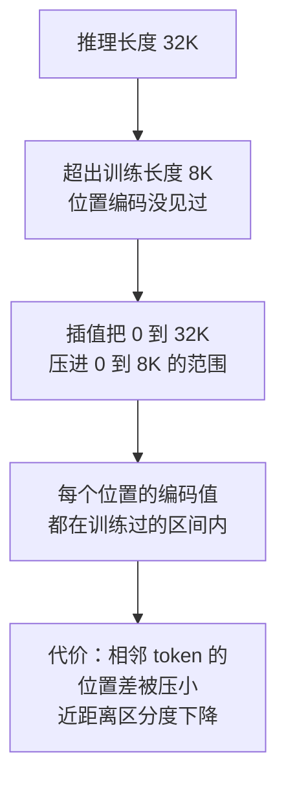
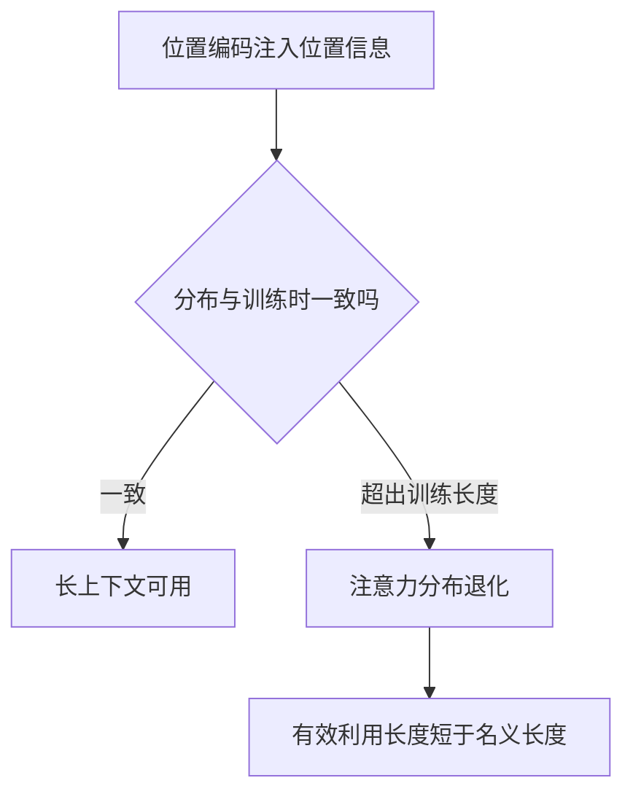
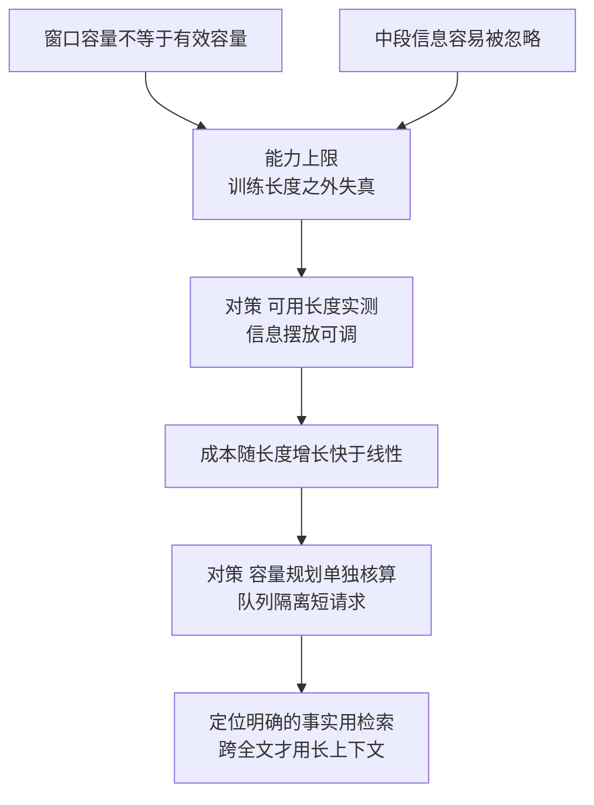

# 位置编码和长上下文限制有效利用

把一句话的词打乱，模型看到的集合是一样的——它天生分不清顺序。
自注意力（让每个词都与句中其他词计算关联强弱的机制）本身对 token（模型处理文本时切出的最小片段，大致对应一个字或一个词）顺序不敏感：把一句话的词打乱，它看到的集合是一样的。所以**必须显式注入位置信息**，这就是位置编码的由来。

读完这一页你能判断厂商宣称的窗口长度能不能真用，会自己测中段找回率，也能说清长请求为什么会拖慢同批的其他请求。

第二个问题更要紧：**窗口变大，不等于模型能真正用上的信息变多。** 厂商宣称的"支持 128K"常常只表示模型能吞下这么长的输入而不报错，并不是"在 128K 下稳定工作"。**信息放在长上下文的中段时，找回率会明显下降**——这是实践中踩得最多的坑。

这一页把两者分开讲清楚，并给出验证长上下文是否真的可用的标准方法。

1. **位置编码** —— 模型怎么知道 token 的顺序（自注意力本身是顺序无关的）
2. **长上下文有效性** —— 窗口变大了，但模型能真正用上的信息并没有同步变多

厂商宣称的"支持 128K 上下文"不等于业务在 128K 长度下能正常工作，可用窗口要按实测画界。

## 窗口 128K 为什么第 3 页的信息找不到：要解决的问题

像一间号称能容纳 128 人的会议室，坐满之后：后 1/3 位置的人说话前排听不清（超出有效长度读不准），同时人越多会议纪要越厚、传阅越慢（token 越多计算量和 KV cache——键值缓存——越大）——「容纳人数」和「人人听得清」是两回事。比喻到此为止：会议室对应上下文窗口（模型一次能读入的最大文本长度），容纳人数对应声明长度，人人听得清对应有效利用长度。

窗口声明支持的长度与实际能正常利用的长度之间存在差距，本篇回答：位置信息怎样进入注意力计算、窗口之外为什么会失真、中段信息为什么会丢、长请求对同批其他请求造成什么影响，以及**可用长度要怎样实测才能写进产品说明**。

## 这件事发生在什么场景：128K 的窗口，第 3 页的信息就是找不到

打个比方：位置编码像给合唱队每个人发一个号码牌——大家唱的调子（词向量）可以一样，但有了号码牌才知道谁该在第几个开口。自注意力本身只看得出"有哪些人"，看不出"谁站第几"。比喻到"为什么要额外加位置信息"为止：号码牌具体怎么编（正弦、旋转、可学习）、为什么窗口变长不等于真能用上，要看正文，比喻只解释"必须加"这件事。

一个合同审查应用，把整份合同（约 60K token）塞进上下文，问："第 3 页提到的违约金比例是多少？"

**模型答错了**，给了一个合同里根本不存在的数字。

但把"第 3 页"单独摘出来（约 2K token）问同样的问题 —— **答对了**。

这就是著名的 **"Lost in the Middle"（中段丢失）** 现象：

**实测规律**（不同模型程度不同，但趋势一致；短上下文各位置都高，差距出在长上下文的中段）：

| 信息位置 | 短上下文（4K） | 长上下文（32K+） |
| --- | --- | --- |
| 开头 | 高 | 高 |
| 中间 | 高 | **明显下降** |
| 结尾 | 高 | 高 |

这个现象论文量出来是一条 U 形实测曲线，见下图：


*图示：论文原图中的 Figure 1。图源：Wikimedia Commons《Figure1 2.png》，作者 احمد ربانی مقدم，CC BY-SA 4.0，https://commons.wikimedia.org/wiki/File:Figure1_2.png。*
曲线两端高、中段是深谷：第 5 到第 15 号位置全部低于红虚线（不给上下文的闭卷基线）——信息放在中间，有上下文反而不如没有。**开头的 76 高于结尾回升后的 63，最便宜的优化是把关键信息放开头**。图取自 [Lost in the Middle 论文（arxiv 2307.03172）](https://arxiv.org/abs/2307.03172)。

**工程含义**：**不要因为"窗口够大"就把所有内容都塞进去。** **关键信息要放在开头或结尾，或者用检索把相关信息挑出来**。


来源：[稀土掘金《图解Transformer：为什么GPT、Claude、DeepSeek都用同一个架构？》](https://juejin.cn/post/7668503904926236723)（CC 4.0 BY-SA）


## 为什么需要位置编码：从零开始

先把形状说成一件事：自注意力像一群蒙眼的人围坐传纸条——每个人只按纸条内容算亲疏，不知道谁坐在第几排，"猫追狗"和"狗追猫"在它眼里是同一群字。位置编码就是给每人发一个座位号，让"谁先谁后"重新进入计算。这个比喻到"座位号"为止——现实里位置编码有三种做法（绝对位置编码、相对位置编码、RoPE），下面逐一展开。

### 为什么说自注意力是顺序无关的

好比一副牌摊在桌上让人只按点数配对（算相似度），红桃 3 配黑桃 3——牌的摆法打乱重放（顺序变了），配对结果一模一样，**谁大谁小根本没参与计算**。比喻到「只看点数、不管摆法」为止，具体相似度怎么算看正文。

自注意力的计算是：**每个 token 对所有 token 算相似度，然后加权求和**。

```
"猫 追 狗"  和  "狗 追 猫"
```

**如果只看 token 集合，两者是一样的** —— **但语义完全相反**。

  **自注意力机制（让模型对输入的不同部分分配不同权重的核心结构）本身无法区分顺序**，所以必须显式注入位置信息。全体成员混站时喊一声"猫、追、狗"和"狗、追、猫"，在场的人听到的字完全一样——谁是追谁是被迫看不出来；要让意思立住，每个人都得举着自己的号牌（位置编码），"我站第 1 位"这件事由号牌上的数字决定，与站的位置无关。

### 三种方式怎么选

| 机制 | 做法 | 特点 |
| --- | --- | --- |
| **绝对位置编码** | 给每个位置一个固定的向量，加到 token 嵌入（把词转成向量的表示步骤）上 | 简单；但**训练时没见过的位置无法处理** |
| **相对位置** | 在注意力计算里加入位置间的距离信息 | 泛化更好；实现各异 |
| **RoPE（旋转位置编码）** | 用"旋转"的方式编码位置，让 attention 自然感知相对距离 | **现代主流**（LLaMA、Qwen、DeepSeek 都用它） |

RoPE 在计算流程里的确切位置值得单独看一眼：它作用在每一层注意力内部——query 与 key（注意力里算相关度的两个向量）先各自经过 W_Q、W_K（生成这两者的权重矩阵）线性变换，然后才被 RoPE 按各自位置 m、n 旋转，**点积结果因此只依赖 n−m 这个相对距离**。**旋转发生在层内而不在输入端**，这是它经常被讲错的一个细节：


*图源：shivam2003 个人博客《DeepSeek 4.4 RoPE Visual》，https://shivam2003.com/posts/deepseek-4-4-rope-visual.html。*

**RoPE 的直觉**用一句话说：

```
把 token 的向量按位置"旋转"一个角度
位置 0 → 旋转 0°
位置 1 → 旋转 θ
位置 2 → 旋转 2θ
...

两个 token 的注意力分数由旋转角之差决定（余弦形式），只依赖相对距离
  → 自然表达了"相对距离"
```

  **优势**：表达的是**相对**关系，所以**比绝对位置编码更容易外推到更长的序列**。钟表的时针是很贴切的例子：时针转到的角度随时间递增（绝对位置），而"现在离开会过了多久"只需看两根针的夹角（相对距离）——**夹角这个量不关心表盘到底转了几圈**，所以时间再长，量夹角的办法照样适用；这正是外推能力的来源。比喻到"量夹角"为止：为什么长序列下会失真，看下一节的四条限制。

「按位置旋转一个角度」长什么样，DeepSeek 技术解读博客里的这张单位圆图最直观：同一个向量在 position 0 时不旋转（角度 0°），position 1 时旋转 θ，position 2 时旋转 2θ——每个位置把自己的向量转过一个与位置成正比的角度：


*图源：同上（shivam2003 个人博客《DeepSeek 4.4 RoPE Visual》）。*

## 长上下文真正受什么限制

如同宴会厅扩容到能坐一千人（窗口变大）：乐队还是原来那支（注意力算力没变），上菜传菜的路变长了（KV cache 与带宽），后排的客人根本听不清台上的致辞（有效注意力衰减）——场地变大，宴会的质量未必跟上。比喻到「场地大不等于听清」为止。窗口变大不等于有效，限制来自四个方面，分别见下文。

### 1. 位置外推为什么让训练长度之外失真

```
模型训练时最长 8K
  → 推理时给 32K
  → 超出 8K 部分的位置编码是"没训练过的"
  → 模型表现下降甚至胡言乱语
```

**厂商的解法**（各种长上下文技术）按两分法是两类，第三项是前两类的结合：

- **位置插值（PI）**：把长位置"压缩"到训练过的范围内
- **NTK（神经正切核：分析宽网络训练动力学的理论工具）感知缩放**：对不同频率用不同的缩放
- **YaRN**：结合插值和频率调整两者



图：插值类技术在做什么——把没见过的位置线性映射回训练过的区间，**代价是近距离位置的区分度被压掉一部分**。不同频率分量对位置压缩的敏感度不同，所以各家针对高频与低频做不同缩放来保住近距离区分度，这正是 NTK、YaRN 在频率上做文章的原因。

**这些技术的效果差异很大**——同样宣称 128K 的模型，**外推后真正可用的长度从 2 倍到 8 倍不等**（needle 测试：把一段关键事实当作「针」藏进长文本）藏进长文再提问能否找回——的找回率不低于短上下文为判据，逐模型实测。

**工程建议**："最大窗口"这个数字要存疑，**可用长度要在你的实际长度上测**。

### 2. 注意力稀释为什么让中段信息先丢失

**信息落在长上下文的中段时，softmax（把一组分数归一化成总和为 1 的概率分布）归一化后分到的注意力份额下降。**

可能的原因有两类（这两种机制是目前的主流解释，尚未有定论），它们共同把中段的注意力份额挤掉：**训练数据的分布**（关键信息常出现在开头/结尾，模型学到首尾权重更高）；**注意力分数的竞争**（长序列下 softmax 分母变大、分数被摊薄）。**中段两样都不占，于是最先丢失**。

### 3. KV cache 怎么推高长上下文的成本

KV cache 的内存占用怎么随并发变化，该页详细列了计算式，见 [[工程知识/AI 系统工程：从模型能力到生产能力/推理服务与平台/批处理、KV缓存、量化与并行如何改变服务容量]]：

```
700 亿参数的模型，FP16（用 16 位存数字的精度格式）：约 0.32 MB / token
128K 上下文 = 42 GB 的 KV cache（单个请求）
```

**长上下文的成本是超线性的**（attention 即注意力机制，**计算量随 token 数平方增长**），KV cache是 O(n)（随 token 数线性增长）。

### 4. 长请求排队为什么抬高整体延迟

长请求占用 GPU 时间长 → 其他请求排队 → **整体延迟上升**。

**这是为什么长上下文服务的并发要严格限制。**

## 生产里怎么配置怎么用

### 原则：为什么不要默认"全塞进去"

放到开会上说：提前把相关材料复印给需要的人（检索 + 精准注入），全部档案不必搬进会议室——档案全堆桌上，找一份关键页反而更慢，真正需要通读全卷的议题（多文档对比）才动整卷。比喻到「全搬不如精准给」为止，下面只讲怎么落成检索注入的做法。

| 做法 | 适用 |
| --- | --- |
| **检索 + 精准注入** | 大多数场景 |
| 全文塞入 | 只在文档确实不长（< 32K）且信息分散时 |
| 分层/摘要 | 超长文档（先摘要，再按需展开） |

先用检索把相关信息挑出来。**确实需要跨全文推理的任务（多文档对比、全局归纳）才用长上下文**。

### 长上下文与 RAG 怎么取舍

检索增强（先从资料库找出相关内容、再交给模型作答的方法）生成（RAG）先把相关片段检索出来，再注入上下文。两种方式的取舍：

| | 长上下文 | RAG |
| --- | --- |
| 信息完整性 | 全文都在 | 依赖召回质量 |
| 成本 | 高（尤其是长文档） | 低 |
| 延迟 | 高 | 低 |
| 中段信息 | 易丢失 | 检索出来就明确 |
| 适合 | 需要跨全文推理 | 定位明确的事实 |

  **实践建议**：**混合使用** —— 用 RAG 定位，把命中的片段放进上下文（而不是整个文档）。图书馆的参考咨询是同一个混合：读者问一个问题，管理员先查目录卡片把相关章节的架位找出来（RAG 定位），再把这几页复印给你（精准注入）——不会把整座书库搬到阅览桌上；整库搬得动的那天，找书也不比复印省事（长上下文的成本与中段丢失）。

### 信息摆在哪个位置

如果必须用长上下文，就把**关键信息放开头或结尾**，理由如下：

剧场的座位排布给"位置可寻址"提供了实物：每张座椅背上缝着排号与座号（B13），观众按票面信息在整面座椅墙里找座位，靠的是物理位置标记——位置本身就是地址，找错位置拿着票就能对出来。比喻到「位置本身就是地址」为止：观众按票面排号直接对照座椅，而模型没有眼睛看排号，是靠位置编码的数值大小来区分谁在前谁在后。上下文里的信息同样需要一个可寻址的位置约定：关键事实放开头（检票口第一排，进场先看到）或按明确的小节标题摆放（分区编号），让模型在注意力检索时有明确的位置锚点；**埋在几千 token 的中段，等于一座没有排号的剧场**。

- 关键指令或关键文档：放在最前面
- 其余上下文：放在中间
- 再次强调关键要求：放在末尾

### 长上下文服务要按哪几项配置

- **限制并发**：长请求占用资源多，要单独限流（控制单位时间放进来的请求数量，超过配额就拒绝）
- **前缀缓存**：相同的系统提示可以复用（注意租户隔离）
- **分级处理**：短请求和长请求用不同的队列/实例，避免长请求阻塞短请求

**外推的有效范围要实测画界**——长度外推方法宣称的上下文窗口与实测有效窗口对不上是常态——困惑度即模型对下一个词的预测误差，它平稳只说明语言建模能力未退化，不代表检索与推理能力保持——按有效窗口设界并标注。

## 怎么测长上下文是否真的可用：验证

**"Needle in a Haystack"（针在草堆里）测试**，这是标准方法：

```
1. 构造一段长文本（比如 32K）
2. 在其中的某个位置插入一句无关的事实（"针"）
   比如："最好的冰淇淋口味是薄荷巧克力片"
3. 问模型："文档里提到的最好的冰淇淋口味是什么？"
4. 改变"针"的位置（开头/25%/50%/75%/结尾）和文本长度
5. 记录每个组合的找回率
```

  **画成热力图**，横轴是文本长度，纵轴是针的位置，实测数据如下。抄写员的抽查同款：把一句要紧的批注夹进长卷的不同页，再让他默写那句批注——夹在哪一页、卷宗多长各试一遍，哪一格默写不出，那一格就是他"看着有字实际没进脑"的地方。抄写员对应模型，默写不出对应找回率降为零，哪一页哪一卷默写不出，对应热力图上哪个格子是红色。

| 信息位置 | 4K | 8K | 16K | 32K | 64K |
| --- | --- | --- | --- | --- | --- |
| 开头 | 可用 | 可用 | 可用 | 可用 | 可用 |
| 25% | 可用 | 可用 | 可用 | 可用 | 退化 |
| 50% | 可用 | 可用 | 可用 | 退化 | 失效 |
| 75% | 可用 | 可用 | 可用 | 可用 | 退化 |
| 结尾 | 可用 | 可用 | 可用 | 可用 | 可用 |

**中段最先失效**，这是长上下文最典型的退化形态。

**全绿之后才能说"支持这个长度"**。很多模型宣称 128K，但在 64K 的中段就已经失效了。

**还要测的**场景按目的归为两类，关联检索类（跨段引用、多跳推理）与鲁棒性类（冲突事实、加噪声）：

- 跨段引用（"第三章提到的 X 和第七章的 Y 有什么关系"）
- 多跳推理
- 冲突事实（文档里有矛盾信息时怎么处理）
- 加上噪声后的表现（真实场景总有无关内容）

## 哪些认识一看就错：常见错误

**错误 1：把"最大窗口"当成"可用长度"**

厂商的 128K ≠ 你的业务在 128K 下正常。**必须用自己的数据测。**

**错误 2：默认把整个文档塞进去**

中段信息会丢失，成本还高。**优先检索。**

**错误 3：关键信息放中间**

放开头或结尾。**这是最便宜的优化。**

**错误 4：忽略长请求的排队影响**

一个 128K 请求可能占用 GPU 几十秒 → 其他请求全排队。**长请求要单独限流/隔离。**

**错误 5：以为长上下文能替代检索**

成本、延迟、中段丢失都是问题。**检索仍然是最有效的手段。**

**错误 6：不做 needle 测试就上线**

"支持长上下文"写进了产品文档，实际中段信息根本找不到。**上线前必须测热力图。**

关系：[[工程知识/AI 系统工程：从模型能力到生产能力/模型基础与训练/Transformer如何把序列建模成可扩展计算]] · [[工程知识/AI 系统工程：从模型能力到生产能力/模型与上下文/上下文工程是在有限预算内构造决策现场]]

## 这套判断在哪儿会失效：边界



名义长度与有效长度是两件事，差别出在位置编码的外推能力，两者对照如下：


- 窗口容量不等于有效容量：位置外推在训练长度之外失真，可用长度依赖模型与具体任务。
- 中段信息容易被忽略：关键信息位于长文本中间时找回率下降，信息摆放位置本身就是一个可调变量。
- 成本随长度增长快于线性：注意力计算随长度平方增长，KV cache 随长度线性增长，长请求的资源占用需要在容量规划里单独核算。
- 长请求会挤占其他请求：单个长请求占用 GPU 时间较长，不做队列隔离时短请求的延迟被抬高。
- **长上下文不能替代检索**：定位明确的事实用检索成本更低，长上下文适合需要跨全文推理的场景。

五条边界归成两类，一类讲"长度本身的能力上限"，一类讲"长度对他人的影响"：



右边两栏是这篇的落点：能力上限这一侧决定了"多长的上下文真正可用"，**需要按模型与任务实测，而不是照抄窗口数字**；影响这一侧决定了容量规划要单独核算长请求，且**不做队列隔离时短请求的延迟会被抬高**。两条合起来才构成"该不该把上下文拉长"的判断依据。

