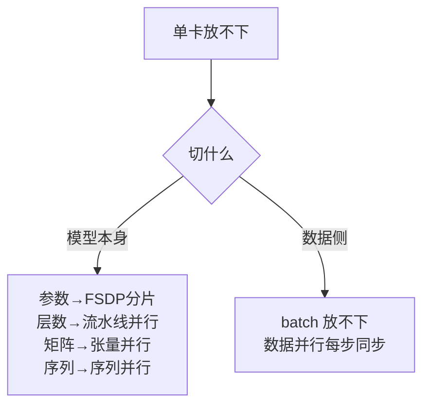

# 分布式训练与并行策略如何切分模型

**单卡放不下大模型时，该复制、切参数、切层还是切批次？训练系统可以复制模型、切分参数/梯度/优化器状态、切分层或切分文本最小单元（token），并行策略用通信和调度复杂度换取显存（GPU 上的内存、模型参数与计算中间结果都存这里）容量或吞吐**，"卡越多越快"这条直觉在这里不成立。
**读完这篇你能判断单卡放不下时该切参数、切层还是切批次，也知道每种切法要多付多少通信**。

## 单卡放不下时，这几种切法分别解决什么问题？

**模型或单批数据超出单卡容量时，训练无法启动；简单地增加设备数量也不会自动加快训练，通信与同步等待会成为新的限制**。本篇回答：**复制模型、切分参数与梯度与优化器状态、切分层、切分输入各自解决什么，通信量由哪些环节承担，哪一种容量不足对应哪一种切分**。

## 五种切法各自动的是模型的哪一部分？

打个比方：并行策略像几个人合抄一本书——数据并行是每人抄不同的页（各拿一份完整副本，抄不同的内容）；张量并行是一页太宽、每人抄半行（切层内）；流水并行是把书分成几段，前一个人抄完一段立刻传给下一个人接着抄（切层间）。这个比喻只说明这三种并行切的东西不同：通信量怎么算、怎么混用、显存各占多少，要看正文。

| 策略 | 切分对象 | 主要收益 | 主要代价 |
| --- | --- | --- | --- |
| 数据并行（data parallel） | 每卡完整模型，不同数据 | 简单、吞吐高 | 每步同步梯度，模型仍需放入单卡 |
| FSDP（Fully Sharded Data Parallel，全分片数据并行：把参数分片到多卡训练） / ZeRO（全分片数据并行：把参数、梯度、优化器状态按卡分片，用时再聚合） | 参数、梯度、优化器状态按卡分片 | 降低单卡显存 | 用到参数时要先 gather（把分片聚合回完整数据）回来，通信量上升；且分片状态要额外记录分片映射，checkpoint 的保存与恢复因此更复杂 |
| 张量并行（tensor parallel） | 同一层的矩阵切成几块 | 容纳大层、低延迟 | 每层两次集合通信，依赖高速互联 |
| 流水线并行（pipeline parallel） | 不同层放不同卡 | 容纳更深模型 | 气泡（bubble）、调度和负载不均 |
| 序列 / 上下文并行 | 序列或上下文维度 | 长上下文容量 | 序列切分后各段之间要互相传递中间结果（激活），这部分跨卡通信是主要代价，切分边界也复杂 |

几个名字先交代清楚：FSDP 是 Meta 开源的深度学习框架 PyTorch 提供的全分片数据并行功能，ZeRO 是 DeepSpeed（微软的分布式训练框架）里同一思路的实现，两者都把数据并行里每卡一份的参数、梯度、优化器状态改成按卡分片（把数据按规则切开、分散到多个节点存储）、用时再聚合；集合通信（collective）指 all-reduce、all-gather 这类所有参与卡一起完成的通信操作；气泡指流水线填充与排空阶段部分设备无事可做的空转时间。

「参数、梯度、优化器状态按卡分片」省下的显存有实测账：**ZeRO 论文把分片做成三个递进档位——只切优化器状态（P_os）、再切梯度（P_os+g）、连参数也切（P_os+g+p），7.5B 参数模型在 64 卡上从每卡 120GB 一路降到 1.9GB**：

*图源：Samyam Rajbhandari 等《ZeRO: Memory Optimizations Toward Training Trillion Parameter Models》arXiv 1910.02054 论文 Figure 1，https://arxiv.org/abs/1910.02054 （论文引用）。绿色 Optimizer States 是最大的一块——这正是表格里「切分对象：参数、梯度、优化器状态按卡分片」的次序依据：论文按「谁占得多先切谁」的顺序把三块状态分档下刀，每多切一档显存降一档，换来的 gather 通信代价记在「主要代价」列。*

哪种资源不够决定切哪里，随之进入关键路径的通信各不相同：

**哪种资源不够决定切哪里：参数放不下用 FSDP 分片、层数放不下用流水线并行、矩阵放不下用张量并行、序列放不下用序列并行、吞吐不够用数据并行**；五种切法与切分对象、收益、代价的完整对照见「机制」节的表格，各自进入关键路径的通信账见「通信量的分账」一节。

**流水线的气泡从哪来？** **朴素的层切分是串行的：第一张卡算完前向交给第二张，第二张算完交给第三张，任一时刻只有一张卡在干活**。GPipe（谷歌提出的流水线并行调度方案）的办法是**把一个 batch 切成 m 个 micro-batch（小批）交错送入，四张卡就能同时处理四个小批，只剩填充与排空两头有空转**：

朴素串行那排（Device 0-3 依次执行 F0..B3）的阶梯是气泡的原始形态，GPipe 交错调度那排把每个格子切小后四个设备同时填满，中间标注 Bubble 的空白随格子增多而缩小——**气泡占比 ≈ (p-1)/(m+p-1)，p 是流水线段数，m 越大气泡越小**。**格子只在设备边界处交接，也解释了为什么流水线并行的通信只发生在层边界**。来源：HuggingFace 文档 [Efficient Training on Multiple GPUs](https://huggingface.co/docs/transformers/perf_train_gpu_many)，Apache 2.0。

**几种并行怎么拼。** **混合并行要同时定下 micro-batch 大小、通信拓扑、梯度累积、混合精度（用 fp16/bf16 等低精度格式计算以省显存和带宽）和故障恢复**。**装机规律由带宽决定：通信最频繁的切分放在同一台机器的 NVLink（GPU 之间的直连高速互联）域内，跨机只走 InfiniBand（高性能专用网络）或以太网做低频的梯度同步**：

同一 Rank 内的横轴是层切分（F0→B3 依次流过），Rank 之间是数据副本，末尾两排处在同一竖线的 Step 框是梯度同步点。来源：HuggingFace 文档 [Efficient Training on Multiple GPUs](https://huggingface.co/docs/transformers/perf_train_gpu_many)，Apache 2.0（同首图）。

**通信量的分账。** **数据并行每步同步的梯度量等于参数量：70B 参数 × fp16（半精度浮点，每参数 2 字节）= 每步 140GB 梯度**，靠梯度分桶（把要同步的梯度分成若干小块分批传输）与计算重叠（让通信与反向计算同时进行、互相遮住耗时）藏进计算时间。**张量并行的激活通信在每个层内发生两次（前向一次反向一次），必须放在 NVLink 域内——层内通信每步两次、频率极高，对带宽极其敏感**，而 H100（英伟达的一款数据中心 GPU）的 NVLink 带宽约 900GB/s，跨机 400Gb/s 的 InfiniBand 折成字节约 50GB/s（1 字节 = 8 比特，400 除以 8 得 50），**两者带宽差一个数量级以上，如果把张量并行这类高频通信切分放到跨机网络，吞吐塌方**。**流水线并行的通信只有层边界的激活，最小，代价是气泡**。**显存仍不够时再叠 ZeRO 分片**。

来源：[稀土掘金《深度解析 Raft分布式一致性协议》](https://juejin.cn/post/6907151199141625870)（CC 4.0 BY-SA）

## 训练中断后怎么靠检查点恢复状态？

**checkpoint（训练检查点）不只是模型权重，还包括优化器状态（记录动量等累积量的数据）、学习率调度器（控制每步更新步长的程序）、随机数状态（决定 dropout 等随机性的种子）、数据游标（标记读到第几条样本的位置）、并行拓扑（各卡如何分组的配置）和代码版本**。**保存频率由重算成本、存储带宽和故障概率决定**；**恢复后必须验证 loss、步数、数据顺序和参数一致性，只检查文件存在等于没检查**。**断点续训的正确性来自"优化器状态 + 数据位点（断点续训从哪条数据继续的标记） + 随机数状态"三份状态的原子保存，模型参数本身也在 checkpoint 内容之列，单独恢复参数恢复不出行为，三份状态漏一份就恢复出静默偏差：随机数状态与数据位点决定每一步的计算，缺任意一份，恢复出的计算顺序就与故障前不一致，训练悄悄偏离**——与 [[工程知识/AI 系统工程：从模型能力到生产能力/Agent与工作流/Agent状态机与任务恢复：进度是状态不是聊天记录]] 里 Agent 靠输出 hash 锚点与幂等（同一操作执行多次与执行一次效果相同）键（重复执行也只生效一次的标识）恢复是同一条纪律——**两者都是靠保存足够多的状态，保证恢复后的行为与中断前一致**。数据加载器（dataloader）预取路径上的并发读取与生命周期错配，与 [[工程知识/缺陷分析：从个案到体系/并发/案例三十二：取到了已经不存在的那个——估算器的读取竞态]] 是同款病。

## 并行策略为什么是通信约束下的妥协？

这套策略族定型于 2018 到 2021 年：GPipe给出 micro-batch 减气泡的形态，Megatron-LM（2019）确立张量并行在 NVLink 域内的用法，ZeRO把数据并行改进成参数、梯度、优化器状态分档切分。**它们回答的是同一个问题——单卡显存增速跟不上参数量增速，且跨设备带宽远低于设备内算力**。**代价随之而来：每拿一份显存容量，都在关键路径上添一段通信或等待**。**数据并行只加吞吐、不省显存，FSDP 拿 gather 通信换显存，张量并行拿层内同步延迟换单层容量，流水线拿气泡换深度，没有一种切分是免费的**。策略组合到最后，本质是**把多种并行方式分配到机内 NVLink 域和机间网络**这两个容量不同的档位里（类似把货物装进大小不同的箱子——只类比容量不同，装填顺序、损耗等不对应），**判据始终是各环节通信量的多少**。

## 这套说法在哪些场景会失效？

- **通信量、同步等待和 straggler（拖慢整体的最慢那张卡）可能抵消额外 GPU：扩展效率要实测，按卡数线性外推是常见错误**。
- **跨节点网络与单机 NVLink/PCIe（外设高速总线）是两个完全不同的带宽档（如 NVLink 每秒约 900GB，跨机 InfiniBand 每秒约 50GB，相差十倍以上）**，如果把张量并行这类高频通信切分放到跨机网络上，**吞吐相差一个数量级**。
- **并行度改变会改变数值行为（累加顺序、混合精度的溢出边界），扩展之后 loss 曲线要与小规模基线（正常状态下的指标水平、用来对比异常）对照**。

## 怎么自己动手验证这套切分账？

- **最小实验**：**固定全局 batch、序列长度、精度、数据和步数，测每卡吞吐、扩展效率、通信占比、显存、p99 step time（每步训练耗时的第 99 百分位）和故障恢复时间**。**改变并行度或节点数时同时比较收敛、数值稳定、最终质量和 checkpoint 可恢复性**。
- **通信占比对账**：**预写每种切分下的通信时间占比与显存占用，实测与预期对不上，说明瓶颈出现在另一维度**。
- **恢复演练**：**从 checkpoint 恢复后跑若干步，loss 与不中断的基线逐步对照，偏差超过混合精度本身引入的数值波动，就说明三份状态漏了一份**。

## 接着读哪几篇：被切分的对象本身长什么样

- [[工程知识/AI 系统工程：从模型能力到生产能力/模型基础与训练/Transformer如何把序列建模成可扩展计算]] —— 被切分的对象本身长什么样
- [[工程知识/性能工程：从用户等待到资源瓶颈/处理器与内存/GPU性能取决于计算、访存、并行与通信]] —— 单卡内的算力、访存与通信账
- [[工程知识/AI 系统工程：从模型能力到生产能力/模型基础与训练/训练作业的显存失效有固定形态：激活峰值、碎片与保存窗口的定位顺序]] —— 讲并行切分之外的动态失效：激活峰值、碎片与保存窗口的崩点怎么按形态定位
