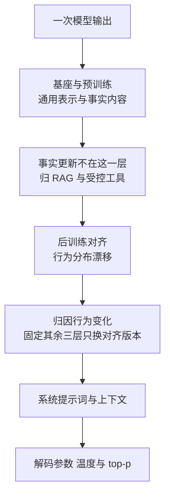
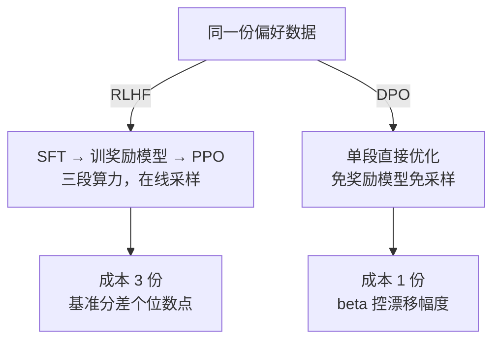

# 后训练对齐与微调改变行为边界

**后训练是预训练（用海量文本先训练出通用语言能力、之后再适配下游任务）之后、用规模较小但意图明确的数据继续调整模型的那一步。它让模型按任务格式、偏好和安全约定行动，但改变的是行为方式，不是往模型里可靠地写入新事实**。读完这篇你能设计最小对照实验，判断一次后训练到底改了什么。

后训练解决的是**预训练模型「会生成但不一定按任务格式、偏好、安全和工具约定行动」**的问题。它**改变行为分布，不是可靠写入新事实**；最小对照应**固定基础模型、提示词和解码参数**（温度，控制输出随机程度的采样参数；top-p 核采样，按累积概率截断候选词范围），只替换后训练版本，检查**格式、工具参数、拒答和旧能力回归**。

预训练形成通用表示和预测能力，后训练在较小但更有意图的数据上塑造「**如何回答、何时拒绝、如何调用工具、输出什么格式**」。**蒸馏（用大模型的输出训练小模型）与系统提示词（每次对话开始时放在输入最前面的角色设定与规则文本，属于当次输入而非模型参数）的改动同样只影响行为方式，需要分别记录与验证**。

## 要解决的问题：后训练改变的是哪一类行为

预训练得到的模型能够生成内容，却不按任务要求的格式输出、不遵循工具参数约定、在应当拒答（模型对某些请求拒绝作答的安全机制）的位置照常作答。本篇回答：后训练改变的是哪一类行为、它能写入什么与不能写入什么、行为改变怎样与事实更新区分开，以及验证一组改动需要固定哪些变量。

## 它是怎么做到的，本质是什么

打个比方：后训练像教一个什么都读过的人怎么在职场说话——知识没变（预训练的还在），但哪些话能说、什么场合该说什么、别人怎么问都该怎么接，这些是后来教的。这个比喻到"改的是行为不是知识"为止：SFT（监督微调，用标注示范教格式）、RLHF（人类反馈强化学习，按人的偏好打分再训练）、DPO（直接偏好优化，跳过打分模型直接学偏好）各自怎么做、为什么会过拟合（模型把训练数据的噪声也记住、在新数据上表现变差的现象）到标注者口味，要看正文。

后训练的机制层：**预训练形成的是输入到输出的概率分布，后训练在较小规模、带有明确意图的数据上继续调整这一分布，使回答格式、拒答边界与工具调用方式发生漂移**。分布漂移改变的是行为选择，**参数中的事实内容并不会因为微调而变得可靠——微调只调整输出分布的概率权重，不会像检索那样把可验证的事实带进回答，所以事实正确率不会因训练而上升，行为改动与知识更新需要分别用不同的手段承担**。

## 微调这条工程链路分哪几段、每段怎么定位版本？

微调也是一条完整的工程链路：文本数据从准备、标注、训练到部署，每一段都要能定位到具体版本。


*图源：Microsoft Learn 中文文档，CC BY 4.0，https://learn.microsoft.com/zh-cn/azure/architecture/ai-ml/guide/machine-learning-operations-v2。*

1. **监督微调（SFT）**：用高质量示范把模型推向目标格式、任务和语气。
2. **偏好数据**：收集两个回答的相对偏好，训练奖励模型或直接优化偏好目标。

偏好数据长成奖励模型的过程，HuggingFace RLHF 博客的图最直观：语言模型对同一批提示生成多个回答，人对这些回答做相对排序（不分绝对分值），每条样本配上它得到的分数，一起喂给奖励模型训练——「收集两个回答的相对偏好」的完整数据流：


*图源：HuggingFace Blog《Illustrating Reinforcement Learning from Human Feedback (RLHF)》配图，https://huggingface.co/blog/rlhf（博客图允许转载引用）。偏好数据的关键形态是相对排序（谁比谁好）而非绝对打分（各值几分）：人对「哪个更好」的判断远比「各打几分」稳定，奖励模型从相对序中学出绝对分值。*

3. **RLHF/DPO 等优化**：提高偏好目标，但可能过拟合标注者、奖励模型或短期风格。
4. **安全与能力回归**：检查拒答边界、工具行为（模型调用外部工具的参数与顺序是否正确）、事实、代码和长上下文（超长输入下的表现）是否互相牺牲。

## 为什么会发生能力退化

微调数据过窄会造成**灾难性遗忘（窄数据反复强化少数模式，挤占承载通用能力的参数）、格式过拟合和分布外性能下降**；**偏好目标可能奖励「听起来正确」而不是「证据充分」**。**模型更服从指令也可能更容易被恶意指令驱动——对齐提高了指令服从的权重，恶意指令落在新的服从范围内时，模型更少触发拒答，风险随之上升**。**参数更新、LoRA（低秩适配，只训练少量低秩参数来微调大模型）、蒸馏和系统提示词的影响范围不同，必须分别记录**。

## 什么时候不用微调

- **事实经常变化或必须引用：优先 RAG（检索增强生成：检索出相关片段再注入上下文）/权威工具**。
- **只是临时格式或少量示例：优先提示词和结构化输出**。
- **需要实时业务状态或副作用：使用受控 API/工具**。
- **需要稳定风格、术语或重复行为，且有足够代表性数据：才评估微调**。

## 怎么判断一次行为变化该记在后训练账上？

一次输出由四层共同决定，归因时只能换其中一层——把基座、对齐、提示词与解码参数摆在四个分支上，行为变化才知道该记在哪一层：



**只换对齐版本、其余三层冻结，观测到的差异才能记在后训练账上；否则格式改善与事实幻觉（模型生成看似合理、实际与事实不符的内容）会被混成同一个结论**。

微调前**冻结基线（正常状态下的指标水平、用来对比异常）、数据和环境**；按任务类型分组比较**质量、拒答、越权（执行了超出授权范围的操作）、引用、延迟、token（模型处理的最小文本单位）、显存（GPU 上用于存放模型与计算的内存）和成本**。至少包含**未见领域、冲突指令（多条相互矛盾的指令同时出现）、长输入、工具错误和恢复样本（工具报错后需要模型自行纠错的样本）**。**目标切片收益超过回归和运维成本，才进入灰度（新版本先放一小部分流量验证，逐步放大到全量）；收益不足时停在实验分支**。

关系：[[工程知识/AI 系统工程：从模型能力到生产能力/模型与上下文/预训练、后训练、RAG与工具改变不同层次]] · [[工程知识/AI 系统工程：从模型能力到生产能力/质量与运营/Agent评测必须覆盖轨迹而不只看最终答案]] · [[工程知识/AI 系统工程：从模型能力到生产能力/模型基础与训练/蒸馏与模型合并：用小模型承接已验证的能力]]

## 动手跑一遍会看到什么：SFT 与 DPO 的最小差异

同一个偏好数据（好答案/坏答案对），监督微调与直接偏好优化的损失形态：

```python
# SFT：只学好答案（坏答案不进损失）
loss_sft = -log p_model(good_response | prompt)

# DPO：好答案与坏答案的相对概率差（免奖励模型）
beta = 0.1
loss_dpo = -log sigmoid(beta * (
    log p_model(good | prompt) - log p_ref(good | prompt)
  - (log p_model(bad  | prompt) - log p_ref(bad  | prompt))
))
# p_ref 是冻结的基座：对齐学的是"相对基座的漂移"，不是绝对概率
```

跑一遍的收获：**DPO 的梯度只在"好答案与坏答案的似然差"上发力；beta 是损失里控制相对基座漂移幅度的系数（过大则偏离基座、损失通用能力；过小则几乎学不动）**。**SFT 会连坏答案的分布一起挪（只在好样本上训练也会压低其余输出的概率），DPO 显式推开坏答案——这就是同一份数据两种损失的行为差异来源**。

## 对齐到底花多少算力、退化会到什么量级？

对齐的成本账：**RLHF 有三段——SFT、奖励模型训练、PPO（Proximal Policy Optimization，近端策略优化：常用强化学习算法），其中奖励模型训练与 PPO 在线采样各占一份算力；DPO 砍掉这两段（免奖励模型、免在线采样），只剩 SFT 一段，成本约为 RLHF 三段中的一段，公开对齐基准上两者差距在个位数百分点**。两条管线摆在一起看：

原始论文里的三步示意完整画出了 RLHF 管线的各段算力去向——Step 1 的 SFT、Step 2 的排序与奖励模型训练、Step 3 的 PPO 更新各占一段：


图源：[InstructGPT 论文（arXiv:2203.02155）](https://arxiv.org/abs/2203.02155) Figure 2。图中蓝色箭头标出数据流向：Step 2 里人对 A-D 四个样本排序训练出奖励模型，Step 3 里 PPO 用奖励信号更新策略并用 KL（Kullback-Leibler 散度：衡量两个概率分布差异的量） 惩罚（用 KL 散度衡量分布差异并施以惩罚，限制对齐后的模型不要离 SFT 起点太远）拉住不偏离 SFT 起点——DPO 砍掉的正是 Step 2 与 Step 3 的独立算力段。

同一管线的另一种画法把强化学习阶段的组件画得更全：微调后的语言模型作为 RL（Reinforcement Learning，强化学习）策略生成回答，奖励模型打分，PPO 更新策略参数，KL 惩罚项把策略拉回初始模型附近——Step 2/Step 3 的算力分工与 KL 锚定机制在这张图上同时可见：


*图源：HuggingFace Blog《Illustrating Reinforcement Learning from Human Feedback (RLHF)》配图，https://huggingface.co/blog/rlhf（博客图允许转载引用）。左下角的 KL 惩罚公式就是上文「拉住不偏离 SFT 起点」的数学形态：π_PPO 与 π_base 两个分布的 KL 散度乘上系数 λ 进入总损失。*



能力退化的量级：**全参微调 10 万条窄域数据后，通用基准掉 5-15 个点是常态（灾难性遗忘），LoRA 与混入通用数据是两条止损线**。与 [[工程知识/AI 系统工程：从模型能力到生产能力/模型基础与训练/LoRA与参数高效微调：改行为不改基座]] 的衔接：**对齐改的是行为分布，微调改的是任务边界，两者都要过 [[工程知识/AI 系统工程：从模型能力到生产能力/质量与运营/离线评测与在线评测回答不同问题]] 的评测门禁——行为改变没有"看起来变好了"，只有指标说话**。

## 怎么自己动手验证

1. **行为对照：同一数据分别按 SFT 与 DPO 训练，比较输出的格式遵从、拒答边界与工具调用方式，确认偏移幅度随 beta 变化**。
2. **通用能力回归：在窄域数据微调前后各跑一次通用基准，记录退化幅度，确认 LoRA 或混入通用数据把退化控制在可接受范围**。
3. **分层归因：微调后知识类问题的正确率不因训练而上升，行为类问题按预期改变，确认改动对应到正确的层**。

