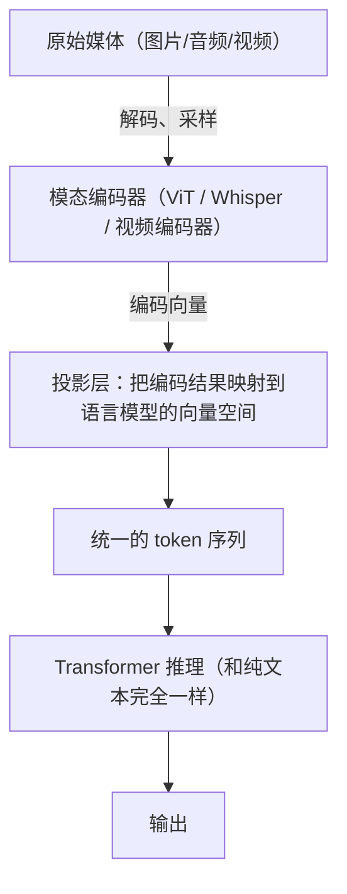
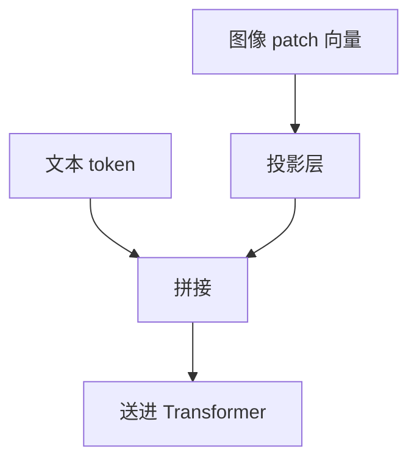

# 多模态模型把不同输入映射到共同推理接口

多模态模型解决的是：**让文本、图像、音频、视频能被同一个模型一起理解。**读完你能算出一页图文输入要花多少 token（token 是模型处理文本与图像时最小的计费与计算单元，图像和文字都要先转成 token 才能一起推理），并判断哪一类输入值得先压缩。

做法上没有把图片直接塞进对话输入。每种模态有各自的编码器，先把图片/音频/视频转成向量，再经投影层（一段把各模态向量送到语言模型向量空间的映射）映射成语言模型能接受的 token——**在模型内部，图像 token 和文字 token 已经没有区别**，所以**可以拼在同一个序列里一起推理**。

理解这条链路有实际用处：**不同模态转成 token 的规则和代价差异极大**，一张 1080p 截图可能是 1000-3000 个 token，一分钟视频可以上万。不看这一层，容易把 token 数当固定常数（如一张图约 100 个），而实际 1080p 截图可达 1000 到 3000 个，**成本和延迟的估算会差一个数量级**。

## 文字图片声音怎么进同一个脑子：要解决的问题

文本、图像、音频、视频分散在各自的处理流程里，**跨模态的信息无法在同一处被比较和推理**。本篇回答：不同模态的输入怎样映射到共同的表示空间、映射过程各自损失什么、跨模态的语义一致性在什么条件下成立，以及哪种任务适合交给统一模型、哪种适合保留各自的专用组件。

## 不同输入怎么映射到同一接口：机制与本质

先把形状说成一件事：多模态模型像一位接待多语种访客的秘书——中文、英文、手语（文本、图像、音频）各配一位翻译（编码器），翻译把各自语言转成同一份内部速记（投影进语言模型的表示空间），之后秘书只看速记办公，不再关心原话是哪种语言。速记的页数由访客带来多少材料决定——一张高清截图折出的速记远厚于一句话，成本与延迟因此跟着媒体形态走。这个比喻到"速记"为止——现实里 token 数怎么算、边界在哪，下面分节展开。

多模态模型的机制层：图像、音频与视频各自经编码器得到向量，再经投影层映射进语言模型的表示空间，在模型内部与文本 token 处于同一序列，一并参与注意力（模型为每个词分配权重、聚焦上下文中最相关部分的机制）计算——从 Transformer 这一层看，它是这类模型共用的基础结构，注意力计算是它让序列里每个 token 互相参考的机制，好比每个 token 轮流当主持人，向序列里其他 token 逐个打听相关信息再汇总。比喻到「逐个打听汇总」为止，现实里还有位置编码、掩码等约束。

多模态请求和纯文本请求完全一样。这条通路决定了请求的 token 数量由分辨率、采样率（只按比例保留部分样本、其余丢弃的比例）与切分策略共同决定，token 越多，模型要做的前向计算步数越多，按量计费的推理费用与首字延迟就越高，所以**成本与延迟随媒体形态（分辨率、帧率越高 token 越多）而不是随文字长度变化**。


来源：[稀土掘金《图解Transformer：为什么GPT、Claude、DeepSeek都用同一个架构？》](https://juejin.cn/post/7668503904926236723)（CC 4.0 BY-SA）


## 这件事发生在什么场景：一张截图把成本抬高了一个数量级

一个客服系统接入了视觉能力，让用户可以截图提问。上线后：

- **成本暴涨**：单次请求从 0.003 美元涨到 0.03 美元
- **延迟变长**：TTFT（time to first token，首字延迟）从 300ms 涨到 2.5 秒
- **偶尔报错**：`context length exceeded`

原因：**一张 1080p 截图会转成 1000-3000 个 image token**，而团队当初按「一张图 ≈ 100 token」估算。

**成本差出十倍，根源是把「模态如何转成 token」当成了固定常数**。快递按体积计费是同一个误会：寄几页文件（文本）按克算，寄一台冰箱（截图）按整个立方算，用寄信的单价去预算家电，账单自然翻十倍——比喻到「计费口径随货物形态变」为止：快递体积报价单是明码的，**模型的媒体 token 口径藏在各家文档里，上线前要按文档实测一次**。

## 从零开始该怎么理解：多模态链路

联合国会议的同传是同一趟链路：各国代表的发言（原始媒体）先经各自语种的同传译员（模态编码器）翻成工作语言速记（投影层映射进语言模型空间），会议记录只认速记（统一 token 序列），后续议事（Transformer 推理）完全不看原话是哪种语言。比喻到「速记统一口径」为止：同传翻完意思就定了，编码链路还有信息损失与成本差异要逐段算，所以下面分节计量。



三种模态的编码方式与产物差异很大，决定了各自的 token 计量口径：

### 1. 不同模态的编码器分别把非文本变成什么？

| 模态 | 典型编码器 | 输出 |
| --- | --- | --- |
| 图像 | ViT（视觉 Transformer） | 一组 patch 向量 |
| 音频 | Whisper 类（OpenAI 的语音识别与编码模型） | 音频帧向量 |
| 视频 | 图像编码器 + 时间采样 | 多帧的图像向量 |

### 2. 投影层怎么把各模态向量送进语言模型的向量空间？

编码器输出的向量和语言模型的 token embedding（把文字、图片等内容转成一串数字向量，机器靠向量距离算相似度） **不在同一个空间**。投影层负责把它们**映射成语言模型能当作 token 处理的向量**：实现上通常是一个小的 MLP（Multi-Layer Perceptron，多层感知机），社区也把这类组件叫 adapter 或 connector，指的都是同一段映射。



**多模态理解由此成立**：投影层把图像变成与文字同空间的 token，二者拼进同一序列；**注意力计算本身不区分 token 来自哪个模态**，能同时参考图和文，所以模型才"看"得懂图。


*图源：Salesforce LAVIS 仓库 BLIP-2 官方架构图，BSD-3-Clause，https://github.com/salesforce/LAVIS/tree/main/projects/blip2。*

这张官方图里投影层的实物是中间的 Q-Former（BLIP-2 提出的轻量查询式桥接模块，用一组可学习的查询向量从图像编码器抽取信息，再送入语言模型）：左侧冻结的图像编码器输出不直接进语言模型，先经这层轻量桥接把视觉向量映射成语言模型可用的表示，右侧语言模型同样冻结。两侧重资产都不动、只训练中间映射——**这正是「投影层是一个小的 MLP 或 adapter」在真实模型里的规模形态**。

LLaVA 的论文原图把这个映射画得更简：CLIP（一种把图像和文字放在一起训练的视觉编码器）视觉编码器输出的视觉特征 Z_v 经一个可训练的投影矩阵 W 变成视觉 token H_v，与文字指令转成的 H_q 拼进同一个序列，一起送进语言模型 f_φ 生成回答——「图像 token 和文字 token 在模型内部没有区别」在这张图里就是两条输入汇进同一排 token：


*图源：LLaVA 论文《Visual Instruction Tuning》Figure 1（arXiv 2304.08485），https://arxiv.org/abs/2304.08485。*

## 视觉 token 数怎么算：成本

token 数随分辨率与切分策略变化，先掌握计算方式再谈优化。直观的理解方式好比切豆腐：图先按固定块大小切成方格（patch），每个小格算一个 token，所以 token 数跟着图的面积走，分辨率翻倍 token 数大致翻四倍；这个比喻只到「按面积切块」为止，不同模型的块大小与切分策略以下文与原论文为准。

### 图像 token 数怎么算

常见做法是把图片切成 **patch**（比如 28×28 像素一块）：

```
一张 1024×1024 的图
  → 切成 (1024/28) × (1024/28) ≈ 37 × 37 ≈ 1369 个 patch
  → 可能还要合并/池化 → 最终几百到几千个 token
```

影响 token 数的三个因素，**分辨率的作用最大（这决定了成本）**：地砖是同一个平方关系：房间边长翻倍，地砖数量翻四倍（patch 数按面积算）——分辨率每上一档，token 与账单跟着面积走，**patch 数是按像素面积机械计算的，和人看着清不清楚无关**。比喻到「按面积计价」为止：地砖可以买便宜款，**token 只能靠降分辨率或裁剪来省**，是下面成本控制小节的主题。

| 因素 | 影响 |
| --- | --- |
| 分辨率 | 越高 token 越多（近似平方关系） |
| 切分策略 | 有的模型支持动态分辨率（小图少 token） |
| 合并方式 | pixel shuffle（按固定规则重排像素块，把多块合并成更少的 token）/ 池化（按局部降采样把相邻小块合并成更少向量）能显著降低 token 数 |

各类图片的 token 数量级如下，具体数值以所用模型文档为准：

| 图片 | 大约 token 数 |
| --- | --- |
| 低分辨率小图（512×512） | ~300-600 |
| 标准图（1024×1024） | ~1000-1600 |
| 高分辨率 / 多图 | 可达数千 |

**成本含义**：一张图可能相当于几千个文字 token。**多图请求的成本会迅速累积。**

### 为什么视频比图像贵得多

视频按帧数线性叠加图像 token，是三种模态里最贵的输入。

```
1 分钟视频，每秒采样 1 帧 = 60 帧
每帧 500 token = 30,000 token
```

**这就是为什么长视频理解成本高、很多产品限制视频时长。**

### 音频的成本怎么算

音频只有转文字与直接编码两条路，**信息保留越多，成本越高**。

| 方式 | 说明 |
| --- | --- |
| 先转文字（ASR，自动语音识别） | 便宜，但丢失非语音信息（语气、环境声） |
| 直接音频编码 | 保留更多信息，成本高 |

**实践建议**：如果只需要「说了什么」，**先 ASR 再送文本**通常更划算。会议纪要是同一个取舍：只要发言内容，速记员整理成文字纪要（先转文字）就够了；要复盘谈判语气、会场氛围，才值得全程录音存档（直接音频编码）——纪要一页纸，录音几小时，成本差着一个量级。比喻到「按需要的信息量付费」为止：录音可以事后补纪要，音频 token 一旦送进模型就按量计费，先想清楚要什么再选通路。

## 哪些能力常被高估：能力与边界

### 视觉语言模型擅长什么、不擅长什么？

| 擅长 | 不擅长 |
| --- | --- |
| 描述图片内容 | **精确的像素级测量**（「这个按钮宽多少像素」） |
| 视觉问答 | 精确的空间关系（「A 在 B 的左边还是右边」） |
| 图表理解（趋势、结论） | **精确的数值读取**（误差可能很大） |
| OCR（印刷体、清晰图适用） | 手写、模糊、复杂表格的 OCR |
| 场景理解 | 计数（超过 5-10 个物体就容易错） |

视觉模型做语义理解，精确的数值提取交给专门的 OCR（Optical Character Recognition，光学字符识别：从图片里认出文字）/检测模型（专门定位并识别物体位置与类别的模型），让前者读图、后者量数，误差大的任务才算安排对了。

机场航站楼的指路牌把这种分工做成了实物：牌面上「到达大厅」的**语义**（方向、含义）任一语种都在表达同一个意思，旅客靠语义理解就能找到路；但牌面下方的航班号、登机口编号这类**精确取值**，靠的是航班信息系统逐字核对，多语言通读并不能让编号更准。多模态模型读图与 OCR/检测量数的关系与此同构。比喻到「语义与取值由两套系统分别负责」为止：指路牌是固定实物，模型是动态推理，取值核对仍可能出错。

**「错误沿链路传播」这条最容易被低估**：多模态链路是一串串联步骤，前端的转写错误会一路传播到摘要、检索和工具调用，而下游每一步都把它当成既定事实。应对方式见下一小节。

能力边界之外，成本侧的账要单独算：[一张图片是怎么变成 AI Token 的](https://blog.eimoon.com/p/how-images-become-ai-tokens) 对比了不同模型的算法——OpenAI 按 32×32 像素方块数出 patch 总数再乘模型系数（1024×1024 的图算出 1229 个 token），Claude 按 28×28 patch 计数，同一张 4K 图标准档约 1560 个、高分辨率档 4784 个。可见**同一模型换个分辨率档位，开销就能差出三倍**；估算容量预算时按视觉 token 计数，按「一张图」估会失真。

### 错误为什么会沿着链路传播

```
音频转写错误 → 摘要错误 → 检索错误 → 工具调用错误
```

错误传播的应对以保留证据与人工复核为主。传话游戏是这条链路的预演：第一人听错一个词（转写错误），传到队尾面目全非（摘要、检索、工具调用全错），而且中途每个人都把听到的当成真的（下游把错误当既定事实）。比喻到「错一个传一路」为止：传话游戏错就错了，生产链路的错会写进数据库、发进工单，所以**证据要留在源头、关键节点要人工复核**。

- 保留**原始片段和时间戳**，便于回溯
- 关键场景**人工复核转写结果**
- 下游断言引用转写原文，出现分歧时回到原始片段核对

## 多模态带来哪些新攻击面：安全

| 风险 | 说明 |
| --- | --- |
| **图片里的文字** | 截图、海报里可以藏提示注入（攻击者把指令藏进数据内容、诱骗模型当作指令执行的攻击手法）指令 |
| **隐藏内容** | 图片元数据（EXIF，记录拍摄参数、位置、设备信息的嵌入数据）、极低对比度的文字 |
| **音频注入** | 音频里可能有人耳听不清但模型能识别的指令 |
| **跨模态绕过** | 文本过滤挡住了，但同样内容放在图片里就过了 |

安全应对的原则是**把所有模态都当成不可信输入**。

- **图片里的文字同样是不可信输入**（见 [[工程知识/AI 系统工程：从模型能力到生产能力/安全与治理/提示注入和工具越权是不同威胁]]）
- 内容审核要**覆盖所有模态**，不能只审文本
- 敏感操作不能仅凭模型对图片的理解来授权

## 生产里怎么用：要点

### 成本能靠哪四个手段控制

| 手段 | 做法 |
| --- | --- |
| **降分辨率** | 大多数任务不需要原图；缩到能看清即可 |
| **裁剪关键区域** | 只传相关部分，而不是整张图 |
| **动态分辨率** | 用支持动态分辨率的模型，小图自动少 token |
| **缓存** | 同一张图多次提问时复用（按图片 hash） |

**最有效的是降分辨率和裁剪** —— 多数任务只依赖语义理解而非像素级细节，所以 512×512 与 1024×1024 效果差异很小，而 patch 数按面积算，1024×1024 是 512×512 的四倍，token 数随之四倍。

### 延迟能从哪里优化

- **预处理异步化**：图片解码、缩放不占模型调用时间
- **图片压缩**：传输体积与处理开销同时变小
- **流式输出**：和文本一样，边生成边返回

## 想自己验一遍怎么动手：验证

模态必要性的验证与质量验证用同一套对照：先只给文本描述试跑同一批样本，不达标再引入图像。四种输入形态如下：

| 输入 | 目的 |
| --- | --- |
| 原图 | 基线 |
| 低分辨率图 | 测试降配后的质量损失 |
| 裁剪图 | 测试裁剪是否丢失关键信息 |
| 纯文本描述 | 对比「必须看图」还是「文字就够」 |

**记录**：结构化字段的准确率、遗漏率、token 数、端到端延迟。

实测里最常见的结论是文字描述就够了，不需要传图；对照表里「纯文本描述」一行低于预期时，才有必要为图像通路付成本。

除输入形态对照外，还要做三项跨通路与计量验证。

1. 跨模态配对：同一语义分别以文本与图像输入，确认两条通路得到的答案一致，差异对应到可解释的编码或采样（只采集一部分数据以控制记录开销）损失上。
2. token 计量：对同一请求分别用文本与媒体形态提交，记录实际 token 数与延迟，与按分辨率、采样率估算的数量对得上。
3. 保真核对：转写或识别结果与原始音频、图像一起留存，下游断言引用原文。

## 哪些认识一看就错：常见错误

**错误 1：按「一张图 ≈ 100 token」估算成本**

实际是 1000-3000 token，成本翻十倍。必须查所用模型的文档，用真实请求实测。

**错误 2：用原始分辨率送模型**

1080p 截图对大多数任务没必要，patch 数按面积算。先缩放到能看清任务目标的分辨率。

**错误 3：让视觉模型做精确数值提取**

像素级测量与精确数值读取误差大。量数交给专门的 OCR/检测模型，视觉模型负责语义理解。

**错误 4：只审文本不审图片**

图片文字里同样能藏恶意指令和违规内容。内容审核必须覆盖所有模态。

**错误 5：把转写结果当真相**

ASR（Automatic Speech Recognition，语音识别） 会错，且错误会沿链路传播。保留原始音频和时间戳，关键场景人工复核。

**错误 6：多图请求不控制数量**

一次传 10 张图就是上万个 token。限制图片数量，或先筛选再提交。

关系：[[工程知识/AI 系统工程：从模型能力到生产能力/模型与上下文/上下文工程是在有限预算内构造决策现场]] · [[工程知识/AI 系统工程：从模型能力到生产能力/安全与治理/提示注入和工具越权是不同威胁]] · [[工程知识/AI 系统工程：从模型能力到生产能力/模型基础与训练/Token、Embedding与表示学习连接数据和模型]]


