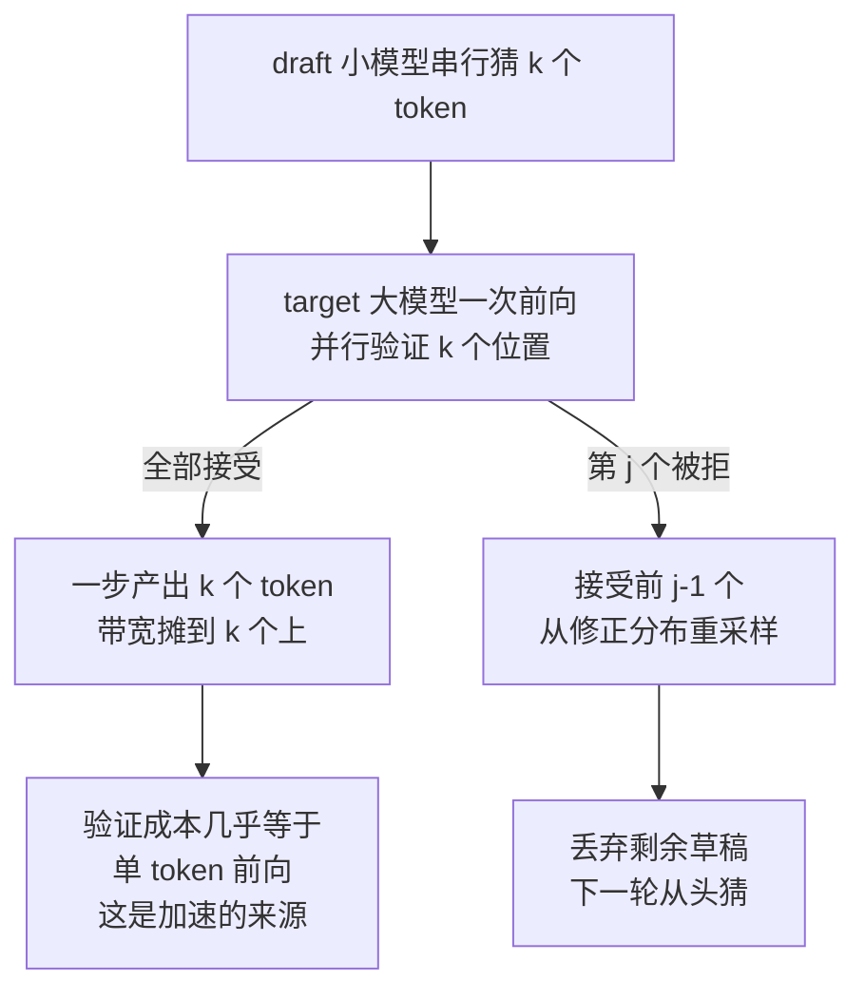
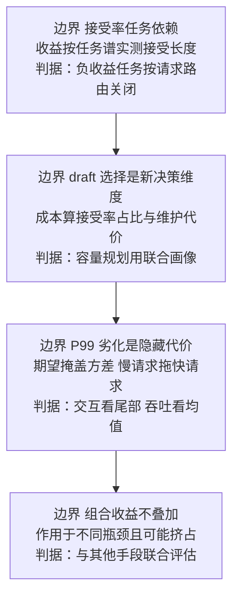
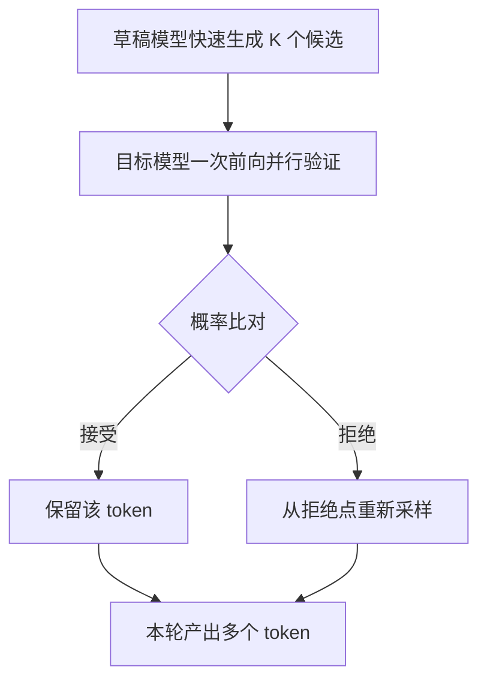
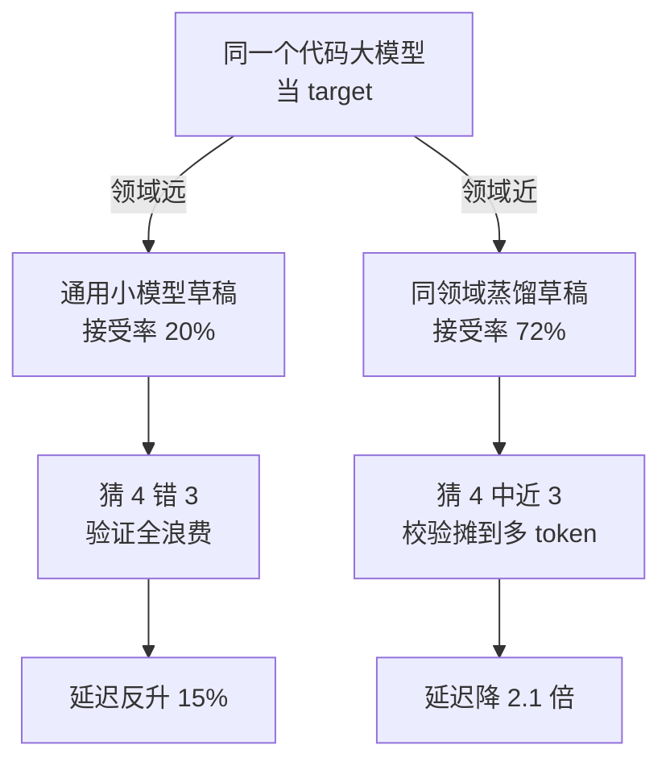

# 投机采样与推测解码：小模型带路大模型确认

## 投机采样要解决什么问题？

自回归解码一次只生成一个词，生成后把它接回输入再生成下一个词，每一步都要做一次前向计算。注意力机制让模型对输入的不同部分分配不同权重，它把每步算出的两组向量——K 用来匹配、V 用来提取——缓存下来随解码不断累积，这就是 KV（Key-Value，键值对）缓存。GPU 在 decode 阶段是 memory-bound（算力够用，数据从显存搬过来的速度跟不上，计算单元只能等），**权重和 KV 缓存的读取主导耗时，算力闲置**。

投机采样要解决的就是这个闲置：**用一次大模型前向确认多个小模型 token**。读完你能判断自己的场景该不该用、怎么测加速比与风险。

它先把串行解码的「每步一 token」变成「每步多 token」：**小模型猜，大模型验证**。speculative decoding 与推测解码是同义译名，本文统一叫投机采样。

可以把它想成两个人签文件：实习生先把要签的几页草拟好，主管拿过来一次翻完，对的地方大概率直接过，不对的地方划掉重签。**翻完几页和翻一页花的时间差不多，所以猜对的部分等于白拿**。

比方到「翻页时间差不多」为止——它与投机采样有两点根本不同：
- **第一，签字是确定的，投机采样按概率随机接受**：同一草稿有时通过有时被拒，接受概率由两个模型的分布差异决定。
- **第二，decode 的串行等待受显存带宽限制**，签字没有这层。

比喻里还有一点对上了：实习生猜错了主管当场改，**改完的签字和主管自己签的一模一样**。

这些收益与代价的完整账目（盈亏临界、批处理冲突、部署形态）见「它从哪儿来，要付什么代价」一节。

## 投机采样是怎么用一次前向换多个 token 的？

**基本协议**。小模型（draft 模型，draft 即草稿）先猜 k 个 token，大模型（target）一次前向并行验证这 k 个 token。验证按分布一致性判定：draft 与 target 的输出分布不同，**直接接受会改变输出分布**。

接受准则（Leviathan et al. 2023 / Chen et al. 2023）：设 target（大模型）给这个 token 打的概率分为 p_t、draft（小模型）给同一个 token 打的概率分为 q_d，按 min(p_t/q_d, 1) 的概率接受 draft token——p_t/q_d 是 target 概率除以 draft 概率，反映两个模型对该 token 的认可程度差异；min 表示取比值和 1 中较小的那个作为接受概率。直觉：target 概率除以 draft 概率，比值小于 1 时按该比例随机接受、以修正分布偏差，比值不小于 1 时直接接受。

被拒时从修正分布重新采样（resample）——**数学上保证最终输出分布与 target 独立采样一致**（无损：每个 token 的概率分布都和直接从大模型采样时相同，输出质量不打折扣）。**这种「质量零损失、只省时间」正是它与贪心（每步取局部最优、不回头的算法思路）单 token 草稿（draft-top-1，每步只取概率最高的一个，直接采信）或早退（early-exit，提前输出近似结果）方法的本质区别**。

**加速比从哪里来？**

每轮（一次 target 前向）产出 E[k] = (1-q^{k+1})/(1-q) 个 token：q 越接近 1，产出越接近上限 k+1；q 越低，连猜带验的浪费越多。**实际加速比约等于 E[k]**（E[k] 是每轮期望产出的 token 数）：每轮花的时间约等于普通解码出 1 个 token 的时间（decode 阶段 memory-bound，验证 k 个与生成 1 个的前向耗时相近），故单位时间产出 E[k] 个就是 E[k] 倍。

**这个前提在 batch 并发变大后会失效**：显存带宽被多个请求分摊，单次前向要服务多个并发请求，验证 k 个 token 与生成 1 个 token 的前向耗时不再相近。**接受率 q 决定收益**：q 高（draft 与 target 分布一致）加速比大，q 低（draft 乱猜）纯亏（draft 浪费 + 验证浪费）。

q 取决于**任务类型与 draft 质量**（draft 质量指草稿模型猜中目标模型输出的概率）：模板性文本（代码、格式化输出、闲聊）模式固定，小模型容易学到和大模型一致的分布，猜得准，接受率高；自由创作输出种类多、不确定性强，小模型难猜中，**接受率低**。q 还取决于** draft 与 target 是否同家族：同一系列**（如 LLaMA-70B 与 LLaMA-7B）的小模型分布更接近，接受率更高；不同系列的模型参数与训练过程不同，分布差异更大，接受率会打折扣。

EAGLE（speculative decoding 的开源实现，草稿模型并行猜多个 token）类方法用三种手段压每 token 成本：
- **预测头**解决猜得准不准的问题：在主模型顶部加一个轻量的预测模块做 draft（小型神经网络，输入主模型的中间状态，输出下一步的候选 token，需要通过少量数据微调学会预测），让候选更接近 target 的分布，从而提高接受率。
- **树形 draft**解决一次猜多少的问题：多个候选按树状组织，通过增加候选分支数量让一次验证覆盖更多可能性。
- **KV 复用**解决重复计算浪费的问题：同一轮验证里多个候选共享已算好的 K/V，省去每个候选重复计算的成本。

三者的共同目标是**提高接受长度**：只要 decode 阶段还是 memory-bound（算力够用但数据喂不上），**多算几个 token 就不增加前向时间**，三种手段都能做到。EAGLE 通常三种并用，面向在线对话、代码补全这类低延迟高候选质量的场景。

Medusa 不用 KV 复用，主要靠多头预测头与树形组织：**它不改主模型权重，也就不能改动注意力计算流程**，而 KV 复用需要改前向计算图。各自的效果以接受长度（即每轮平均确认的 token 数）衡量：[EAGLE](https://arxiv.org/abs/2401.15077)、[Medusa](https://arxiv.org/abs/2401.10774) 等论文在代码、翻译类高接受率任务与同家族 draft 配置下公开报告的数值多在 3 到 5 个，属行业典型经验值。



图：为什么一次前向能换 k 个 token——验证 k 个位置与生成 1 个 token 的前向成本几乎相同，猜对的部分等于白拿，猜错的位置付一次重采样。

提出这一框架的 Leviathan 论文把完整流程画成一张图：draft 模型自回归猜出 k 个候选 token，target 模型一次前向对全部候选位置给出概率，逐位置按接受准则判定，被拒位置起剩余草稿全部丢弃并从修正分布重采——一轮「猜 + 验」最多产出 k+1 个 token：


*图源：Fast Inference from Transformers via Speculative Decoding（Leviathan et al., arXiv 2211.17192）Figure 1，arXiv 论文默认许可，https://arxiv.org/abs/2211.17192。术语对照：draft model＝草稿模型，target model＝目标模型，accepted/rejected＝接受与拒绝，resample＝重采样。*

**投机采样要占哪些资源、有哪几种部署形态？** draft 总要多占一份资源：同卡部署时 draft 额外占一份显存，且两模型间切换有开销；异卡部署时多占一块卡的显存。自推测（self-speculative，同一模型的不同层做 draft：用模型自身的浅层快速猜测、深层最终确认）省掉独立 draft 的显存与维护。批次维度：投机采样与 continuous batching（按步粒度动态组批的在线批处理）组合时，批内各请求的接受长度不同，步调度按最小接受长度推进（木桶效应）——批模式下加速比打折，见 [[工程知识/AI 系统工程：从模型能力到生产能力/推理服务与平台/推理批处理的两难：吞吐与延迟的调度天平.md]] 的调度天平。


来源：[稀土掘金《图解Transformer：为什么GPT、Claude、DeepSeek都用同一个架构？》](https://juejin.cn/post/7668503904926236723)（CC 4.0 BY-SA）


## 它从哪儿来，要付什么代价？


**盈亏临界**。粗略参考：**同家族 draft 的前向成本通常不到 target 的一成**，即每轮额外开销约等于 0.1 次 target 前向；每轮平均接受 2 个 token 时，同样一次前向多产出 1 个 token，省下一次串行等待，**收益大于开销**。上述数值来自推理引擎工程团队（vLLM、TensorRT-LLM 等社区）的实践经验，非论文实验数据，只在特定条件下成立：同架构 GPU、低并发批量（0.5B-3B 的 draft 配 7B-70B 的 target、batch 小于等于 8）；大批量在线服务（batch 远大于 8）的临界点**会明显上移**。

方向上：显存带宽越充裕，target 单步 decode 相对越快，draft 的额外开销占比上升，**盈亏临界接受率随之提高**；模型规模越大，target 前向越慢，**临界接受率反而下降**。判断自己场景是否够本，按「怎么自己动手验证」一节的实验步骤跑一次即可。

推测执行是 CPU 分支预测与编译器并行化的老思想（1970s+），搬进 LLM（大语言模型）推理的关键认识是**「大模型前向的并行性被浪费了」**——验证 k 个 token 与生成 1 个 token 的前向成本几乎相同（前向计算以矩阵乘法 GEMM——General Matrix Multiply，通用矩阵乘法——为主）：一次前向验证 k 个位置近似把批量从 1 扩到 k，**闲置算力被填上，所以成本几乎不涨**，成本分析见 GPU 执行模型[[工程知识/AI 系统工程：从模型能力到生产能力/模型基础与训练/GPU执行模型与显存层级：SIMT与合并访存]]的 memory-bound 分析。DeepMind（Leviathan 2023）与 DeepSpeed（Chen 2023）同年论文确立分布级无损框架，后续 EAGLE/Medusa 系（两条 draft 结构改进路线的代表工作）在 draft 结构上演化（独立小模型 → 自推测 → 树形 draft 头）。

「接受率决定收益」不是推演，DeepMind 论文的实测曲线直接给出两者随 draft token 数 k 的联动：左图温度 0.8 的三个任务里，加速比随 k 先升后平（α 高的任务在 k=4 附近到顶，α 低的任务 k 一大反而被浪费拖累）；右图 k=4 固定时，接受率越高的任务加速比越高。正文「按任务谱实测接受长度」的依据就是这张图：


*图源：DeepMind 投机采样论文（Fast Inference from Transformers via Speculative Decoding，ICML 2023）arxiv HTML 版，arXiv 论文默认许可（非独占分发权），https://arxiv.org/html/2302.01318v1。曲线来自 Chinchilla 70B target 配 4B draft 的实测：任务可预测性（α）高的翻译任务加速 2.5x 上下，自由度高的任务收益贴地——同一套机制在不同任务谱上的收益差出一个量级，部署前的负载画像是必做项。*

Medusa（一种推测解码改进方案，思路是在主模型上直接加轻量预测头）的树形 draft 头是这条演化线的实物形态：


*图源：Medusa 官方仓库（FasterDecoding/Medusa），Apache-2.0，https://github.com/FasterDecoding/Medusa。*

图中主模型上加的多个解码头就是「draft 头」路线：每个头多猜一步、候选组成一棵树，一次前向用树形注意力并行校验多个候选。draft 结构在变，**候选的校验依然发生在 target 侧**——一次前向确认多个 token 的核心账目不变。

**接受准则的无损性证明**。speculative sampling 的修正分布 resample 数学上等价于从 target 分布直接采样。resample 的取法是：拒绝后从 max(0, p_t - q_d) 归一化分布采，直觉上就是在 target 认为 draft 猜得不够好的地方，按差值比例重新随机选取——**输出分布严格不变，加速是免费的**：路径变短只是少做几步串行等待，每次前向的算力没变，分布由接受准则保证严格不变，所以不付质量代价。这个「免费加速」是它与其他有损加速（量化有损、蒸馏有损、早退有损）的哲学差异。代价：免费的是质量，不是资源，代价来自三个方面，且都随负载特征变化：
- **draft 前向成本**：draft 越大成本越高。
- **验证浪费**：接受率越低，draft 白算的比例越高，低接受率时这项主导。
- **KV 管理复杂化**：draft 与 target 的 KV 要同步维护，长上下文场景里最明显。

**加速比是期望值不是保证**：拒绝后的重采样与下一轮 draft 重启，让**延迟分布出现长尾（P99 可能劣化）**；与批处理组合的木桶效应让服务化场景的实际收益小于论文单请求数字。**部署前按真实负载画像（任务谱、长度分布）实测，别拿 benchmark 单点外推**。

## 这套说法在哪儿会失效

- **接受率是任务依赖的，没有普适加速比**。代码与模板文本接受率 0.8+（2-3x 加速），自由创作 0.3-0.5（可能负收益），量级均为公开典型值。上线前按任务谱实测接受长度分布，负收益任务关闭投机采样（按请求路由开关）。
- **draft 模型的选择是新决策维度**。同家族小模型（分布接近但多一个模型要维护）、自推测（省显存但结构改造）、draft 头（Medusa/EAGLE 类：在主模型上加轻量预测头，用少量训练获得 draft 能力）。选型三问：接受率多少（实测）、draft 成本占比（前向 + 显存）、维护复杂度（多模型的版本同步）。
- **P99（最慢 1% 请求的延迟）劣化是隐藏代价**。期望加速掩盖尾部：接受长度方差大时，同 batch（批，一次同时送进 GPU 的多个请求）内快请求被慢请求拖（木桶）。交互场景（对延迟敏感）与吞吐场景（对延迟钝感）对投机采样的收益评估完全不同。
- **与量化、批处理的组合收益不是叠加的**。量化提速 decode（带宽侧）、批处理摊薄权重读取（吞吐侧）、投机采样缩短串行链（延迟侧）三者作用于不同瓶颈，组合收益要实测，可能互相挤占（批模式下投机加速比打折）。容量规划用联合画像，见批处理与容量 [[工程知识/AI 系统工程：从模型能力到生产能力/推理服务与平台/批处理、KV缓存、量化与并行如何改变服务容量.md]]。

四条边界量的是四个不同维度，合起来才构成"该不该上投机采样"的判断：



麻省理工科技评论的 [投机解码被"投机"了](https://www.mittrchina.com/news/detail/16030) 指出这项技术自 2022 年底提出后已被 vLLM、SGLang、TensorRT-LLM——英伟达（NVIDIA）官方推理加速引擎 TensorRT 的大语言模型版本——等主流推理引擎悉数收编，同时点出一个结构性瓶颈：**草稿模型的"猜"与大模型的"验"仍然是串行的**，每轮验证结束草稿模型才拿到结果，整个流程里总有一方闲着。

云栖网 [Speculative Decoding 推测解码](https://www.yunthe.com/speculativedecoding-tui-ce-jie-ma-da-mo-xing-tui-li-jia-su) 给出了接受率这一关键变量的机制解释：**草稿模型与目标模型的分布越接近接受率越高**，可用 KL（Kullback-Leibler 散度：衡量两个概率分布差异的量）来量化这种差异，以此指导选型。这正解释了第一条边界为什么是任务依赖的——代码与模板文本模式固定，小模型容易学到与大模型一致的分布，接受率能到 0.8 以上；自由创作分布发散，接受率就低。

草稿大量被拒时的后果：draft 前向全白费，被拒位置之后未验证的草稿作废，前面已接受并验证过的 token 保留有效。每轮既要花 draft 猜的时间，又要花 target 验证的时间，被拒越多，花在白做功上的比例越高，净耗时超过常规逐 token 解码，**收益可能落到负值**。

## 怎么自己动手验证？



**加速来自把串行的等待换成一次并行的验证**，可以用以下三个实验量化投机采样的收益条件：

- **接受率与加速比实测**：同一 target 配不同 draft，跑代码/闲聊/创作三类负载，统计接受长度分布与端到端加速比。预期：任务谱与 draft 质量双维度决定加速比；代码任务 2-3x、创作任务接近 1x 甚至负收益。任务依赖性的直接证据。
- **无损性验证**：投机采样开与关在同一温度下生成 N 条输出，对比输出分布（一致性统计或下游评测分数）。预期：分布一致（无显著差异）。无损声明的事后验证。
- **批模式收益衰减实验**：单请求 vs batch=32 下投机采样的加速比对比。预期：批模式下加速比明显衰减（木桶效应：最短的板决定桶能装多少水，这里最短的板就是接受长度最短的那条请求）。衰减曲线是服务化场景容量规划的依据。

## 动手跑一遍你会看到什么账？

```text
一次投机解码的推演账（通用形态，量级为公开典型值）：

常规解码：大模型逐 token 出，每次前向都吃满一次显存带宽 → 利用率低
  投机账：小模型一次猜 4 个 token → 大模型一次前向并行验 4 个
    → 全对：一步出 4 token
    → 第 3 个错：接受前 2 个，丢弃后 2 个，从错误处重新走
  接受率的账：小模型与大模型分布越接近接受率越高
    → 领域近的草稿模型收益大；领域远的接受率 20%，加速比反而 < 1（白猜）
  输出分布不变账：拒绝采样保证最终分布与大模型独立采样一致
    → 加速不降质由机制保证，与调参无关
```

两种草稿接到同一个 target 上的示意对位（量级为公开典型值），把「接受率决定收益」画成两条链：



批处理冲突的常见形态——在线服务为省显存把投机解码（小模型先猜几个词、大模型一次性验证的加速方法）与大 batch 共用，**投机带来的收益被 batch 排队吃掉**（投机加速的是单序列带宽利用，batch 大时本来就在摊薄）；**投机适合延迟敏感的单请求场景**。分布漂移的条件推演——采样温度调高后小模型更难猜中，接受率与加速比同步下滑；温度与草稿策略要联动调。解码加速的容量前提见 [[工程知识/AI 系统工程：从模型能力到生产能力/推理服务与平台/GPU显存管理决定服务容量上限.md]]、加速与成本的联动账见 [[工程知识/AI 系统工程：从模型能力到生产能力/推理服务与平台/推理服务的单位请求成本从token定价推出来.md]]、模型协同的选型观见 [[工程知识/AI 系统工程：从模型能力到生产能力/生态与选型/模型、框架、运行时与协议解决不同问题.md]]。

## 接着该读哪几篇？

- [[工程知识/AI 系统工程：从模型能力到生产能力/推理服务与平台/推理批处理的两难：吞吐与延迟的调度天平.md]] —— 吞吐侧优化的对偶
- [[工程知识/AI 系统工程：从模型能力到生产能力/模型基础与训练/GPU执行模型与显存层级：SIMT与合并访存.md]] —— decode 阶段的算术强度分析
- [[工程知识/AI 系统工程：从模型能力到生产能力/推理服务与平台/模型量化的精度经济学：位宽精度与显存的三角.md]] —— 另一维度的降本杠杆
- [[工程知识/AI 系统工程：从模型能力到生产能力/推理服务与平台/模型路由与级联：小模型过滤大模型兜底的省钱结构.md]] —— 小模型辅助大模型的亲缘结构
