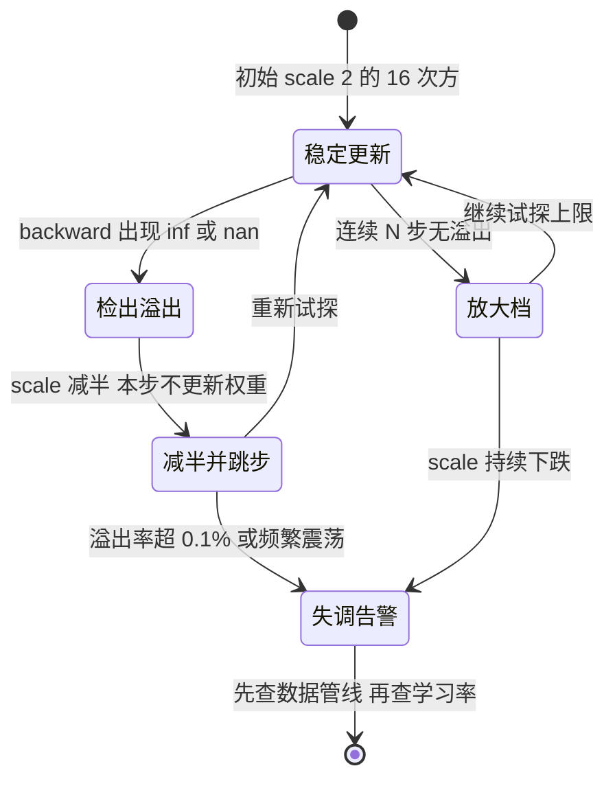

# 混合精度与数值稳定：低位宽训练的溢出与下溢管理

低位宽训练为什么会劣化质量？这题讲清数值风险与防护：读完你能给训练配好精度档位与三件防护。

**FP16（16 位浮点，动态范围窄）训练跑到第 3000 步 loss（损失函数值，衡量模型预测与真实结果的差距）突然变 NaN（Not a Number，浮点运算溢出或无定义时的错误值），FP8（8 位浮点，位宽更低）更激进地省显存（GPU 上的内存、模型参数与计算中间结果都存这里）但对算子的要求更高。要解决的问题是每个精度档位的风险来源（溢出、下溢、精度损失）：配好对应的防护（loss scaling、敏感算子保持 FP32（32 位浮点数格式，精度最高显存最贵）的化简与梯度统计），让低位宽训练既快又不悄悄劣化数值化质量。**

本质是**动态范围与精度的交换——好比量杯：量程对应动态范围**（量程宽就不容易溢出），刻度疏密对应精度（刻度密读数才准）。FP32 有 8 位指数、23 位尾数，动态范围约 1e38；FP16 指数只有 5 位，上限约 65504、下限约 6e-8；BF16（脑浮点格式，16 位）指数位与 FP32 相同（8 位），动态范围一样但尾数只有 7 位——**精度低但不容易溢出。训练中梯度常比权重小几个数量级，FP16 下大量梯度下溢成零，loss scaling（损失缩放）就是给 loss 乘一个大系数把梯度拉回可表示区间，再在更新前除回去。**

两种精度的位分配差异一目了然：FP32 的符号、指数、尾数三段宽度是 FP16 的完整参照系，FP16 把指数压到 5 位、尾数压到 10 位——指数位少了 3 位是溢出与下溢风险的直接来源：


*图源：华为昇腾社区《混合精度原理与计算过程（AMP）》，https://www.hiascend.com/document/detail/zh/Pytorch/600/ptmoddevg/trainingmigrguide/PT_LMTMOG_0071.html，中文标签官方文档图。*

## 三件防护怎么配、档位怎么选？

接着上文那个量杯比喻建立形状：FP32 是实验室级的精密量杯（8 位指数管量程、23 位尾数管刻度，又宽又细），FP16 是量程窄一半多、刻度稀一倍的家用量杯（5 位指数、10 位尾数），BF16 干脆保持量程、把刻度做稀（8 位指数、7 位尾数）。训练里最麻烦的是梯度这类"极小量"：家用量杯量一滴水，直接读成零（下溢）。

loss scaling 就是"先往样本里兑十倍的水再量、读数后按比例折回"——量程内读得清，折算不丢数。现实里折算要挑时机（权重更新前必须折回）、有些步骤根本不能兑水（softmax——把一组分数归一化成总和为 1 的概率分布）、归一化对刻度极敏感，必须用精密量杯。下表三件防护分别对应兑水时机、兑水禁区、读数异常的处理。

| 防护 | 防什么 | 怎么做 |
| --- | --- | --- |
| loss scaling | 梯度下溢 | loss × s 再反传，权重更新前 unscale；s 动态调整（溢出则减半） |
| 敏感算子 FP32 化 | 归一化、softmax、reduction（对张量做求和或求均值等归约的操作）的精度塌陷 | 这些层强制 FP32 计算，只对 conv/matmul 用低精度 |
| 梯度统计与跳批 | 溢出批次混入更新 | 监控 inf/nan 梯度比例，溢出批跳过而非写入 NaN |

loss scaling 不是一个写死的常数，它的系数会根据溢出信号切换：检测到溢出就减半并跳过当前步，连续多步正常就尝试放大；溢出即数值超出表示范围变成 inf（无穷大，超出表示范围时的浮点值），整个控制回路长这样：



有了这套状态机回路，FP16 训练即使偶尔溢出也能跳过该步继续，不会整体崩溃，所以档位选择可以放心选 FP16；BF16 动态范围大，几乎不溢出，不需要这套回路。

这一整套回路在一次训练迭代里的数据流，教学图把 FP32 与 FP16 的分工画成了闭环：橙色全程是 FP32，绿色全程是 FP16，Loss Scaling 在 FP16 反传前把损失放大、Remove Scale 在进 FP32 主梯度前把尺度除回去——两种精度各自的辖区与交换点就是这张图的两条横带：


*图源：selene 教学库（chrisvdweth/selene，GitHub raw 直链），《Resource-Efficient LLMs》混合精度章节。FP16 辖区覆盖计算密集的前向与反传，FP32 辖区覆盖权重更新，两个辖区的边界正是溢出与下溢的检查点（定期保存进度、故障后从最近一次保存处恢复）。*

**档位选择的起点：有 BF16 硬件（Ampere 及以后）优先 BF16，动态范围大、不需要 loss scaling，是省心的默认；FP16 是老硬件的过渡档，必须配 loss scaling；FP8 位宽更低、动态范围更窄，全局统一缩放已不够用，因此只适合对成本极敏感且有成熟框架支持的场景，需要对每个张量单独设缩放系数（per-tensor scaling，即每个张量独立设定一个缩放值）与更细的算子检查。推理与训练不同：推理可以更激进地低精度（权重与激活的分布固定），训练必须保守（分布每步都在变）。**

「梯度比权重小几个数量级」是量出来的分布，NVIDIA 的混合精度训练文给出实测直方图（把数值按区间分桶统计、看分布形态）：


**直方图里最左那根柱是关键：分布峰值在 2 的 -28 次方附近，但约 5% 的长尾（少数请求耗时远高于其余大部分）延伸到 -60 以下，远低于 FP16 能表示的最小正数（约 6e-8，即下溢线），直接反传就是静默清零。loss scaling 把整条分布右移进可表示区间，更新前再除回去——防护针对的就是这一段。**图取自 [NVIDIA 混合精度训练博客](https://developer.nvidia.com/blog/mixed-precision-training-deep-neural-networks/)。

## 配错会坏成什么样：失效形态

**精度问题往往在跨层传递时被放大。FP32 主权重、FP16 梯度与 FP16 激活各自的表示范围不同，低精度档位的动态范围窄一个量级，梯度一旦跨过档位边界就溢出成 inf，inf 乘进权重使该层更新变成 NaN，再向后传播就污染整个更新。**NVIDIA 论文实测的 SSD（Single Shot Multibox Detector，一种目标检测模型）训练梯度直方图正好呈现了这种分布形态——绝大多数梯度挤在低位宽能表示的范围中心，少量长尾靠近边界，溢出风险集中在尾部的少数桶：

（梯度直方图已在「机制」节引用，此处不重复贴图）。


| 失效 | 机制 | 信号 |
| --- | --- | --- |
| loss 变 NaN | 梯度溢出或下溢后写入 inf/nan | loss 曲线某步后恒 NaN，重启复现 |
| 质量悄悄降 | 每层低精度计算引入微小舍入误差，逐层累积后改变参数分布，loss 看着正常但最终指标差 | 与 FP32 基线对比最终任务质量差 1%+ |
| scaling 失调 | scale 太小梯度仍下溢，太大频繁溢出跳批 | 溢出率 >0.1% 或 scale 频繁震荡 |
| 算子不兼容 | 某些 kernel（算子底层的计算内核）无低精度实现，静默回退 FP32 | 实测加速比低于理论值 |
| 数值噪声放大 | 低精度的舍入噪声被较大的学习率放大、或被较弱的正则化掩盖 | 小数据集上过拟合行为变化 |

## 哪些结论不能照搬到其他场景？

- 加速比承诺要按你的模型实测：低精度主要加速计算密集的矩阵乘，注意力（模型为每个词分配权重、聚焦上下文中最相关部分的机制）与通用矩阵乘 GEMM（模型算力的核心运算）密集的模型计算瓶颈恰在矩阵乘，收益大；大量小算子与 reduction 的模型收益小；框架文档的 2-3x 是理想情形。
- BF16 并非万能答案：尾数少意味着精度低，某些对精度敏感的任务（数值回归、精确定位）BF16 与 FP32 有可测差距，要对比后决定。
- 混合精度的"混合"策略因框架而异：哪些算子自动 FP32 化、autocast 的边界在哪，换框架要重新验证，不能沿用结论。
- 与量化的边界：训练用混合精度是"计算档位"，部署用量化是"存储与带宽档位"，两者独立决策、独立验证，中间的精度一致性要端到端测。

## 损失缩放的账怎么算？跑一遍代码和真实案例

自动类型转换（autocast）区域内算子按白名单自动分档：卷积、Matmul 用 FP16 计算，BatchNorm（批量归一化）、softmax 等敏感算子保持 FP32——框架替使用者做了哪些决定，官方机制图画得很清楚：


*图源：同上（华为昇腾社区《混合精度原理与计算过程（AMP）》系列）AMP 计算流程一图。*

可运行示例：fp16 训练的动态范围问题与损失缩放的解法：

```python
scaler = GradScaler(init_scale=2**16)
with autocast(dtype=torch.float16):        # 前向用 fp16（快 2-3 倍，省一半显存）
    loss = model(input)
loss_scaled = scaler.scale(loss)           # 损失放大 65536 倍
loss_scaled.backward()                     # 梯度带着缩放走，避开 fp16 下溢区
scaler.step(optimizer)                     # 检查有无 inf/nan
scaler.update()                            # 有溢出 → 缩小 scale 并跳过本步

# fp16 的短板：动态范围约 6e-5 到 6e4
#   梯度值集中在 1e-7 量级 → 直接存 fp16 全部下溢成 0 → 训练静默失效
#   缩放 2^16 后梯度回到可表示区间；权重更新仍用 fp32 主副本
# bf16 换指数位换尾数位：范围与 fp32 相同（不会溢出/下溢），
#   精度降到 8 位尾数 → 无需缩放，代价是累积误差更粗
```

数值失效的实录形态——loss 变 nan 时别停在"训练不稳定"这类含混说法上，三个来源覆盖了绝大多数案例：梯度溢出（scale 太大）、学习率过大致权重爆炸、数据里有 inf。诊断顺序：先看 scale 曲线（持续下跌说明在频繁跳步）、再查数据管线、最后才是调学习率。

静默失效比崩溃更危险的实录见 [[工程知识/AI 系统工程：从模型能力到生产能力/模型基础与训练/后训练对齐与微调改变行为边界.md]] 的评测通过条件——梯度下溢成 0 时训练照常跑、loss 照常降（在缩放的损失上看不出来），评测指标停滞不动时才会暴露，这也是混合精度训练必须带指标看板的理由。

## 怎么自己动手验证混合精度是否稳定？

最小验证：同一配置跑 FP32 与 BF16 各一份，对比三件事——loss 曲线形态一致、最终任务质量差距 <0.5%、吞吐提升符合预期；再跑 FP16 + loss scaling 变体，监控溢出率与 scale 轨迹，断言溢出率 <0.01% 且 scale 稳定。发现 NaN 时先做二分（每次把搜索范围砍半、按对数速度收敛的查找法）定位：固定 seed 逐步回退精度档位，找到第一个出问题的算子再决定单点 FP32 化。

关系：[[工程知识/AI 系统工程：从模型能力到生产能力/模型基础与训练/分布式训练与并行策略如何切分模型]] · [[工程知识/AI 系统工程：从模型能力到生产能力/推理服务与平台/模型量化的精度经济学：位宽精度与显存的三角]] · [[工程知识/AI 系统工程：从模型能力到生产能力/模型基础与训练/LoRA与参数高效微调：改行为不改基座]] · [[工程知识/AI 系统工程：从模型能力到生产能力/模型基础与训练/训练作业的显存失效有固定形态：激活峰值、碎片与保存窗口的定位顺序]] —— 数值失效之外的显存空间失效形态：loss 变 NaN 找本篇，显存 OOM（Out Of Memory，内存耗尽后被系统强制终止进程） 找那篇，两类失效的验证都要重跑