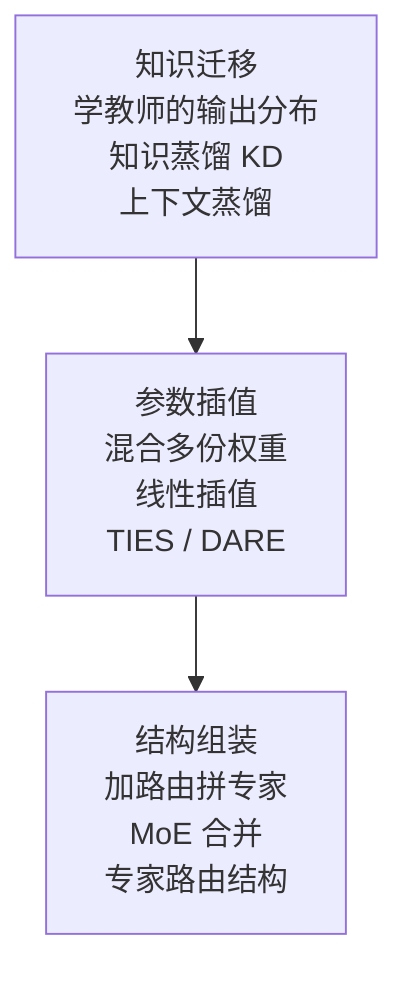
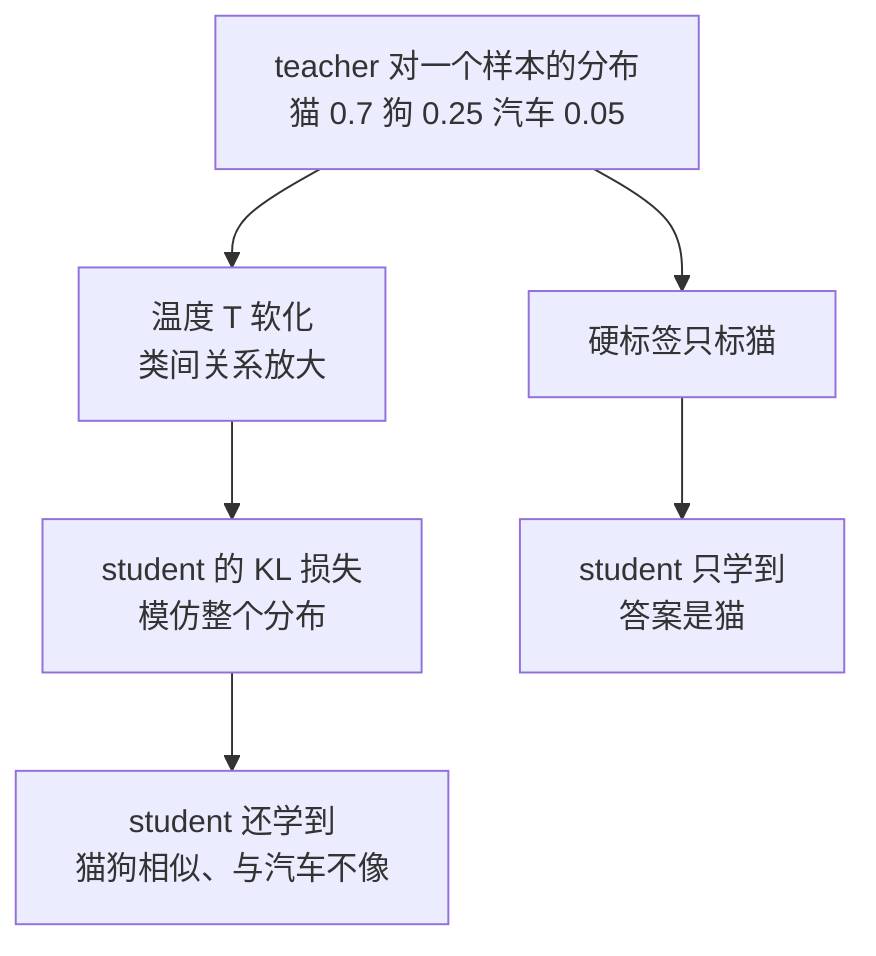

# 蒸馏与模型合并：用小模型承接已验证的能力

**蒸馏是用大模型的输出当教材训练小模型，把已验证能力压进可部署的成本预算。要解决的问题：压缩能力并诚实评估压缩后的边界。**读完你能判断一次蒸馏结果能否迁移到你的任务，以及它的边界在哪。

能力是怎么转移的？靠三种机制之一：知识迁移（学生模仿教师的输出）、参数插值（把多份权重按比例混合）与结构组装（把多个模型拼成一个带路由的新结构）。

下表四条路线里，知识蒸馏与上下文蒸馏属知识迁移，权重合并属参数插值，MoE 合并属结构组装。蒸馏的训练信号是教师输出——logits，模型输出的未归一化分数、softmax 之前的原始打分，即模型给每个候选词的分数；思维链（模型逐步推理的中间过程）；或偏好排序（依据好坏给多个答案排序），学生学的是教师的决策函数（输入到输出的映射规则）；权重合并赌的是「不同训练的解处于同一损失盆地」——损失盆地（loss basin）指训练误差曲面上的一块低洼区域，盆地内的参数都算好解，插值混出来的点若还在盆里就不会太差。

## 能力是怎么从大模型转到小模型的？两类机制、四条路线

打个比方：蒸馏像让实习生看资深工程师的解题草稿——不只抄答案，还学他"为什么先看这一项"（软标签里的分布），这样实习生学到的比只背答案多。这个比喻到"学的是什么"为止：损失函数（衡量模型预测与真实值差距的函数）怎么设计、温度怎么选、合并多个模型时权重怎么加权，要看正文。


| 路线 | 输入 | 机制 | 产物 |
| --- | --- | --- | --- |
| 知识蒸馏 KD | 教师软标签 + 任务数据 | 学生模仿教师输出分布，温度平滑放大类间信息 | 单个更小模型 |
| 上下文蒸馏 | 教师的提示或示例 | 把长提示的效果烧进权重 | 免长提示的小模型 |
| 权重合并 | 多个微调权重（同基座） | 线性/TIES/DARE 插值 | 单个混合权重 |
| MoE 合并 | 多个同构专家 | 把独立模型组装为专家路由 | 稀疏激活大模型 |

**四条路线归入三类机制，机制决定的是「能力从哪里来」与「失效会长什么样」——知识迁移继承教师的判断结构（教师缺陷遗传是它的特有风险），参数插值赌各份权重的解在同一个损失盆地里（盆地外合并出坏解是它的特有风险），结构组装引入路由层——负载不均与显存（GPU 上的内存、模型参数与计算中间结果都存这里）碎片是它的特有风险**，显存碎片指显存被不连续小块占满、大张量放不下的现象：



上下文蒸馏与知识蒸馏的区别：知识蒸馏学教师输出的概率分布，上下文蒸馏学的是教师依赖的提示与示例本身——「烧进权重」指把提示的效果固化进参数，之后不再携带长提示也能得到同样行为。表中另两个术语：MoE（Mixture of Experts，混合专家）指一次只激活部分专家的结构，稀疏激活指每次推理只用其中一小部分参数；插值类路线的定义见下文 TIES 流程处，此处不重复。TIES 的完整流程见下图：多个模型的任务向量先 Trim 掉小改动，再按多数符号解决冲突，最后只平均符号一致的参数——「盆地外合并出坏解」的风险，正是被这三步裁剪与冲突裁决压住的：


*图示：TIES-Merging 的三步合并流程。图源：TIES-Merging 论文（arXiv 2306.01708）Figure 1，https://arxiv.org/abs/2306.01708。图上被裁掉的虚线小箭头就是「微调（在预训练模型上用少量数据继续训练、让模型适配具体任务）只带来微小变化的参数」——插值方案的质量差距，主要来自对这类冗余与符号冲突的处理方式。*

**蒸馏的训练信号从软标签（分类分布的温度平滑）到生成式蒸馏（教师思维链作为训练语料）不等；选择依据是学生要承接的任务形态：判别任务是选答案（如分类、判断题），用软标签最直接；生成与推理任务是写答案（如问答、解题），要对齐（让模型行为符合人类意图与价值观的训练过程）教师的完整输出。**

教师向学生传递两条信号——软标签（教师输出的概率分布）与硬标签（训练数据里标注的标准答案，如分类题里的正确类别），见下图。


*图示：知识蒸馏：教师模型把软标签教给学生模型。图源：Wikimedia Commons《Knowledge-distillation-cv.png》，作者 Prakhar Ganesh，CC0，https://commons.wikimedia.org/wiki/File:Knowledge-distillation-cv.png。*
来源：Wikimedia Commons「Knowledge distillation」条目图。图上学生的两个入边正对应两条信号；教师上方标注 pre-trained 说明它只出教材、不参与梯度回传。

## 大模型压成小模型会在哪些环节出问题？

| 失效 | 机制 | 信号 |
| --- | --- | --- |
| 学生容量不足 | 任务超出小模型承载，蒸馏只学会表面模式 | 目标任务分距教师差距大且不再收敛 |
| 分布漂移 | 蒸馏数据分布 ≠ 上线分布，学生学到的是旧分布决策 | 线上长尾样本表现骤降 |
| 教师缺陷遗传 | 教师幻觉、偏见被学生放大或固化 | 学生错误与教师系统性错误同源 |
| 合并盆地外 | 两个微调解不在同一损失盆地，插值得到坏解 | 合并后各源任务质量同时下降 |
| benchmark 虚高 | 评测集与蒸馏数据同分布，测出记忆而非能力 | 换独立评测集大幅掉分 |

合并路线的收益在公开榜单上有实录形态：Open LLM（大语言模型）排行榜前列一度被 mergekit（一个开源模型合并工具）合并产物占据——榜首 GML-Mistral-merged-v1 与第三名 CatMacaroni-Slerp 都是合并模型（Slerp 即球面线性插值，一种权重合并算法），超过所有原始预训练（用海量文本先训练出通用语言能力、之后再适配下游任务）模型：


*图示：合并收益的公开实录。图源：Hugging Face 博客《Merge Large Language Models with mergekit》（mlabonne），https://huggingface.co/blog/mlabonne/merge-models。图上榜单排名是 Open LLM v1 评测集上的结果——**换个独立评测集重测，排名会重新洗牌，这正是「benchmark 虚高」一行要防的事：合并模型的榜单收益要换集复核，不能只看单一榜单。***


## 这套说法在哪儿会失效？

「徒弟学的是师傅会的」的实物原型是作坊里的师徒：徒弟临摹师傅的样稿出活，师傅擅长的手艺传得快，师傅的习惯性毛病也一并传下去——徒弟的手艺上限是师傅的手艺，样稿上没有的活，徒弟出不了：


*图源：Wikimedia Commons，Louis-Émile Adan 绘画翻拍，公有领域，https://commons.wikimedia.org/wiki/File:Apprenticeship.jpg。*

蒸馏正是这套传承：软标签是师傅的样稿（不只给答案，还给"差多远"），学生容量是徒弟的天分，教师缺陷遗传是师傅的毛病入徒。这个比喻只类比能力的来源与缺陷的遗传，学生容量这类模型属性不能拿徒弟天分去推断——"蒸馏不创造教师没有的能力"这句话，画里就是徒弟出不了样稿上没有的活。

- 蒸馏不能创造教师没有的能力：它压缩与固化，不发明；教师在该任务上不可靠时，蒸馏只会更便宜地不可靠。
- benchmark 提升不等于**生产收益：延迟收益是确定的**（模型变小），质量收益依赖分布稳定，两个收益要分开陈述、分开验证。
- 权重合并的适用前提窄：同基座、相近任务、训练差异小；跨基座合并在当前技术下不成立，别把 merge 当免费午餐。
- 蒸馏后的模型边界要重新标定：学生的"不知道"区域与教师不同，拒答与置信度阈值**不能沿用教师时代的配置**。

## 动手跑一遍会看到什么？

一段 logits 蒸馏的核心循环里，知识蒸馏与直接标 answer 训练的差别在一个超参 T（温度）：

```python
import torch, torch.nn.functional as F

T = 2.0   # 蒸馏温度：把 teacher 的分布软化
# teacher_logits: 大模型对同一输入的输出（不回传梯度）
# student_logits: 小模型的输出
loss = F.kl_div(
    F.log_softmax(student_logits / T, dim=-1),
    F.softmax(teacher_logits / T, dim=-1),
    reduction="batchmean",
) * (T * T)   # 梯度尺度补偿，保证 T 变化时学习率等价

# 对比硬标签：loss_ce = F.cross_entropy(student_logits, answer_ids)
# 差别：硬标签只说"答案是什么"，软标签还说"不是什么、差多远"
#   teacher 对 [猫0.7 狗0.25 汽车0.05] 的软分布，
#   把"猫和狗相似、和汽车不像"这个暗知识教给了学生
```

跑一遍的收获：蒸馏的价值在负知识的传递——样本空间里"哪些答案不成立、彼此多接近"，硬标签完全丢掉，软标签完整保留。学生知道哪些答案不成立、彼此有多接近，遇到没见过的样本时能更稳地排除错误选项，这就是小任务上蒸馏学生泛化更好的机制来源。



图：软硬标签的差别落在哪——右链只传答案本身，左链把教师对整个样本空间的结构判断一并传下去，负知识（哪些不成立）是泛化的来源。

## 这些结论的量级靠什么数字支撑？

收益的量级账：公开基准上蒸馏小模型（学生参数量为教师 1/10）在同类任务上通常保留教师 90-97% 的任务精度，推理成本降到 1/10 以下——每 token（模型处理文本的最小单位，约相当于一个词或半个词） 推理成本通常低一个数量级左右（量级估计，精确比值随任务与部署而变），这是蒸馏在经济上成立的原因。失效形态同样有量化迹象：教师在某垂直领域本身不可靠时（如准确率不高还自信作答），学生拟合的就是这套错误分布——蒸馏不创造能力，只搬运能力；合并两条权重时，两条在共享任务上方向一致就小幅提升（1-3 个点），在冲突任务上方向相反就会互相拉扯。与 [[工程知识/AI 系统工程：从模型能力到生产能力/模型基础与训练/LoRA与参数高效微调：改行为不改基座]] 的关系：LoRA 在同一模型里加窄能力，蒸馏把已验证能力换到小模型上降本，两者常串联（先 LoRA 调教师、再蒸馏到学生）。评测衔接：蒸馏学生必须过 [[工程知识/AI 系统工程：从模型能力到生产能力/质量与运营/离线评测与在线评测回答不同问题]] 的门禁——"在训练分布内保留 95%"之外，还要测分布外的退化幅度。

## 怎么自己动手验证？

蒸馏收益要与三集对比对账——预写学生达到教师的质量线、独立长尾（少数请求耗时远高于其余大部分）集不塌、延迟收益符合成本模型，任一项与预期对不上就退回重训。

最小验证：三集对比——教师、学生、学生上线版本在同一任务集与独立长尾集上的质量与延迟；断言学生达到预设质量线（如教师的 95%）、独立集不塌、延迟收益符合成本模型。合并路线另测：合并权重在所有源任务上都不低于各源权重减阈值，任一源任务塌方即判合并失败。

关系：[[工程知识/AI 系统工程：从模型能力到生产能力/模型基础与训练/后训练对齐与微调改变行为边界]] · [[工程知识/AI 系统工程：从模型能力到生产能力/推理服务与平台/模型路由与级联：小模型过滤大模型兜底的省钱结构]] · [[工程知识/AI 系统工程：从模型能力到生产能力/质量与运营/离线评测与在线评测回答不同问题]]
