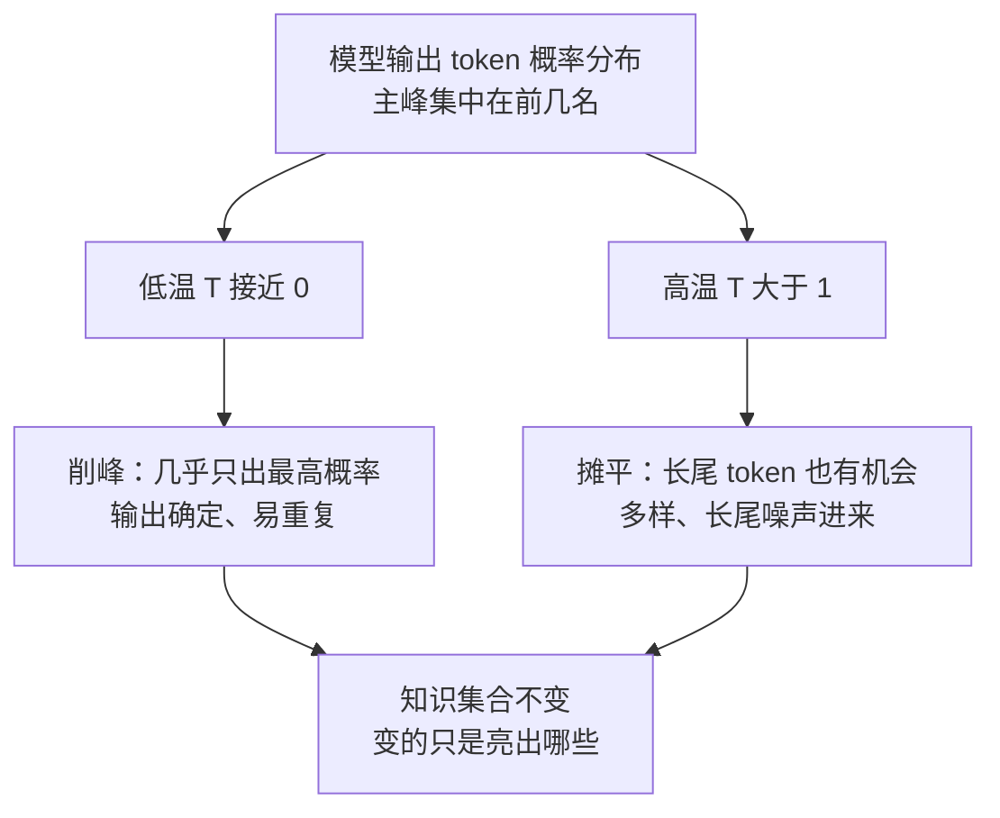
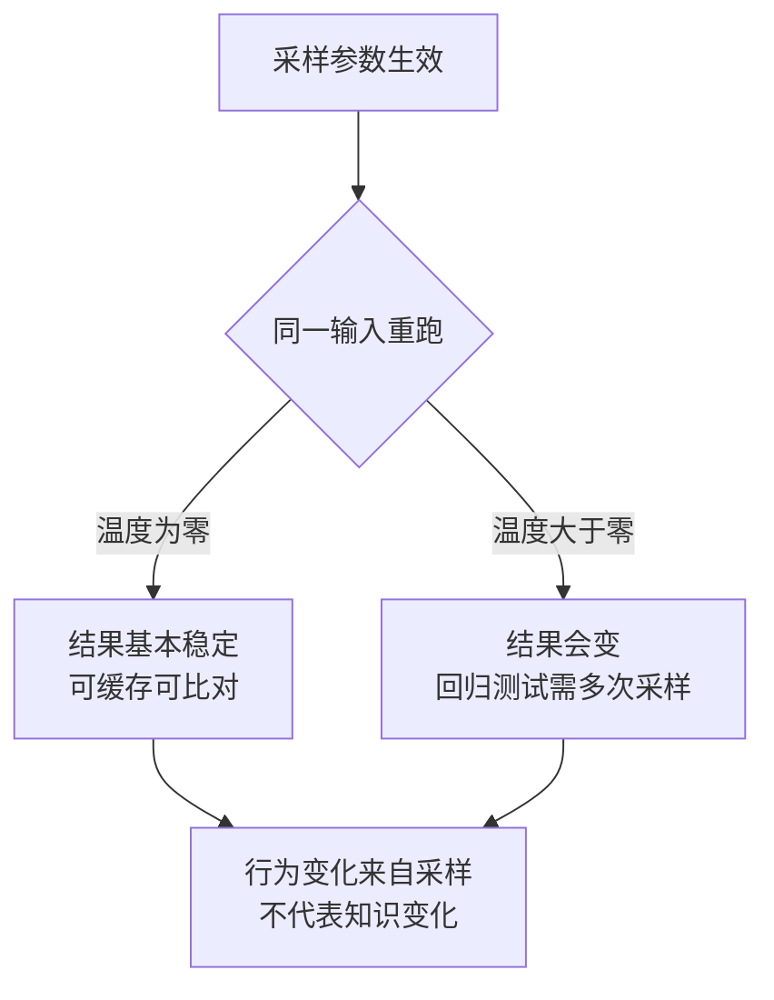

# 解码采样决定生成行为而不是知识本身

模型每步给出下一个 token（模型一次生成的最小文本单位，可理解为一个词或字）的概率分布，采样策略决定从分布里怎么挑。**它改变多样性和稳定性，但补不上缺失的事实**。读完这篇你能按任务选采样参数，并用最小实验验证改动效果。

温度、top-p（核采样，只在累积概率达到 p 的候选里选）、top-k（只在前 k 个候选里选）、重复惩罚（对已经出现过的词降低再次被选中的概率，减少复读）、停止条件（遇到指定标记或长度上限就结束生成）和结构化约束（用固定格式或 schema 限定输出结构）**会改变多样性、稳定性、长度和错误形式，但不能把缺失的事实变成可靠知识**；最小实验是**固定 greedy、低温和高温的格式通过率、引用支持率、重复率与成本**。



图：温度调的是分布形状，不是模型的知识。两条链最终指向同一点：采样参数改变行为层，改变不了知识层。

## 要解决的问题：采样参数改变的是输出的哪一类属性

**同一段提示词（发给模型的输入指令与背景信息）在不同请求里得到风格差异很大的输出，或者输出稳定但内容与其他事实对不上，团队改动提示词之后现象随机变化**。本篇回答：**采样参数改变的是输出的哪一类属性、它会带来哪些副作用、它与模型掌握的知识之间是什么关系**，以及比较不同采样配置时应当固定哪些变量。

## 常见采样策略各自怎么起作用，什么场景该用哪个

打个比方：**采样参数像调收音机的旋钮——台还是那些台（模型知识没变），但旋钮决定了你听到的是清晰的原声还是混杂的噪音，是每次都听同一首还是换着听**。这个比喻到"改的是行为不是知识"为止：温度、top-p、top-k 各自怎么起作用、什么场景该调哪个，要看正文。


*图源：Holtzman et al.，《The Curious Case of Neural Text Degeneration》(arXiv:1904.09751) Figure 3，论文配图。*

| 策略 | 机制 | 适用倾向 | 风险 |
| --- | --- | --- | --- |
| greedy | 每步选最大概率 | 稳定格式、确定性任务 | 可能重复或陷入局部高概率 |
| temperature | 重塑每个候选词的原始打分（logits）再算概率 | 控制随机性 | 温度越高不等于创造力越有用 |
| top-p/top-k | 只在候选子集采样 | 开放式生成 | 截断会改变尾部概率质量 |
| beam search | 保留多条高分路径 | 某些序列生成任务 | 对开放式对话常变得保守、重复 |
| grammar/JSON schema | 将非法 token 路径屏蔽 | 结构化输出、工具参数 | 只保证语法，不保证业务语义 |


*图源：同上（Holtzman et al.）。*

「分布是全集、采样是抽一支」的实物原型是庙里的签筒：**一筒竹签收着全部可能的运势（知识层），摇出哪一支是当次那一摇的事（解码层）——摇的手法再花哨，也摇不出筒里没有的签**。这个比喻只对应「知识层决定有什么、采样层决定取哪支」这一层关系：


*图源：Wikimedia Commons，公有领域，https://commons.wikimedia.org/wiki/File:%E7%AB%B9%E7%B1%A4%E5%8F%8A%E7%B1%A4%E6%96%87.JPG。*

**温度调的是摇的力度（低温稳取筒口那支，高温连筒底长尾都摇得出来），top-p/top-k 调的是允许出签的范围；筒里有没有那支签，与怎么摇无关**。比喻到这里为止，签筒没有对应的摇法参数，摇的手法不映射任何采样配置——**这就是"采样参数改变行为层、改变不了知识层"的实物注脚**。


*图源：同上（Holtzman et al.）。*


来源：[稀土掘金《图解Transformer：为什么GPT、Claude、DeepSeek都用同一个架构？》](https://juejin.cn/post/7668503904926236723)（CC 4.0 BY-SA）


## 工程上最容易忽略采样参数的哪些边界



采样改变的是行为而不是知识，这一点决定了**它能不能进回归基线**（正常状态下的指标水平、用来对比异常）：**因为采样让同一输入的输出随机变化、不可复现，所以高温配置的结果不能直接当作固定的回归基线**，判断见下表：


- **同一提示词和模型，采样参数变化就可能产生不同工具调用和安全行为**。
- **输出长度上限（max_tokens）、自定义结束标记（stop sequence）和截断都会改变完成条件；「返回 200」不代表任务完成**。
- **结构化约束可能让模型在无法满足语义时输出形式正确的错误值**。
- **流式输出中途断开、重试或重复提交时，调用方必须用幂等（同一请求重复执行多次结果一致）和状态机处理**。

## 这些量在什么数量级：温度与 top-p 的行为账

同一模型的采样参数账：temperature（采样温度参数：越低越确定，越高越发散）=0（贪心）**输出确定但重复风险高**（越生成越长时，反复吐出相同片段的循环生成概率会上升）；**temperature=0.7 + top_p（核采样参数：只在累积概率前 p 的候选里挑）=0.9 是对话类服务的常见起点**（多样性足够、且不易出现重复啰嗦的退化输出）；**代码生成类任务取更低温度（0-0.3，语法错误的代价高）**。参数的影响可量化对比：**公开基准上同一模型温度 0 与 0.8 的 pass@1（单次生成通过率）差通常在 1-5 个点**（量级为公开典型值），**pass@k差距反向（高温多采样命中率高）**——**若验收要求单次必须正确，看 pass@1、取低温更稳；若允许多次尝试内命中，看 pass@k、取高温更划算**。**按任务的验收指标（单次正确还是多次尝试内正确）选温度，这是解码参数唯一可靠的选型依据**。

## 真实案例里发生了什么：输出确定性的衔接

采样参数的工程纪律接两篇：[[工程知识/AI 系统工程：从模型能力到生产能力/质量与运营/可靠生成需要结构、证据、拒答与回归]] 的回归测试（改动后重跑旧用例、确认没有破坏既有功能）要求输出可复现——**temperature>0 时同一提示词两次输出不同，回归判据要从"输出相等"改成"结构相等 + 断言点成立"**，**temperature=0 也要固定种子与 batch（数值非确定性仍在）**；[[工程知识/AI 系统工程：从模型能力到生产能力/推理服务与平台/批处理、KV缓存、量化与并行如何改变服务容量]] 的 batching 会引入浮点非确定性——**采样参数的"确定性承诺"要连着基础设施一起核对**。

## 动手跑一遍会看到什么：采样改变行为的典型形态

```python
# 知识固定、行为可调的直接实验（通用示例）
prompt = "列出这个项目的三个风险"

# 贪心解码（temperature=0）：跑三次，输出完全相同
#   ["进度风险", "质量风险", "成本风险"] —— 每次都一样

# temperature=0.8：跑三次，三种组合
#   ["进度风险", "人员流动风险", "依赖延迟风险"]
#   ["质量风险", "成本风险", "进度风险"]
#   ["依赖延迟风险", "合规风险", "文档缺失风险"]
#   —— 模型"知道"的风险集合不变，采样决定每次亮出哪些
# 温度调的是分布形状：低温削峰（只出最可能的），高温摊平（长尾也有机会）
```

**把"换参数"当"换能力"的典型形态**——评测发现模型"不会"列风险，加 few-shot、换提示词轮番尝试后才发现采样温度设了 1.3（过高，长尾噪声盖过了主分布），温度回落到 0.3 后"不会"变"很稳"：**先查解码配置，再动提示词与数据，顺序颠倒会让力气白花一半**。相反方向的形态：**创意场景设了贪心（每步取局部最优、不回头的算法思路），用户发现"每次生成的文案一模一样"，这属于调用侧采样参数所在的「控制面」配置与任务错配，能力本身没有问题**。知识层与解码层的分界实验是同一结论的另一半：**模型不知道的事实，任何采样参数都变不出来——参数调分布，数据与检索改知识**（与 [[工程知识/AI 系统工程：从模型能力到生产能力/知识与检索/RAG的核心是选择可引用证据.md]] 的证据供给衔接）。

## 怎么自己动手验证

1. 固定变量：在**固定模型快照、提示词、工具 schema 与输入集**的前置条件下比较不同采样配置，确认**输出差异来自参数而不是**其他变动。
2. 分工测试：**知识类问题在调整温度前后答案事实不变，格式类问题随结构化约束改善**，确认**两类属性没有被混在一起调**。
3. 任务分档：**按任务类型分别统计确定性、格式通过率、事实/引用支持率、拒答、工具参数正确率与平均、长尾（少数请求耗时远高于其余大部分） token 和成本**，确认**没有用同一个全局温度掩盖任务差异**。

关系：[[工程知识/AI 系统工程：从模型能力到生产能力/模型与上下文/模型提出候选，系统定义正确性]] · [[工程知识/AI 系统工程：从模型能力到生产能力/推理服务与平台/推理服务的核心矛盾是延迟、吞吐、显存与质量]]

## 效果从哪儿来，要付什么代价

**按任务类型分别设定采样策略，换来的是格式通过率、引用支持与成本之间可以做有依据的取舍，同一提示词在不同请求上的输出差异有了可解释的来源**。代价是**参数与业务语义的边界需要单独守住**，温度提高不等于**知识增加**，**结构化约束只能保证形状**，**回归判据还要从输出相等改成结构与断言成立**。

