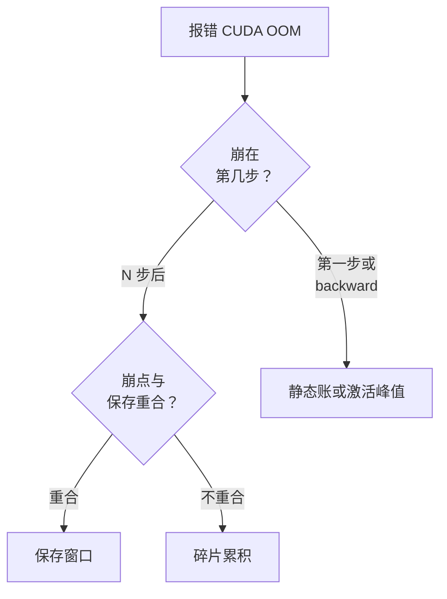

# 训练作业的显存失效有固定形态：激活峰值、碎片与保存窗口的定位顺序

训练跑到某个深度突然报 CUDA out of memory（CUDA：NVIDIA 的 GPU 并行计算平台与编程模型），多数人的第一反应是把 batch 调小，但 OOM（显存耗尽导致程序被终止）的形态不止「参数放不下」一种：同样的报错文本，可能是第一步激活就爆，可能是若干步后碎片积到临界，可能发生在保存检查点（定期保存进度、故障后从最近一次保存处恢复）的瞬间，也可能只在最长样本出现时触发。把每类都当成「放不下」去减 batch，会白白损失吞吐还常常治不好。

要解决的问题就是：显存失效为什么不能一律当成参数放不下、按什么顺序定位。读完这篇你能按失效时点分清四种形态、知道每类对准的对策与代价，也能把定位顺序从「先减 batch 再说」换成先看显存曲线再动手。

## 显存账本里六类占用各随什么变：本质与构成

打个比方：显存像一间工作室，模型参数是常驻的器械柜，买来就搬进来、一直占着；梯度和优化器状态是每道工序都摊开一遍的工作台，跟着训练步反复进出；激活是正在加工的半成品堆，工序高峰时最占地方；检查点保存是每隔一段把全部工具拍快照（某一时刻的完整只读副本）装箱，装箱那一瞬间要额外空出一份场地。这个比喻到「六类占用各有节奏」为止：每块具体怎么算、失效怎么定位，要看正文。

显存的六类构成（临时缓冲并入碎片一行看，两者都属动态分配行为，失效时点不同），各自随什么变、失效形态在哪一步触发：

| 占用 | 随什么变 | 失效时点 | 典型信号 |
| --- | --- | --- | --- |
| 参数权重 | 参数量 × 精度 | 进程启动加载时 | 第一步之前就失败 |
| 梯度 | 与参数同量级 | 第一次反向传播 | forward 能过，backward 崩 |
| 优化器状态 | 参数量 × 每参数额外字节（如 Adam 为 8 字节） | 优化器初始化或首次 step | backward 能过，step 崩 |
| 激活 | batch × 序列长度 × 宽度 × 层数（注意力类还有随长度平方的部分） | 前向峰值处 | 长序列样本或大 batch 触发 |
| 临时缓冲 | 单步前向/反向的 Workspace 需求 | 换大算子（大矩阵乘、大归约）的那一步 | 大算子组合的步内崩，上一步还正常 |
| 碎片 | 分配器的复用策略 | 跑了 N 步之后突然崩，重启又在相近步数崩 | 崩点与保存周期无关 |
| 检查点保存窗口 | 模型 + 优化器状态的总和 | 保存瞬间 | 固定周期、可复现的崩点 |

前三块是静态账，随训练架构定死；后三块是动态账，随 batch、序列长度、运行时长与保存周期浮动——**临时缓冲看单步峰值，碎片看累积趋势**，两者失效时点不同。OOM 定位的第一步就是把报错时刻对到这张表的某一行的「失效时点」上。

图注与正文的对法：斜坡是碎片累积的曲线形态（利用率逐步逼近上限），崩点本身散布、不与步数固定挂钩——曲线走势归形态、崩点时点归样本，两条线索合起来才完成归因。

## 四种失效形态怎么区分、各自对准什么对策？

四种形态按失效时点区分，对策完全不同：

**形态一：激活峰值。** 注意力（模型为每个词分配权重、聚焦上下文中最相关部分的机制）模型的激活显存随序列长度平方增长（注意力矩阵是长度 × 长度），4096 上下文能跑、32768 上下文第一步就爆，是这类形态的典型表现。梯度累积把多个 micro-batch（一次前向-反向所用的最小样本组；全局 batch 由若干个 micro-batch 累加而成）的梯度累加后再统一更新参数，压的是 batch 维度，序列维度的平方项它管不了，所以「减 batch 无效、必须减序列或开激活重算」本身就是这条形态的诊断特征。FlashAttention 把注意力中间矩阵消除后同卡能从 4096 跑到 32K，长序列实录见 [[工程知识/AI 系统工程：从模型能力到生产能力/推理服务与平台/FlashAttention是IO感知的精确算法，不是近似.md]]，就是这类形态的对策样板。

**形态二：保存窗口。** checkpoint（训练检查点）不止是模型权重：优化器状态、学习率调度器、随机数状态、数据游标都要一起存——三份状态漏一份就恢复出静默偏差的机制，[[工程知识/AI 系统工程：从模型能力到生产能力/模型基础与训练/分布式训练与并行策略如何切分模型.md]] 已展开。保存动作要求「当前显存里驻留的活数据」与「正在写盘的快照」同时在场，显存峰值在保存瞬间叠出一道尖峰。**崩点与保存周期精确重合、且每个保存周期都崩，是这条形态的指纹**。对策是把保存改成 CPU 侧中转或分片（把数据按规则切开存到不同节点）写出，而不是继续压训练本身的 batch——压 batch 是在为别人的尖峰腾地方，吞吐损失全算在自己头上。

**形态三：碎片累积。** 深度学习框架的缓存分配器（把释放的显存块留在池子里复用而不是归还系统）面对变长序列时，反复申请释放不同大小的块会把大块整存整拆成零散小块，总空闲量足够却找不到一块连续空间，申请照样失败。**重启后在相近步数再次崩、且崩点与保存周期无关**，是这条形态的指纹。推理侧用 PagedAttention 把 KV（Key-Value，键值对：按键取值的最简数据模型） 缓存分页化消除碎片，有效利用率从 20-40% 提到 96% 以上，展开见 [[工程知识/AI 系统工程：从模型能力到生产能力/推理服务与平台/GPU显存管理决定服务容量上限.md]]，训练侧对应的思路是把变长请求整理成固定档位的分桶（bucketing），让分配模式回归「整块申请整块释放」，碎片增长率随之下降。

**形态四：峰值样本。** 语料里混着极少数超长样本，绝大部分步数风平浪静、走到那条样本时崩。崩点随机散布、与步数无固定关系，是这条形态的指纹。对策是入口处按长度截断或过滤，让预算按「最坏样本」配置，这条形态与数据治理里「污染样本在入口拦截」的道理同源（[[工程知识/AI 系统工程：从模型能力到生产能力/数据与MLOps/训练数据治理：来源、许可与污染决定语料的长期价值.md]] 讲入口拦截的完整管线）。

## 对策每一条都在拿什么换什么：代价与边界

显存对策略给不了免费选项，每条对策的账都在三个科目之间转账：**算力（重算换显存）、通信（分片换容量）、吞吐（减 batch 减序列直接降产出）**。定下对策前把这三个科目过一遍账：

| 对策 | 压哪一块 | 付什么 |
| --- | --- | --- |
| 梯度累积 | 激活的 batch 项 | 相同全局 batch 下步数变多，通信次数不变但整体变慢 |
| 激活重算（gradient checkpointing） | 激活峰值 | 前向重算一遍，算力多付约三分之一 |
| 序列分桶 | 激活的序列项与碎片 | 桶内短样本陪跑长档位，浪费部分算力 |
| 分片保存 / 异步保存 | 保存窗口尖峰 | 保存路径复杂化，恢复验证要覆盖新路径 |
| 量化加载（低精度加载权重） | 参数静态项 | 数值行为改变，与混合精度的档位决策要合流验证 |

这些数字的量级与构成可对照 NVIDIA 的 GPU 性能背景文档（显存层次与各块占用来源）与 HuggingFace 的单卡高效训练指南（梯度累积与激活重算的取舍）核验。梯度累积对浮点结合律的敏感性——多次小加法与一次大加法结果有 1e-6 级差异，该量级出自 [[工程知识/AI 系统工程：从模型能力到生产能力/推理服务与平台/FlashAttention是IO感知的精确算法，不是近似.md]] 边界节的实测对照——在累积步数下被放大，数值敏感的训练要对照验证。

这套分类的失效边界也要摆明：它只覆盖「显存空间维度」的失效；数值维度的失效（梯度溢出、下溢、loss 变 NaN）是另一套形态与防护，见 [[工程知识/AI 系统工程：从模型能力到生产能力/模型基础与训练/混合精度与数值稳定：低位宽训练的溢出与下溢管理.md]]。显存与数值的失效偶尔同源（激活重算改变了浮点求和顺序），两边的验证都要重跑。OOM 定位的纪律一句话：**先把崩点对到形态上，再动手调参**；跳过分型直接减 batch，是在用吞吐为错误的归因付费。

## 怎么自己动手验证定位顺序有效？

验证的核心是**把「崩点时点」与「显存曲线」对上**，预期对不上就要怀疑归因错了：

- 显存曲线记录：训练脚本里每个 step 输出当前显存占用（PyTorch 的 `torch.cuda.max_memory_allocated`），崩点处回看曲线是台阶（保存窗口）、斜坡（碎片累积）还是孤立尖峰（峰值样本）。
- 形态复现：构造三种实验——固定 batch 把序列长度从 4096 升到 8192（预期第一步崩，属激活峰值）；跑 200 步每 50 步保存一次（预期崩点落在保存处，属保存窗口）；长度随机分布跑长跑（预期崩点散布且逐步逼近上限，属碎片）。
- 对策回归：应用对策后重跑同配置，断言崩点消失且显存峰值低于预算的 90%（留缓冲）；梯度累积与重算开启后，loss 曲线与不开的基线（正常状态下的指标水平、用来对比异常）对照，偏差应在混合精度自身波动范围内。

这套定位顺序的前提是**显存计量本身可信：容器环境里显存 limit 与框架**看到的数字要对得上（容器边界篇已说明 GPU 显存不属于普通 CPU 资源、要单独测量），归因前先确认没有别的进程在同一张卡上分走预算。

## 这套说法在哪儿会失效？

- 参数与优化器状态超大、单卡确实放不下静态账时，本篇的动态对策全部无效，要回到并行切分。FSDP（Fully Sharded Data Parallel，全分片数据并行：把参数分片到多卡训练）与 ZeRO（Zero Redundancy Optimizer，零冗余优化器：把优化器状态、梯度、参数分片到各卡消除副本的数据并行方案，FSDP 是它的工程实现）分档切片的账见 [[工程知识/AI 系统工程：从模型能力到生产能力/模型基础与训练/分布式训练与并行策略如何切分模型.md]]。
- MoE 模型的专家放置带来的碎片是路由负载不均的伴生问题，与本篇的分配器碎片不同源，见 [[工程知识/AI 系统工程：从模型能力到生产能力/模型基础与训练/MoE路由的工程问题：负载不均与显存碎片.md]]。
- 多进程共享单卡（如按卡切给多个作业）时，峰值观测要按进程聚合，单进程曲线看不出全卡真相。

## 案例回流：显存账对不上时的真实形态

[[工程知识/缺陷分析：从个案到体系/稳定性/案例一：垃圾回收线程的终止——BookKeeper 磁盘写满]] 与显存失效不同源但同构：磁盘写满让后台回收线程终止，资源压力从「慢」变成「停」，与显存 OOM 前碎片化加重的形态一样——资源耗尽不是瞬时事件，是观测指标先变差、系统行为再变形的过程。可操作的对法按同一顺序走：第一步确认计量本身可信（本篇前提节——容器 limit 与框架看到的数字对得上、没有别的进程分走预算）；第二步看资源曲线的形态（磁盘水位爬升对应显存斜坡、周期性尖峰对应保存窗口）；第三步才轮到调参（回收参数对应 batch 与序列）。两案共享的判据：资源账对不上时，先查计量、再看曲线、最后调参，顺序反过来会白调。

## 想深入相邻问题该读哪几篇？

- [[工程知识/AI 系统工程：从模型能力到生产能力/推理服务与平台/GPU显存管理决定服务容量上限.md]] —— 推理侧的显存预算与并发上限，与本篇合成训练与推理两套显存账
- [[工程知识/AI 系统工程：从模型能力到生产能力/模型基础与训练/混合精度与数值稳定：低位宽训练的溢出与下溢管理.md]] —— 数值维度的失效形态与防护
- [[工程知识/后端系统：在并发、失败与变化中维持服务/基础设施/容器隔离资源边界与镜像身份.md]] —— 容器资源边界与 OOMKilled 的宿主机视角
