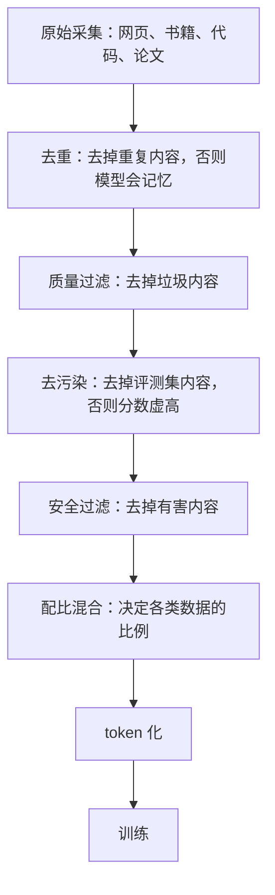
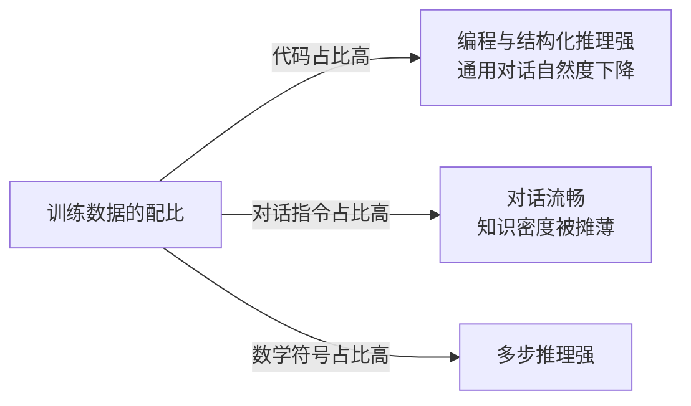

# 预训练数据决定模型能力上限

**模型的能力从数据里来**，这是 scaling laws（规模定律：参数量、数据量、算力与损失之间的幂律关系）系列论文反复验证过的实证结论。参数量、架构、算力都是**放大器**——它们决定能吸收多少，**数据决定能吸收什么**。读完你能判断一个模型在某类任务上不行是数据没覆盖还是容量不够，并知道该补数据还是加参数。

**训练数据决定能力上限**。理解这一点对使用模型（而不只是训练模型）很关键：它解释了为什么模型在某些领域很强、某些领域很弱；为什么"更大"不一定更好；以及为什么微调（在预训练模型上用少量数据继续训练、让模型适配具体任务）注入知识常常适得其反。

## 要解决的问题：数据的哪些属性决定模型能学到什么

同样规模的模型与算力投入，在不同数据上的能力表现差距明显，而数据质量问题在训练完成之前难以从指标上察觉。本篇回答：数据的哪些属性决定模型能学到什么、参数量与架构在其中起什么作用、数据治理在训练链路里的位置在哪里，以及污染与许可问题会以什么形式在后期显现。

## 数据怎么定住能力上限：机制与本质

先把形状说成一件事：模型像一个只上过图书馆里有的课的学生——训练目标是预测下一个词，为了少犯错他会把馆里每本书的规律都背下来，但图书馆没进过的书，他再聪明也背不出来。馆舍大小与课时（参数与算力）决定他能背多少，进馆的书目与编目质量（数据的分布、质量与配比）决定他实际学到什么。这个比喻到"编目"为止——现实里能力的边界由损失函数（衡量模型预测与真实答案差距的优化目标）与语料统计共同决定，下面逐层展开。

从训练机制看，预训练（用海量文本先把通用语言能力训练出来的阶段）的原理是：训练目标是预测下一个 token，模型为降低这一损失而吸收数据中的统计规律，**数据里不存在的内容无法从参数中得到**。参数与算力决定可吸收的容量，数据的分布、质量与配比决定实际吸收到什么，因此**同一份架构与预算在不同语料上得到的能力不同**。


## 这件事发生在什么场景：为什么它对中文古籍一无所知

一个团队拿开源模型做古籍数字化，问"《XX 卷》第三段讲了什么"。模型**自信地编了一段**，看起来像那么回事，但完全是虚构的。

换成闭源的大模型，回答变成"我没有这本书的信息"——**这个回答反而是对的**。

差别不在参数量，在**训练数据**。两个模型的差异列在下面：

| | 那个开源模型 | 闭源大模型 |
| --- | --- | --- |
| 训练数据里的中文古籍 | 几乎没有 | 少量（扫描本 OCR，光学字符识别） |
| 遇到不知道的 | 编（因为没学过"不知道"这种模式） | 拒答 |

这就是"数据决定上限"的具体含义，拆开看是三层：

1. 数据里没有的领域，模型只能编——它不知道自己不知道
2. 数据质量差，模型学到的是噪声
3. 即使参数翻十倍，缺的数据还是缺的

## 预训练究竟是什么：从零开始

### 为什么说训练目标简单

```
给模型一段文本的前半部分，让它预测下一个 token（token 是文本被切分后的最小单元，一个词或词的一部分）
```

```
输入："今天天气很"
目标："好"          ← 模型要猜出这个
```

**就这么一个任务，在几万亿 token 上反复做。** 模型为了"猜对下一个词"，**必须先读懂上下文里的语法与事实**；长程推理与代码模式，是它在海量上下文里归纳出的规律。Kaplan 论文的逐位置损失曲线证明：上下文越长损失越低，说明模型确实用到了这些模式。于是它被迫学会：

- 语法（什么样的词序合法）
- 事实（"中国的首都是___" → 北京）
- 推理（"如果 A>B 且 B>C，那么 A___C" → >）
- 代码模式（函数怎么组织）

  **这些都是"为了预测准"而涌现的副产品**，不是显式教会的。熟读唐诗三百首的孩子没上过一节修辞课，接得住"欲穷千里目"的下一句——为了接得准，韵律、对仗、典故都顺带进了脑子；顺带学会的这些，不是谁直接教他的。比喻到"接下句"为止：模型侧的损失曲线证据，看下面 Kaplan 论文的实测。

预测为什么会迫使模型学东西，Kaplan 论文测过同一序列里不同位置 token 的损失：序列越往后（可用上下文越长），每个 token 的预测损失越低，且按幂律下降（损失随可用上下文长度以固定的指数关系持续走低）——**模型只有从上下文里读到语法、事实与推理模式，才能把后面的词猜准**，损失曲线的下降就是这些能力被吸收的直接证据：


*图源：[Kaplan et al.《Scaling Laws for Neural Language Models》（arXiv:2001.08361）](https://arxiv.org/abs/2001.08361)，arXiv 论文引用。*

### 数据管道怎么运转

数据管道的第一步是把原始数据搬到能反复读的地方。领物凭证模式（数据工程里常见的存储做法：把大块数据单独存放、只在主流程里留一个指向它的编号）说的是同一件事：**大载荷另存到专门的存储，流水里只带一个指向它的凭证**。这个比喻只用来说明重内容外置、主线只留指针，不涉及数据质量与配比。




**每一步都在决定模型最终会什么。**

## 为什么规模不是唯一的轴：关键认知

这条论点在 2020 年的 Kaplan scaling laws 论文里有实测曲线背书：每个算力预算下取最优模型，测试损失沿一条平滑的幂律前沿下降——同一个预算下，参数摆错了位置的模型（曲线右侧翘起）明显偏离前沿，参数多不等于落在前沿上：


*图源：同上（[Kaplan et al.《Scaling Laws for Neural Language Models》）。*

### Chinchilla 定律是什么

早期大家认为"参数越大越好"。**2022 年 Chinchilla 论文改变了这个认知**：

**给定算力预算，模型大小和数据量要一起放大。**

| | 参数 | 训练 token | 结果 |
| --- | --- | --- | --- |
| GPT-3（2020） | 1750 亿 | 3000 亿 | 数据相对不足 |
| Chinchilla（2022） | 700 亿 | 1.4 万亿 | 参数只有 GPT-3 的 1/2.5，各项基准反超（论文实测） |

**含义：很多"大模型"其实是数据不足的。** 用小得多的模型 + 更多数据，**能达到更好效果**。

数据不足在曲线上长什么样，Kaplan 论文还给了另一组实测，展示数据量对测试损失下限的约束：每组同色曲线对应固定数据量，虚线是训练损失、实线是测试损失——**数据被吃尽的那个步数（竖线）之后，训练损失还在降，测试损失却抬头离开前沿**。**数据规模把测试损失的下限摆在那里，参数与算力再多也压不下去**：


*图源：同上（[Kaplan et al.《Scaling Laws for Neural Language Models》）。*

**对使用者的启示**：看到"某某模型有万亿参数"，**先查它训练了多少 token，参数量单独不构成强弱结论**。

### 数据配比怎么取舍

不同数据的比例直接决定能力倾向，举两个例子：

| 加大某类数据 | 增强 | 可能削弱 |
| --- | --- | --- |
| 代码 | 编程、结构化推理 | 通用对话自然度 |
| 数学/符号 | 多步推理 | — |
| 多语言 | 该语言能力 | 英文能力（算力竞争） |
| 对话/指令 | 对话流畅度 | 知识密度 |
| 合成数据 | 特定格式/任务 | 可能放大错误模式 |

**这就是为什么不同模型"性格"不同**——哪怕是同样的架构，配比不同能力就不同。



图：配比怎么变成能力倾向——**同一个模型架构在不同配比下走向不同的强弱面**，选型时按自己任务的类型找对应配比训练的模型。

「哪种数据备得多，模型就偏哪一路」的实物载体是训练集群里的数据管道：TB 级的训练语料按配比混入训练流，代码、对话、多语言各自占多少百分比，直接写进模型的能力倾向。配比只决定能力的强弱分布，不决定能力上限：


*图源：Wikimedia Commons，Damakamis，CC BY-SA 4.0，https://commons.wikimedia.org/wiki/File:Antwerp_Mons_Waterloo_Warehouses_datacenter_06.jpg。*

铅字房把这个道理讲得更古老：新闻字备得满当当、诗词字只备几百枚的铅字架，**排出来的一定是新闻体**——要它排骈文，架子上的字根本不够。比喻到这里为止：铅字种类对应数据的分布，铅字数量对应数据量，排字能力对应模型把数据学进去的本事。

**选型含义**：benchmark 总分之外，要看**在你的任务类型上的表现**。一个代码配比较高的模型，**写文案可能不如通用模型**。

## 对使用者意味着哪三件事：实际含义

### 1. 为什么模型不知道它不知道什么

  **训练数据里没有的领域，模型会编——而且编得很自信。** 酒桌上被问到不懂的行当是同一个形态：真懂的话题对答如流（训练数据里有的），完全陌生的领域有些人照样侃侃而谈、声音不小（编造且自信）——**分不清他哪句有底、哪句在撑场面，只能靠核查（引用来源、保持验证），不能靠语气判断**。

| 场景 | 表现 |
| --- | --- |
| 问训练数据里有的 | 准确 |
| 问训练数据里没有的 | **编造，且语气自信** |
| 问需要实时数据的 | 用旧知识回答，或编 |


- 关键结论**要求引用来源**
- 对模型的回答**保持验证习惯**

### 2. 为什么微调不能有效注入知识

常见误区："要让模型知道本公司的产品，那就微调一下。"

**微调对"注入事实"效果很差**，公开实验结论对照如下：

| 目标 | 微调有效吗 |
| --- | --- |
| 改变**风格/格式**（总是输出 JSON、用某种语气） | 很有效 |
| 改变**行为**（什么时候拒答、怎么调用工具） | 有效 |
| 注入**大量新知识**（领域手册、专有语料） | 效果差，且容易灾难性遗忘（新学的知识挤掉旧能力，原本会的内容退化） |

**原因**：微调是在已有表示（模型把输入压缩成的内部特征）上做小幅调整，**不是往数据库里写记录**。**少量样本记不住，大量样本会破坏原有能力**。

**正确做法**：知识用 **RAG（检索增强生成，先从外部资料里检索再让模型据此回答）**，行为才用微调。

### 3. 训练数据为什么有时间截止

模型只知道**训练数据截止日期之前**的事。印好的日历是同一个边界：2026 年的日历印完，里面就没有 2027 年的假期——日历没有坏，出厂时那页纸还不存在；想知道 2027 年的事，**得去问能联网查的工具（接搜索或检索），不能问印死的纸**。

```
问："2026 年最新的前端框架是什么？"
模型：可能用 2024 年的知识回答（如果训练数据截止在那里）
```

这里要做的是两件事：
- 时效性问题必须接搜索或检索
- 不要问模型"最近发生了什么"

## 自己训练微调时数据质量管到哪：边界

| 问题 | 后果 | 检测 |
| --- | --- | --- |
| **重复数据** | 模型记忆、泛化差 | 去重率、n-gram 重复检测（n-gram 指文本中连续相邻的 n 个字或词，用来发现重复内容） |
| **评测污染** | benchmark 分数虚高 | 与评测集做 n-gram 匹配 |
| **低质量数据** | 学到噪声 | 用模型打分过滤，但要抽样人工检查 |
| **偏见** | 输出有系统性偏差 | 分群评测 |
| **隐私泄露** | 模型能背出训练数据里的个人信息 | 用 canary（植入的假信息）检测 |
| **合成数据** | 可能放大生成模型的错误 | 保留生成配置，对比真实数据分布 |

**一个实用建议**：过滤"低质量"时**别把"容易分类"当成"没价值"**。很多高质量内容（代码、少数语言、专业文档）在通用质量分类器下得分不高，**被误删会明显损害能力**。

## 哪些认识一看就错：常见错误

**错误 1：认为参数大 = 能力强**

Chinchilla 已经证明：**数据不足的大模型，不如数据充足的小模型。**

**错误 2：用微调注入知识**

效果差且容易破坏原有能力。**知识用 RAG。（检索增强生成，先从外部资料取证据再让模型据此作答）**

**错误 3：认为模型知道自己的知识边界**

**它不知道。** 数据里没有的，它会编。

**错误 4：忽略知识截止日期**

问时效性问题会得到过时的答案。**必须接检索。**

**错误 5：以为更多数据总是更好**

**脏数据会损害模型。** 去重和质量过滤比堆量重要。

**错误 6：过度依赖合成数据**

合成数据来自另一个模型，**会继承并放大它的错误模式**。要混合真实数据，并保留生成配置以便归因。

**错误 7：评测集没做去污染**

训练数据里混进了评测题 → 分数虚高 → **上线后发现真实能力差得多**。**训练前必须做 n-gram 匹配去污染。**

关系：[[工程知识/AI 系统工程：从模型能力到生产能力/模型基础与训练/后训练对齐与微调改变行为边界]] · [[工程知识/AI 系统工程：从模型能力到生产能力/数据与MLOps/数据集、特征与模型版本必须可追溯]] · [[工程知识/AI 系统工程：从模型能力到生产能力/模型基础与训练/Token、Embedding与表示学习连接数据和模型]]
- [[工程知识/性能工程：从用户等待到资源瓶颈/观测与诊断/市面Benchmark的设计读法：宏微与中间层基准.md]] —— 评测集分布决定结论适用面，AI 榜单同原理

能力上限结论要与污染核对对账——预写评测题在训练数据中的匹配命中为零，**命中存在时与预期对不上，该分数不能作为能力上限的证据**。

## 想自己验一遍怎么动手：验证

1. 去污染核对：训练前对评测题做 n-gram 匹配，确认训练数据中没有命中，命中部分剔除后重跑评测。
2. 分布对照：在自有任务的评测集与公开榜单上分别测同一模型，确认两者排序不一致时以自有分布为准。
3. 数据溯源：对合成数据保留生成配置与配比记录，确认模型表现异常时能追到具体的数据来源。

## 收益从哪来、付什么价：效果与代价

按数据的分布与质量评估模型能力，能得到两样东西：一是判断能力边界与知识时效的依据，二是选型时先确认评测集的任务类型与自己的任务是否一致、以自有任务上的表现而非榜单总分为准的习惯。这样做的代价是数据治理与去污染的前置工作，以及模型发布时无法从参数量推出实际表现。把知识维护在检索与工具侧需要持续投入，**收益是模型换代时知识资产不被一并替换**。

