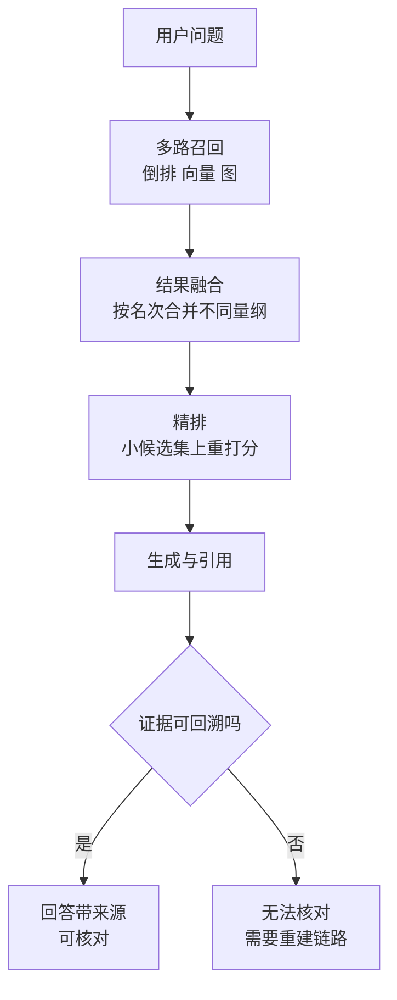
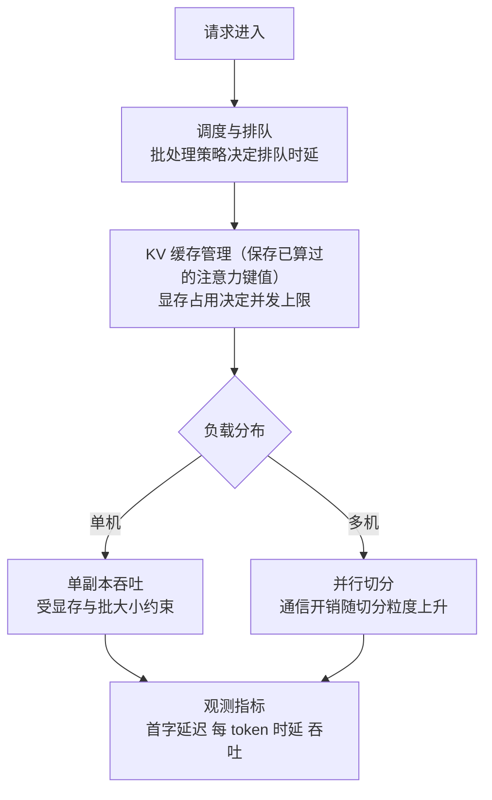

# AI 技术动态

这页汇总 AI 领域的技术动态，按快照（某一时刻的完整只读副本）时间记录。读完这页你能快速看清这段时间发生了什么，以及哪些条目已经有正式结论。

> 当前快照：**2026-10-08**。

**本页记录会快速失效、且已经影响工程选择的实现状态：机制变了、默认行为变了、或者某条路径被移除——这些才写**。**版本与弃用节奏变化快，宣传数字对应的硬件、数据又与你自己的不同，所以不能直接外推到自己的数据、硬件与流量**。

稳定原理与判断方法留在对应主题页。厂商停服排期属于对方的时间表，不是工程知识，本页不逐条罗列；只在它确实要求你提前改代码时才写。

当前唯一需要动手的是 vLLM（开源的大模型推理引擎）：**v0.32 将移除 Model Runner V1（负责模型加载与执行的运行组件）**。**Model Runner 分 V1、V2 两个版本，V2 已是全模型默认，还在引用 V1 的部署要先迁到 V2——迁移要验的是模型加载路径与并发下的显存占用，不是改个版本号**。

## 当前快照下哪些对象的状态已经改变？

模型和框架的发布说明讲的是宣传数字；**真正改变工程选择的是机制层面的变化：默认行为改了、能力边界移了、某个原来可用的路径被移除**。**这类变化让照旧文档写的代码在某个时点之后失效，而失效形态（报错、静默降级、性能塌陷）各不相同——本页记的是这些，不是版本号流水**。本篇要解决的问题：**当前快照下哪些对象的状态已经改变、哪些变化有明确日期、每项变化对应什么工程动作、以及哪些能力仍然停留在观察而不足以成为默认架构**。

## Agent 与互操作进展到哪儿了

这一节讨论的对象有一个共同结构：**模型上下文（一次调用中模型能看到的输入信息总量）有固定上限，请求一旦发出就不再变化，因此单次调用无法容纳全部长期状态，超出部分必须放到外部存储**。**主上下文负责当下这轮决策、外部存储负责长期留存，两者要来回搬运信息才能配合**。分层内存的设计正是把主上下文当缓存、外部存储当持久层。**缓存态随平台下线而消失，只有外部持久层里的状态能保留，所以关键状态必须自己留平台外副本**。

| 对象 | 截至 2026-10-08 的状态 | 工程动作 |
| --- | --- | --- |
| OpenAI Responses API | 当前新集成主接口；Conversations API（承接多轮会话状态的接口）承接会话状态 | 记录实际模型快照；Provider 状态不作为唯一业务状态 |
| OpenAI Assistants API | 2026-08-26 已下线，端点返回 404；Threads（会话线程，保存多轮对话上下文）历史读取同时失效 | 删除残留依赖；提示词、instructions 和工具定义必须有平台外的副本 |
| OpenAI 弃用节奏 | 端点下线后**不是降级，是返回 404**：调用直接失败，不是换个名字就能继续。微调权重与基座模型绑定，基座下线即失效——迁移是重训项目，不是改模型名。完整排期看 [官方弃用时间表](https://developers.openai.com/api/docs/deprecations)；最近一个要动手的是 **10-23**（gpt-4 / gpt-3.5-turbo / o1 / o3-mini / o4-mini / gpt-image-1 及其微调版本） | 清点仓库和配置里写死的模型字符串；10-23 这批波及旧教程代码和全部基于 gpt-4 的微调资产，微调迁移要按重训排期，不是替换名字；图像链路单独验收生成质量，语音链路按官方替换表分批改

| OpenAI Agents SDK Python（SDK 即软件开发工具包） | 0.x 快速演进；官方文档持续覆盖 Runner（驱动一次对话循环的执行器）、tools、guardrails（安全护栏，约束模型行为的规则）、handoffs（交接，把任务转给另一智能体）、sessions（保存会话状态的机制）、sandbox（隔离运行环境，让代码和工具在受控沙箱里跑）、tracing（记录调用过程以便追踪）与 testing（配套测试工具） | 锁定实际版本，用回归工具重测兼容性、核对状态序列化、guardrail、trace 和测试夹具 |
| MCP（Model Context Protocol，模型上下文协议） | 规范 [2026-07-28](https://modelcontextprotocol.io/specification/2026-07-28)：无状态核心、MRTR（多轮工具结果复用）、Mcp-Method/Mcp-Name 路由头（供服务端在路由时识别调用的方法与目标名称）；EMA（企业统一授权，让企业通过统一身份提供方授权访问 MCP 服务器、无需逐个配置）扩展已稳定；Roots/Sampling/Logging 弃用，保底 12 个月窗口；扩展均为可选，需客户端与服务端在初始化时显式协商，当前列有 Tasks（长任务异步执行，带轮询与可持久化句柄）、Skills over MCP、MCP Apps | 新实现采用无状态核心；确认错误码变化（缺失资源从 -32002 改为标准 -32602）；不要再在 Roots/Sampling/Logging 上建新功能；长任务要走 Tasks 扩展，且先确认对端是否协商支持 |
| A2A（Agent-to-Agent，智能体间通信协议） | 已发布规范 1.0.0；协议兼容性使用 1.0，仓库 patch 修订另行核验 | 回归 Agent Card（描述智能体能力与接入方式的元数据卡片）、任务状态、认证、取消与协议绑定 |
| LangGraph（基于图结构编排多步骤 Agent 工作流的框架）Python | 官方文档持续维护，版本快速迭代 | 锁定仓库实际版本，重点验证 checkpoint 重放、副作用（操作对外部状态产生的额外影响）和状态迁移 |
| Google ADK（Agent Development Kit，智能体开发工具包）Python | 官方文档与 SDK 持续迭代 | 锁定仓库实际版本，评估 workflow、memory、MCP/A2A 与部署耦合 |
| Microsoft Agent Framework Python | 官方（[Agent Framework 文档](https://learn.microsoft.com/en-us/agent-framework/)）提供从 AutoGen（微软早期的多智能体对话框架）与 Semantic Kernel（微软此前的智能体开发框架）迁移的路径，仍在快速迭代 | 新项目先做能力与兼容性评估；旧 AutoGen、Semantic Kernel 项目先建立迁移回归集 |
| OpenTelemetry GenAI 约定（为生成式 AI 应用定义统一可观测性字段的规范，覆盖模型调用、token 用量、延迟等）| Development（OpenTelemetry 的成熟度级别之一，位于 Stable 之前，字段仍可能调整） | 内部 schema 保持稳定，在适配层映射实验字段 |

版本和状态的逐项一手来源见 Agent应用工程技术核验（来源层档案，已脱敏）。

Agent 与互操作一节里变动最活跃的是 MCP：规范 2026-07-28 版把无状态核心与 MRTR（多轮工具结果复用）写入正文。MCP 连接的两端，左边是 AI 应用（聊天界面、IDE（集成开发环境）、Agent），右边是数据和工具。

MCP 官方文档把 MCP 比作 AI 应用的 USB（Universal Serial Bus，通用串行总线接口标准）-C（USB 的 Type-C 接口形态，可正反插）接口：AI 应用与数据和工具经同一个标准化协议相连，支持双向数据流。和 USB-C 一样，它只规定两端怎么插接与传数据，不负责数据内容、鉴权和业务逻辑，这些仍由应用自己实现。这个比喻到「连接标准化」为止，不代表接上就能用，工具是否可用仍要逐个验证：

*图源：[Model Context Protocol 官方文档](https://modelcontextprotocol.io/docs/getting-started/intro)（页面截图，2026-09-27）。规范版本一变，这张图两端的应用与服务器实现就要各自回归（重新跑一遍兼容性测试，确认没有破坏原有功能）——表格里「回归工具、状态序列化（把内存对象转成可存储或传输的字节格式的过程）」的核验动作对应的就是协议两端的适配。*

这张图把 Agent 技术栈从下往上分成六层。最下面第一层是物理层：模型跑在装满 GPU 的服务器上。下图是一台装配中的 GPU 服务器，机箱里的加速卡与供电、散热一起决定了**这一层的容量上限**。**每一次推理请求最终都由这台机器的 GPU 执行，所以上层讨论的并发、路由与成本预算，都受这台机器的插槽数和显存（GPU 上的内存、模型参数与计算中间结果都存这里）上限约束**。

> 图：装配中的 Supermicro Nvidia GPU 服务器（Lawrence Systems 机房），来自 [Wikimedia Commons](https://commons.wikimedia.org/wiki/File:Client_Project_Hashcat_Testing_With_an_AMD_Epyc_Supermicro_Nvidia_GPU_Server_Using_Proxmox_(Lawrence_Systems)_08.png)，CC BY 3.0。

来源：[CSDN Agent 技术全景图](https://opc.csdn.net/6a80164810ee7a33f29b410d.html)（CC 4.0 BY-SA）

## 检索与 RAG（检索增强生成）有哪些新进展

**检索链路的每一段都能独立替换，选型时要分别验证而不是整体接受：**

| 对象 | 当前工程判断 | 采用时真正要验证 |
| --- | --- | --- |
| 倒排（倒排索引，按词项反查文档）+ 向量混合检索 | 仍是多数知识问答的可解释基线；RRF（倒数排名融合，按名次而非原始分数合并多路结果，`rank_constant` 控制靠前名次的权重）可融合不同量纲的结果 | 目标问题分桶、候选召回、重复去除、过滤顺序和 `rank_constant` |
| Cross-Encoder（把查询和文档拼在一起整体打分的模型）/ late interaction（查询与文档各自编码后再逐段交互打分） | 适合在小候选集上做精排；不是全库检索的替代品 | top-K、批处理、p95 延迟、语言/领域迁移、分数校准与引用覆盖 |
| 查询改写与 Agentic retrieval（由模型自主决定检索时机与方式的检索） | 处理多轮、省略、多跳和证据缺口；会增加循环与成本 | 原问题保留、最大轮数、停止条件、来源污染和无答案行为 |
| AutoRAG 类 AutoML（自动机器学习，自动搜索模型与流程配置） | 用自己的问题集自动比较切分、召回、重排、提示词和生成组合；属于实验优化层 | 训练/保留集隔离、目标函数、成本/安全约束、可复现和回滚 |
| GraphRAG（基于知识图谱的检索增强生成）| 适合关系链和语料级全局主题；不应成为所有问题的默认路径 | 实体消歧、图更新、原文回指、构图成本和与 hybrid 基线的分桶收益 |
| 开放表格式（Iceberg、Delta、Hudi 是三种代表方案，管理用于统计、报表和查询的历史数据，区别于处理实时事务的业务数据，提供快照与事务能力） | 为文档/事件摄取提供快照、事务、删除和增量读取；不是检索算法 | `source_version -> index_version -> evidence_id` 绑定、删除传播和多引擎一致性 |

**RAG 的有效演进落在证据选择、索引生命周期与自动实验三件事的组合上，组件名称的堆叠不构成演进**。详细边界见 [[工程知识/AI 系统工程：从模型能力到生产能力/知识与检索/检索从一次查询演进为有状态的证据获取]]。

## 推理后端与分布式服务有哪些变化

推理后端宣传的吞吐数字，只有**在排队策略、显存占用与并行切分都给定后才可比较**：

| 对象 | 截至 2026-10-08 的状态 | 采用时真正要验证 |
| --- | --- | --- |
| vLLM | v0.31.0（10-05）：请求级多模态处理参数（`mm_processor_kwargs`、`media_io_kwargs`）不再默认接受——它等于让调用方决定服务端怎么处理多模态输入，现在收紧成显式开关，服务端没加 `--trust-request-mm-kwargs` 时这类请求直接报错；前缀缓存的块哈希输入变了，LoRA 路径计入哈希、附加键按来源打标，LoRA 名与 `cache_salt` 不再互相覆盖；等待队列换成「已持有 KV 块的请求优先」的 KV 持有队列，取代原来的 `skipped_waiting`；新增 `vllm preload` 常驻权重守护进程，把 v0.30.0 的 Fast Start（权重缓存，引擎常驻权重跳过冷加载）从单次加载提速扩成跨重启保留量化后权重；MRV1 的可用组合继续收窄，MRV1 + 流水线并行（PP）大于 1 + 异步调度 + 结构化输出在启动时被直接拒绝；同时移除 `tokenizer_mode="slow"`，在线 `quantization="fp8"` 改走 `fp8_per_tensor`。v0.29.0 起的入口改 `vllm serve`、MRV1 计划 v0.32 移除两项不变 | 升级前用同一基准环境跑相同提示词/并行度/量化对比 TTFT（首字延迟）、ITL（token 间延迟）、OOM（显存不足导致进程被终止）与工具调用正确率；多模态服务要在启动参数里显式开 `--trust-request-mm-kwargs`，不开就是请求直接失败而不是降级；前缀缓存命中率要重测，哈希内容变了之后旧的命中率不再可比，LoRA 与 `cache_salt` 混用的部署要验隔离；还在用 MRV1 的部署按上面那组被拒组合自查，迁 V2 验的是模型加载路径与并发下的显存占用，不是改个版本号；MRV1 目前只留给少数 ROCm（AMD 的 GPU 计算平台，对应英伟达的 CUDA 生态）路径，其余路径已不再支持回退 |
| TensorRT-LLM | 面向 NVIDIA（英伟达，GPU 与加速计算硬件的主要厂商） GPU 的编译、kernel、量化、KV cache 与高性能运行时 | 构建时间、硬件绑定、数值质量、可观测性与目标 workload 收益 |
| SGLang（支持结构化输出与高吞吐的推理服务框架）| 提供结构化生成、缓存与高吞吐模型服务能力，可接入分离式部署 | 模型兼容、调度、缓存命中、稳定性和团队维护成本 |
| NVIDIA Dynamo | 面向多节点推理的数据中心级编排与路由，覆盖 prefill/decode（prefill 处理输入并生成首个 token，decode 逐 token 续写）分离和 KV 传输 | 互联拓扑、KV 传输、两个 worker 池的扩缩比例和故障恢复 |
| Ray Serve LLM | 在推理引擎之上提供多节点放置、路由、扩缩、模型复用与服务组合 | 队列驱动扩缩是否适合 token workload、冷启动、placement 与控制面复杂度 |
| Kubernetes GPU 调度（Kubernetes：容器编排平台，负责容器的部署、调度与自愈） | 通过 device plugin（把 GPU 注册成可分配资源的插件）暴露和分配 GPU 等扩展资源 | 设备发现、拓扑、健康、碎片、队列和模型 SLO 仍需上层处理 |

[vLLM v0.31.0 发布说明](https://github.com/vllm-project/vllm/releases/tag/v0.31.0) · [vLLM v0.30.0 发布说明](https://github.com/vllm-project/vllm/releases/tag/v0.30.0) · [vLLM v0.29.0 发布说明](https://github.com/vllm-project/vllm/releases/tag/v0.29.0) · [vLLM 官方文档](https://docs.vllm.ai/en/latest/) · [TensorRT-LLM 官方文档](https://nvidia.github.io/TensorRT-LLM/) · [NVIDIA Dynamo 分离式服务](https://docs.nvidia.com/dynamo/dev/knowledge-base/concepts/system-architecture/disaggregated-serving) · [Ray Serve LLM](https://docs.ray.io/en/latest/serve/llm/) · [Kubernetes GPU 调度](https://kubernetes.io/zh-cn/docs/tasks/manage-gpus/scheduling-gpus/)

表格首行的 vLLM 在仓库里长这样：**main 分支的提交列表里天天有新 commits（2026-09-26 一天合入八条，9-27 当天又有内核与指标修复合入），「版本快速迭代、升级前先跑基准」在这个提交速率下是日常**：

*图源：[vLLM GitHub 仓库 commits 页](https://github.com/vllm-project/vllm/commits/main/)（页面截图，2026-09-27）。表格里的版本号（v0.29.0、v0.30.0、v0.31.0）对应这条提交流在三个时间点的状态；MRV1 弃用、入口改 `vllm serve` 这类破坏性变化以天为单位出现在这一页的提交列表里。*

推理引擎优化单个模型实例，服务框架处理副本、路由和扩缩，Kubernetes 管理资源放置，平台层负责版本、评测与发布。**它们可以组合，但不能用后一层掩盖前一层的容量瓶颈：例如上层再加副本，也突破不了单个模型实例的显存与吞吐上限，所以每一层的瓶颈都要单独测**。完整关系见 [[工程知识/AI 系统工程：从模型能力到生产能力/推理服务与平台/AI平台必须统一模型、数据、评测与发布版本]]。

## 哪些趋势已经成立、哪些选择仍需证明

| 变化 | 已经成立的工程事实 | 仍需用本地实验回答 |
| --- | --- | --- |
| Continuous batching（持续批处理，在已有序列结束前不断把新请求并入运行中的批次）| 动态填充活动序列比固定批次更适合长度不一的生成请求 | 在目标长度分布下的 TTFT/ITL 与公平性 |
| Prefix/KV cache reuse（共享前缀缓存复用，多个请求共用同一段已算过的前缀计算结果）| 共享前缀可减少重复 prefill，KV 分页可降低碎片 | 实际命中率、租户隔离、失效和显存收益 |
| Prefill/decode 分离 | 两阶段可独立放置和扩缩 | KV 传输成本是否低于隔离收益 |
| 低精度推理 | 权重或 KV 表示可降低容量和带宽压力 | 任务质量、kernel 支持和端到端成本 |
| 多模型/LoRA（低秩适配，在固定基座上挂轻量适配权重）复用 | 共享基座可减少大量稀疏模型副本 | 加载抖动（性能指标不稳定的起伏）、缓存淘汰、路由和隔离 |
| Agentic retrieval | 能按证据缺口继续检索 | 额外循环是否提高真实任务成功率 |
| 推理引擎常驻权重 | vLLM Fast Start 证明重启成本可以压到秒级 | 常驻显存占用与多模型轮换的收益边界 |

## 为什么进入观察而不是默认采用

| 技术 | 为什么有价值 | 为什么不应成为默认架构 |
| --- | --- | --- |
| Agentic retrieval | 能根据证据缺口动态选择查询和来源 | 增加循环、延迟、成本和来源污染风险 |
| GraphRAG | 改善全局主题和关系型查询 | 图构建、更新和实体消歧（判断文本中同名实体是否指同一对象）成本高，非所有问题受益 |
| 多 Agent | 可隔离上下文、权限或并行专业任务 | 通信损失、状态同步和评测面显著增加 |
| 长上下文 | 减少部分预处理和检索步骤 | 容量不等于有效利用、时效、权限与来源治理 |
| 托管 Computer Use | 能覆盖无 API 的界面动作 | 易受界面变化和间接注入影响，验证与沙箱要求高 |
| 全量 prefill/decode 分离 | 能分别优化两阶段 | 短请求、低并发或慢互联下可能更慢、更复杂 |
| 过度张量并行（把模型单层切到多张加速卡上并行计算）| 能容纳大模型 | 小批次通信可能超过计算收益，先用最小并行度 |
| 单一综合 AI 指标 | 看似便于比较版本 | 会掩盖质量、延迟、成本、安全和任务切片的冲突 |

**这些能力在进入生产前，都要在明确的问题切片上跑赢简单基线（正常状态下的指标水平、用来对比异常）；跑不赢就留在观察层**。

## 哪些事件需要立即复查

- **模型、SDK（软件开发工具包）、协议或框架发布破坏性版本**；
- **正式弃用、下线日期或安全公告**；
- **身份、授权、工具调用和数据保留语义改变**；
- **状态、checkpoint、取消或恢复行为改变**；
- **新评测显示当前方案在核心任务切片上系统性失效**。

**新模型名、单个 benchmark 提升、GitHub 热度或营销发布本身不足以改变架构**。

## 维护方法是什么

**每次复查只更新事实行：对象、版本、发布日期、状态、迁移影响和一手链接**。**影响稳定原理时才修改核心主题页；只影响某个实现时，仅更新本页和对应采用记录**。每周例行检查由定时任务执行，扫描来源与更新步骤由维护流程单独维护，不在本文展开。

**动态条目要与原文对账——预写每条动态改变的是协议、接口还是部署方式，复核时与原文对照对不上就撤下该条，不留过期结论**。

## 怎么自己动手验证

1. 来源核对：**每条动态附上规范、发布说明或迁移文档的原文地址，确认结论与原文一致**。
2. 时效核对：**核对 review_after 与各条目的变化速率匹配，高变化条目在下一个复核周期内被重新检查**。
3. 影响判断：**对每条动态写明它改变的是协议、接口还是部署方式，确认对本库其他文章的引用随之更新**。

## 它是怎么做到的，本质是什么

**AI 技术动态的机制层：实现状态按发布日期和弃用时间表变化，稳定原理不随之改变，工程判断却必须建立在当前的一手来源上**。**把事实行与原理分开存放，事实行只记录对象、版本、日期、状态与迁移动作，原理判断留在主题页，任一对象的状态变化都能回溯到具体的发布日期和对应的工程动作**。