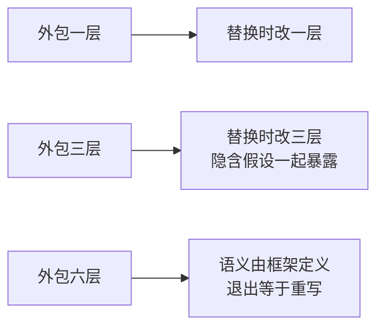
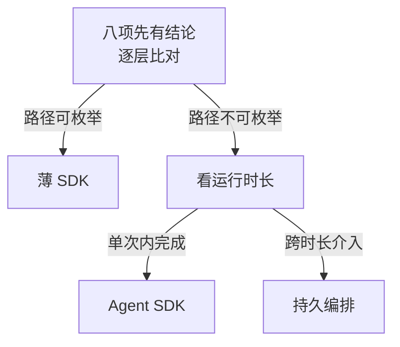

# Agent 系统选型不是框架排名

**这篇回答：选 Agent 框架不能只看排名，要先定自己必须拥有的运行语义；读完你能列出运行语义清单，再判断哪些框架实现值得用**。**「哪个 Agent 框架最好」没有脱离任务的答案**。不同工具覆盖 Provider（模型服务商接入）接口、Agent 循环（模型、工具、观察反复执行的步骤）、图式编排（用节点和边描述流程）、知识接入（检索外部资料）、持久执行（长任务跨时不丢进度）和观测（记录运行轨迹便于排障）中的不同部分。**选型应从自己必须拥有的运行语义开始——运行语义指系统在任务状态、控制流、工具约定与持久化上必须怎样运作、且能验证的约定——再判断哪些实现值得外包**。

## 要解决的问题：一套 Agent 系统里哪些部分必须自己掌握


来源：[稀土掘金 @智泊AI](https://juejin.cn/post/7615229750572269577)（CC 4.0 BY-NC-SA）

**面对多个覆盖范围不同的框架与工具，按流行度或功能数量选择之后，实施阶段发现在运行语义上缺少任务必需的部分，替换成本已经产生**。本篇回答：一套 Agent 系统里哪些部分必须自己掌握、哪些可以交给现成实现、各项能力对应运行语义的哪一段，以及选型应当从什么条件出发。

## 它是怎么做到的，本质是什么

**打个比方：选 Agent 框架像选车——这个比喻只用来说明排名与真实需求的差别，具体该比哪几项、怎么在自己的场景上试，要看正文**。**排行榜告诉你哪辆加速快，但你真要问的是"这车坏了附近有没有修的"（生态与可维护性）、"保险条款保不保我这种路况"（责任边界）、"我要拉货它能不能拉"（真实需求）**。


来源：[稀土掘金 @智泊AI《深度解析 AI Agent》Plan & Execute 一图](https://juejin.cn/post/7615229750572269577)（CC 4.0 BY-NC-SA）

**一套 Agent 系统的核心结构：任务状态、控制流、工具约定与持久化边界必须在系统里由某一层明确承担，框架只是把其中若干层的实现成本降低**。**一套实现覆盖的范围越大，框架替你做的默认决定就越多，其中就有越多你没有明文写出的前提条件，替换时需要改动的代码范围也随之扩大**；自己必须掌握的运行语义与可以外包的实现之间，划分位置决定了**后续的替换成本：未写明的前提越多**，替换时就要把越多正确语义重新证明一遍，成本就越高。

## 为什么先画系统再看框架


来源：[稀土掘金 @智泊AI《深度解析 AI Agent》ReAct 循环一图](https://juejin.cn/post/7615229750572269577)（CC 4.0 BY-NC-SA）

**为什么要在比较产品前先写出这八项？因为不写明，框架会用自带的隐含语义填空，结果往往跟你的任务对不上，而框架只能降低实现成本，不能替你定义正确语义**。要写的有：任务状态、控制流、工具接口约定、持久化边界（哪些状态需要跨进程存活）、人工审批、失败模型（出错、超时、取消时系统如何反应）、评测和部署约束。

| 层 | 常见实现 | 采用时重点比较 |
| --- | --- | --- |
| 模型接入 | Provider SDK、统一适配层 | 错误、流式、工具、结构输出、状态接口 |
| Agent loop | Agents SDK、轻量自建循环 | 最大轮次、工具执行、handoff（Agent 间任务交接）、guardrail（输入输出防护规则） |
| 编排 | 图/事件工作流（以事件触发驱动节点流转） | checkpoint（状态快照，用于恢复）、暂停、并发、恢复和版本迁移 |
| 数据与检索 | RAG（检索增强生成）框架、搜索与数据库 | 解析、索引、ACL（访问控制列表）、重排和引用 |
| 持久任务 | workflow engine、队列 | exactly-once 假设（同一事件只生效一次）、幂等（重复执行结果一致）、补偿（撤销已执行步骤的反向操作）、长等待 |
| 观测评测 | trace/eval 平台 | 数据所有权、开放格式、回放和 grader（评分器） |

**一套框架覆盖的层越多，初期集成越快（预置组件多），迁移和隐式语义风险也越大（预置背后的假设多）**。**这条账按外包的层数算：外包一层（例如只外包模型接入），替换时只改这一层；外包三层（例如模型接入、Agent 循环、编排都交给框架），替换时三层连同它们之间的隐含假设一起暴露；外包到全部六层，运行语义由框架定义，退出等于重写**。



**三层与六层的差别不在代码量：外包层数越多，原本借框架成立的正确性就越多，退出时这些正确性都要自己重新证明一遍，要重证的语义数量才是差别所在**。

## 选型的三种常见起点各适合什么场景？

**取决于两点：任务路径能否事先列全、任务要运行多久；本节先给这两点判据，再分三种起点展开**。买厨具是同一个起点选择：偶尔煮泡面，一口电煮锅就够（薄 SDK）；天天做饭要顺手，买台半自动料理机（Agent SDK）；开餐厅要出餐稳定、能暂停能续做，上商用厨线（持久编排）——三种都是对的，取决于做什么菜。比喻到「按用途选炊具」为止：**厨具买小了可以添，编排运行时选轻了要伤筋动骨地迁数据，所以下面的限制条件要逐条对**。

对前述八项（任务状态、控制流、工具接口约定、持久化边界、人工审批、失败模型、评测和部署约束）先得出自己的结论，再逐层比对任务形态：任务路径可以事先列全的，直接选轻量实现；路径列不全的，再按运行时长逐层挑。这一步要在看任何框架名单之前完成，它把可选范围切成了三块：薄 SDK、Agent SDK、持久编排（下文逐块展开），见下图。

**是否做维度核对，决定了缺失项何时暴露。做核对，缺失项在选型期就浮现；抄排名，缺失项要等上线后才撞上**：



三种起点各有限制条件，不存在优劣排序：每个起点能覆盖的任务范围不同。无论落在哪个起点，替换成本都看自持与外包那条线画在哪一层。

### 哪种团队适合薄 SDK + 自有应用层

**适合流程较短、团队已有成熟后端基础设施、希望保持 Provider 或框架可替换。模型、工具和 trace 用 SDK，状态、权限和业务流留在自己的代码**。代价是**需要自己实现循环和适配**，换来的是**换 Provider 或换框架时业务代码不用重写**。

### Agent SDK 适合什么团队

**适合需要现成工具循环、handoff、guardrail、session 和 tracing，但任务仍主要在单次服务或较短运行内**。半自动料理机上手快（现成工具循环），但它内置的预约程序（session）只管这次做菜的过程（会话上下文），不记你家冰箱的库存（业务状态）——库存得你自己记账，机器一断电，记在里面的账就没了。比喻到「便利件别当账本」为止：**料理机坏了换一台就行，业务状态错乱要重新对账**。**除 session 外还有两项要确认：tool guardrail 是否覆盖所有调用路径；对 provider 的绑定有多深（换模型服务商时改动范围有多大）**。

### 图式或持久编排运行时适合什么团队

**适合长任务、显式分支、暂停恢复、人工介入和并发**。中央厨房的中央控制系统是同一个形态：每道菜到哪道工序有记录（checkpoint 重放语义）、中间半成品怎么存放（状态 schema 迁移）、停一条线其他线不受影响（并发与故障隔离）——**验收中央厨房不看操作屏好不好看（节点 API 是否易写），看停复产演练能不能过**。

比喻到「验收看演练不看屏」为止：**厨房演练停一小时能扛，线上编排停机是业务事故，所以重点验证的是重放与迁移语义**。**重点验证 checkpoint的重放语义、节点副作用、状态数据结构定义（schema）的迁移和生产运维，而不是只看节点 API 是否易写**。

## 比较框架要问哪十个问题

1. **状态由谁定义，能否使用业务类型而不是框架消息对象？**
2. **中断后从节点前、节点内还是节点后恢复？**

**副作用（会改动外部状态的操作，如写库、发消息）会不会重放？**
3. **工具执行、审批和错误是否能替换成自己的实现？**

4. **能否锁定模型、提示词（发给模型的输入指令与背景信息）、工具 schema 和工作流版本？**
5. **trace 是否覆盖模型、检索、工具、状态和人工步骤？**

6. **测试时能否使用确定性模型（给定输入必得相同输出，便于复现）和内存执行器？**
7. **provider、存储和观测能否替换，迁移出口是什么？**

8. **序列化格式升级后，旧 checkpoint 如何恢复？**
9. **依赖失败、取消、限流（控制单位时间放进来的请求数量，超过配额就拒绝）和部分成功如何表达？**
10. **许可证、维护状态、安全公告和发版节奏（release cadence）是否符合团队能力？**

## 当前实现层有哪些选择

截至 2026-09-03，OpenAI Agents SDK、LangChain 的 LangGraph、Google 的 ADK（Agent Development Kit，Google 的智能体开发框架） 和 Microsoft Agent Framework 都在活跃演进，但定位不同。当前版本与迁移状态见 [[工程知识/AI 系统工程：从模型能力到生产能力/生态与选型/AI技术动态]]，不在本页做永久排名。

**下列产品已经停服、被替代或进入维护状态，不能再作为新架构的默认项：OpenAI 的 Assistants API（早期托管对话与工具调用接口）已下线，OpenAI Swarm（早期多智能体编排实验项目）已被 Agents SDK 取代，Microsoft AutoGen（早期多智能体对话框架）进入维护模式**。**历史代码需要迁移，但它们仍可作为设计演进证据**。

## 最小采用实验怎么做

**选两个真实任务实现纵向切片：一个普通成功路径，一个包含工具超时、人工暂停和恢复的失败路径。测量代码复杂度、状态可见性、故障定位、恢复正确性、测试难度和迁移出口**。试驾是同一个动作：光看参数表（框架排名）定不了车，要各跑一趟高速（成功路径）和一趟堵车加烂路（失败路径），油耗、换挡、底盘的真实手感才作数——比喻到「两条路都开过」为止：**试驾不满意可以不买，编排框架上线后换，迁移成本远超试驾，所以切片要真跑**。**框架减少的样板代码如果换来了无法解释的状态语义，就不是净收益：状态语义说不清，排障和迁移都要重新猜测，长期成本会吃掉省下的样板**。


## 动手跑一遍会看到什么：选型维度的账

```text
同一需求（客服工单 Agent），按维度而非框架名的选型表：

  维度 1 任务形态：路径固定（分类→查询→回复）还是开放探索？
    → 固定：工作流引擎足够（成本低、可测强），框架排名前几都用不上
  维度 2 上下文规模：会话要跨天保持吗？记忆体量多大？
    → 跨天：需要状态外置与记忆治理，查这两项的成熟度而非框架热度
维度 3 工具生态：要接的 12 个既有服务有现成协议适配吗？
    → MCP（模型上下文协议，用于把外部工具接进 Agent）覆盖 9 个，剩 3 个自己写适配层（工作量进排期）
  维度 4 可观测与回放：出错后能回放完整轨迹吗？
    → 轨迹日志与每步证据留存是硬需求，缺失此项的方案直接出局
  维度 5 团队能维护吗：升级节奏、breaking change 频率、社区响应
    → 框架排名前十里挑团队读得懂源码的两个

  排名表回答不了以上任何一问——它只回答「大家都在用哪个」
```

**按排名选型的实录——某团队按热度榜选了排第一的框架，上线后发现回放能力缺失（排障全靠猜），补轨迹系统花的功夫超过当初选型的调研量；换成排名第五但回放完善的框架，排障时间从小时级降到分钟级**。反向实录——团队按自建还是购买（build vs buy）的判断框架选择自写编排层（两百分之一复杂度的需求用两百分之一的代码自己写），维护成本完全可控，框架升级风暴与己无关。**两个结局的分岔点都在选型期：维度核对做到位，缺失项当场暴露；直接抄排名，缺失项要等上线后撞上**。

**选型的底层判据与 [[工程知识/软件构建：让变化可以理解、验证与交付/架构与代码/购买与自建的决策框架：每条约束都摆上桌面.md]] 遵循同样的判断方式：把所有约束摆到明面上比较，并把退出时的代价算进账里**。它与 [[工程知识/AI 系统工程：从模型能力到生产能力/Agent与工作流/先用工作流，只有路径无法预先枚举时才使用Agent.md]] 的形态判据衔接。

## 怎么自己动手验证

1. **先行定义：在比较产品之前写出任务状态、控制流、工具接口约定、持久化边界、人工审批、失败模型、评测与部署约束八项，确认每项都有明确结论，缺项与预期对不上就先别比较产品**。
2. **逐层比对：按 Provider 接口、Agent 循环、图式编排、知识接入、持久执行与观测六层列出自己的实现与可外包部分，确认采用决策逐层有依据**。
3. **语义自持：确认框架替换后自己定义的正确语义仍然成立，关键状态与失败处理没有依赖框架私有机制**。

## 接着读哪几篇：同在AI 系统工程里的相邻问题

- [[工程知识/AI 系统工程：从模型能力到生产能力/Agent与工作流/模型负责判断，运行时负责执行语义]] · [[工程知识/AI 系统工程：从模型能力到生产能力/生态与选型/MCP连接能力，A2A委托任务]]
