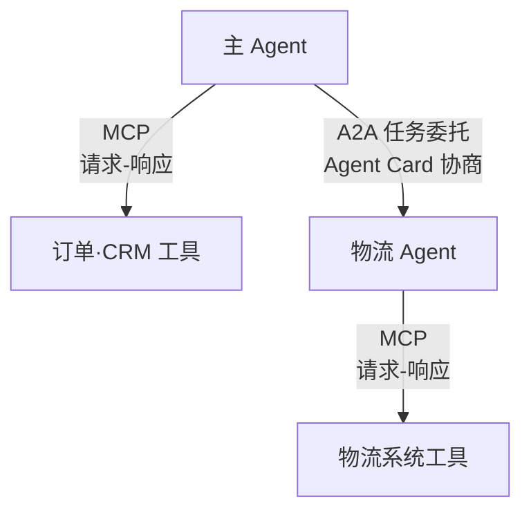
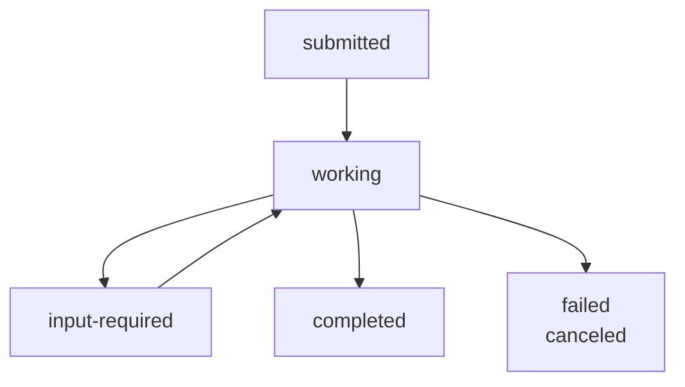

# MCP与A2A的分工：工具协议与Agent协议不互相替代

**MCP（Model Context Protocol，模型连接工具与资源的协议）与 A2A（Agent 间协议，用于智能体互相发现与协作）分别接不同形态的能力，用错协议会把长任务塞进短时的请求-响应里，状态散落、超时从零开始。读完这篇你能按「能力对象是工具还是远程 Agent」选协议。**

团队把「查库存」做成了 MCP server，又把「审批退款」也做成了 MCP server（server 指对外提供工具调用能力的服务端进程），结果发现退款需要多轮确认、有状态推进、有超时取消——硬塞进请求-响应形态的 MCP 后，状态散落在会话参数里——请求-响应协议不保存任务状态，超时后这次会话的参数全部丢弃，一次超时就要从零重跑。要解决的问题：理解 MCP 与 A2A 分别解决什么问题、为什么不互相替代，避免把长时任务塞进短时工具协议。

本质是**连接对象与交互形态的匹配**。**MCP 连接的是工具与资源：能力边界清晰、调用短时、无（或少）状态推进，形态是「客户端请求-服务端响应」；A2A 连接的是远程 Agent：任务是多轮推进、有状态、可挂起可取消、有产物（artifact）与状态通知，形态是「任务生命周期管理」。**

把工具做成 A2A 是过度设计——像给拧螺丝配一整套项目管理流程（引入任务状态机的复杂度换不到东西）；把 Agent 做成 MCP 是形态错配——像拿一次性纸杯当保温壶装整晚的热水（多轮状态塞进单次请求，状态与恢复全要自己造）。这两个比喻只说明复杂度与形态的不匹配，不涉及协议的报文结构。

A2A 官方文档把这种互补画成一张图：应用内部的 Agent 经 MCP Server 取资源与工具，跨系统边界经 A2A protocol 连接对端不加暴露内部状态的黑盒（不接触代码内部、只看输入输出的测试或分析方式） Agent，并用 agent card（远程 Agent 的自我介绍卡片，写明自己能提供哪些能力）发现能力——两层协议各管一个方向：


*图源：A2A 官方仓库文档《Agent2Agent (A2A) Protocol》，https://github.com/a2aproject/A2A（Apache 2.0）。*

## 为什么说这是两层协议，各管哪一层？

打个比方——只是帮助区分层次的类比，不代表协议的报文结构：MCP 像统一的螺丝刀接口（工具怎么接进来），A2A 像工人之间对讲的标准用语（Agent 之间怎么派活）；拧螺丝用哪种刀头，和两个人怎么商量活怎么分，是两件事。这个比喻到「两者管的是不同层」为止：各自的报文长什么样、能力怎么发现、出错怎么传，要看正文。

这个分工有一张官方全景图：A2A 协议主页把两个 Agent 画在组织或技术边界（组织边界指不同公司或部门之间，技术边界指不同技术体系的系统之间）的两侧，边界之上 A2A 连通两侧，边界之内每个 Agent 各自用 MCP 接企业 API 与应用——两层协议在同一张图里各管一段：


*图源：A2A 协议官方文档主页插图，https://a2a-protocol.org/（A2A Project，Apache 2.0 同类开放许可）。图上 A2A 与 MCP 的位置关系就是本篇的判据可视化：A2A 横穿边界连 Agent，MCP 纵向接能力——同一系统里两者并存，管的是不同方向。MCP 把认证、限流（控制单位时间放进来的请求数量，超过配额就拒绝）、协议转换这些通用逻辑集中收拢在工具接入这一层，业务层只面对已经收敛好的接口。*

两层协议并存时，Agent 侧长什么样？多个 Agent 在一个管理者的调度下分工，提交代码的与审查代码的各管一段，形成提交、审查、修复的闭环——Agent 之间互派任务的部分走 A2A 这一层，每个 Agent 内部调工具的部分走 MCP 这一层：


来源：[稀土掘金 @智泊AI](https://juejin.cn/post/7615229750572269577)（CC 4.0 BY-NC-SA）

| 维度 | MCP | A2A |
| --- | --- | --- |
| 连接对象 | 工具、资源（能力单元） | 远程 Agent |
| 交互形态 | 请求-响应（短时） | 任务生命周期（长时、多轮） |
| 状态语义 | 会话级，协议本身无任务状态 | 任务有显式状态机（submitted/working/input-required/completed/failed/canceled） |
| 产物 | 工具结果（同步返回） | artifact（异步产出，可多个） |
| 中断与恢复 | 客户端自己处理超时重试 | 协议内置 cancel、状态查询、推送通知 |
| 适合的例子 | 查库存、读文档、发一条消息 | 审批流、跨 Agent 研究任务、长时编排 |

判据一句话（「能力对象」指这次要调用的东西是什么）：**要调的是可枚举的一次性动作用 MCP；要调的是一个有始有终、有生命周期的过程用 A2A。**放到例子上：查库存一次调用就返回结果，是可枚举的动作，走 MCP；审批退款要多轮确认、状态推进、超时取消，是有生命周期的过程，走 A2A。

**一个系统两者并存是常态：Agent 用 MCP 拿工具，用 A2A 委托任务。**A2A 官网把一次委托里客户端与远程 Agent 之间发生的事归纳成四件：安全协作、任务与状态管理、用户体验协商（协商任务结果怎么呈现给用户，如表单、富文本、流式更新）、能力发现——「有始有终的任务」就是靠这四件事撑起来的：


*图源：A2A 协议官网 How it works 插图，https://a2a-protocol.org/（A2A Project，Apache 2.0）。*

## 用错协议会出什么错？五种失效形态

**五种失效的共同前提是协议形态与能力形态不匹配。**下图展示 Manager 下发任务、各 Agent 各自调工具的分层结构：


在这张分层图里，如果同一个能力（如「查库存」）既在工具层注册成 MCP server、又在 Agent 层注册成远程 Agent，就要同时维护两份描述，改一处漏一处就出现漂移——这就是表里「双协议身份混乱」的由来。

*图源：稀土掘金 @智泊AI《Multi-Agent 系统分层结构》插图，https://juejin.cn/post/7615229750572269577（CC 4.0 BY-NC-SA）。*

| 失效 | 机制 | 信号 |
| --- | --- | --- |
| 任务塞进 MCP | 多轮有状态任务做成请求-响应 | 超时后无法续跑，状态散落会话参数 |
| 工具塞进 A2A | 简单能力包了任务状态机 | 延迟与实现复杂度上升，收益为零 |
| 双协议身份混乱 | 同一能力在两层都注册 | 维护两份 schema，漂移出现 |
| A2A 任务泄漏 | 远程 Agent 的任务 ID 无清理机制 | 任务表无限增长，状态通知一直推给已不存在的接收方 |
| MCP 会话过期 | 长会话挂着不关，服务端会话资源泄漏 | 会话数线性涨，内存涨 |

## 动手跑一遍，两层协议在同一场景里各做什么？

```text
同一场景，两层协议各解决什么（通用形态）：

场景：智能体帮用户「查订单状态并同步给协作伙伴」

MCP 层（Agent ↔ 工具）：
  Agent 通过 MCP 调订单系统的查单工具、CRM 的写入工具
  解决：Agent 与每个工具之间「怎么发现、怎么调用、怎么鉴权」
  形态：一个 Agent 连 N 个工具服务器，点对点集成

A2A 层（Agent ↔ Agent）：
  主 Agent 把「跟进物流异常」委托给物流 Agent
  解决：Agent 之间「怎么声明能力（Agent Card）、怎么交接任务、
        怎么同步进度」（任务级协作，非函数调用）
  形态：对等协商，双方都是自治主体

两层同时在场的形态：
  主 Agent --MCP--> 订单工具（函数级）
  主 Agent --A2A--> 物流 Agent --MCP--> 物流系统的工具
```

层错位的实录——用工具协议做 Agent 间协作的形态：把对方 Agent 的一条能力注册成自己的「工具」，对方内部的多步流程被压成一次函数调用（丢失进度可见性与中途协商能力），对方升级流程后调用方静默失败——工具协议没有能力版本协商，对方改了接口调用方收不到通知，于是不报错地失败；换 A2A 的任务委托形态后，进度事件流与能力卡片版本协商把这些失效点接住。反向实录：把 A2A 用在稳定的内部函数调用上（调用本进程内同构逻辑），协商协议的开销全是白付。判据：对面是「被调用的能力」用工具协议，对面是「有自己状态与流程的自治主体」用 Agent 协议。与 [[工程知识/AI 系统工程：从模型能力到生产能力/Agent与工作流/工具是受约束的能力，不是提示词里的函数名.md]] 的工具观衔接、与 [[工程知识/AI 系统工程：从模型能力到生产能力/Agent与工作流/多智能体只在能并行或需要独立上下文时才值得.md]] 的多智能体（能感知环境、调用工具、自主完成多步任务的 AI 程序）边界衔接。

## 这套说法在哪儿会失效

工具协议的价值在于把访问外部能力的通用逻辑收拢到一处，业务进程只面对本地接口——这个形态与大使模式（在业务进程旁放置一个代理进程统一处理外部访问，业务侧只看到本地接口）一致。


- 协议不解决权限模型：MCP 的工具调用与 A2A 的任务委托都需要运行时鉴权（主体、scope、审批），协议层只定义消息形状，权限仍要应用层做，这与工具约定的原则一致（见 [[工程知识/AI 系统工程：从模型能力到生产能力/Agent与工作流/工具是受约束的能力，不是提示词里的函数名]]）。
- A2A 的任务状态机与 Agent 内部状态机是两个层次：A2A 管理任务在两个 Agent 间的可见状态（对任务委托方透明），Agent 内部怎么切分状态是自己的事（见 [[工程知识/AI 系统工程：从模型能力到生产能力/Agent与工作流/Agent状态机与任务恢复：进度是状态不是聊天记录]]）；不要把内部状态映射成 A2A 状态。
- 两个协议都在快速演进：版本绑定要显式，升级要重测兼容性；公开规范链接见 sources。
- 选型判断与范式选择独立：ReAct（推理与行动交替进行的循环范式）/计划-执行（先定计划再逐步执行）决定「Agent 自己怎么行动」（见 [[工程知识/AI 系统工程：从模型能力到生产能力/Agent与工作流/ReAct计划执行搜索：三种行动范式的适用边界]]），MCP/A2A 决定「能力怎么连接与委托」；一个系统两个决策都要做，互不替代。

两层协议在同一个场景里各管一段：MCP 层解决 Agent 与工具之间「怎么调用能力」，A2A 层解决 Agent 与 Agent 之间「怎么协作任务」。下图展示同一场景里两层各走一条线：



主 Agent 对工具是调用者（点对点请求-响应）、对物流 Agent 是委托方（任务级状态推送与 artifact）——两种身份走两种协议，能力发现与鉴权语义各自成立。

## 怎么自己动手验证？

先看要验证的机制本身：A2A 的价值集中在任务的中间态上——可挂起、可取消、可按任务 ID 续跑，这些状态在请求-响应形态里无处安放：



让「中途终止进程后还能接着跑」成立的是任务状态持久化在服务端、可凭任务 ID 查询：中断后查到的无论是 working 还是 input-required（挂起等待补充信息），都能从断点续跑；failed 可重试，canceled 由协议内置取消。换成请求-响应形态，中断就只剩从零重跑一条路。

协议分工要与两种形态对照对账——预写任务生命周期形态在中途终止后可续跑、请求响应形态只能重跑，实测与预期对不上就说明任务状态没有被真正持久化。

最小验证：构造一个需要多轮推进的任务（如「搜索-整理-生成报告」），分别用 MCP 形态（请求-响应）与 A2A 形态（任务生命周期）实现各一份：断言 A2A 版本在中途 kill 进程后可通过任务状态查询恢复续跑，而 MCP 版本无法恢复只能重跑；再对比两者的空载开销：同一简单任务分别走 A2A 与走 MCP，先测出 A2A 比 MCP 多花的毫秒数；这个数字接近零，就能确认 A2A 的任务状态机对简单工具没有引入负担。最后做一次协议身份审计：列出全部注册能力，断言无同一能力双层注册。

关系：[[工程知识/AI 系统工程：从模型能力到生产能力/生态与选型/模型、框架、运行时与协议解决不同问题]] · [[工程知识/AI 系统工程：从模型能力到生产能力/Agent与工作流/工具是受约束的能力，不是提示词里的函数名]] · [[工程知识/AI 系统工程：从模型能力到生产能力/Agent与工作流/Agent状态机与任务恢复：进度是状态不是聊天记录]]

同族：[[工程知识/AI 系统工程：从模型能力到生产能力/生态与选型/编辑器与编码代理的通信通道：能力协商与连接归属]] —— 工具能力与界面交互分属两条协议线
