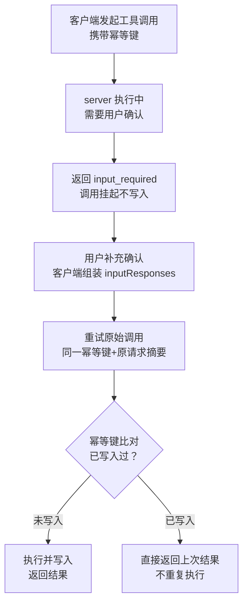
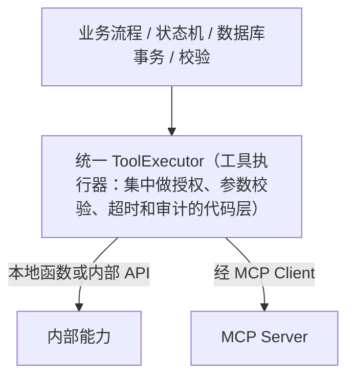
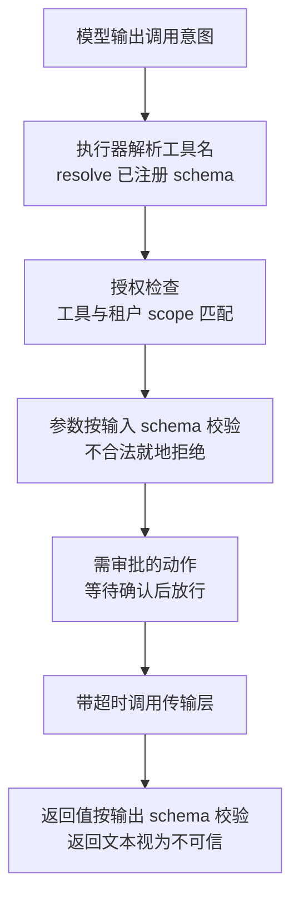

# MCP接入必须验证协议、身份与工具约定

**把 MCP（Model Context Protocol，模型上下文协议）作为大 Agent（由模型驱动、能调用多种工具完成任务的完整智能体应用）的一个子模块**：业务代码仍由普通函数、HTTP 或数据库接口组成，**需要跨应用发现、共享或隔离部署的能力通过 MCP 暴露，其余留在进程内**。本文讲接入上线前必须核验的**协议、身份与工具约定**；读完你能列出一份接入检查清单，并判断**哪些能力不该暴露成工具**。

## 要解决的问题：哪些能力只适合用普通接口直接实现

答案先说：**服务身份、能力范围、输入输出结构与实际实现的一致性、副作用（操作对外部状态产生的额外影响）与超时行为，这些协议都不管，只能由应用自己的代码来做**。接入前没核对，这些问题接通前无从发现，要等到真正调用时才显现。全文按四部分展开：**哪些能力只适合用普通接口直接实现、暴露为 MCP 服务需要满足什么条件、接入前要逐项确认哪些内容、版本不兼容以什么形式出现**。

## 它是怎么做到的，本质是什么

*图示：MCP 初始化时序——连接建立后先交换协议版本与能力清单，然后才进入工具调用。图源：Wikimedia Commons《Model Context Protocol Initialization sequence diagram》，作者 modelcontextprotocol developers，MIT，https://commons.wikimedia.org/wiki/File:Model_Context_Protocol_Initialization_sequence_diagram.svg。这张图上"协商完成"只代表双方说好了怎么说话，不代表说的内容可信——下面这层核对正是协议不管、必须由应用侧补上的部分。*

协议到底管什么？MCP 协议这一层官方规范写明**只管两件事：能力描述（服务端列出自己提供哪些工具及各需什么参数，通过 tools/list 接口由客户端拉取）和调用传输（双方用什么格式把消息发过去、把结果传回来，即 JSON-RPC 消息的发送与结果回传）**。

服务身份、授权范围、输入输出结构与副作用语义，规范都不覆盖，由应用侧承担。接入时执行器（应用侧集中做授权、参数校验、超时和审计的代码层，见后文统一 ToolExecutor）做一次发现，把结果写成配置文件；**这份文件只反映发现那一刻的服务端能力，需要重新发现才会更新**。

之后每次调用仍要执行器逐次核对**工具是否可用、参数是否合法、是否越权（访问了权限范围之外的资源）**。热更新只替换了配置文本，没有触发执行器重新拉取服务端能力并逐项比对，**工具未经核对就交给模型调用，启动时建立的那层核对随之失效**。

协议自身分两层：**数据层规定消息的结构与含义，传输层规定消息如何送达**；两者分开便于更换传输方式而不改内容格式。参与方有三个：**Host 是运行模型的应用，Client 是模型侧连接器，Server 是提供工具的一方**。官方 Architecture 页有完整定义——接入前对「谁在说话、协议管到哪一层」建立坐标系，就在这页：

*图源：modelcontextprotocol.io 官方文档页面截图（2026-09-27），https://modelcontextprotocol.io/docs/concepts/architecture。*

## MCP 从基础到演进怎么走

| 层次 | 关键问题 | 实践焦点 |
| --- | --- | --- |
| 基础 | MCP 连接谁、暴露什么？ | Host/Client/Server、resources/prompts/tools（MCP 暴露的三类能力：资源、提示、工具）、JSON-RPC（MCP 采用的远程调用消息格式）和 schema（接口的参数与返回结构描述） |
| 演进 | 如何在生产规模运行？ | 2026-07-28 无状态核心、`server/discover`、header routing（通过请求头路由）、可缓存 list（可被客户端缓存的能力清单） |
| 原理 | 如何完成跨请求交互？ | 显式句柄、MRTR、Tasks extension、客户端驱动重试 |
| 边界 | MCP 能保证什么？ | 只标准化传输和能力描述；授权、幂等、审批和回滚仍由应用强制 |
| 实践 | 如何安全接入？ | 新旧版本并行、contract test（契约测试，预先校验 schema 与错误码约定的自动化测试）、风险分级、审计、超时、熔断（错误率过高时暂时断开调用快速失败）和降级（压力过大时关闭次要功能，保住主流程） |

## MCP 到底负责什么？哪些必须由应用自己负责？

| 问题 | MCP 负责 | 应用仍需负责 |
| --- | --- | --- |
| 能力发现 | server capabilities、tools/resources/prompts 描述 | 允许清单、schema 裁剪和产品语义 |
| 协议通信 | JSON-RPC、传输和结果封装 | 超时、取消、重试、熔断和连接池 |
| 身份认证 | 按传输采用规范的认证握手 | 用户/租户授权、scope（权限范围，限定能访问哪些资源）、允许清单（限定可调用的工具集合）、审计和数据驻留 |
| 工具执行 | 将调用请求交给 server | 参数校验、幂等、审批、回滚和副作用控制 |
| 版本选择/探针 | `server/discover`（可选预取）、能力和协议版本 | 锁定 SDK、contract test、迁移与回退 |

2026-07-28 规范移除了两类东西：**协议层会话（连接建立后双方维持的有状态上下文，相当于接通电话后一直占着这条线）和 `initialize`/`initialized` 握手**（旧版客户端与服务端在调用前交换协议版本与能力的固定流程，相当于打电话先报工号确认身份）。现在的做法是**每次请求自带身份与版本信息，不再占线**。

替代机制看下面两段。一是 Streamable HTTP POST（MCP 的 HTTP 传输方式，POST 请求带上消息、响应可流式返回）：它使用 headers 与 `_meta`（消息自带的元数据字段）自描述；stdio 等传输按各自规范字段传递版本，并以 `server/discover` 提供可选的能力预取（需要时客户端可提前拿一份服务端能力清单备用，不用也可以）。

因为版本与能力随每个请求自描述，**这些字段与 discover 合起来取代了原握手的版本协商和能力交换作用**，客户端不用先建立会话，也能完成原本靠握手完成的版本与能力确认。二是长任务不再挂在会话上：**Tasks 成为 `io.modelcontextprotocol/tasks` 扩展**，是 MCP 为长时间运行的操作提供的机制，客户端可查询进度、获取结果或取消任务；它与下节的 MRTR 配合使用，前者承载长任务的状态查询与取消。

旧版 server 仍可能使用有状态会话。生产网关（站在客户端与后端服务之间的入口层，集中处理路由、鉴权与协议转换）应对每个接入客户端做版本探针（请求到达时检测它支持的版本，据此选对应的处理路径）并保留兼容路径——这样新旧客户端都能接通，不探就只能按单一版本处理、另一侧会连不上。

不能根据一份旧配置猜测传输和授权语义。[MCP 2026-07-28 发布说明](https://blog.modelcontextprotocol.io/posts/2026-07-28/)

### 为什么无状态不等于无状态应用

协议不再替应用保存 session。若工具需要跨调用状态，应返回显式句柄（如 `basket_id`、`browser_id`），像取号排队——**显式句柄就是那个号，后续调用凭号继续办理**，而不是**系统替你记着**（比喻只到「状态由调用方持号」为止）。这样状态有**明确所有权、可入库、可审计**，也能在普通负载均衡（请求随机分给任一实例、不挑实例）下路由；代价是**模型/客户端必须正确传递句柄**，应用要处理**过期、租户绑定和重放保护**。

### 原理：MRTR 如何替代服务器主动请求

MRTR（Multi-Round Trip Request，多轮往返请求）是**工具执行中的往返确认机制**：服务器在执行工具时发现缺参数或需要用户授权，主动向客户端发出确认请求，调用先挂起，等用户补充确认后再带着确认信息重试。举例：工具要扣款，服务器先暂停，等用户确认金额后才真正执行。

当工具在执行中需要用户确认或补充参数，2026-07-28 服务器返回 `resultType: "input_required"`，客户端带 `inputResponses` 重试原始调用。重试必须具备**幂等（同一个操作执行一次和执行多次的结果相同，重复执行不会产生额外副作用）键和原请求摘要校验，防止用户确认后重复写入**；对于长任务，MCP 按 SEP-2663（Spec Enhancement Proposal，规范增强提案，编号 2663）提供了 Tasks extension——需**客户端与服务端双方都同意开启才能用**。

开启后 Tasks extension 提供三个 MCP 标准方法：`tasks/get` 查询任务当前状态，`tasks/update` 修改任务参数或配置，`tasks/cancel` 终止正在运行的任务。不要把任务状态藏在传输 session 中。

接入完成后要回头核对：客户端只调用服务端声明过的能力、违反输入约束的参数被拒绝。这一步是为了验证协议层不管、必须由应用侧补上的核对是否真的生效；任何一条与实际行为不符，就说明工具约定还没核验到位。

## 为什么协议版本与路线图要分开

2026-07-28 是稳定规范；MCP roadmap 中的 agentic messaging（智能体间消息传递）、webhooks/channels（事件订阅通道）、DPoP/WIF（Wi-Fi 接口）/token exchange 是三类仍在草案阶段的身份凭证机制，它们让工作负载替自己领身份令牌：DPoP 给每个请求绑定密钥防重放；WIF 即 Workload Identity Federation，工作负载身份联合，好比机器代员工刷卡进楼、但只限这台机器；token exchange 是令牌交换。三者的区别在「密钥绑在哪一层」；「刷卡进楼」这个比方只到「替别人领身份」为止，密钥具体绑在哪一层要看正文。渐进式工具发现和 SDK conformance（SDK 即软件开发工具包，conformance 指一致性测试）。SDK 一致性测试属于未来方向，不能当作当前协议保证：实现时只依赖已发布 schema 和 SDK migration guide，路线图用于预留接口而不是提前绑定。

## 为什么是 80% 普通代码 + 20% MCP

（这个比例是经验示意：纯内部函数可以全部用普通代码，只有**跨应用共享、需要隔离部署的能力**才计入 MCP）。

推荐边界：

统一执行器的最小接口：

~~~python
async def invoke(tool_name, args, context):
    spec = registry.resolve(tool_name)
    policy.authorize(spec, context)
    validated = spec.input_model.model_validate(args)
    if spec.requires_approval（是否需要人工批准的字段）:
        await approval.wait(spec, validated)
    result = await transports[spec.transport].call(
        spec, validated, timeout=spec.timeout_ms
    )
    return spec.output_model.model_validate(result)
~~~

**模型只生成调用意图，不能直接决定权限或执行 Shell/SQL**（Shell 是操作系统命令，SQL 是数据库查询语句）。**执行器必须在模型之外做授权、参数和输出校验；MCP server 返回的文本也要视为不可信数据**。

从模型输出一句话到工具真正被执行，中间每一段都由执行器把关，像机场安检逐关检查，每关不放行就不能进下一关（比喻只到「逐关校验」为止）：

这张图对应安检比喻的每一关：**模型只提供意图，工具名解析、授权、参数校验、审批、超时与返回值校验全部在执行器里逐次发生**。跳过其中一关会发生什么？**对应环节的约束就失效：跳过参数校验，越权或畸形参数会直接传给 server；跳过授权检查，任何工具都能被调用**。

## 最少要配哪几个字段

~~~json
{
  "name": "support.create_ticket（创建工单的工具名）",
  "transport": "http",
  "server": "support-mcp",
  "protocol_version（协议版本字段）": "2026-07-28",
  "allowed_scopes（允许的权限范围字段）": ["ticket:write"],
  "risk": "write",
  "requires_approval": true,
  "timeout_ms": 8000,
  "retry": {"max_attempts（最大重试次数字段）": 1},
  "idempotency": "required",
  "input_schema": "registered-schema-id",
  "output_schema": "registered-schema-id"
}
~~~

配置文件只是一次声明，**不代表服务端真的如此**。真正的**依据来自启动时重新发现工具、逐项比对 schema 的结果**。热更新跳过了这次重新发现与比对，等价于**绕过了核对环节**，相当于换了锁芯却沿用旧钥匙，没人核对新锁到底认哪把钥匙（比喻只到「未重新核验」为止），所以**变更必须触发人工审查或 contract test，不要支持未审计的「热更新后立即给模型使用」**。

## 上线要检查哪些项

接入方多了，请求量与故障面随之上升，单靠应用内控制不够，**限流（控制单位时间放进来的请求数量，超过配额就拒绝）是不可省的一项**。限流的形状很直白：资源占用随请求量上升，超过阈值**后开始拒绝**，把占用压在可控区间。

*图源：[Azure 架构中心「Throttling」模式](https://learn.microsoft.com/zh-cn/azure/architecture/patterns/throttling)官方配图 throttling-resource-utilization.png，Microsoft，许可 CC BY 4.0。*

- [ ] server 身份、来源、版本、许可证和网络出口已审核。
- [ ] 只暴露当前租户和任务需要的工具；scope 在执行时再次验证。
- [ ] 读、写、删除、发送和扣费动作有风险等级、审批和回滚（把系统状态退回到改动之前的版本）。
- [ ] 输入/输出 schema、错误码、超时、取消、重试和幂等行为有测试。
- [ ] 记录 tool name、版本、参数摘要、调用者、审批、结果状态、耗时和成本；敏感内容脱敏（遮盖敏感字段的部分内容、保留可辨识形态）。
- [ ] MCP 不可用时有普通代码或人工回退；升级前验证旧版/新版协议互操作。
- [ ] 新版 Streamable HTTP POST 请求的 `MCP-Protocol-Version`、`Mcp-Method`、`Mcp-Name` headers 和 `_meta` 均有约定测试；stdio 等其他传输按规范使用对应 `_meta` 字段，旧版握手路径有明确下线日期。
- [ ] `tools/list`、`resources/list/read` 的 `ttlMs`/`cacheScope` 缓存键包含租户、身份和 schema 版本；权限变更可主动失效缓存。
- [ ] MRTR/Tasks 重试使用幂等键（请求自带唯一标识，重复提交只生效一次）、任务句柄租户绑定和状态机；断线、重复提交和取消均有负向测试。

## 哪些情况不该用 MCP

同一进程内、数据结构稳定、延迟敏感且不需要跨团队复用的函数，为什么要用普通代码而不用 MCP？因为这些场景**没有跨应用发现或隔离部署的需求**，引入 MCP 只会增加序列化（把内存对象转成可存储或传输的字节格式的过程）与网络跳转的开销。**MCP 适合跨应用共享、需要独立部署的能力**，这类能力交给 MCP 之后生态里其他应用也能复用；**它不适合承载所有功能**。Agent 的整体编排和风险控制见 [[工程知识/AI 系统工程：从模型能力到生产能力/Agent与工作流/构建可靠Agent应用]]。

## 怎么自己动手验证

1. 能力协商：连接后核对**初始化交换里的协议版本与服务端声明的能力集合**。预期是**客户端没有调用服务端未声明的能力**，实际行为与预期对不上就先停下排查。
2. 约定核验：对每个工具用符合与违反输入 schema 的两种参数各调一次，确认**违反 schema 的参数被拒绝，返回值与声明的输出类型一致**。
3. 超时与版本：人为让服务端延迟超过约定时限，确认**调用按超时终止；客户端与服务端版本不兼容时连接明确失败**。

