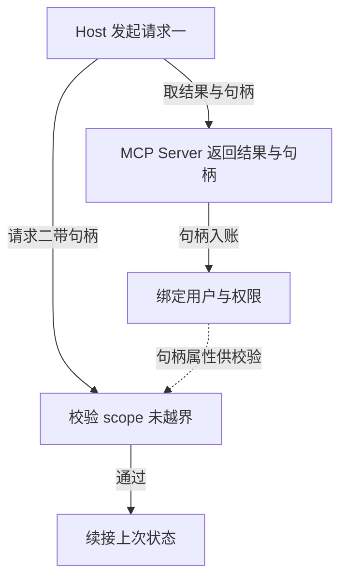
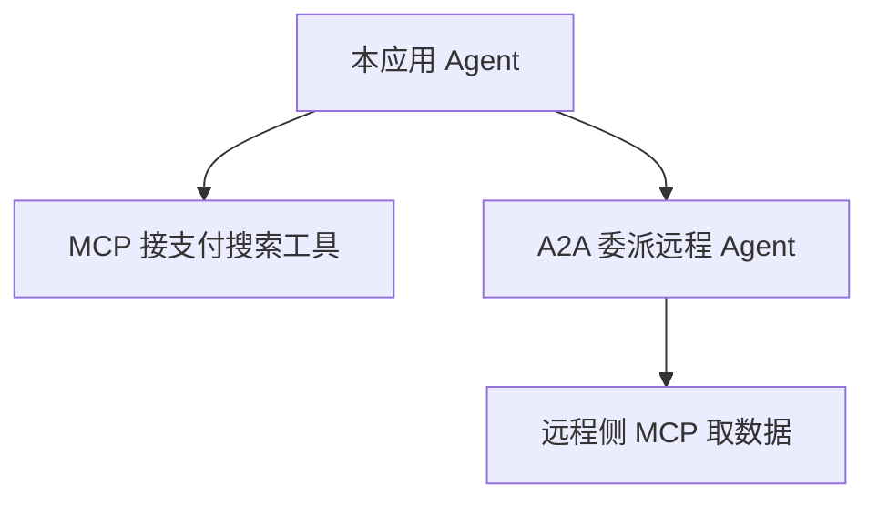
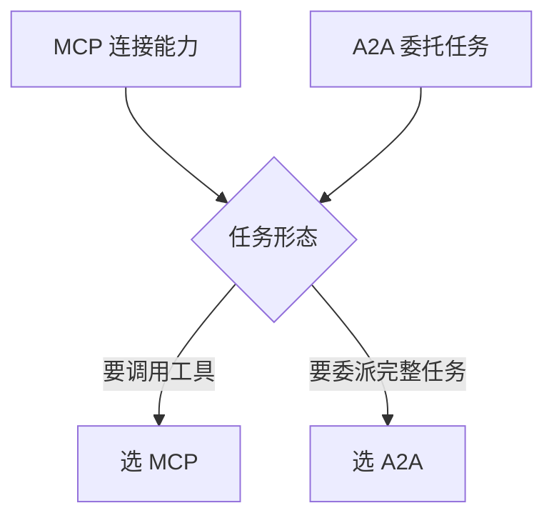

# MCP连接能力，A2A委托任务

这篇对比 MCP（Model Context Protocol，模型上下文协议）与 A2A（Agent2Agent 协议，Google 主推的 Agent 间协作协议）：**一个连接工具，一个委托任务**。读完你能分清两种协议各自该用在什么场景。**MCP 让 Host（承载模型与用户交互的宿主应用）发现并使用外部工具、资源和提示；A2A 让一个独立 Agent 把任务委托给另一个独立 Agent，并观察任务、消息与产物状态**。**两者的适用范围限于工具发现与任务委托，不覆盖权限校验、业务流程编排和内部接口，这些仍由应用自己承担**。

## 连接能力与委托任务差在哪

来源：[稀土掘金 @智泊AI](https://juejin.cn/post/7615229750572269577)（CC 4.0 BY-NC-SA）

**协议名称相近、都用于 Agent 之间的互操作，实际抽象的对象不同：MCP 只暴露工具而非任务状态，A2A 只委托任务而非发现工具**，**选错一侧便缺另一侧的能力**，具体表现为缺少任务状态跟踪或缺少工具发现能力。本篇回答：两种协议各自让一侧的能力被另一侧使用、各自传递什么状态、各自不适合承担哪些职责，以及它们与应用内部工作流、权限体系和业务接口之间的位置关系。

## 它是怎么做到的，本质是什么

*图源：稀土掘金 @智泊AI 插图，https://juejin.cn/post/7615229750572269577（CC 4.0 BY-NC-SA）。*

从机制上看：**MCP 描述的是能力，Host 通过它发现并调用外部工具、资源与提示；A2A 描述的是任务，一个独立部署的 Agent 把任务交给另一个并观察其状态与产物**。下图 ReAct 循环里的每一步「行动」走的都是这两类通道：**调用本方工具走 MCP，委托外部 Agent 走 A2A**。

**两者的抽象对象不同，能传递的状态也不同**。**远程结果与本地预期不一致时如何检测、会话状态如何保存、任务所有权与验收责任归谁，这些都需要调用方的运行时来处理**：结果是否对得上，**靠本地比对返回内容与预期结构**；状态在请求之间，**由调用方自己保存与续接**；所有权与验收责任，**在委托时绑定到具体执行记录与主体**。

## 这四种连接方式该怎么区分

| 选择 | 对端是什么 | 交互核心 | 何时使用 |
| --- | --- | --- | --- |
| 本地函数/内部 API | 同一应用控制的能力 | 请求—结果 | 内部边界清晰，不需要动态发现 |
| MCP | 工具或知识服务 | tools、resources、prompts | 跨应用复用能力与标准化接入 |
| A2A | 独立部署的 Agent | Agent Card、Message、Task、Artifact | 跨团队或跨产品委托长任务 |
| 工作流引擎 | 本应用的节点与状态 | 状态转移、事件、恢复 | 自己拥有端到端流程和一致性 |

**同一进程里把两个提示词（发给模型的输入指令与背景信息）角色称为 Agent，不需要 A2A；业务服务已经有稳定 API，也不必为了接入模型再包一层 MCP**。

## MCP 现在的规范怎么说

截至 2026-09-03，发布规范为 `2026-07-28`。**该版本核心转向无状态请求/响应（每次请求自带所需上下文，服务端不保留上次调用的记忆），用每请求元数据表达版本和能力**；**协议级 session（协议层维持的连接上下文）与旧初始化握手（连接建立时双方协商版本与能力的步骤）被移除**，多次请求之间需要保留任务信息（跨调用状态）时，**由工具显式返回句柄（用于续接跨调用状态的凭证，下次请求带上它服务端才能认出这是同一次任务的延续）**。**Tasks（任务这一层抽象）是扩展，不是核心协议**。

**这次变化的工程含义是：远程 MCP 更容易横向扩展（增加实例分担流量）和经过网关（统一入口与转发），但应用不能再把隐式连接状态当作业务状态**。**工具返回的句柄需要和用户、租户、权限及过期时间绑定**。可以把句柄想成寄存柜的小票：句柄在手才能续接状态，就像小票在手才能开柜取物，服务端保存的数据对应柜子里的物品，这个比方只到凭票取物为止。**柜子不会过期，句柄会。过期时刻由服务端裁定，不是持票人说了算**。

协议级 session 移除之后，跨调用的状态由谁携带、在哪一步绑定租户与过期时间，只剩图上这条时序——请求二携带同一句柄回来，服务端校验 scope（授权范围）未越界后才能续接上次状态：

协议只规定句柄怎么传与怎么校验格式，判断越没越界要靠服务端自己比对绑定范围，**于是授权不能指望协议兜底**：图上句柄只在绑定范围内有效，**越租户、超期、跨 server 转交 token（访问令牌，OAuth 流程里证明调用权限的凭证）三件事都得由服务端与运行时自己拦**。

**MCP 授权只规定传输与 OAuth（开放授权框架，让应用在不拿到用户密码的前提下获得有限授权）等互操作要求**。**服务端仍需对每个资源和动作完整授权**；**客户端不能把一个 server 获得的 token 转交给另一个 server，也不能因为模型发现某个工具就自动扩大 scope**。

## A2A 现在的规范怎么说

截至同一基准日，A2A 规范主版本为 1.0，固定规范页为 v1.0.0，官方仓库 patch（补丁）修订另行核验。它定义 Agent Card（描述一个智能体能力与接口的自述文件）、Message（Agent 之间传递的消息）、Task（一次委托的任务）、Artifact（任务产出的结果数据或文件）、流式更新、推送、取消和协议绑定。

A2A Task 是远程协作对象，不等于**应用内部 checkpoint**（检查点，应用内部记录执行进度与状态的位置）。**调用方仍需把远程 task id 绑定到自己的 run（一次执行记录）、主体和目标 revision（版本快照，标明这次委托针对哪个版本的目标）**；远程 Agent 上报的任务状态为 completed（A2A Task 的状态取值之一，表示远程 Agent 声明任务已结束）时，**仍须经过本地验收，不能直接升级为业务成功**。

A2A 协作的三步工作流有官方中文版讲解，IBM 的协议页把发现、身份验证、沟通画成一段完整流程：客户端智能体（能感知环境、调用工具、自主完成多步任务的 AI 程序）先发现远程智能体并取其智能体卡，按卡片声明的安全方案（卡片里写明支持的身份验证方式，如 API Key 或 OAuth）完成验证，之后才进入任务沟通：

*图源：IBM 官方中文页《A2A 协议》，https://www.ibm.com/cn-zh/think/topics/agent2agent-protocol，页面截图。中文图对位上文 Agent Card 三个职责：卡片在发现步被取走、在验证步声明安全方案、在沟通步支撑任务交接。*

## 两个协议怎么一起用

两个协议在一个系统里可以组合：本应用 Agent 用 MCP 接支付搜索工具，同时用 A2A 委派远程 Agent，远程侧再用 MCP 取数据：

协议组合会把远程工具、数据流向、租户归属这几条信任关系像链条一样串起来，这几条信任关系各是一环、互相依赖，**任何一环被攻破，攻击面都会顺着组合关系扩大到其余两环**，这个比方只到断一环整条失效为止。**所以三件事都要端到端审计（对整条链路逐段留痕核对）：远程 Agent 用了哪些工具；数据流向了何处；结果属于哪个租户**。**Agent Card、工具描述和远程产物都属于第三方输入（来自外部、未经本地校验的内容，可能被篡改）**。

## 采用前要先答哪几个问题

- **是否真的存在独立部署或跨语言复用需求？**
- **对端身份、版本、能力列表和 schema（接口结构定义）变化如何验证？**
- **用户身份如何委托，token audience 和 scope 如何限制？**
- **长任务如何取消、超时、恢复和避免重复副作用？**
- **远程结果如何绑定来源，如何在本地独立验收？**
- **协议升级是否有新旧版本并行、探针（向系统注入的检测点或检测请求）、兼容测试和回滚（把系统状态退回到改动之前的版本）路径？**

**如果这些问题没有答案，协议只接上了通道：对端可信与否没人验证、结果可认与否没有本地验收，等于把信任交给了未确认的一方，信任边界没有闭合，系统边界也就没有真正建立**。

## 怎么自己动手验证

两者解决的是不同层次的问题：MCP 做能力接入，A2A 做任务交接。这张图按任务形态在两个协议之间做选择，之后按三步核对自己是否用对了协议：

1. 抽象对象核对：**按需求确认对端是工具与知识服务还是独立的 Agent，选择对应的协议，两个协议的使用场景不混用**；预写对端类型再选协议；**选错了协议，把应走 A2A 的长任务误用 MCP，MCP 没有任务与产物的状态通道，任务和产物的状态变化就观察不到**。
2. 边界核对：**确认权限系统、业务 API 与应用内部工作流仍由自己的系统承担，没有因为引入协议而被协议替代**。
3. 状态观察：**发起一次委托后确认能观察到任务、消息与产物的状态变化，任务失败时失败原因能追回被委托方**。

## 效果从哪儿来，要付什么代价

区分两种协议的抽象对象带来的收益是**接入前的判断有据：跨应用复用能力与跨团队委托任务各自**找到对应的协议，避免只为两个提示词角色之间的一次调用就引入完整协议栈——**多出的握手、状态管理与版本协商都是白付的成本**。代价在**组合节已经展开：第三方输入带来的端到端审计与本地验收**成本是主要部分，此外还有**每次调用多一次网络跳转的延迟、多一层服务需要部署与监控、跨协议排查问题时追踪链路更长**。

## 还想顺着这条线读哪几篇？

同在 AI 系统工程里的相邻两篇：

- [[工程知识/AI 系统工程：从模型能力到生产能力/Agent与工作流/工具是受约束的能力，不是提示词里的函数名]] · [[工程知识/AI 系统工程：从模型能力到生产能力/生态与选型/AI技术动态]]
