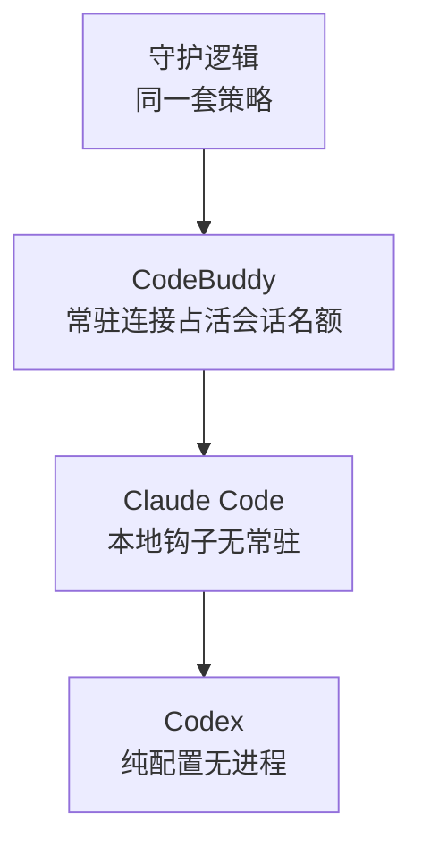
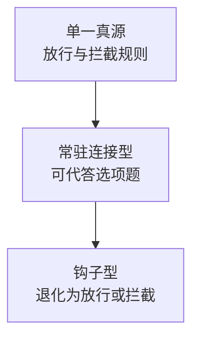

# 多 AI 客户端的统一接管：hooks、配置与常驻连接的三种适配

给多个 AI 客户端统一配一套守护（一套自动应答、自愈与监控的外部接管程序），第一件事是**搞清楚每个客户端到底通过什么机制接入外部控制**。读完这篇你能判断守护该写在哪、占不占资源、会不会互相干扰。
每个客户端「被外部接管」的方式完全不同：**有的开放常驻连接，有的只在本地跑钩子脚本，有的纯靠一份配置文件**。

核心结论是：**三种接入机制在资源上正交，配额不共享**。**一个常驻连接型的活会话上限，和另一个走本地钩子的客户端没有任何关系；后者连常驻进程都没有，多少个会话都不消耗前者的名额**。搞清这一点，才不会把不同客户端的上限误当成同一个池子去争抢。

## 要解决的问题

想给所有 AI 客户端统一加一层「自动应答 + 自愈 + 监控」的守护，会遇到的第一个困惑是：**它们接受外部接管的方式根本不一样**。

- **有的客户端有一个可以被旁听、接管的常驻交互通道**。
- **有的客户端不提供常驻通道，但允许在每次工具调用前后跑一个本地脚本**。
- **有的客户端连脚本都不跑，只读一份审批策略和沙箱配置**。

如果以为它们都走同一种方式，就会**要么给不需要常驻进程的客户端硬起一个进程，要么误以为某个客户端的会话数会挤占另一个的名额**。

## 三种客户端各靠什么机制被接管

先把形状说成一件事：三种接入像给三栋楼装同一个门禁系统——常驻连接型是在总控室拉一根专线到楼里值班室（有人盯着实时画面，但值班的工位，即会话名额，要占一个）；钩子型是在每扇门的锁上装触发器（每次开门先跑一遍检查脚本，没有值班室也不占工位）；配置型是把规则直接写进楼宇自控的面板——改参数生效，连触发器脚本都不用跑。这个比喻到「不用跑」为止，现实里三种适配各自的接管点与限制，下面逐个展开。

| 客户端 | 接管方式 | 有没有常驻进程 | 占不占活会话名额 |
| --- | --- | --- | --- |
| CodeBuddy | 守护程序接管常驻交互连接 | 有（守护常驻） | 占——每个活着的会话一个名额 |
| Claude Code | 原生 hooks：每次工具调用前本地跑脚本 | 无（本地命令调用） | 不占——没有常驻连接 |
| Codex | 配置文件：审批策略 + 沙箱模式 | 无（纯配置） | 不占——连进程都没有 |

三种接入点与资源占用一图看全：守护写在哪一端、有无常驻进程、名额怎么算，三条链各走各的：

同一条放行规则的表达力随接入方式变轻而逐级递减。三处表达若不同源，就会出现「A 客户端放行、B 客户端拦截」的行为分裂：三种接入各自用不同能力解释同一份规则，钩子型只能放行或拦截、配置型只能静态策略，表达力不同就会判出不同结果。

三种接入机制"频道各自独立、互不占用"的关系，对讲机是现成的实物：两台对讲机要通话必须拧到同一个频道，不同频道各自独立——常驻连接型的名额是它自己频道里的容量，钩子型与纯配置型根本没有拧到这个频道上，谈不上争抢：

*图源：Wikimedia Commons，Wtshymanski，公有领域，https://commons.wikimedia.org/wiki/File:Recreational_Walkie_Talkies.jpg。*

三处表达若不同源，就会出现「A 客户端放行、B 客户端拦截」的行为分裂。

### 常驻连接型怎么接（CodeBuddy）

这类客户端维护一条可以被外部旁听的交互通道。守护作为一个独立进程挂上去，成为「替身窗口」，**代替人应答审批、选项题、文件读写委托**。因为它是一条真实的常驻连接，所以**每个活着的会话占一个名额，有明确的上限**。这个上限是**该客户端专属**的活会话数，**别的客户端配了适配器也不会来分这杯羹**。

细节见 [[工程知识/AI 系统工程：从模型能力到生产能力/质量与运营/AI 客户端会话需要守护：审批、委托与断线的接管层]]。

### 钩子型怎么接（Claude Code）

这类客户端不提供常驻接管通道，但在生命周期节点开放 hooks——每次工具调用前，**本地执行一个你自定义的脚本，脚本可以放行或拦截**。守护逻辑就写进这个脚本：判断这次调用是否合规、要不要自动批准。

官方生命周期图把全部接管点标在同一张图上：会话级（SessionStart/SessionEnd）、每轮级（UserPromptSubmit/Stop）、工具级（PreToolUse/PostToolUse）三类事件挂在 agentic loop（代理循环）的不同位置，脚本在事件触发时被本地拉起：

*图源：Anthropic 官方文档 Claude Code Hooks（https://docs.anthropic.com/en/docs/claude-code/hooks），hooks-lifecycle 配图代理循环段，文档引用。图中从上到下：Session Start（会话开始）经 UserPromptSubmit（用户提问提交）进入 AGENTIC LOOP（代理循环），循环内 PreToolUse 挂在每次工具执行（tool executes）前——放行或拦截的判定位置，PermissionRequest 分出批准与拒绝（Permission Denied）两条路，PostToolUse/PostToolUseFailure 挂在执行后，SubagentStart/Stop 管子代理起止；完整长图（含每轮异步事件与 SessionEnd）见原文档。英文标签对照：Setup=初始化配置，slash commands=斜杠命令，Elicitation=补充输入。*

关键性质是**它没有常驻进程**：**hook 是被客户端在本地临时拉起的命令，跑完就退**。你开多少个 Claude Code 会话，**都不消耗任何「活会话名额」，也不与常驻连接型的配额冲突**。它就是一个本地命令调用。上图也直接显示了这一点——**hook 只在事件点被触发执行，两次事件之间不存在任何守护进程（后台长期运行的进程）**。

### 配置型怎么接（Codex）

这类客户端更进一步，连脚本都不跑，只读一份配置文件来定审批策略和沙箱模式。守护要做的只是把策略写进这份配置，并做语法校验。**它连进程都没有，是最轻的接入方式**。

## 为什么配额正交

三种接入机制对外暴露的是同一个入口，内部按客户端类型分流到不同的适配路径——这与网关（按路径把请求分流到多个后端服务的统一入口）是同一种结构。这个类比只取「统一入口、各自分流」这一层，不涉及网关的集中式单点（没有备份、一坏全局受影响的组件）故障：

*图源：Microsoft Learn「Gateway Routing pattern」，https://learn.microsoft.com/en-us/azure/architecture/patterns/gateway-routing ，CC BY 4.0。*

**分流结构解释了配额为什么正交：配额按客户端各自统计，各走各的通路，互不占用**。统一入口不等于**统一账本：新增客户端复用同一个统一入口**，容易让人顺带假设它的名额也进同一个池子，**其实各家仍各算各的**。**这一点在加第四种客户端时最容易搞错**。

三种机制占用的是三类完全不同的资源，配额池互不重叠，下表按机制列出各自占用的资源与含义。

| 机制 | 占用的资源 |
| --- | --- |
| 常驻连接型 | 该客户端的活会话名额（进程内连接数） |
| 钩子型 | 本地一次命令执行的瞬时资源，用完即还 |
| 配置型 | 什么都不占，只是一份被读取的文件 |

**三者互不挤压的机制在名额池本身，每家各算各的账**。

- **常驻连接型的活会话名额，是它自己守护进程里的旁听线数量，与另外两家无关**。
- **钩子型开再多会话，也只是各自在本地起脚本，不进那个名额池**。
- **配置型更是连运行时痕迹都很少**。

误解的来源通常是把「我同时开了很多 AI 会话」当成一个统一的负载去担心配额——**因为误以为所有会话共享一个名额池，其实各家各算各的，常驻连接型那一家的会话数单独有上限，其余两家的会话数不占任何名额，也没有上限一说**。

## 效果从哪儿来，要付什么代价

**收益**

- **一套守护策略能覆盖异构客户端：常驻连接、钩子、配置三种接入方式各得其所**。
- **配额互不干扰，不必为不同客户端之间虚构一个共享池去焦虑**。
- **最重的常驻方案只用在真正需要的客户端上，其余用轻量的钩子或配置即可**。

**代价与边界**

- **能力不对等**：**配置型和钩子型能做的比常驻连接型少**。配置型只能定策略，**做不到「代答选项题」这种需要应答通道的动作**；钩子型能拦截放行，**但没有独立的旁听线**。**接入方式越轻，能接管的事越少**。
- **每家的接入点会变**：**hooks 的行为、配置文件的字段都可能随版本演进，适配层要做版本核对，不能假设永远兼容**——呼应 [[工程知识/AI 系统工程：从模型能力到生产能力/生态与选型/MCP与A2A的分工：工具协议与Agent协议不互相替代]]（MCP，模型上下文协议，一种让模型调用外部工具的协议）的思路：**接入约定要显式验证**。
- **策略要保持一致语义**：**同一件事（比如「哪些操作自动放行」）在三处都要表达成一致的规则，否则会出现「A 客户端放行、B 客户端拦截」的行为分裂**。

## 从什么地方做

1. **先列清楚你在用哪几个客户端，各自怎么接入**：常驻连接、钩子还是配置，一张表就能看清。
2. **按能力把策略分层**：**能在常驻连接型上做的完整应答，钩子型退化为放行/拦截，配置型退化为静态策略**。

**别指望轻量接入做到重量级的事。**
3. **分别验证配额来源**：**确认每个客户端的名额是各算各的，避免把一家上限当成全局瓶颈**。

4. **给每个适配层加版本核对**：**hooks 和配置文件随版本变，接入前先验证当前版本的接入点还在、字段没改**。
5. **保持三处策略同源**：**把「放行白名单/拦黑名单」写成单一真源（同一份规则只定义一次，三种接入都引用它），再映射到三种接入形式，防止行为分裂**。

相关（接入约定）：[[工程知识/AI 系统工程：从模型能力到生产能力/生态与选型/MCP接入必须验证协议、身份与工具约定]] · [[工程知识/软件构建：让变化可以理解、验证与交付/架构与代码/适配器与防腐层隔离外部模型]]（防腐层：隔离外部模型变化、避免污染内部逻辑的适配层）

接管位置要与客户端接受的机制对账——预写常驻连接、本地钩子与配置文件三种客户端各自的接入点，守护写在它不接受控制的位置时，与预期对不上。

## 怎么自己动手验证

1. **配额正交**：在两个走不同接入机制的客户端上分别开到各自上限，**确认一个客户端的会话数不影响另一个的可用名额**。
2. **机制匹配**：逐一核对每个客户端的接入方式（常驻连接、本地钩子、配置文件），**确认守护写在了它真正接受控制的位置，钩子型客户端没有多余常驻进程**。
3. **互不干扰**：同时跑多个客户端的接管，**确认一个客户端的审批与自愈动作没有改变另一个客户端的配置或状态**。

## 接着读哪几篇：常驻连接型接管的完整机制

- [[工程知识/AI 系统工程：从模型能力到生产能力/质量与运营/AI 客户端会话需要守护：审批、委托与断线的接管层]] —— 常驻连接型接管的完整机制
