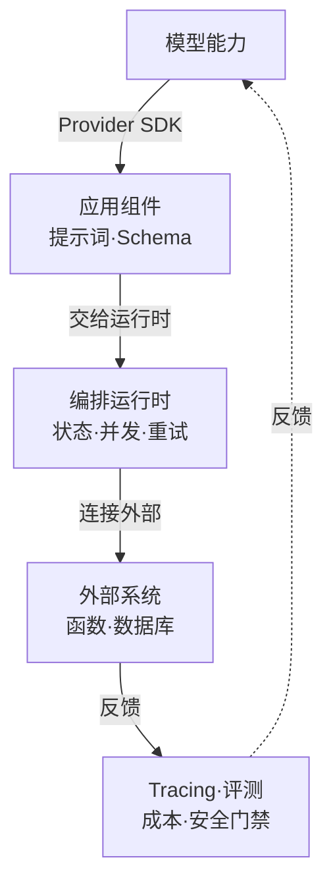
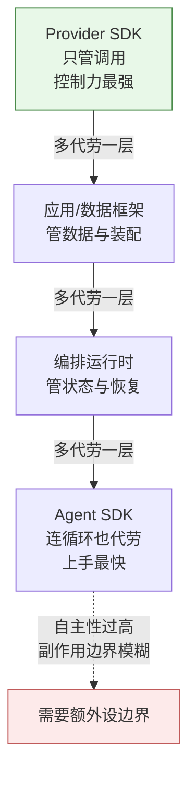
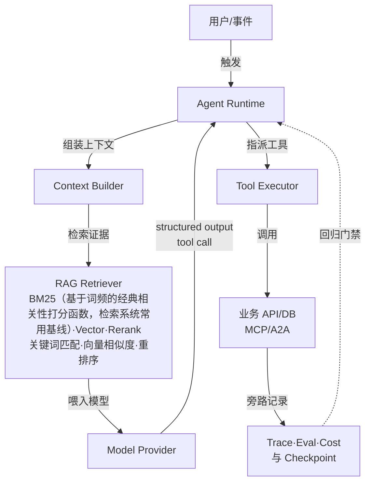
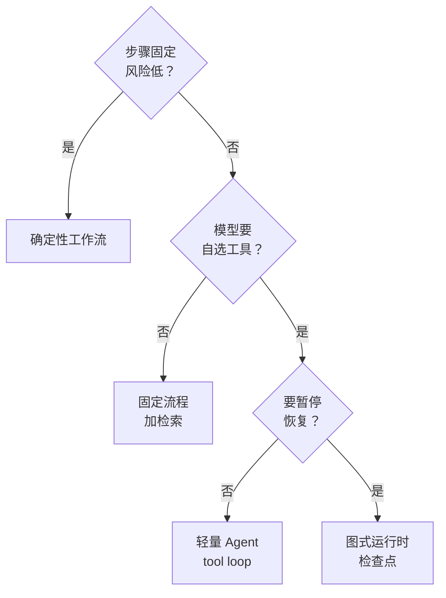

# 模型、框架、运行时与协议解决不同问题

## 四个词混着说会出哪些错：要解决的问题

线上出问题时判断是哪一层的问题、换模型或协议时哪些接口不用改——这篇讲**模型、框架、运行时、协议、评测五层各管什么，以及替换其中一层时其余接口为何不变**。

## 一句话怎么先分清四层

先把形状说成一件事：这套分层像一家餐厅——**模型是会做菜的主厨**（给判断，但每次手艺有波动）；**框架是半成品料包与菜谱库**（复用别人的配菜与工序）；**运行时是前厅经理**（接单、记台号、客人催单时重上一道，停电恢复后知道哪桌菜还没上）；**协议是采购与外卖对接的标准单据**；**评测是试吃与客诉回访**（证明菜真的能吃）。**把"主厨很好"当成"餐厅能开张"，就是混层最常见的错**。这个比喻到"回访"为止——现实里各层的接口与生命周期，下面逐层展开。

**模型负责提出概率性的判断，框架负责复用组件，运行时负责把判断变成可恢复的执行，协议负责连接外部能力，评测负责证明结果。**

这五层首尾相接成一圈：**模型能力经 Provider SDK（供应商提供的、用来发送请求与接收模型结果的软件开发工具包）进入应用组件，交给编排运行时，由它连接外部系统，最后 Tracing（追踪，记录一次请求各步骤的调用顺序与耗时）与评测的结果又反馈回模型——串行的是调用方向，并列的是职责归属**：


五层职责的实物原型是旅行转换插头：**你的设备制式（模型）不因旅行改变，变的是墙上插座的制式（外部环境），转换插头（协议层）负责把两边接起来**——**插头插不进去时，设备没有坏，坏在适配层的制式不匹配**；这个比喻只说明「制式匹配」这一点，各层的具体接口与生命周期下面逐层展开，不要拿插头外形去对应别的东西。**烧坏设备的是把 110V 电器直接插进 220V 插座（绕过协议层直接对接外部能力）**：


*图源：Wikimedia Commons，Grandmaster Huon，CC0 1.0，https://commons.wikimedia.org/wiki/File:Travel_adapters_in_action.jpeg。*

五层各自只依赖相邻层暴露出来的接口，**不越层依赖对方藏在接口后面的细节**，因此**换掉任意一层都不改变其余四层的接口，只改变这一层自己的假设**；而 **Tracing·评测这一层是唯一能判断「换得对不对」的位置——它收口整个闭环**。（本图是能力分层，谁提供什么；后面那张是一次请求的执行时序，谁先谁后——两者的排列方向相反，两者各自成立）。

最常见的误解是**把「换模型」「换框架」「加一个向量库」当成同一种升级**。它们改变的是**不同的假设**：

| 改动 | 主要改变 | 不会自动解决 |
| --- | --- | --- |
| 换生成模型 | 推理、表达、工具选择和成本曲线 | 权限、状态恢复、错误补偿、事实新鲜度 |
| 换 embedding/reranker | 候选覆盖和排序 | 解析错误、ACL（访问控制列表）、生成幻觉 |
| 换应用框架 | 连接器、抽象和开发效率 | 业务流程正确性和生产 SLO（服务级别目标，对可用性与延迟的对外承诺） |
| 换编排运行时 | 状态、重试、暂停、恢复和并发 | 模型本身的知识与推理能力 |
| 接入 MCP（模型上下文协议）/A2A（Agent2Agent 协议，Google 主推的 Agent 间协作协议） | 能力发现和跨进程协作 | 服务端授权、幂等、数据脱敏 |
| 加长上下文 | 一次请求能放入更多内容 | 内容是否相关、可引用、可更新 |

这一圈分层在业界有一张官方版全景：Google 的 agentic 生态图把四层叠在一起——最上 Agent Development Kit（构建、评估与部署 Agent 的开源工具包，简单说就是开发工具箱——Agent 指能根据目标自己选择下一步动作的程序），其下 MCP，再下 Vertex AI Agent Engine（生产部署托管平台，帮你把服务跑起来），最底 A2A。开发、上下文、部署、协作四层各答一问，与本篇的分层判断互相印证：


*图源：A2A 协议官方文档 agentic-stack 插图（Google），https://a2a-protocol.org/（agentic-stack），官方文档配图。四层的先后关系对应正文「改哪一层只改哪一层的假设」：换框架不动运行时，接协议不替代授权——图上每层标签里那句「不会自动解决」的事，仍归其余各层。*


来源：[CSDN Agent 技术全景图](https://opc.csdn.net/6a80164810ee7a33f29b410d.html)（CC 4.0 BY-SA）


## 从调用模型到可运营 Agent 差在哪：演进

| 阶段 | 主要问题 | 新增抽象 | 仍然必须自己负责的部分 |
| --- | --- | --- | --- |
| 原始模型 API | 如何发送消息并拿到文本 | Provider SDK、流式、超时 | 解析、重试、业务校验和日志 |
| Prompt/Chain | 如何把多个调用串起来 | 模板、链、结构化输出 | 分支、状态、错误补偿、回放 |
| RAG（Retrieval-Augmented Generation，检索增强生成）与工具调用 | 模型如何访问外部事实和动作 | Retriever、function calling、tool schema | 权限、幂等、证据绑定和副作用审批 |
| 工作流/图编排 | 如何表达分支、并发和长任务 | 状态图、事件、检查点、队列 | 状态模型、恢复语义、预算和 SLO |
| Agent runtime | 如何允许模型动态选择下一步 | tool loop、handoff（把对话移交给另一个 Agent）、human-in-the-loop（人工在环，关键节点交人确认） | 停止条件、沙箱、策略和审计 |
| 协议互操作 | 如何跨团队、跨语言复用能力 | MCP 的 tools/resources/prompts、A2A 的任务语义 | 身份、授权、兼容版本和远程故障 |
| 评测与运营 | 如何知道升级是否真的变好 | trace、离线集、在线反馈、质量门禁 | 指标定义、样本治理和回滚决定 |

演进的本质：每新增一层，都在把原本藏在 Prompt 或一次性脚本里的假设，逐步显式化为**接口、状态、策略和证据**，同时新增**可观测性（通过系统对外输出判断内部状态的能力）和回退路径**。

## 模型层管哪些事：能力、接口和生命周期

### 模型到底提供哪些能力

对应用工程师而言，模型可以抽象成下面这个调用形态：

```text
generate(input, context, tools, output_schema, budget)
    -> text | structured_output | tool_calls | refusal | error
```

**这七项能力要分别理解，只记一个模型名称是不够的**：

- **生成**：**自然语言、代码、JSON 或多模态输出**。
- **推理预算**：**模型在质量、延迟和 token（模型处理文本的最小单位，约相当于一个词或半个词） 成本之间的可调曲线；推理更久不保证业务正确**。
- **工具调用**：**模型提出工具名和参数，应用验证后执行，再把结果作为新上下文返回**。
- **结构化输出**：**语法/schema 合法是第一道门，业务约束、权限和事实正确是后续门**。
- **上下文窗口（模型一次能读入的最大文本长度）**：**一次调用的容量，不等于长期记忆，也不等于可检索性**。
- **多模态**：**文本、图片、音频、视频和文件的输入/输出；引用模型必须能定位到页码、时间段或坐标**。
- **批处理（把多个请求合并成一批同时计算、提高硬件利用率）、后台和流式**：**是交互形态与调度能力，不应直接混入业务领域逻辑**。

### 为什么能力标签比品牌名更稳定

做法是**为内部模型注册表维护能力标签，型号不散落在业务代码里**：

| 标签 | 例子 | 需要验证的指标 |
| --- | --- | --- |
| `reasoning` | 复杂规划、代码、冲突消解 | 任务成功率、步骤数、推理 token |
| `fast` | 分类、改写、路由、批量抽取 | P95、吞吐、单位成本 |
| `tool_use` | 函数/MCP 调用和多轮循环 | 参数正确率、无效调用率 |
| `long_context` | 长文档分析、跨文件总结 | 证据召回、位置敏感性、成本 |
| `vision`/`audio` | 图表、截图、语音和视频 | OCR（从图片里把文字认出来）/定位准确率、媒体引用完整性 |
| `embedding` | 语义索引和相似度 | Recall@K、语言/领域覆盖、维度 |
| `rerank` | 候选集精排 | nDCG、P95、候选规模上限 |

  **模型注册表至少保存 provider、稳定快照（某一时刻的完整只读副本）/别名、能力标签、上下文/输出限制、区域、价格、数据处理政策、弃用日期和回归测试集（回归集，用来验证改动没有破坏已有行为的样本集合）结果**。**供应商的 `latest` 别名（永远指向其当前最新版本、内容会随发布悄悄变化）适合试验，不适合没有回归门禁的关键路径**。**用工看技能清单与用简历上的公司名是同一区别：招"能独立排查线上故障的人"（能力标签，可验证）比招"某某大厂出来的"（品牌名，会变）可靠**——大厂的团队也换人，胜任力标准不随人事流动；**`latest` 别名就是那位"当前在职但岗位随时会换的人"**。

### 模型变更影响哪些范围

```text
模型快照变更 -> 生成/工具/结构化输出回归
embedding 变更 -> 重建索引 + 召回回归
reranker 变更 -> 排序回归 + 延迟/吞吐回归
上下文模板变更 -> 端到端轨迹回归
供应商 API 变更 -> schema/错误/限流/计费接口一致性测试（contract test，验证调用方与提供方对接口格式的约定没被改动的测试）
```

OpenAI 的 Responses API（把多轮对话、工具调用与结果放进同一次请求的新接口）把文本/图像输入、结构化输出、内置工具、MCP 工具和自定义函数都纳入这次请求；这说明「模型调用」和「工具编排」正在靠近，但工具执行、权限和业务副作用（操作对外部状态产生的额外影响）仍由应用掌握。[Responses API reference](https://developers.openai.com/api/reference/typescript/resources/responses/methods/create)

## 框架层为什么不能一个词盖过去：四种东西

**「Agent 框架」通常混合了四种职责。先判断你需要哪一种**：

| 类别 | 典型职责 | 何时值得引入 | 主要风险 |
| --- | --- | --- | --- |
| Provider SDK | 认证、请求、流式、类型和错误 | 任何模型调用 | 把供应商对象泄漏到业务层 |
| 应用/数据框架 | Prompt、Loader、RAG、Schema、工具适配 | 连接器多、需要快速试验 | 抽象过厚，难以定位失败层 |
| 编排运行时 | 图、状态、检查点、并发、恢复、人工暂停 | 长任务、分支、可恢复执行 | 隐式状态和序列化兼容 |
| Agent SDK | tool loop、handoff、guardrail（拦截越界动作的护栏检查）、trace | 需要现成 Agent 运行循环 | 默认自主性过高，副作用边界模糊，需要额外设边界 |

四类按「替你做多少事」从少到多排成一条链：**SDK 只管调用**；**应用/数据框架替你管数据与装配**；**编排运行时替你管状态与恢复**；**Agent SDK 连工具调用循环也代劳，上手最快、控制力最弱**。**链上越往后替你代劳越多，应用方能直接控制的地方就越少，一旦出错更难定位与改正，所以风险栏里要付的代价也越大**：



同时引入多类时，**按上表「主要风险」一列各自设防，不要把四类当成同一件事一次性套上**。

### 主流框架该怎么正确定位

以下是「能力边界」而不是**永久排名**；具体版本、API 和许可证以来源页为准：

- **LangGraph**：低层、图式的 Agent 编排运行时，重点是持久化执行、流式、人工介入和状态恢复；官方当前文档把它定位为可独立于 LangChain（同生态里更早的应用框架）使用的 runtime，并明确 `State`、`Nodes`、`Edges` 是核心抽象。[官方概览](https://docs.langchain.com/oss/python/langgraph/overview) · [Graph API](https://docs.langchain.com/oss/python/langgraph/graph-api)
- **LlamaIndex**：以数据接入、索引、检索和工作流为中心，适合把企业数据接入 Agent；当前官方文档将 Workflows（LlamaIndex 的编排单元，按事件把步骤串起来）描述为事件驱动、按步骤执行，事件类型表达边，普通 Python 表达步骤逻辑；旧 `QueryPipeline` 已进入 feature-freeze（功能冻结，只修缺陷不再加新功能）/deprecation，编排应优先评估 Workflows。[官方 Workflows](https://developers.llamaindex.ai/python/llamaagents/workflows/) · [QueryPipeline 迁移提示](https://docs.langchain.com/en/stable/module_guides/querying/pipeline/)
- **PydanticAI**：以类型、依赖注入、结构化输出和 provider-agnostic 为中心；适合 Python 团队把 schema 与业务类型放在一等位置。[Agent 概念](https://pydantic.dev/docs/ai/core-concepts/agent/)
- **OpenAI Agents SDK**：提供 Agent、工具、handoff、guardrail 和 tracing 的现成运行循环；适合在 OpenAI 生态内快速获得一致的轨迹和工具编排。[Tracing](https://openai.github.io/openai-agents-js/guides/tracing/)
- **MCP**：Host/Client/Server 之间发现和调用 tools、resources、prompts 的协议，编排框架的角色由其他层承担；2026-07-28 core 改为无 session 的每请求自描述，但接入后仍要做应用级授权、限流（限制单位时间内放行的请求数量）和审计。[历史基线 2025-06-18](https://modelcontextprotocol.io/specification/2025-06-18/index) · [2026-07-28 changelog](https://github.com/modelcontextprotocol/modelcontextprotocol/blob/main/docs/specification/2026-07-28/changelog.mdx)

选择框架时，**先画出自己的状态机（描述系统有哪些状态、什么条件下从一个状态转到另一个状态的一组规则）和工具约定，再看框架能否表达它**；**不要先按 GitHub 热度选框架——热度高的框架通常带着一套现成抽象，先定下框架，业务写法就会被这套抽象带着走，等于被反向塑造**。装修先量房再挑工法的道理一致：**先画好自家的水电走向（状态机与工具约定），再挑能按图施工的队伍（框架）；反过来先请了队再改户型，住进去的每个别扭都来自将就**。

## 运行时层为什么说 Agent 是可恢复的分布式流程

一个生产运行时至少要回答下面这些问题：

1. 当前执行处于哪个状态？输入、计划、工具结果和证据如何转成可存储、可传输的形式（序列化）？
2. 进程崩溃、网络超时或用户离开后，如何从检查点（定期保存进度、故障后从最近一次保存处恢复）恢复？
3. 工具已经产生副作用时，重试是否会重复执行？幂等（同一个操作执行一次和执行多次的结果相同，重复执行不会产生额外副作用）键（让同一操作重试多次只生效一次的标记）在哪里？
4. 哪些节点可并发，哪些节点必须按租户、资源或事务顺序执行？
5. 什么时候停止、拒答、转人工或回退到确定性路径？

### 最小状态模型长什么样

```yaml
run_id: run_...
workflow_version: support_triage@3
status: waiting_for_tool # running | paused | waiting_human | succeeded | failed
goal: "处理用户工单"
messages: []
plan: []
tool_calls: []
evidence: []
budget:
  max_steps: 12
  max_tokens: 30000
  max_cost: 0.20
checkpoint: cp_...
```

状态中**不要保存无法解释的「模型记忆字符串」作为唯一事实**。**关键事实应来自数据库、工具结果或带版本的证据；历史消息可以摘要，但摘要必须可追溯到原始事件**。病历的规矩是同一条：**诊断结论（关键事实）写的是检验单编号与测量值（数据库、工具结果、带版本的证据）**，医生的主观印象可以记（摘要），但要能追溯到当时那张单子——**只写"患者自述好转"（模型记忆字符串）当唯一依据，复查时谁也无法核对**。这个比喻只说明关键事实要能追溯到原始证据这一点，病历的其余流程不对应系统。

### 检查点、重试和副作用怎么配合

  - **检查点**保存**可恢复状态**，不等于**业务数据库事务**；**两者要有明确的一致性边界**。装修的节点验收与材料台账是这两个东西：**节点验收（检查点）记"水电已试压合格、今天做到哪"，台账（业务事务）记每笔材料的进出**——两本要互相引用，**验收不能替台账，台账断了验收也白记**。这个比喻只说明检查点与业务事务要互相引用、各记各的，装修的其他环节不对应系统。
- **重试**只对分类为 **transient（瞬时、可重试）**的错误开启；**写操作必须使用幂等键（请求自带唯一标识，重复提交只生效一次）或先查询状态**。
- **暂停/人工接管**要保存**完整上下文、审批人、参数摘要、过期时间和恢复入口**。
- **并发**要**定义合并规则**；**两个 Agent 同时修改同一资源时，不能靠最后写入获胜**。
- **预算**同时限制**步数、墙钟时间、token、工具次数和费用**；**任一耗尽都进入可解释的降级（主动牺牲部分功能或精度，保住核心链路）**。

LangGraph 将 **checkpointer 用于线程级短期状态，将 store 用于跨线程长期记忆**，并支持**中断后用同一 `thread_id` 恢复**；**这类语义正是运行时而非模型本身提供的**。[Persistence](https://docs.langchain.com/oss/python/langgraph/persistence) · [Time travel](https://docs.langchain.com/oss/python/langgraph/use-time-travel)

## 四者怎么组合起来：组合方式

组合后的执行顺序不是一条直线：运行时同时派出上下文构建与工具执行两条分支，模型的 structured output 与 tool call 要回到运行时才能决定下一步，Trace·Eval·Checkpoint 再经回归门禁回到运行时——两条回边都指向同一个节点：


图里 RAG Retriever 一栏的 BM25（基于词频的经典相关性打分函数，检索系统常用基线）是按关键词出现频率与文档长度打分的经典检索方法，Vector 是按向量相似度找语义相近内容的检索，Rerank 是对候选结果再精排。

两条回边解释了「运行时为什么必须是可恢复的」：**模型只输出决定，状态与下一步都在运行时**；**回归门禁这条回边让评测结果能反向改变下一次执行的走向**。**RAG 与 Tool（工具执行）是运行时派出的两条并行分支**，这也说明 **RAG 不是 Agent 的同义词**——**确定性工作流可以调用 RAG，Agent 也可以完全不用 RAG**。

工具调用一旦跨出进程，就要经过网络发送，而网络发送由分层协议逐层承载，所以图里那条跨进程的边，实际由网络协议栈承担。下图是 TCP/IP 协议栈的经典分层图：**应用会话、进程端口、主机寻址、链路各层各答一个问题**——**协议层之所以独立于框架与运行时存在，就是因为它回答的是「两边怎么对上」，这与「流程怎么编排」分属不同层**。


> 图：IP 协议栈连接示意图（Network Topology 与 Data Flow），来自 [Wikimedia Commons](https://commons.wikimedia.org/wiki/File:IP_stack_connections.drawio.png)，CC BY-SA 3.0，作者 Kbrose。

一个典型请求的职责顺序是：

1. **运行时加载会话状态和工作流版本**。
2. **Context Builder（负责拼装发给模型的上下文）根据权限、问题类型和 token 预算选择历史、RAG 证据和工具说明**。

3. **模型给出结构化决定：直接回答、检索、调用工具、请求审批或拒答**。
4. **Tool Executor（负责实际执行工具调用的组件）再次做 schema、权限、资源归属、幂等和风险检查**。

5. **运行时保存工具结果和 checkpoint，决定下一步或结束**。
6. **Evaluator（负责评判执行结果的组件）检查任务完成、证据支持、工具正确性、安全和成本，并把 trace 纳入回归集**。

对比两句常用的话：**RAG 解决「从外部知识取得证据」，Agent 解决「根据目标选择并执行步骤」**。**两者一静一动，经常搭着用**。

## 选型怎么一步步定：决策树

选型可以按三个判定问题依次收窄：**先看步骤是否固定且风险低（是就根本不需要 Agent）**，**再看是否需要模型自选工具并按结果继续**，**最后看是否需要长任务与暂停恢复**——答「否」就停在当前档位，答「是」才继续往更重的方案走：



## 验收要核哪几条：工程清单

### 接口要核什么

- [ ] 业务层依赖内部 `ModelProvider`、`Retriever`、`ToolExecutor`、`StateStore` 接口。
- [ ] 每个模型、工具、索引和工作流都有可追溯版本。
- [ ] 结构化输出有 schema、业务校验、有限重试和不可解析时的回退。

### 运行时要核什么

- [ ] 长任务可暂停、恢复、取消和查询状态。
- [ ] 工具调用有超时、幂等、权限、审计和副作用等级。
- [ ] 重试不会重复写操作；并发冲突有显式策略。
- [ ] 步数、token、费用和墙钟时间均有预算。

### RAG/知识要核什么

- [ ] 证据带来源 URI（Uniform Resource Identifier，统一资源标识符，标记证据出处）、chunk、版本、时间和权限主体。
- [ ] 召回、排序、引用支持和拒答分别评测。
- [ ] embedding 变更会触发索引重建与回归；权限和删除有可测 lag。

### 观测与治理要核什么

- [ ] Trace 能串起模型、检索、工具、状态和人工审批。
- [ ] 线上样本可脱敏（遮盖敏感字段的部分内容、保留可辨识形态）回放，失败轨迹进入版本化回归集。
- [ ] Prompt injection（提示注入：攻击者把指令藏进数据内容、诱骗模型当作指令执行的攻击手法）、越权（访问了权限范围之外的资源）、敏感输出、危险工具和供应商故障都有测试。
- [ ] 每次框架/模型升级都有兼容性、成本、延迟和回滚（把系统状态退回到改动之前的版本）记录。

## 想继续深入还能看哪些材料

- [[工程知识/AI 系统工程：从模型能力到生产能力/Agent与工作流/构建可靠Agent应用]]
- [[工程知识/AI 系统工程：从模型能力到生产能力/Agent与工作流/先用工作流，只有路径无法预先枚举时才使用Agent]]
- [[工程知识/AI 系统工程：从模型能力到生产能力/知识与检索/RAG的核心是选择可引用证据]]
- [[工程知识/AI 系统工程：从模型能力到生产能力/生态与选型/MCP接入必须验证协议、身份与工具约定]]
- [[工程知识/AI 系统工程：从模型能力到生产能力/生态与选型/多 AI 客户端的统一接管：hooks、配置与常驻连接的三种适配]]
- [[工程知识/AI 系统工程：从模型能力到生产能力/质量与运营/可靠生成需要结构、证据、拒答与回归]]
- [[工程知识/后端系统：在并发、失败与变化中维持服务/分布式可靠性/部分失败决定分布式系统的设计]]
- [[工程知识/软件构建：让变化可以理解、验证与交付/测试与交付/测试策略从风险选择证据]]

## 更新节奏怎么安排：更新规则

模型和 SDK 版本、协议草案、价格与弃用信息按 7–30 天复查；运行时可靠性和评测方法按 1–3 个月复查；分层模型与接口原则按 6 个月复查。新事实先进入 [[工程知识/AI 系统工程：从模型能力到生产能力/生态与选型/AI技术动态]]，通过来源、日期、影响范围和回归结果门禁后再改写本页。


## 想自己验一遍怎么动手：验证

最小验证：把一个已上线的功能逐层分开，检查**模型、框架、运行时、协议与评测各自承担的部分是否能在替换其中一层时保持其余部分不变**。**替换模型版本后断言上层接口与内部状态无需改动**；**替换运行时后断言模型调用代码无需改动**；**替换协议后断言内部工作流无需改动**。

职责归属验证：对一次失败逐个排查，**断言能定位到具体层（模型输出、组件装配、执行状态、外部连接或结果证明）**，而不是**笼统归因于整体**。

选型对账：**每层的候选按同一负载基准测一轮（吞吐、延迟、故障恢复各一组数字），预写预期值，实测与预期对不上的候选回到上一层换路线，不靠榜单印象定案**。
