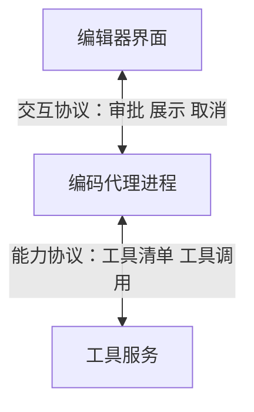
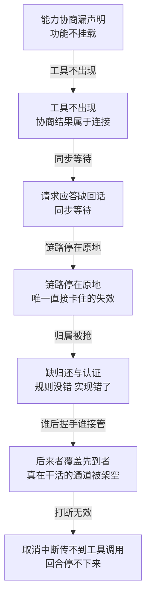
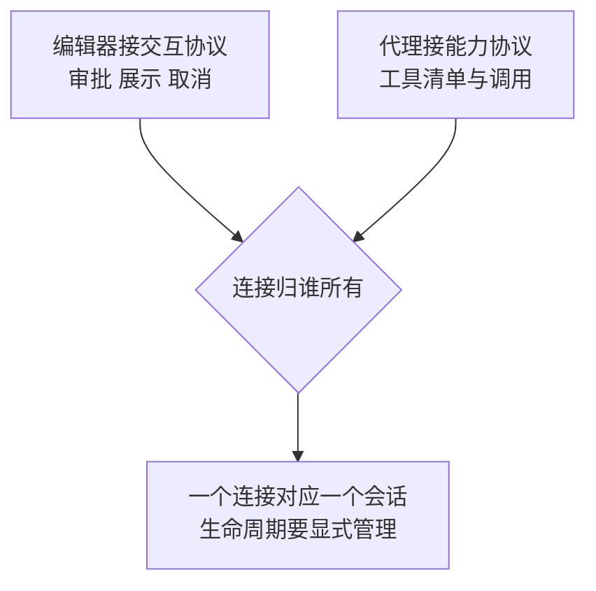

# 编辑器与编码代理的通信通道：能力协商与连接归属

编辑器与编码代理之间有两条通信线（一条管工具调用、一条管界面交互），本文讲清**各自归谁管**。读完你能分清哪些能力靠协议谈、哪些归编辑器自己管，也知道接代理时先问清哪几件事。

编码代理从终端走进编辑器之后，多出的就是第二条：编辑器要把工具调用画在界面上、要弹审批按钮、要把改动渲染成差异视图、要能取消一次正在跑的任务。代理进程（运行编码代理的程序进程，与编辑器分属两个进程：编辑器负责界面渲染，代理负责执行工具调用，两者各自崩溃互不影响）怎么拿到工具，业界已经有一套协议：Model Context Protocol（模型上下文协议，AI 应用连接工具与数据源的开放协议，简称 MCP）。**它管的是模型与外部工具、数据源之间的调用**。**审批按钮、差异视图、取消任务这些界面交互能力是另一条线的事，不归它管**。

**把两条线混成一条，会在协议选型时得出错误结论**：例如接了 MCP 这条工具协议，就以为界面审批自然可用，实际界面审批由另一条交互协议负责；反过来，界面里能弹审批，也不代表已经具备工具调用能力。

## 编辑器与代理之间到底有哪两条通信线

两条通信线连接的对象与方向都不同：一条是编辑器与代理进程之间的**交互协议，负责审批、展示与取消**；另一条是代理进程与工具服务（提供工具的一方，代理进程作为客户端向它索取工具清单、发起调用）之间的**能力协议，负责工具清单与工具调用**：



**能力协议**解决代理进程如何发现与调用外部能力：工具清单、参数形状、调用与返回值、进度通知。代理进程是这条线上的客户端，工具服务是服务端。

**交互协议**解决编辑器如何与代理进程共同完成一次会话：发送用户输入、接收流式输出、把需要人决策的请求送到界面并取回答案、取消正在执行的回合。编辑器是发起方，代理进程对外提供这条通道。这条协议的代表是代理客户端协议（Agent Client Protocol，ACP）。**它规定了编辑器如何接入编码代理、如何在界面上显示审批按钮和流式输出内容**（逐段返回的文本、进度与工具调用状态）。

同一个代理进程同时站在两条线上：这里的线是两条互不连通的协议连接，代理在其中一条上做客户端、在另一条上做服务端。具体说，**它是能力协议的客户端，又是交互协议的服务端**。两条线可以各自替换 —— **换编辑器不影响接哪些工具，换工具服务不影响界面**。这与语言服务器协议 LSP（Language Server Protocol，编辑器与语言工具的通信标准）是同一个思路：LSP 解耦的是编辑器与语言分析，把语法检查、跳转定义这类分析工作交给独立的语言服务器进程；这里解耦的是编辑器与编码代理，两端一一对应。这个类比只到「解耦」这一点为止：LSP 本身只有编辑器与语言服务器这一条线，对应这里的交互协议线；工具能力协议是另一条独立协议，不在 LSP 范围里。

LSP 官方文档用一张图交代过这个解耦形态：开发工具与语言服务器之间走 JSON-RPC（一种用文本消息来回传递调用与结果的远程调用格式），同一个工具会话里 Sass 与 Java 各连一台语言服务器，`textDocument/definition` 这类请求按语言分发给对应的服务器——「一条协议线、按语言一比一拉连接」的拓扑，与上面说的「换编辑器不影响接工具、换工具不影响界面」是同一种设计判断：


*图源：Language Server Protocol 官网《Overview》，https://microsoft.github.io/language-server-protocol/overviews/lsp/overview/。Development Tool=开发工具（宿主），Request: textDocument/definition=跳转定义请求，Response: Location=返回定义位置。同一宿主为每门语言各起一台服务器、互不复用连接——正是 MCP 图里「客户端与服务器一一对应」在语言分析场景的同款规则。*

把三条协议放在一起，MCP 回答代理怎么拿到并调用外部能力，A2A（Agent-to-Agent，代理到代理协议，让两个代理进程互相发现并委托任务）连接两个代理进程，回答一个代理怎么把任务委托出去，ACP 回答界面怎么和人一起完成一次会话，**各自的问题互不重叠**：

| 协议 | 连接的两端 | 回答的问题 |
| --- | --- | --- |
| 模型上下文协议 MCP | 代理进程 ↔ 工具服务 | 代理怎么拿到并调用外部能力 |
| 代理到代理协议 A2A | 代理进程 ↔ 另一个代理 | 一个代理怎么把任务委托出去 |
| 代理客户端协议 ACP | 编辑器 ↔ 代理进程 | 界面怎么和人一起完成一次会话 |

三者并列构成协议族的三个位置：能力、委托、交互。任何一方都替换不了另一方，详见 [[工程知识/AI 系统工程：从模型能力到生产能力/生态与选型/MCP与A2A的分工：工具协议与Agent协议不互相替代]]。

能力协议这条线的拓扑，MCP 官方文档的全景图画得最清楚：宿主应用（编辑器、桌面工具）内部为每个工具服务维持一个 MCP 客户端，客户端经协议连接本地的文件系统、数据库服务器或远程的 SaaS 服务器——代理进程作为宿主，**正是通过这组 1:1 连接拿到工具能力**：


图源：[Model Context Protocol 官方文档《Introduction》](https://modelcontextprotocol.io/docs/getting-started/intro)（MIT 许可）。图中宿主内的三个客户端各连一台服务器，正是上表「代理进程 ↔ 工具服务」那一格的展开——**客户端与服务器一一对应、互不共享连接，这条规则决定了工具权限按连接隔离**。

## 交互协议靠哪四样东西撑起一次会话

这一节要解决的问题是：一次会话要正常跑起来，依赖哪四个环节——能力协商、请求应答、连接归属、取消中断。

**能力协商**。连接建立后双方先各自声明支持什么：是否支持在界面里提问、是否支持承载图像、是否支持每次改动的采纳与拒绝。**这份声明决定哪些功能挂载（接入会话、在会话里可用）**——没有声明提问能力的连接，依赖提问的工具不会出现在会话里。**协商结果是连接的属性，不是会话的属性**：连接属性指换一次客户端就要重新确认，不会随会话内容改变。替换一个客户端就是更换一条连接，协商要重做，原先挂上的工具可能因此消失，**所以接入第三方客户端时最容易踩空**。

**请求与应答的双向流动**。多数消息是代理进程到界面的流式事件（如输出文本的逐段推送、进度更新这类持续推送、不需要界面回复的消息），另有一类是界面必须回话的请求：这次工具执行是否放行、这个选项选哪一个。这类请求在代理进程内部是**同步等待**的：请求发出后代理进程停住不动，**界面给出答复才继续往下走，答不上就一直停在原地**。

这套双向流动的原始形态在 LSP 官方的时序图里一目了然：开发工具与语言服务器之间的消息分两类，打开、修改、关闭文档走单向通知，跳转定义这类需要结果的调用走请求加应答成对出现——**ACP 的交互协议沿用同一骨架**，只是通知的内容从「文档已修改」换成「输出流多了一段」，请求的内容从「定义在哪」换成「这次工具执行是否放行」：


*图源：同上（Language Server Protocol 官网《Overview》）。*

**连接的归属**。**一次会话在同一时刻只能绑定一条交互通道**，因为请求要送到明确的收件人手里。注册表（一张记录哪条通道正在服务当前会话的表）通常只有一个槽位（表里的一个格子），后写入的连接覆盖先写入的。这条规则本身没错，错在实现里**缺少「归还」与「认证」，且写入不鉴权**：先到者占用槽位、不主动归还就一直占着；后来者无需认证即可写入覆盖；被覆盖后界面与原通道的应答就此断开，真正在干活的通道被架空（原通道的应答被新连接覆盖，界面收不到它的回复，用户点下的审批没人接收、正在跑的请求等不到答复，这条通道因此失效）。规则没错，实现错了，见 [[工程知识/AI 系统工程：从模型能力到生产能力/质量与运营/投递指针的选举与失效：连接注册表的四个健壮性缺陷]]。

**取消与中断**。界面要能打断一次还在跑的回合，代理进程要能把中断传播到当前工具调用；**这条链断掉时回合停不下来**。

四个环节的运行机制各管一段，排查时协商与归属的错查连接属性与槽位写入记录，请求应答的错查请求与应答是否配对，取消中断的错查中断信号有没有传到当前工具调用；把这四种失效按发生顺序排成一列，可以逐条看清各自的触发条件和后果：



这套握手在 LSP 里分三步走：连接建立后第一个请求永远是 initialize（初始化请求，双方在这一步互相告知能力，避免后续产生无效请求），然后是 InitializeResult 响应（语言服务器回给编辑器的能力清单）、initialized 通知（编辑器收到清单后发回的就绪确认）。火山引擎开发者社区的 [理解 Language Server Protocol 的工作原理](https://developer.volcengine.com/articles/7070054923957698596) 给出了原始形态；[语言服务器与 IDE（Integrated Development Environment，集成开发环境） 集成](https://www.i32n.com/m/000000K8Z1?p=2) 一文把这个过程拆成 initialize 请求、InitializeResult 响应、initialized 通知三步，并点明这一步的作用正是 Capability Negotiation（能力协商）。编码代理的通道是**同一套模式的翻版**，差别只在协商的内容从「是否支持补全」换成了「是否支持在界面里提问」。


## 这套说法在哪儿会失效

- **交互协议不承载业务语义**。它只负责把请求送到界面并带回答案，请求该不该批准由策略层判断，见 [[工程知识/AI 系统工程：从模型能力到生产能力/安全与治理/沙箱限制能力，策略限制行为]]。
- **能力协商是连接级的，不是会话级的**。同一份配置换一个客户端就可能少挂载一类工具，排查时先核对协商声明。
- **通道断开后的行为没有统一规定**。规范通常只描述正常时序，断开导致的等待如何处理由实现决定；不少实现只在断开那一刻记一条警告，随后让调用一直阻塞，既不报错也不返回，**这正是「工具调用一直等待、日志里只有一条警告」的来源**。
- **一条通道服务一个会话**。多会话并行需要多条通道，把多个会话挤在同一条通道上要求协议本身具备会话标识与路由能力。

## 接入新客户端时怎么自己动手验证？

接入一个新客户端时，握手层（连接建立时的能力协商那一步，对应前文 initialize 三步）核对能力声明、路由层核对请求去向、时序层核对请求与应答配对，三个层次每层都有可查的证据：

1. **握手层**：抓一次连接建立过程，核对双方声明的能力字段是否与预期的功能挂载一致。日志里按能力名检索：

```bash
grep -n -i 'initialize\|capabilities' "$CLIENT_LOG" | head -20
```

2. **路由层**：核对请求实际发给了哪条连接。日志里检索投递失败与连接标识，两条连接标识交替出现说明归属被抢过：

```bash
grep -c 'sendToClient' "$CLIENT_LOG"
grep -o 'connectionId=[^ ]*' "$CLIENT_LOG" | sort | uniq -c
```

3. **时序层**：把日志里每一次请求与对应的应答配对，配不上对的就是等待的调用。同一时刻只能有一条连接在应答，出现两条即为异常。

**预期**是请求的连接标识在整个会话期间保持不变。**对不上**说明存在中途接管，需要回到归属策略上查「谁在什么时候写入了槽位」。

## 会带来什么影响，要付什么代价

- 分成两条线换来的是可替换性：界面与工具各自演进，互不牵连。
- 代价是多一条通道要维护，多一处可能断开、可能被接管的位置。
- 接入方需要遵守一条纪律：**观察与接管必须保持旁观者身份（旁观者指可以接收状态更新、可以对请求作出答复，但不得替原通道写入会话的应答槽位）**，任何写入槽位的动作都要可归还，见 [[工程知识/缺陷分析：从个案到体系/并发/只读旁观者不能改变被观察对象的状态]]。
- 无人值守场景下这条通道必须有替代应答者，见 [[工程知识/AI 系统工程：从模型能力到生产能力/质量与运营/AI 客户端会话需要守护：审批、委托与断线的接管层]]。

## 实际接入时从哪一步开始做？

两类协议解决不同的问题，连接归属决定会话生命周期由谁收——先分清编辑器与代理各自的通道，再核对归属：



1. **先分清两条线**：把工具连接配置与客户端接入配置分开管理，各自独立验证。
2. **再核对协商**：新客户端接入后先确认能力声明，再验证依赖这些能力的工具是否挂载。
3. **再守归属**：任何旁路（绕开主流程的备用路径）接入都不得写入会话的应答槽位；只订阅事件流、按需应答。
4. **最后补失效处理**：给等待应答的调用加超时与就地报错，让通道断开表现为明确失败。

## 接着读哪几篇：同在AI 系统工程里的相邻问题

- [[工程知识/AI 系统工程：从模型能力到生产能力/生态与选型/MCP与A2A的分工：工具协议与Agent协议不互相替代]] · [[工程知识/AI 系统工程：从模型能力到生产能力/质量与运营/投递指针的选举与失效：连接注册表的四个健壮性缺陷]] · [[工程知识/AI 系统工程：从模型能力到生产能力/质量与运营/AI 客户端会话需要守护：审批、委托与断线的接管层]] · [[工程知识/后端系统：在并发、失败与变化中维持服务/服务设计/一路会话只能有一个回复归属：多客户端接入时的所有者绑定]]
