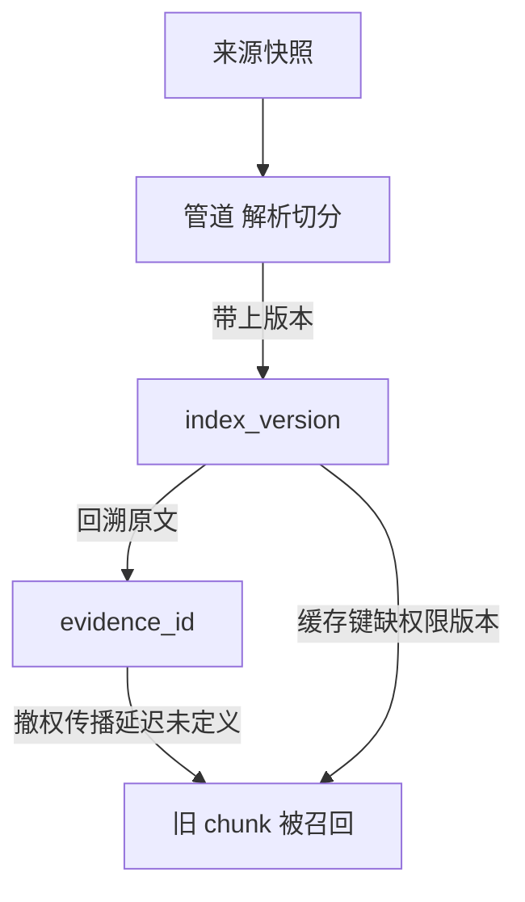

# RAG 数据管道从文档到可引用证据

读完这一篇，你能判断自己的检索系统是在哪一步把内容丢掉的，以及为什么一个改好的文档仍然被召回旧版本。RAG（Retrieval-Augmented Generation，检索增强生成：先检索资料再让模型基于资料回答）指让模型先检索资料再据此回答的做法；它的数据管道，负责把一堆原始文档变成模型能放心引用的证据。它解决的是原始文档不能稳定检索、授权和引用的问题。

整个过程像给一座图书馆编目：入库的条件是每本书都要贴分类号（结构）、写明版次（版本）、标注谁有权借（权限）、记下它在哪个书架哪一层（位置），之后任何一次检索才可能准确取到书、还回原位。这个比喻到"编目错了会怎样"为止——图书馆编错目最多是找不到书，而检索系统编错目会让模型把这个错误版本当作可信证据写入回答。

核心机制是**把来源解析成带结构、版本、权限和位置的知识单元，再建立可重建索引**；最小例子是修改一条政策并撤权，验证旧切块不再被召回、引用能回到新版本原文。这里的知识单元通常叫 chunk（切块：把长文档切成的一小片，检索和引用都以它为单位），权限信息叫 ACL（Access Control List，访问控制列表：写明这条内容谁可以看）。
## 上线前要先记住哪几句？

| 维度 | 回答 |
| --- | --- |
| 要解决的问题 | 原始文档不能直接被稳定检索和引用；解析丢结构、版本残留或权限遗漏会让模型获得看似相关却错误的上下文。|
| 本质 | 把来源转换成带结构、版本、权限和位置的知识单元，并让它们可以被召回、过滤、引用和删除。|
| 做法 | 发现来源，解析并保留标题/表格/代码，按语义切分，写入 ACL 和版本元数据，再建立词法、向量或结构索引。|
| 效果与代价 | 证据可追溯、可更新、可按权限过滤，回答更容易审计；代价是解析、重建、存储和索引发布流程变重。|
| 边界 | Embedding 或切块优化不能修复错误来源、实时状态和业务计算；索引命中也不等于模型实际使用并正确引用。|
| 验证 | 抽样回到原文核对结构和位置，分别测召回、过滤、重排、引用支持、删除传播和生成拒答。|

**RAG 的质量上限由「哪些内容被正确地变成可检索、可授权、可引用的证据」决定。**把文件切成几段再做向量搜索只是其中一步；解析错误、层级丢失、权限遗漏、旧版本残留和引用无法回指都会出错：例如权限遗漏会让不该看到的内容被召回，模型据此引用越权（访问了权限范围之外的资源）内容，从而在看似有上下文的情况下给出错误答案。

## 一条文档变成证据要经过哪些步骤

```text
来源发现 -> 解析/OCR（光学字符识别：把图片里的文字识别成可编辑文本） -> 结构恢复 -> 切分
    -> 元数据/ACL -> embedding（把文本编码成向量的表示，向量检索用的就是它） + 词法索引
    -> 版本化写入 -> 查询召回/过滤/重排（用更精细的模型对候选再排序，挑出最相关的前几条）
    -> 证据组装（把召回的 chunk 与引用拼成可核对的材料） -> 生成/引用 -> 反馈与重建（用使用结果回灌并重建索引）
```

从原始来源到可查询索引的完整链路长什么样，官方参考实现的索引运行实录对照：


*图源：微软 GraphRAG 官方仓库 docs/img/pipeline-running.png，MIT 协议，https://github.com/microsoft/graphrag。*

终端里逐个出现的工作流名——create_base_text_units（切分）、create_entities（抽取）、后续的社区检测与汇总——与本篇「来源发现 → 解析 → 切分 → 索引」的段落一一对应，区别只在中间一步抽取的是实体关系（谁和谁之间有什么关系，比如"A 公司—位于—北京"）；每个工作流都是一次会静默丢内容的转换——「解析错误、层级丢失」就发生在最早的那次转换里，而它一旦出错，后面所有工作流的产出都建立在残缺输入上。

chunk 的七字段元数据就是每个快件的面单：`document_id` 是运单号、`version` 是第几次改动、`acl` 是收件人白名单、`source_url/section/offset` 是货架坐标——引用回溯（点击引用回到原文位置）对应按面单直接找到那件包裹，面单不清的包裹在撤权传播时就是那条"旧 chunk 仍被召回"的虚线：撤权信息没有随面单同步更新，相当于收件人白名单还是旧的，包裹仍然能被旧权限放行。这个比喻到"能不能找回原文"为止：面单保证的是可追溯，检索准不准靠的是切分和索引，面单管不了。

**每个 chunk 至少需要稳定的 `document_id、version、source_url、section、offset、acl、updated_at`。表格、代码、列表、标题和脚注应保留结构；如果只能引用 chunk 文本却无法回到原文位置，系统难以审计。**

## 文档改了以后，旧版本为什么还会被搜到

**用 `source_updated_at -> indexed_at -> query_visible_at` 描述新鲜度**：source_updated_at（内容在来源处被修改的时刻）、indexed_at（管道处理完写入索引的时刻）、query_visible_at（这条内容对当前用户可见的时刻）。**更新不能只追加新 chunk：旧版本何时不可见、删除/撤权多久传播、embedding 变更是否需要重建，都必须有明确状态。**缓存键要包含租户（共用一套系统的不同客户或团队）、权限版本、文档版本和必要的时间切片。


来源快照、索引版本与 evidence_id 之间怎么串，以及撤权传播与缓存键在哪一步决定旧 chunk 还可见不可见：



快照、索引版本、evidence_id 三级串起来才谈得上可回溯：来源快照（某一时刻的完整只读副本）更新后仍要验证检索索引已经同步，撤权传播延迟没有定义的部分就是图上那条虚线。

来源规模较大时，可以用数据库快照、对象存储清单或 Iceberg/Delta/Hudi（三款开放表格式：像数据库管理表那样管理数据湖里的一批文件，自带版本与事务）一类开放表格式表达一批文件的 schema、版本和提交边界，再把 `source_version -> index_version -> evidence_id` 写入索引元数据。它们解决来源集合的增量、删除和回溯，不负责 BM25（一种按词频打分的经典关键词检索算法）、ANN（近似最近邻搜索：牺牲精度换速度的向量检索）、近似最近邻——用近似算法快速找向量相似项，精度换速度——或重排；来源快照更新后索引是否同步，属于下文验证步骤要覆盖的内容。

## 切分方式为什么决定了你能搜到什么

**切分粒度决定了召回的下限：切太碎**，单个 chunk 语义不完整、命中了也撑不起答案；**切太粗，一个 chunk 混多主题、检索时互相拖累**。粗排与精排的分工在检索链的形态上看最直观——向量检索先按语义相似度（两段文字在含义上的接近程度）圈出候选，过滤（按权限、时间等条件筛掉不合格的候选）与重排再收窄到最终返回的前 K 条结果（TopK）：


*图源：阿里云开发者社区《图文详解 RAG 技术和流程》，CC 4.0 BY-SA，https://developer.aliyun.com/article/1670698。切分决定候选池里每一片的语义完整度，粗排精排决定最终哪几片能到模型面前——切分粒度错档时，再强的重排也救不回被切碎的证据。*

切分与检索的取舍，和 UDP（用户数据报协议，只管发、不保证到达与顺序）与 TCP（传输控制协议，负责把数据完整、有序地送达）的取舍同构：一边是省事但可能漏，一边是可靠但要多走几步——切分像 UDP 省事但可能漏掉上下文，检索加重排像 TCP 多走几步但更可靠。这个比喻只到「是否多花一步换可靠」为止，UDP/TCP 本身的握手、重传等细节不在其中。

固定大小切分的产物长什么样，官方流程图给出的正是这一层：原始文档先预处理，再按固定大小切成若干切片——切片一旦切断定义、表格或因果，检索取到的那一片就是残缺证据：检索和引用都以 chunk 为单位，切断后模型拿到的只是半截定义或半截因果，无法还原完整含义，引用自然残缺。


*图源：同上（阿里云开发者社区《图文详解 RAG 技术和流程》），CC 4.0 BY-SA。*

- 固定 token 长度简单，但可能切断定义、表格和因果关系。
- 按标题/段落递归切分保留语义层级，但会产生长度不均和长段落。
- 父子 chunk、滑窗和摘要可改善召回，却增加重复、token 和引用合并成本。
- OCR、HTML 清洗（去掉网页标签只留正文）和代码解析都可能静默丢失内容；必须保留原文哈希（把任意长度数据压成固定长度指纹、不可逆）并对每次解析产出做比对告警；为每次解析产出分别留存哈希、逐次比对，后续召回结果与哪一次的哈希对不上，就能锁定是那次解析静默丢掉了内容。

管道本身也在变。综述论文把这条线的来路按年份排开，管道每一步被替换或加固的时间点都在图上。

2017 到 2019 年是从问答流水线配稠密检索（用向量表示做语义匹配，区别于按关键词匹配）起步。2020 年 RAG 与 DPR（Dense Passage Retrieval，稠密段落检索）登场，REALM（Retrieval-Augmented Language Model，检索增强语言模型）这类工作把检索接进生成。

2021 到 2022 年往解码器内部融合与检索质量基准演进。2023 年接入大模型并出现自适应检索与自我批判。

2024 年补上安全检索与多模态。2025 年走向图结构检索与智能体（能感知环境、调用工具、自主完成多步任务的 AI 程序）式检索：


*图示：检索增强（先从资料库找出相关内容、再交给模型作答的方法）生成从 2017 年到 2025 年的架构演进，每一段标注该阶段出现的关键工作。图源：arXiv 综述《A Systematic Review of Key Retrieval-Augmented Generation (RAG) Systems: Progress, Gaps, and Future Directions》，https://arxiv.org/html/2507.18910v1。*

这条时间线的每一步都在改管道的一处：解析、切分、索引、检索、组装。本篇讲的「把来源变成可引用证据」，正是那些年份里最不容易在论文标题上体现出来的一段工作。

## 新版索引上线前该检查什么

发布一个索引版本前，用代表性查询检查召回、权限、版本、引用位置、删除传播、重复文档和跨租户隔离；再测生成是否只使用证据、是否正确拒答和是否能解释证据不足。RAG 的索引版本和生成模型版本要一起进入追踪，不能只记录最终回答。

关系：[[工程知识/AI 系统工程：从模型能力到生产能力/知识与检索/RAG的核心是选择可引用证据]] · [[工程知识/AI 系统工程：从模型能力到生产能力/知识与检索/混合检索、重排与查询改写各自解决什么问题]] · [[工程知识/AI 系统工程：从模型能力到生产能力/知识与检索/检索从一次查询演进为有状态的证据获取]] · [[工程知识/AI 系统工程：从模型能力到生产能力/知识与检索/多模态RAG：图表、PDF与音频的证据不能只靠文本化]]

管道产出要与引用回溯对账——每个入库 chunk 带来源文档、页码、版本号，检索命中后抽查引用能否回溯到原文同一位置，对不上的 chunk 说明切分或改写破坏了证据定位，要回炉入库逻辑。

## 怎么自己动手验证

1. 更新与撤权：修改一条政策并撤销其访问权限，确认旧 chunk 不再被召回，引用能回到新版本原文。
2. 索引重建：从来源重新构建索引，确认结构、版本、ACL 与位置信息都能复原，重建结果与在线索引一致。
3. 引用可达：对召回结果逐条点击引用，确认能定位到原文的具体位置与版本。

