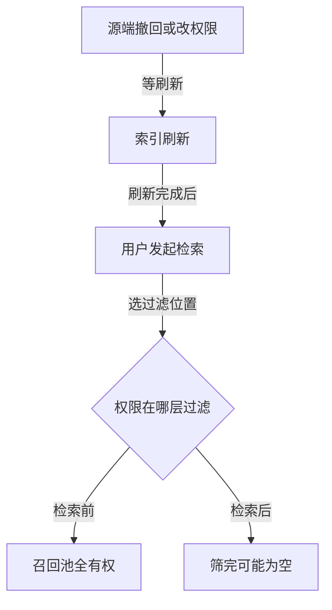
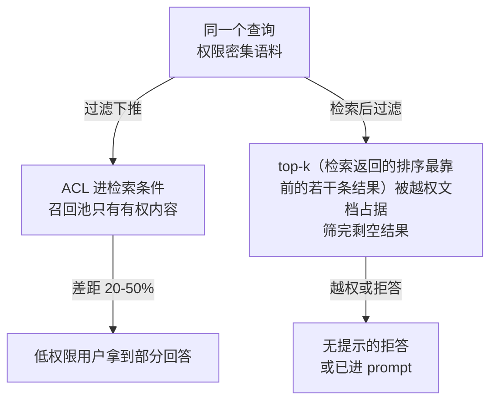

# RAG的新鲜度与权限传播：撤回的数据不能再被检索到

RAG（检索增强生成：先从资料库里找出相关片段，再让模型照着这些片段回答）系统上线后最常见的失效是"检索到了不该检索的东西"：**文档已更新但索引里还是旧版，作者已撤回但向量库里还能召回，用户没有权限但摘要层把内容漏了出去**。读完你能用版本号对账、访问控制列表下推和逐层删除传播，排查并堵住这三类失效。

可以把它想成图书馆的旧版书目：书已经下架，卡片还插在目录柜里。这个比方只到「目录卡片和书架上的书会对不上」为止；图书馆下架不会通知借过书的人，而撤回要主动把消息推到下游每一层。

要解决的问题：**把新鲜度、权限和删除当作检索链路的一等公民（在系统中被原生、正式对待的对象），索引之外的事后过滤不可依赖**。

本质是**三个缓存一致性问题**（同一份数据在不同地方存在多份副本，副本之间要保持同步）叠加。**索引、摘要、向量、图结构都是源文档的派生物（由源文档生成的副本或索引）**；**源变了派生物必须跟着变，权限判断必须在召回前生效，删除必须传播到所有派生层**。**任何一层漏掉，用户看到的都是过期、越权（访问了权限范围之外的资源）或已删除的内容**。下面先看权限该在哪一层拦截，再看版本如何对账，最后看删除如何逐层收回。

## 撤回以后三类失效形态怎么发生

| 失效 | 机制 | 信号 |
| --- | --- | --- |
| 新鲜度失效 | 源文档更新后索引未重建，召回旧版本 | 引用时间戳早于源 updated；同一问题新旧答案不一致 |
| 权限失效 | 召回时只看语义相似度，ACL（访问控制列表，下文多处用到）在生成后才检查或不检查 | 低权限用户引用中出现高权限内容 |
| 删除失效 | 源已删除但向量、摘要、缓存、图节点残留 | 已撤回文档仍被引用；删除后命中率未降 |

## 版本、过滤位置与传播路径分别怎么保证撤回后立刻检索不到

撤回能不能立刻检索不到，取决于**索引刷新与过滤位置这两段：索引刷新需要时间**，刷新完成前旧版仍在检索库里，所以**源端撤回或改权限后要等索引刷新才能生效**；**用户发起检索时权限在哪一层过滤决定召回池的形态**：检索前过滤时召回池只有有权内容、时延看索引刷新，检索后过滤时有权内容已被挤出、筛完可能为空。整个传播链在 Microsoft Learn 官方 RAG 高层架构图上就是两条流：左侧数据管道流负责文档切块、富化、向量化进检索库；右侧应用流经编排器（把查库、调用模型等步骤串起来的调度模块）查库再调模型作答。**撤回要在左边追上索引刷新，权限要在右边拦在编排器取数之前**：


*图源：Microsoft Learn《What is Retrieval Augmented Generation (RAG)?》高层架构图，CC BY 4.0，https://learn.microsoft.com/zh-cn/azure/ai-studio/concepts/retrieval-augmented-generation。两条流是两种失效的现场：新鲜度失效出在左边管道刷新滞后，权限失效出在右边编排器取数绕过了 ACL——本篇讨论的所有传播路径都落在这两条流上。*



**权限过滤的正确位置在召回之前或之中**：向量库支持带 filter 的检索时把 ACL 作为过滤条件传入，不支持时在候选集生成后、上下文组装前过滤。**生成后再检查已经晚了，因为越权内容可能已进入提示词（发给模型的输入指令与背景信息）上下文或被模型转述**。

过滤位置不同，召回池的形态在检索那一步就分岔：**检索后过滤时越权文档占满排序前位，有权内容被挤出，低权限用户能拿到的结果变少**，因此两种做法的召回率（被找回来的相关样本占全部相关样本的比例）差距在权限密集场景**可达 20-50%**：



**新鲜度靠版本一致性保证**：源文档带 revision（源文档每次修改时递增的版本编号，用于检测源与索引是否分叉）与 valid time（生效时间），索引记录同 revision；**召回请求携带当前 revision，命中的片段随结果带回版本号，生成引用时一并展示版本与生效时间**。**检测新旧分叉最简单的办法是定期对账源与索引的 hash**。

**删除传播是三者的老大难**。一次"删除文档"实际要清理：**向量库条目、摘要、父子文档树（把长文档分成父块与子块两级的结构）中的子块、图索引的节点与边、检索缓存、已生成的历史回答**（后者通常不追溯，但要在证据链上标记失效）。**漏掉任何一层，删除就只是"入口不可见"**。

"撤回要收回全部派生副本"的实物原型是旧时的送奶工：订户门口每晚放空瓶，送奶工清晨送新奶、顺手收回空瓶——订户撤订后，若只停送新奶而门前的旧瓶没人收，邻居路过照样以为这家还在订奶：


*图源：Wikimedia Commons，Ontario 保险档案照片，OGL-ON 许可，https://commons.wikimedia.org/wiki/File:Milk_wagon_delivery_man_returning_milk_bottles_(I0004245).jpg。*

撤回一篇文档就是停送一次奶：源端删除只是"不再发货"，**向量库、摘要、缓存、图节点是已经送到各家门口的瓶——删除传播的完整动作是逐层收回，收不干净的层就是"撤回后仍能检索到"的死角**。


来源：[阿里云开发者社区《图文详解 RAG 技术和流程》](https://developer.aliyun.com/article/1670698)（CC 4.0 BY-SA）


## 动手跑一遍会看到什么：一次撤回的传播时延实测

撤回一篇文档后，逐层探测全文检索、向量库、缓存何时真正"不可见"，**三层时延的最大值就是撤回传播的真实上界**：

```bash
# T0：删除源文档（wiki 调用返回 404）
# T0+5min：全文检索引擎仍命中（索引刷新周期 5 分钟）
# T0+30min：向量库仍召回（重建管道周期 30 分钟）
# T0+31min：缓存层仍返回（TTL（Time To Live，存活时间：到期后自动失效或删除） 30 分钟，缓存过期时间到期前未主动失效）

# 三层时延取最大值 = 最坏 30+ 分钟内，撤回内容仍可能出现在答案里
```

复现方法的要点：撤回后按固定间隔用同一查询打检索层与生成层，**记录"仍被引用"的最后一次时间——三个 TTL（Time To Live，存活时间：到期后自动失效或删除）的最大值就是撤回传播的真实上界**。**修正动作按层做：索引层挂删除事件流CDC（Change Data Capture，变更数据捕获：把数据库的增量改动当成事件流发出去），秒级、向量库支持按文档 ID 单独删除条目（不必等整库重建）、缓存层在删除事件里主动失效**。

## 这些量在什么数量级：权限过滤的位置差

权限过滤放在检索后（top-50 再过滤），**top-k（检索返回的排序最靠前的若干条结果）被越权文档占据，用户可能拿到"全被过滤光"的空结果且无提示**；放在检索中（元数据过滤下推），**召回池从一开始就只有有权的内容——两种做法的召回率差距在权限密集场景可达 20-50%**（大量文档因权限被扔掉后 top-k 被污染或排空）。成本侧：**下推过滤要求向量库支持元数据索引，过滤字段基数高（万级用户组）时索引膨胀显著，按实际权限模型选字段**。

## 这套说法在哪儿会失效

- 先过滤权限会缩小召回池，可能让低权限用户得到"拒答"而非"部分回答"，这是产品决策不是技术缺陷，需要明确选一个。
- 向量库的 filter 性能有限：ACL 维度多、规模大时，先粗召回后细过滤可能比全量带 filter 更快，两种顺序都要测。
- 版本一致性有窗口期：源更新到索引重建之间必然存在旧版可召回的间隙，重要的场景要在引用上标注时间戳让用户可判断。
- 图索引（如 GraphRAG 这类基于图结构的检索方案）的删除传播成本远高于平面向量：节点被多份摘要引用时，删除需重建受影响的摘要层。

## 怎么自己动手验证

权限与新鲜度要与派生层对账——删除后所有派生层零命中、低权限回答不含高权限内容，任一项与预期对不上就说明传播链没有覆盖到那一层。

最小验证做三个测试：一是删除传播测试，删一篇文档后遍历所有派生层断言零命中，记录传播时间；二是越权零容忍测试，用不同权限身份跑同一问题集，断言低权限回答不含高权限内容的 hash；三是新鲜度对账，抽样比较源与索引的 revision，统计分叉率。

关系：[[工程知识/AI 系统工程：从模型能力到生产能力/知识与检索/RAG数据管道从文档到可引用证据]] · [[工程知识/AI 系统工程：从模型能力到生产能力/知识与检索/RAG的核心是选择可引用证据]] · [[工程知识/AI 系统工程：从模型能力到生产能力/模型与上下文/记忆是受治理的状态，不是更长的聊天记录]]
