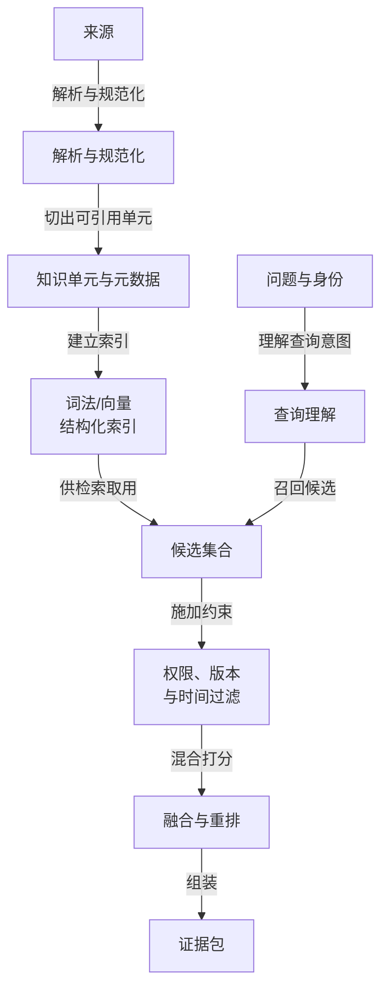
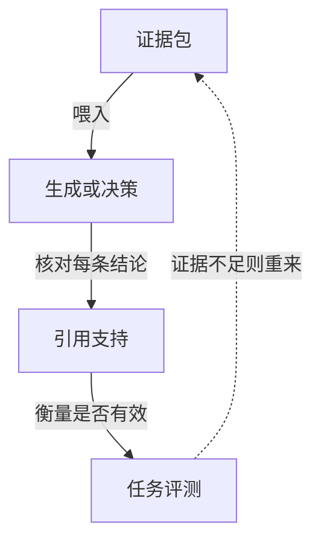

# RAG 的核心是选择可引用证据

RAG（检索增强生成：先从资料库里找出相关片段，再让模型照着这些片段回答）的关键**按问题、身份和时间挑出能支撑结论、并且能被检查的证据，而不是**把更多文本塞进上下文。读完这篇你能判断检索该在哪一层加强，**也知道为什么必须能拒答**。

RAG 要解决的问题是：**模型训练时学到的知识有截止时间，之后的新事实它不知道，而且答完说不清依据是哪条资料**。核心是**按问题、身份和时间选择能支持结论的证据**，把更多文本塞进上下文解决不了这件事；边界是**召回命中**（被检索到的片段）不等于**模型使用正确**，**必须能拒答、引用和处理冲突版本**。最小实验是用**单跳、数字、无答案和撤权样本**分别测召回与引用支持。

RAG 是一个证据系统：**针对当前问题、身份和时间，从外部知识中选择能够支持结论的材料，并让答案与这些材料建立可检查的关系**。"向量数据库（专门存向量并按相似度检索的数据库） + 大模型"的印象只覆盖了候选生成与生成两段；**解析、权限、版本、排序、证据覆盖和拒答共同决定系统质量**。

## 要解决的问题：按问题与身份与时间选择证据的依据是什么

模型训练完成后记住的知识有截止时间，之后的新事实它不知道，只能靠外部资料补齐；检索到的内容也无法证明它支持当前结论，团队只能看到回答质量不稳定而找不到原因。本篇回答：按问题与身份与时间选择证据的依据是什么、召回命中与正确使用之间的差距在哪里、无法回答时怎样拒答，以及处理同一事实的多个版本时按什么顺序判定。

## RAG 是怎么运作的，它的本质是什么？

打个比方：RAG 像给模型配一个带编号的档案室——先把资料拆成能单独抽出的一页页，每页贴上来源、日期和谁能看，问到哪件事就按编号把那几页抽出来摆在桌上，模型照着桌上这几页写答案，写完还要标出每句话出自第几页。这个比喻到"材料怎么进出"为止：它让你记住检索、权限、引用这三个动作，但相似度怎么算、重排（布局或尺寸变化触发重新计算排版）模型怎么打分、两段证据打架时判谁赢，都得看正文里的机制，比喻帮不上忙。

RAG 的机制层：**模型的参数里只有训练截止前的通用模式，外部事实必须由当前可访问的材料补充**，而材料能否出现在答案里取决于**它经过解析、过滤、召回与重排之后是否进入模型可见的位**置。相似度（文本在语义或字面上有多接近）**只说明文本接近**，能否支持结论取决于**权限、版本与时间过滤之后的证据集合**，**两者的判断依据不同**。

RAG 原论文把这条链概括为两段：检索器从外部知识里取出若干段落，生成器以这些段落为条件产出答案。下面这张原论文架构图给出了它的最小形态：

图中只画到"检索器 + 生成器"两段，**正因如此它容易让人低估工程复杂度：解析、权限、版本、重排、证据覆盖和拒答都不在这张图里，却共同决定系统质量**。

**检索结论要与引用对账（逐条核对答案能否指回原文）——预写每个答案都能指回原文片段，指不回或只能指到模型解释时，与预期对不上，该证据不可引用**。


来源：[阿里云开发者社区《图文详解 RAG 技术和流程》](https://developer.aliyun.com/article/1670698)（CC 4.0 BY-SA）


## 一条完整链路长什么样



证据包组装完成后进入生成与核对环节：



**只优化 embedding（把文本转成一串可计算距离的数字），相当于只优化这条链中的一个部件**。

## 演进为什么暴露新的失败层

| 阶段 | 新增能力 | 主要失败 |
| --- | --- | --- |
| 直接塞上下文 | 小规模资料可直接使用 | 容量、噪声、权限和更新成本 |
| 稀疏检索 | 精确词、编号、代码和专名匹配 | 同义表达和语义改写 |
| 稠密检索 | 语义相似和跨表达召回 | 数字、否定、版本和相似干扰 |
| 混合检索 | 兼顾词法与语义信号 | 融合权重和候选重复 |
| 重排 | 改善前几名证据质量 | 延迟、候选规模和领域迁移 |
| 查询分解 | 处理多面和多跳问题 | 子问题遗漏、路径膨胀 |
| Agentic retrieval（让模型根据中间结果自主继续检索） | 根据观察继续查找 | 无界搜索、来源污染和成本 |
| 时间与权限感知 | 支持企业当前事实 | ACL（Access Control List，访问控制列表：逐条列出谁可以对资源做什么） 滞后、删除延迟、版本冲突 |

**这些能力每一层都只补一类失败、又引入新的失败层，所以单点能力无法覆盖全部，实际系统通常需要混合这些能力，而不是**选择一个「最先进 RAG」标签。渔网补洞是同一件事：**网眼太大漏小鱼，补密了挂水草（新失败），再加一层滤网又堵住大鱼的路——每一层补丁堵住一类漏，也带来一处新的堵，最后的网是层层补出来的组合，没有"一张一劳永逸的网"**。

## 为什么数据建模先于检索算法

检索的读路径和缓存是同构的：先查近的地方，没有才回源（缓存未命中时去后端或源站取数据）。旁路（绕开主流程的备用路径）缓存（在数据源旁另设一层缓存）把这条路径写得很清楚——读时先查缓存，未命中才读数据源并回填。**缓存能否精准回源与失效，取决于数据是否带租户、版本、时间等元数据，所以数据建模要先于检索算法**。


一个知识单元不应只有文本和向量。至少保留：

```yaml
document_id: policy-42
unit_id（单元编号字段）: section-3.2
source_uri（来源地址字段）: ...
source_type: official_policy
version: 2026-08-10
valid_from: 2026-09-01
valid_to: null
owner: support-platform
acl: [role:support, tenant:acme]
content_hash: ...
parent: policy-42
```

**切块需要尊重标题、表格、代码、列表和父子关系**。固定字符切块虽然简单，却**容易把条件与结论、函数签名与实现、表头与数据分开**。**对代码应保留符号、文件和引用关系；对表格应保留表头与行列语义；对政策应保留生效时间和适用主体**。

那么可引用的证据到底长什么样？LTO（Linear Tape-Open，磁带存储技术）磁带的目录卡（LTO-CM，LTO Cartridge Memory）是一个可直接对照的实物例子：每盘带内置一枚非接触存储芯片，带上数据的校验、分区索引、写入次数都随带保存——磁带走到哪里，它的元数据跟到哪里，驱动器读带前先读芯片核对，数据与元数据一体是「可引用」的物理前提。这正是知识单元该有的形态：content 与元数据（芯片上的校验与索引对应 source_uri（来源地址字段）、version、unit_id（单元编号字段））一体保存，引用可核对到具体位置。磁带不带目录卡时驱动器拒读（无法确认身份与版本），证据系统里切块时拆散了正文与元数据的对应，引用就成了无从核对的话。


*图源：Wikimedia Commons，Linda Bartlett（美国国家癌症研究所），公有领域，https://commons.wikimedia.org/wiki/File:Computer_tapes.jpg。*

## 检索质量为什么要分层测量

| 层 | 指标或问题 |
| --- | --- |
| 解析 | 文本、表格、代码和元数据是否完整？ |
| 候选召回 | 必需证据是否出现在候选集合，Recall@K 如何？ |
| 排序 | 必需证据是否进入模型实际可见的位置，MRR（Mean Reciprocal Rank，平均倒数排名：检索质量指标）/nDCG（衡量排序质量的指标）如何？ |
| 覆盖 | 多面问题的核心子问题是否都有证据？ |
| 引用支持 | 每个关键句能否由引用片段直接支持？ |
| 新鲜度 | 答案是否使用查询时有效的版本？ |
| 权限 | 越权内容是否在检索前或最迟生成前被强制过滤？ |
| 任务结果 | 证据是否真正提高用户任务成功率？ |

  **最终答案正确但引用不支持，和引用正确但漏掉关键方面，是两种不同故障。必须分别标注**。质检分开核对结论与出处是同一分工：**会计账面平了但每笔都对不上凭证（答案对、引用不支持），与凭证齐全但漏了一类支出（引用对、覆盖不全），是两种要分别修的错——混在一起说"报告有质量问题"，谁也改不动**。

## 什么时候不用向量检索

- **主键、订单号、版本号和精确字段优先结构化查询或词法检索**；
- **需要聚合、过滤和计算的数据优先数据库或分析引擎**；
- **实时状态优先业务 API，而不是**等待索引同步；
- **小而稳定的规则可以直接进入程序或短上下文**；
- **用户问题不需要外部事实时，不应为了架构统一强行检索**。

  RAG 与工具的区别在于**：RAG 主要返回支持判断的证据**，工具可以**读取实时状态或产生动作**。**一个 Agent 可以先检索政策，再调用订单 API，最后提出退款动作；不要把三者都塞进「知识库查询」**。办事窗口的分工是同一个区别：**翻政策汇编（检索证据）、刷系统查实时余额（工具读状态）、点"确认退款"（工具做动作）是三个动作——把"查余额"也当成翻资料，刷出来的就是几分钟前的快照，余额刚变动就错了**。

## 为什么更新、删除和权限是生产核心

**索引必须能回答源文档何时更新、哪些单元受影响、旧版本何时停止可见、删除多久传播、embedding 变更是否需要重建**。**缓存键需要包含租户、权限版本、文档版本和必要的时间切片；对撤权和实时事实敏感的查询，不应只依赖相似度缓存**。

## 失败按什么顺序定位

遇到错误答案时按链路向前追，追的路径如下：

1. 来源中是否存在正确事实？
2. 解析是否保留了它？
3. 权限与版本过滤是否正确？
4. 候选召回是否包含它？
5. 重排是否把它放进可见位置？
6. 组装证据包的 Context Builder 是否真的选择了它？
7. 模型是否正确使用并引用？
8. 任务评测是否把错误识别出来？

  **这比笼统地「调 chunk size 或换 embedding」更能定位根因**。流水线逐站查是同一方法：**一批货送到终点少了件，从装车、分拣、装盒、贴单、扫描逐站核——每站问"货过我这儿了吗"，第一处答"没见过"的那一站就是丢件点；上来就调传送带速度（调 chunk size），十有八九白调**。

## 发布前如何证明它真的有用

先把一组真实问题固定下来，并为每个问题记录：应命中的证据、允许的版本与权限、答案必须覆盖的断言，以及无答案时应如何拒答。然后按下面顺序验证：

1. **数据层**：**抽样检查解析结果是否保留标题、表格、代码、链接和生效时间，并用源文档哈希（把任意长度数据压成固定长度指纹、不可逆）确认没有静默丢失**。
2. **检索层**：分别测候选召回、过滤、重排和最终上下文，**不把「进入候选集」误当成「模型实际看见」**。
3. **生成层**：**逐条核对关键断言是否被证据支持**；证据不足时，**系统应拒答或明确说明缺口，而不是**用模型记忆补齐。
4. **系统层**：在撤权、删除、版本冲突、索引延迟和高并发下重跑，**记录延迟、成本、错误和租户隔离结果**。

  **只有当检索、引用、权限、时效和任务结果同时通过，RAG 才能进入线上流量**。新药放行的道理一致：**成分核对（数据层）、动物与临床试验（检索与生成层）、储运与禁忌（权限时效层）全过才上市——任何一层"看起来还行"都换不来放行，上市后出事召回的代价远大于做完全部试验**。详细指标见 [[工程知识/AI 系统工程：从模型能力到生产能力/质量与运营/RAG评测要分离检索质量与生成质量]]。

## 还想深入可以接着读哪几篇？

- [[工程知识/AI 系统工程：从模型能力到生产能力/模型与上下文/记忆是受治理的状态，不是更长的聊天记录]] · [[工程知识/AI 系统工程：从模型能力到生产能力/质量与运营/Agent评测必须覆盖轨迹而不只看最终答案]]
