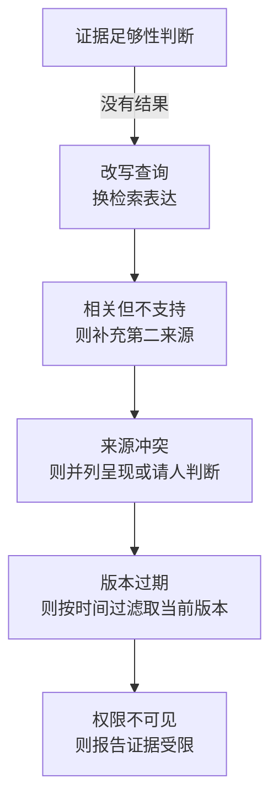
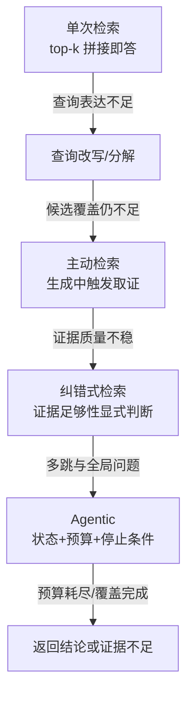

# 检索从一次查询演进为有状态的证据获取

**RAG（检索增强生成：先从资料库里找出相关片段，再让模型照着这些片段回答）的演进逐步回答五个未解决的问题：何时需要外部证据、应该查什么、结果是否足够、证据如何组织、什么时候停止**。**每增加一层决策能力，也增加一层可观测和评测责任**。**读完后你能判断自己的检索方案该不该从单次查询升级为有状态检索，以及每加一层能力要补哪些评测**。

**所谓有状态（state），是指系统记着已经查过什么、还缺什么、预算还剩多少，下一步动作由这些记录决定**。可以把它想成查资料：简单问题查一次目录就够；问题含糊时先改写关键词；需要多份材料时分成子问题；证据互相矛盾时要换源或停下来请人判断。

这个比方只到行为层面，状态的具体字段要看正文。**所谓「高级 RAG」（advanced RAG），就是把上面这些动作变成可记录、可限时、可评测的状态，而不是让模型无限搜索**。

它在普通一次检索之外，再加改写、分解、纠错、多轮循环等决策步骤——改写针对查询表述偏差，纠错针对证据不足，多轮循环针对需要多跳的问题。这个比方只到「下一步由已查过什么决定」为止，子问题怎么拆、预算怎么分配要看正文。

## 一次查询为什么不够用：要解决的问题

**一次查询什么时候会不够用？需要多跳推理、或者问题表述和语料用词不一致时，召回就会不足——把全部检索压在一次调用里，表述偏差没有机会被修正**。**本篇回答：检索为什么会演进成有状态的过程、状态里需要保存什么、每一类能力新增了哪些评测维度，以及什么时候应当停止检索并给出证据不足的结论**。

## 有状态的证据获取强在哪：机制与本质

先打个比方：单次查询像去图书馆只问一次"哪本书讲预算"（管理员递来一摞书就走），**有状态检索像请了一位研究员——他记着已经翻过哪些书、哪些子问题还没查、今天还剩两小时预算，下一步去哪个书架由记到哪儿决定**。这个比喻到"书架"为止——**现实里状态里存的是证据、未覆盖子问题与剩余预算，停止条件因此成为必要组件**。

**单次查询把检索看作一次函数调用（按一次按钮出一个结果，查完即结束）；有状态检索把它看作一个循环（反复看路况决定下一步怎么走），状态里保存已获得的证据、尚未覆盖的子问题与剩余预算，每一步的动作由当前状态决定**。**状态的存在使停止条件成为必要组件——状态里记着剩余预算与未覆盖子问题，预算耗尽或子问题覆盖完成就必须停；也使评测从命中率（请求直接从缓存拿到结果的比例）转向轨迹与成本，因为每一步动作由当前状态决定，只看最终命中判断不了中途决策的质量，要看整条轨迹与花费**。


来源：[阿里云开发者社区《图文详解 RAG 技术和流程》向量搜索一图](https://developer.aliyun.com/article/1670698)（CC 4.0 BY-SA）


再一处图源：[阿里云开发者社区《图文详解 RAG 技术和流程》两阶段一图](https://developer.aliyun.com/article/1670698)（CC 4.0 BY-SA）


## 为什么可更新知识要放在参数之外：基础范式

**2020 年的 RAG 工作把参数化生成模型与外部非参数记忆结合，核心价值是让模型按输入取得外部信息，而不是要求所有事实都固化在参数中**。**这建立了长期不变的分工：模型擅长语义整合，外部知识系统负责可更新、可定位的事实**。

检索系统最初的工程形态通常是最简单的四步链：

```text
问题 -> 单次检索取回前 k 条候选（top-k）-> 拼接片段 -> 模型回答
```

**它适合问题与单个片段高度对应的语料，但很快暴露出查询表达、证据覆盖和检索质量不可见的问题：单次调用把检索压成一步，没有中间状态记录每步召回了什么，所以哪里漏了、哪步质量差都无从观测**。

## 相似为什么不等于有用：混合召回与重排

多路召回之后要排个先后，**重排（布局或尺寸变化触发重新计算排版）就是给候选排一个优先级顺序，分数高的先进入生成环节**。**招聘筛简历是同一个两段式：先按关键词从简历里粗筛出三百份（多路召回），HR（Human Resources，人力资源）再逐份细读排出面试名单（重排）**——比喻到「先撒网再排序」为止：**HR 再仔细也只能在已收到的简历里挑，初始查询没捞到的候选人（候选里本来就没有的证据）她见不到，这是重排的天花板**。


**稠密向量（用一串数字表示一段文字的语义，意思相近则数字接近）擅长语义改写，词法检索擅长编号、专名、代码、数字和罕见词。两者没有简单替代关系**。**生产系统常先合并多个通道的候选，再用交叉编码器（把查询与候选一起编码打分）、后期交互（late interaction：先各自编码、检索时再交互算分）或任务规则重排**。

**这一阶段解决「候选是否覆盖」和「前几名是否可用」，但不能解决复杂问题需要多组证据、初始查询信息不足或检索结果本身质量差——重排只决定已有候选的先后顺序，拿不出新证据，初始查询没查到的、候选里本来就没有的，它都无能为力**。

## 用户问题为什么不一定是最佳查询：改写与分解

复杂问题可能包含多个方面，或者需要先找到一个实体再查第二跳。系统开始生成多个查询、分解子问题、使用假设性文档或沿实体关系扩展。

**收益来自提高证据覆盖，代价是查询漂移、重复候选、调用成本和组合爆炸**。**因为多轮查询会漂离原意、组合爆炸让结果难追溯，规划器必须保留原始目标，列出需要覆盖的子问题，并能解释每个检索步骤服务于哪个缺口，才能把方向拉回**。

## 为什么不是每个位置都值得查询：主动检索

FLARE（一种在生成过程中按不确定性主动触发检索的方法）把检索触发推进到生成过程：当后续内容不确定时再主动获取资料。在此基础上，Self-RAG更进一步，把是否检索、证据相关性和生成支持度都纳入反思信号。与之不同，Adaptive-RAG关注的是查多深：按问题复杂度在不检索、单步和迭代检索之间选择。

**这三个方法都让检索从固定前置步骤变成运行时决策，区别在触发方式**。**FLARE 与 Self-RAG 由模型在生成中当场决定要不要查、查几轮、何时停。Adaptive-RAG 先用模型评估问题是否需要多跳推理、是否需要多份材料，以此判定复杂度，再据此决定检索深度：浅问题一次检索，深问题迭代多轮**。**把"是否继续取证"交给模型自己判断时，评价这一步必须有外部锚点——内部自评仍是模型自己给自己打分，发现不了模型固有的盲区，算不上锚点**。**Reflexion 是一种带自我反思循环、用外部反馈纠偏的调优方法，让模型在多轮尝试中根据外部评分调整策略，它把评估信号分成内部自评与外部反馈两类（内部自评是模型自己打分；外部反馈来自真实答案或人工判定）。只有在外部反馈可用时，反思才真正带来下一轮的改进：外部反馈来自真实答案或人工判定，能纠正模型自己看不到的方向**。

「有状态的证据获取」这件事，企业磁带库是现成的实物参照：**一座自动磁带库装着上万盘 LTO（Linear Tape-Open，磁带存储技术）磁带，总容量以 PB（Petabyte，千万亿字节）计，任何人都读不完——机械臂取带不靠遍历，而是按目录定位到具体槽位（「检索键」），磁带插入驱动器后按文件索引读取所需块（「切片」），取出的数据就是「证据」，这盘带上没有就换目录再查（「改写查询」），查遍目录都没有就明说「库中未见」（「证据不足即停」）**。**所谓状态记录，就是前面定义的 state：记着查过什么、还缺什么、预算还剩多少。检索系统要修的正是这套纪律，而不是把整库数据全塞给模型**。


*图源：Wikimedia Commons，Jorge Franganillo，CC BY 2.0，https://commons.wikimedia.org/wiki/File:StorageTek_tape_library_(51993015872).jpg。*


## 低质量证据为什么不能直接进生成：纠错式检索

**CRAG（一种先评估检索质量、证据不足时再走纠错路径的方法）等工作引入检索质量评估和纠错路径：当本地候选不足时改写查询、扩大来源或使用其他数据源**。**其核心是把「当前证据是否足够」设成显式状态**，具体算法各版本不同，但都遵循同一思路：**先判断证据够不够，再决定下一步动作**。

**这个状态至少区分：没有结果、结果相关但不支持结论、来源冲突、版本过期和权限不可见。不同原因对应不同动作，不能统一成「再搜一次」**。

这五种不足的处置路径各不相同，画进同一张图：



## 索引结构怎么跟着问题结构走：层次与图检索

RAPTOR（一种把文档递归聚类再逐层摘要、形成层次结构的索引方法）通过递归聚类和摘要构造层次表示，适合跨长文档的多层问题。GraphRAG（把语料抽成实体关系图再做社区摘要的方法，微软提出）使用实体关系与社区摘要处理语料级全局问题。**层次索引像先读目录再读章节摘要，逐层缩小范围；图索引像顺着人物关系网追线索，从一个人查到一群人**。**它们解决的是普通片段检索难以覆盖的特定问题结构，不是所有 RAG 的默认高级版本**。

**如果任务主要是精确政策、代码符号或订单状态，图构建成本很可能没有收益**。**采用前先建立「局部事实、跨段综合、关系路径、全局主题」等查询切片，证明新索引只在哪些切片上改进**。

## 证据获取怎么变成可恢复任务：Agentic retrieval

什么时候检索该变成可恢复任务？**当系统能根据当前证据选择查询、数据源和下一步，并保存未解决问题、观察和预算时，检索成为有状态过程**：刑侦探案是同一个形态：**侦探手上有一块案情板（状态记录），钉着已查实的证据（resolved）、还没落实的疑点（required）、办案经费（预算），下一步去哪儿查由板子上缺什么决定，经费烧完或疑点清零就收队**——比喻到「看板决定下一步」为止：**侦探收队还有案卷归档，检索的停止还要把证据不足作为正式结论输出，不能悬着**。

```yaml
question: ...
required_facets: [...]
resolved_facets（已解析的维度字段）: [...]
queries: [...]
evidence: [...]
conflicts: [...]
remaining_budget（剩余预算字段）: ...
stop_reason: ...
```

状态里的三个字段与磁带库的对应关系：resolved_facets（已解析的维度字段）即已拿到证据的子问题，queries 即已经发出过的查询，remaining_budget（剩余预算字段）即剩余检索预算。

**「Agentic」新增的是决策与状态；循环调用一个 retriever 只是它的表层形态。它适合动态网站（网页内容随时间变化）、跨数据源调查和开放式研究**。**对固定知识问答，不需要运行时决策与状态维护；省去循环调用与预算跟踪的开销，确定性混合检索通常更便宜、结果也更可复现**。

从单次查询到有状态检索，决策与停止条件怎么长出来，演变过程见下图：



## 自动调优能调哪些旋钮、又替代不了哪些事？

**AutoRAG（一个开源的 RAG 自动调参工具）这类工具把检索管线（pipeline，数据从输入到输出依次经过的处理流程）的各个环节——解析、切分、向量化、召回、重排、生成配置——放进实验空间，在固定问题集上批量比较不同参数组合，找出可行方案；哪些参数进入试验范围、用什么指标判好坏仍要人来定**。**它解决的是人工一次只试一个参数、实验难复现的问题；收益是更快发现可行组合，代价是搜索成本、过拟合（模型把训练数据的噪声也记住、在新数据上表现变差的现象）和错误目标函数被放大**。**它替代不了的是真实任务的回归验证、权限与语料快照（某一时刻的完整只读副本）的固定、人工对合成问题的抽样核验**。

**一轮受控优化应当固定语料快照、问题与参考证据、权限、模型和硬件，再同时比较检索质量、引用支持、延迟与费用**。**调优集与保留集必须分开，合成问题要抽样人工核验；自动选择出的配置先进入影子流量或灰度（新版本先放一小部分流量验证，逐步放大到全量），而不是直接覆盖线上索引**。**模型或框架给出的「最佳配置」只是候选结论，不能代替真实任务回归**。

## 升级路径怎么挑

| 已观察到的失败 | 优先动作 | 暂时不要做 |
| --- | --- | --- |
| 还没有稳定评测集 | 建立问题、证据、权限和无答案样本 | 比较模型或向量库排行榜 |
| 目标证据在候选里但排得靠后 | 引入或校准重排器（reranker） | 立刻重做整个索引 |
| 语义改写、多语言召回不足 | 对照更合适的 embedding，例如 BGE-M3 类多语言模型 | 只看公开 benchmark 就迁移 |
| chunk 脱离标题和邻近语义 | 加入文档上下文、父子扩展或 Contextual Retrieval（为每个文本块附带其所在文档的上下文一起索引） | 单纯扩大文本块（chunk）和 top-k 取回条数 |
| 初始查询无法覆盖多面问题 | 查询分解、主动或纠错式检索 | 无界 Agent 循环 |
| 问题依赖关系路径或全局主题 | 在对应问题切片上评估 GraphRAG | 把全部语料默认图化 |
| 现有存储无法表达过滤和更新 | 最后再评估索引或向量库迁移 | 用换数据库掩盖解析与评测缺失 |

**这个顺序是因果顺序：先证明失败发生在哪一层，再改变能影响该层的最小组件**。**每次只改变一组变量，才能知道收益来自哪里**。产品榜单的顺序与本表的先后没有关系。

## 检索演进后评测要怎么变

| 能力 | 不能只看 | 必须新增 |
| --- | --- | --- |
| 混合与重排 | 最终答案 | 各通道召回率（Recall，该通道该召回的证据有多少被找回来了）、融合效果（多路召回结果的合并方式）与排序质量 nDCG（normalized discounted cumulative gain，归一化折损累积增益，越靠前的命中权重越高）|
| 查询分解 | 单个 query 命中 | 子问题覆盖、漂移与总查询数 |
| 主动检索 | 是否调用检索 | 触发正确性与避免检索的收益 |
| 纠错 | 最终找到证据 | 质量判断、换源和冲突处理 |
| 层次/图检索 | 平均 Recall | 适用问题切片与构建成本 |
| Agentic retrieval（由模型自主决定检索时机与方式的检索） | 回答质量 | 轨迹、停止、总成本和来源安全 |
| 自动配置搜索 | 调优集最高分 | 保留集、复现记录、成本约束和回滚（把系统恢复到上一个可用版本） |

演进方向最终都回到同一个标准：**系统是否以可接受的成本，找到当前主体有权使用、在当前时间有效、足以支持目标结论的证据。**


## 会话场景怎么防改写跑偏：会话态检索的对账

**会话态检索（多轮对话里带着上下文做检索）的效果要与查询意图对账——补全后的查询与用户原始意图偏离（补进了会话噪声、没有带来澄清），看每轮改写的 diff 与最终答案引用的证据，对不上的轮次回退为仅用原始查询**。**翻译官替客户问价是同一个风险场景：客户原话「这批货什么价」（原始查询），翻译官补了一堆前情摘要去问（改写），卖家答非所问时，要能翻回客户原话重新问（回退为仅用原始查询）**——比喻到「原话留底可回退」为止：**问价错了还能再问，检索跑偏烧的是预算与延迟，所以每轮 diff 都要留痕**。

## 想自己验一遍怎么动手：验证

**盲测对照是同一个做法：把单次检索与多轮检索的结果都去掉来源标签（不告诉评判者哪份是谁出的），让评判者按子问题覆盖率与正确率两项断言打分，再看谁的查询成本高（总查询数、总 token、耗时）**——比喻到「去标签盲评」为止：**盲测只评质量，成本账还要单独算，提升值不值要除以多花的查询数**。

**最小验证：取一组需要多跳才能回答的问题（答案分散在两份以上材料里），分别用单次检索与多轮检索跑，断言多轮方案在子问题覆盖率与最终答案正确率上更高，同时记录总查询数、总 token 与端到端耗时，确认提升与成本的比例可以接受**。

**停止条件验证：构造一个无法从语料中回答的问题，断言系统在预算耗尽时返回明确的证据不足，而非继续扩大检索范围**。

## 这套演进在哪儿会失效：边界

- **多轮检索的收益依赖问题本身可分解：答案集中在一份材料里的问题，多轮只会增加查询次数与延迟**。
- **判断检索时机的正确率决定收益：把需要检索的问题判为不需要时，本轮不会取回证据；把不需要检索的问题判为需要时，多付出一次检索成本**。
- **检索轮数与上下文占用互相推高：每多一轮就往上下文多塞一批证据，轮数越多占用涨得越快，上下文窗口（模型一次能读入的最大文本长度）长度固定，所以轮数加到一定程度先撞上上下文上限而非先撞上预算**。
- **纠错依赖质量判断的正确性：判错方向时换源会换到更差的材料**。
- **图检索与层次检索需要额外的构建与维护：语料更新快时，图结构本身的维护成本可能超过它带来的召回收益**。

## 接着读哪几篇：同在AI 系统工程里的相邻问题

- [[工程知识/AI 系统工程：从模型能力到生产能力/知识与检索/RAG的核心是选择可引用证据]] · [[工程知识/AI 系统工程：从模型能力到生产能力/知识与检索/混合检索、重排与查询改写各自解决什么问题]] · [[工程知识/AI 系统工程：从模型能力到生产能力/质量与运营/RAG评测要分离检索质量与生成质量]]
