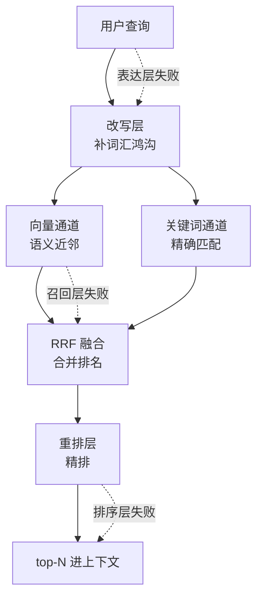
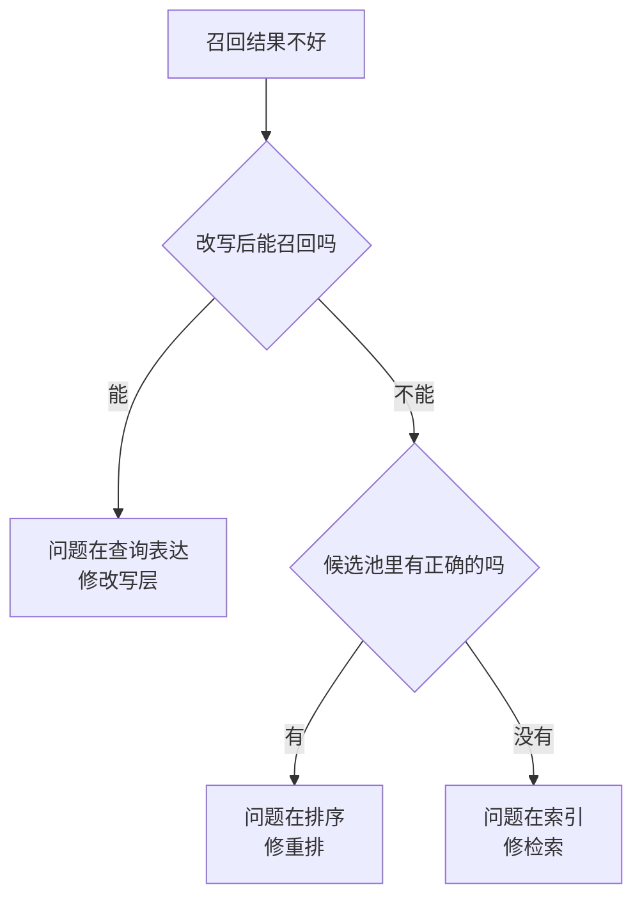
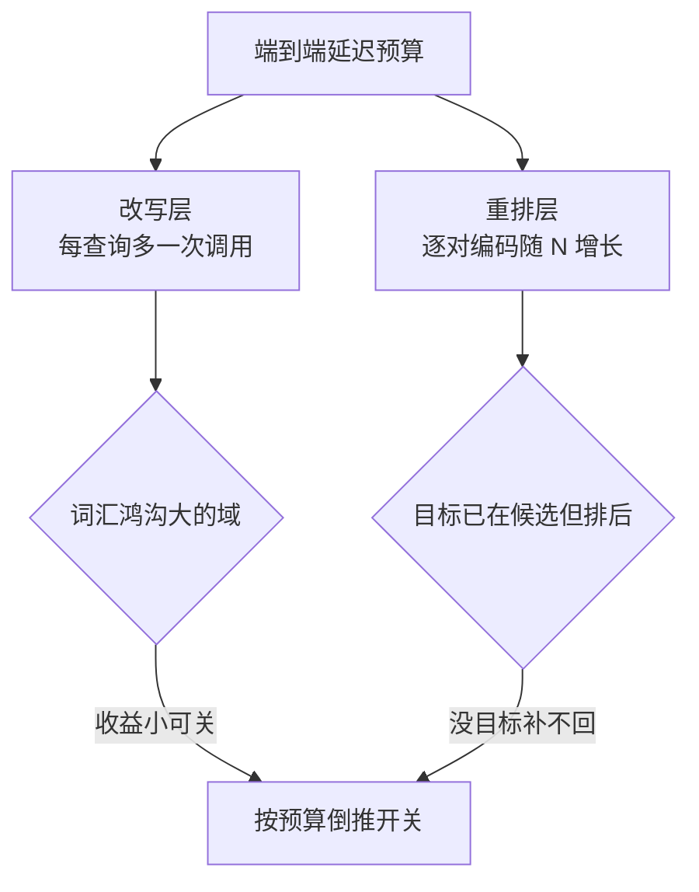

# 混合检索、重排与查询改写各自解决什么问题

**混合检索、重排和查询改写修的是不同层的失败：找候选、排顺序、补问题表达**。读完这篇你能判断失败发生在哪一层，并用最小对照验证每个组件的真实贡献。

**最小对照指在同一查询集上分别关闭某一个组件、对比指标变化的实验方法：记录 Recall@k（前 k 条结果里命中目标的比例）、nDCG（按名次加权的排序质量指标）、引用覆盖、延迟和成本，避免把堆组件误认为提升**。

**RAG（检索增强生成，先检索资料再让模型照着资料作答的框架）检索失败不是一个单一问题：关键词检索擅长精确术语和稀有标识，向量检索擅长语义近似，重排擅长在较小候选集中精细比较，查询改写擅长弥补用户问题表达不完整**。**把所有技术都堆上去会增加延迟；而且每个组件只贡献各自的分数、没有单独归因，叠在一起就分不清是哪一层在起作用，因此更难解释，必须先判断失败发生在哪一层**。

## 要解决的问题是什么

**回答质量不佳时把所有检索手段一起加上，延迟与成本上升而质量没有变化，也无法判断究竟缺哪一环**。本篇回答：候选生成、相关性排序与问题表达各自修复的是检索链路的哪一段失败、各项在什么条件下才有收益、关闭其中一个组件时应当观察哪些指标，以及怎样避免把组件的堆叠当成质量的提升。

## 三个组件分别修好哪一种失败？

先打个比方：检索链路像图书馆找资料，这个比喻只说明三阶段的分工，不涉及具体的编码与融合算法——**查询改写是先把你的问题翻译成图书管理员听得懂的说法（把"回滚消息"翻成书架上叫"补偿"的那类书），混合召回是同时按书名索引和"相似话题"两种线索各拉一车候选书，重排是管理员把两车书逐本翻开比较、挑出最相关的十本。三步各修一种失败：翻译没做，表达清楚的问题也找不到书；只有一种召回线索，要么漏了改了名的书、要么漏了内容相关的书；没有最后那道逐本翻，翻错顺序就让最好的书沉底**。

**这个比喻到"挑出十本"为止——现实里逐本翻——cross-encoder 逐对编码算力贵，只能对融合后的前一百条做，这正是分层的原因**。

**混合检索与重排的机制层：检索失败分别发生在候选遗漏、候选排序与问题表达三个位置。词法检索依据精确 token（词元，文本被切分的最小单位）匹配，向量检索依据表示空间中的邻近，重排依据查询与段落的联合编码。三种方式的依据不同，各自能修复的范围互不重叠。在候选集合里没有目标文档的情况下，重排只能重新安排已有的候选，无法补回缺失的材料**。


来源：[阿里云开发者社区《图文详解 RAG 技术和流程》三阶段一图](https://developer.aliyun.com/article/1670698)（CC 4.0 BY-SA）


再一处图源：[阿里云开发者社区《图文详解 RAG 技术和流程》精排阶段一图](https://developer.aliyun.com/article/1670698)（CC 4.0 BY-SA）


## 四层各自管什么？

| 层 | 解决 | 不解决 |
| --- | --- | --- |
| 词法/BM25（按词频与逆文档频率打分的关键词检索算法） | 专名、错误码、版本号、精确短语 | 同义改写、隐含意图 |
| 向量召回 | 语义近似、自然语言表达差异 | 稀有 token、权限和事实正确 |
| 融合（如 RRF，倒数排名融合） | 合并不同召回器的候选排名 | 候选集合本身没有目标文档 |
| Cross-encoder（把查询与候选文本拼在一起联合编码的重排模型）/重排 | 用 query 与文档联合编码精排 | 大规模全库搜索、过期/越权文档 |

**查询改写、分解、扩展或假设性答案可以提高召回，但改写由生成模型产出，可能造出原文没有的词汇或假设，因此会引入模型幻觉（模型生成看似合理、实际与事实不符的内容），还有额外循环和成本**。**每个改写都应保留原问题、改写文本、召回来源和最终证据，便于判断收益是否来自真实覆盖**。

**同一个查询在四层依次流动：改写层补词汇鸿沟（用户说法和文档用词对不上的落差），向量通道做语义近邻召回，关键词通道做精确匹配，RRF 合并排名（做法见上表：把各通道排名取倒数再求和），重排层精排后取 top-N（前 N 条结果）进上下文**：



**Cross-Encoder 应放在候选召回和权限/版本过滤之后，只对 top-N 候选做联合编码。它与双编码器（bi-encoder，先把查询与文档各自编码再比较的模型）的分工是：前者把查询与候选放在一起细看，判断 query 与段落的细粒度关系更准，代价是延迟随候选数量增长**。**此外，分数也不能跨模型直接比较——不同重排模型的打分尺度和训练目标不同，绝对分数没有统一基准**。**候选规模、批处理（把多个请求合并成一批同时计算、提高硬件利用率）、领域迁移和 p95 延迟（95% 的请求延迟都不超过该值）必须在同一评测集上做对照**。

同一套四层结构在中文技术社区的实现图里长这样：BM25 与向量两路并行召回，RRF 合并排名，交叉编码器重排后取 top-K——与上文流程图逐层对位：


图源：[InfoQ《打破向量检索的局限：RAG 混合检索实践》](https://www.infoq.cn/article/QC1mkdEzZRL1FFpvfukC)（作者授权发布，仅外链署名）。**这张中文图把 RRF 融合与重排的先后关系画进了同一条链路，读图时注意 BM25 通道与向量通道的分数分布不同：两个通道的分数范围和含义完全不同，无法直接相加或比较，因此 RRF 放弃原始分数、只用名次来合并**。

## 质量差先查哪一层？



**四层职责不同，诊断要按顺序排除才能定位到该改哪一层——召回结果不好时，先判断是查询表达的问题、候选池缺失的问题还是排序的问题**：


1. **先用标注查询判断目标文档是否存在、是否有权限、是否在当前索引版本**。
2. **比较 BM25、向量和融合的 Recall@k；若候选没有目标，先修切分、embedding（把文本映射成向量的模型）、过滤或查询**。
3. **若目标在候选但排名靠后，再评估重排模型和候选数量**。
4. **最后才引入查询改写/多跳；同时记录额外 TTFT（首字延迟，从发请求到拿到第一个输出的时间）、token、失败循环和引用质量**。

## 上生产前要守住哪些边界？

**任何检索器都不能绕过 ACL（Access Control List，访问控制列表：逐条列出谁可以对资源做什么）、（访问控制表，逐条列出谁对什么资源有什么权限）版本和删除过滤。分数不能跨模型、跨索引版本直接比较；阈值（判断文档是否够相关、够格进入下一轮的最低分数）需要按领域和查询类型校准——不同领域的相关文档分布差异大，固定阈值会把某一领域本该召回的文档挡在门外**。**低置信度或证据冲突时，系统应拒答、请求澄清或交给人工，而不是用更多生成掩盖召回失败：额外生成会引入新的幻觉风险，且解决不了底层候选缺失的问题**。

关系：[[工程知识/AI 系统工程：从模型能力到生产能力/知识与检索/RAG数据管道从文档到可引用证据]] · [[工程知识/AI 系统工程：从模型能力到生产能力/知识与检索/检索从一次查询演进为有状态的证据获取]] · [[工程知识/AI 系统工程：从模型能力到生产能力/质量与运营/RAG评测要分离检索质量与生成质量]]

## 动手跑一遍会看到什么？

查询"如何回滚（把系统恢复到上一个可用版本）已发布的事务性消息"，看每层各自贡献什么——改写补词汇鸿沟、双通道各管语义与精确、重排逐对编码随 N 增长只对 top-N 做：

```python
query = "如何回滚已发布的事务性消息"
# 第 1 层 查询改写：大语言模型（LLM，能按上下文生成文本的模型）改写成检索友好形态
#   "事务性消息 回滚 补偿 逆向消息 撤回" （原查询里"回滚"在消息域叫"补偿/撤回"）
#   → 贡献：词汇鸿沟（用户词 vs 文档词）补齐

# 第 2 层 召回（混合）：
#   向量通道 top-50：语义近邻（"消息补偿机制设计""发件箱模式与回滚"）
#   关键词通道 top-50：精确命中（含 "事务性消息" 的规范文档、API 参考）
#   RRF 融合：d = Σ 1/(60+rank)，两通道都排前的文档浮上来
#   → 贡献：向量管"说得不同但意思近"，关键词管"术语必须精确"

# 第 3 层 重排（cross-encoder）：对融合后的前一百条（top-100）候选逐对打分，取 top-10
#   → 贡献：双编码器/双塔（把查询与文档各自编码后再比较的模型）是"先编码后交互"（快但粗），像两人各自读完书再比对笔记；重排是"逐对交互"（慢但准），像两人坐在一起逐句讨论。这个比喻只到「各读各的与坐在一起」为止，编码方式等细节不在其中
#   典型：召回 50 名之外的正确文档被重排拉回前 3

# 第 4 层 生成：top-10 进上下文
```

跑一遍的收获：**四层的失败模式互不相同（改写失去原意、召回漏、重排慢、上下文超限），诊断先分层再定位——跳过第 2 层直接调重排，是检索优化最常见的力气错花**。

## 各层的收益怎么量化？

各层的收益量级（公开评测的典型区间）：

- **混合召回：纯向量换成混合召回后，召回率（被找回来的相关样本占全部相关样本的比例）提升 10-20 个点，术语精确匹配的场景提升更大**
- **重排：加 cross-encoder 后，top-3 命中率再提 5-15 个点**
- **查询改写：在词汇鸿沟大的域（专业术语、跨语言）提升 10-30 个点，口语化问答域收益小**

**成本账同样分层：改写每查询多 1 次 LLM（大语言模型）调用（百毫秒级），重排 top-100 多 100 次 cross-encoder（见上文四层表格）前向（十毫秒到百毫秒级）——按延迟预算倒推每层开不开**。**与 [[工程知识/AI 系统工程：从模型能力到生产能力/知识与检索/向量数据库不是RAG本身]] 的衔接：索引选型只是第 2 层内部的一个变量；与 [[工程知识/AI 系统工程：从模型能力到生产能力/知识与检索/GraphRAG适合关系与全局问题但成本更高]] 的分界：本篇四层管局部问题，全局问题走图谱路线**。


**四层不是都要开：改写层适用于词汇鸿沟大的场景，重排层适用于目标已在候选但排名靠后的场景，如果候选里根本没有目标文档，重排的收益条件不成立，此时唯一能做的就是在延迟预算内决定是否开启该层**：



每层开关都挂着各自的收益条件。具体怎么验证每层的真实贡献，见下一节的验证步骤。

## 各组件的真实贡献怎么验证？

1. **单组件对照：在同一查询集分别关闭混合召回、重排与查询改写，记录每层的 Recall@k、nDCG、引用覆盖、延迟与成本，提升对应到预期的那一层才说明归因成立**。
2. **分层定位：对失败查询先判断问题位于候选遗漏、候选排序还是问题表达哪一层，确认改动只针对该层**。
3. **上限核对：目标文档不在候选集时确认重排无法补回，据此回到召回层处理**。

