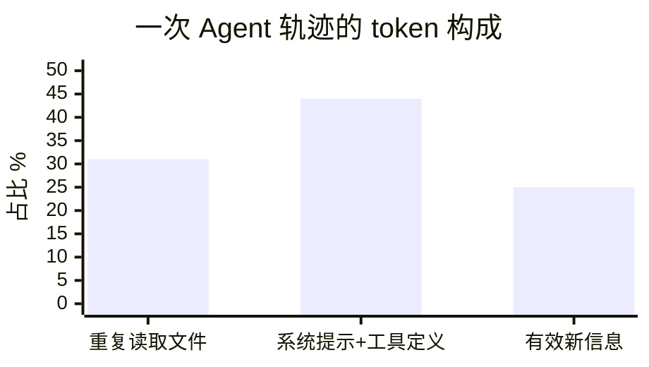
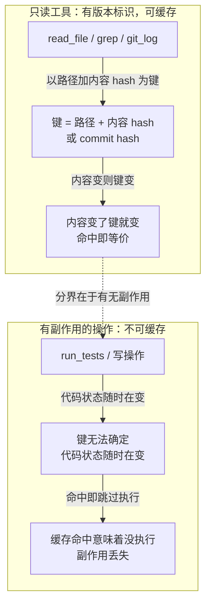
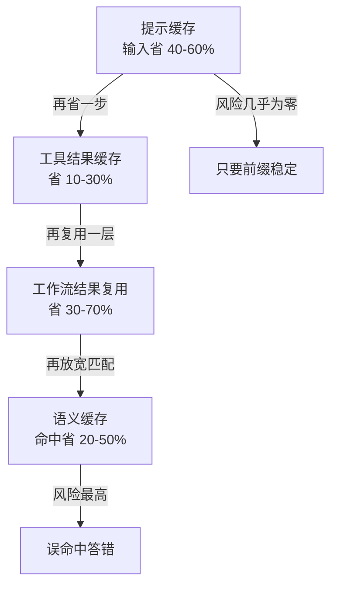
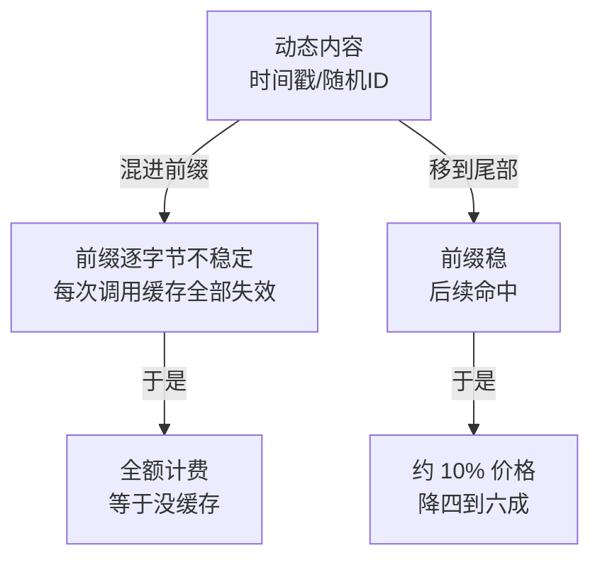

# Agent 的缓存与结果复用

## 同一件事为什么反复花钱重做：要解决的问题

本文讲 Agent（能自主调用工具完成任务的程序）的缓存与结果复用：同一份文件被反复读取、同样的提示被反复重发，**这些重复开销大部分可以省掉**。读完你会知道哪些内容该缓存、缓存键怎么带版本标识、哪些操作不能缓存，以及怎么用命中率（请求直接从缓存拿到结果的比例）判断复用机制是否真的生效。

## 这件事发生在什么场景：同一个文件，读了又读

一段真实代码 Agent 轨迹的调用统计与 token 构成：

```
总调用：52 次
其中 read_file("src/config.yaml")：11 次
     grep("TODO")：7 次
     相同的系统提示 + 工具定义：52 次（每次都重发）
```

| 部分 | 占比 |
| --- | --- |
| 重复读取的文件内容 | 31% |
| 系统提示 + 工具定义（每次重发） | 44% |
| 实际有效的新信息 | 25% |

把这三个数摆在一起看，浪费掉的部分比有效部分大得多，哪一块占大头一眼可见：



**四分之三的 token（模型处理文本的最小单位，约相当于一个词或半个词） 花在了重复内容上。** 这些内容本可缓存一次后反复复用；之所以每次重发，是因为没有复用机制去拦截重复请求，因此**浪费出在工程侧的复用缺失，不怪模型本身**。下文把复用分成四个层次：重复读取的文件内容交给工具结果缓存（层次 2），系统提示与工具定义的重发交给提示缓存（层次 1），剩下的第三项才是真正需要模型参与的部分：**缓存命中的内容与原内容完全一致，模型看到的信息并未减少，省掉的只是重复发送与重复读取的搬运，模型本要做的理解工作不变**。

## 复用分哪四个层次：方案

先把形状说成一件事：四个层次的复用像一家面包店的备料方式——门口现烤面包（提示缓存，即下文层次 1 的 Prompt Caching：相同前缀直接复用，成本最低）；后厨常备黄油（工具结果缓存，即层次 2：今天还要用的原料不重新进货）；墙上贴着常客问题的便签——即层次 3 的语义缓存：话与便签相似就直接抄答案，便签贴错就会答非所问；中央工厂配送成品（工作流复用，即层次 4：别的分店做好的直接运来）。比喻里离顾客（对应调用点，即发起调用的位置）越近的一层，**省下的越是当场要付的处理成本**；越远的一层覆盖范围越大，但省得越少、维护成本越高——**每层都要回答"这批料什么时候不能再用"**。

比喻到此为止。现实里四层各自的失效条件，下面逐层展开。

四个层次的组织和处理器缓存（CPU 内部容量小但速度快、靠近计算单元的高速存储）的层级结构相似：都有多层，都按离使用位置的距离分层，这里的使用位置在 Agent 侧就是调用点（发起这次读取的那行代码），在处理器缓存里就是计算单元。离使用位置越近的存储容量越小、访问越快，所以靠近调用点的层命中率高（缓存被成功复用的比例高）、单次省得少，远离的层覆盖越广但省得越少。差别在于**处理器缓存由硬件统一保证一致性，这里的每一层都要自己回答「什么时候这份缓存不再成立」**——下文每个层次各有一节讲失效条件。


### 层次 1：Prompt Caching 怎么用（最省事，必做）

主流模型 API（应用程序编程接口，如 Anthropic）提供的 Prompt Caching（提示词缓存）：**把提示词（发给模型的输入指令与背景信息）前缀缓存起来，后续调用只付约 10% 的价格。**

```
第一次调用：系统提示(8000) + 工具定义(4000) + 对话(2000)  → 全价
第二次调用：系统提示 + 工具定义（命中缓存，10%）+ 对话(4000)
```

**要求：前缀必须稳定。**

| 做法 | 缓存效果 |
| --- | --- |
| 系统提示 + 工具定义 + 历史（稳定在前） | 命中 |
| 在系统提示开头放当前时间 | 每分钟失效 |
| 把用户输入放在最前面 | 每个用户都不同，无法复用 |

**顺序决定缓存能否命中：把稳定的部分放在前面，把变化的部分放在后面**。下面代码里的「断点」指提示中可缓存的分界点，由 TTL（存活时间，到期后自动失效）标记，命中缓存的部分按 10% 计价，未命中的部分全价。

```python
# 正确顺序：稳定的放前面
messages = [
    {"role": "system", "content": SYSTEM_PROMPT},      # 固定
    {"role": "system", "content": TOOL_DEFINITIONS},   # 固定
    # cache 断点在这里
    *conversation_history,                              # 变化的部分
    {"role": "user", "content": new_input},
]
```

断点怎么在一段提示里生效，Anthropic 官方文档用三种 TTL组合画了出来：同一段提示被 1 小时与 5 分钟两种 TTL 的断点切开，每次请求从后往前找命中的断点，命中 Cache Read（读缓存命中）的部分按 10% 计价，未命中的部分按写缓存计价：


**注意**：对话历史增长时，只有前面的部分能命中缓存。所以**缓存命中率会随对话变长而下降**——新增内容占的比重越来越大，此时压缩历史记录反而能提高命中，这正是引入「上下文压缩」（把旧对话摘要或丢弃，以缩短前缀、减少每次重发量）的时机：对话增长到命中率明显下降时，压缩旧对话减少的是每次要重发的新增量，让命中部分在总输入中的占比回升——**压缩缩短的是前缀长度，并非让缓存变得更准**。

### 层次 2：工具结果缓存怎么配（省的是"重复读取"）

这一层管的是 Agent 调用的工具结果，**与模型内部的 KV Cache（模型推理时自己维护的中间状态缓存，工程侧不参与管理）是两回事**；本层缓存由工程侧写入与失效。判据只有一条——同样的输入在下次调用时还成立吗，成立就能缓存，判据见下表第三列：

| 工具 | 可缓存吗 | 依据 |
| --- | --- | --- |
| `read_file` | 可以 | 路径 + 文件的 mtime/hash |
| `grep` | 可以（短期） | 查询 + 目录的变更时间 |
| `list_dir` | 可以（短期） | 路径 |
| `git_log` | 可以 | commit hash |
| `run_tests` | 不可 | 每次代码可能变了 |
| 写操作 | 不可 | 缓存写操作会导致不执行 |

**判断是否可缓存，看两件事：内容是否有确定的版本标识，以及操作是否带有副作用（即执行会改变外部状态，比如写文件、跑测试）**。版本标识指能唯一反映内容状态的值，例如文件的修改时间（mtime）、内容指纹（hash，对内容算出的标识值，内容一变指纹就变）、Git（分布式版本控制系统）的 commit 标识，内容一变这些值就跟着变。**测试与写操作的代码状态随时在变，键定不下来；只读工具有版本标识，键能确定**。



这张图里危险的是有副作用那一支：命中了缓存，调用方以为测试跑过，**实际上这一步被跳过**。**只读工具命中缓存时结果等价于重新执行，写操作命中缓存时结果等价于没有执行**——这正是两者的分界线。

`read_file_cached(path)` 在文件读取外面包一层缓存，代码如下。

```python
def read_file_cached(path):
    key = f"{path}:{file_hash(path)}"      # 内容变了 key 就变
    if cached := cache.get(key):
        return cached
    content = read_file(path)
    cache.set(key, content, ttl=300)
    return content
```

**关键：缓存键要包含内容的版本标识**（mtime、hash、commit），内容变了键就变，**命中才等价于重读**。**只按路径缓存会导致读到旧内容。**

给模型的返回要标明是缓存的结果：

```
[缓存] src/config.yaml（读取于 3 分钟前，文件未修改）
...内容...
```

**这样模型知道内容可以信任，也知道它可能不是最新的**——文件未修改时缓存内容就是最新，文件改了它就是三分钟前的旧版本，**真要最新就再读一次**。

### 层次 3：语义缓存怎么省（省的是"重复的语义查询"）

**概念**：把问题转成一串数字（向量），两串数字距离越近表示问题意思越接近；通过这种方式判断问题是否问过相近的，**相似的问题直接返回历史答案**。

```python
def semantic_lookup(query):
    similar = vector_db.search(query, threshold=0.95)   # 阈值要高
    if similar:
        return similar.answer
    return None       # 没命中就正常调用
```

这个方案**省得多，坑也最深**，各项隐患见下表。

| 风险 | 说明 |
| --- | --- |
| **误命中** | 语义相似但问题不同，返回错误答案 |
| **过期** | 代码改了，但缓存的答案还在 |
| **个性化丢失** | 不同用户的相似问题返回相同答案 |

答案确定的时候可以用缓存，满足下面几条再放心开：

- 阈值设得很高（0.95+）
- 答案是确定性的（FAQ、文档问答）
- 有明确失效机制（代码 commit 变了就清）

答案因人而异的时候不该用缓存，命中下面任一条就关掉：

- 代码相关（改动频繁，误命中代价高）
- 需要个性化的
- 答案有时效性的

语义缓存的完整链路在 GPTCache（开源语义缓存项目）官方架构图里一目了然。问题先进 Embedding Generator（把文字转换成向量的模块）转向量；Cache Manager（缓存管理器）拿向量查相似条目；Similarity Evaluation（相似度评估模块）按阈值判定是否命中，命中就直接返回历史答案，未命中才调用 LLM（大语言模型）并把结果写回缓存。上文的风险表每一行都能对应到链路上的一个环节，**误命中就出在阈值（Threshold）判定**——相似度达到门槛就判为同一个问题，**这正是误命中的根源**；过期出在 Cache Manager 存的条目：


*图源：GPTCache 官方 README（zilliztech/GPTCache，GitHub 仓库首页架构图），Apache-2.0，https://github.com/zilliztech/GPTCache。*

**保守建议**：默认不用语义缓存。**先做前两层，它们安全且效果明确。**

### 层次 4：工作流结果怎么复用

如果你用了工作流[[工程知识/AI 系统工程：从模型能力到生产能力/Agent与工作流/先用工作流，只有路径无法预先枚举时才使用Agent]]，**中间步骤的结果可以复用**：

| 步骤 | 动作 | 复用条件 |
| --- | --- | --- |
| 1 | 提取 diff | 同一个 PR（Pull Request，请求把改动合入主干的申请）重复审查时可复用 |
| 2 | 分类变更类型 | 可复用 |
| 3 | 按类型深入审查 | 代码变了才需重跑 |

**按 Git 提交记录（commit）的 hash 值缓存中间结果**，PR 更新后**只重跑受影响的部分**。

## 收益从哪来、付什么价：效果与代价

| 层次 | 典型节省 | 风险 |
| --- | --- | --- |
| Prompt Caching | **40-60%**（输入部分） | 无（只要前缀稳定） |
| 工具结果缓存 | 10-30% | 读到旧内容（用版本键避免） |
| 语义缓存 | 20-50%（命中时） | **误命中，返回错误答案** |
| 工作流复用 | 30-70% | 缓存失效（缓存里的数据过期或不一致、需要回源加载）逻辑复杂 |

**优先级：Prompt Caching > 工具结果缓存 > 工作流复用 > 语义缓存。**

四个层次按可靠程度从高到低排成一列，越往下失效条件越难把握、风险也越大；节省幅度与位置没有对应关系——靠近调用点的层次1只省输入前缀，而工作流复用省的是整段中间结果，位置近不等于省得多，各层的实际节省见上面的表：



这张图说明了优先级排序的依据：**前两层靠版本标识就能保证正确**——内容一变键就变，命中即等价于重读。语义缓存不同，它的节省取决于相似问题是否真的等价，误命中会答错，**所以默认不启用**。

## 动手时从哪儿开始

**第一步：先看成本构成**

统计：系统提示占比、重复工具调用次数、历史增长速度。**不要凭感觉优化。**

**第二步：上 Prompt Caching**

调整消息顺序，把稳定的放前面。**这一步通常能省 40%+，且零风险。**

**第三步：给只读工具加缓存**

从 `read_file` 开始——它通常是重复最多的。**用 hash/mtime 做缓存键。**

**第四步：缓存命中率监控**

```json
{"cached_tokens": 8200, "total_input_tokens": 12400, "hit_rate": 0.66}
```

命中率从上一步返回的 JSON 里取：用 cached_tokens 除以 total_input_tokens 就是 hit_rate（命中率），再判断它是否低于 50%。

**命中率低于 50% 通常说明前缀不稳定**：命中率低代表大量输入没走缓存、按全价计费，而**没命中最常见的原因就是前缀被动态内容打乱**，所以要查前缀里是否混入了变化项；长对话除外——命中率随对话变长自然走低，前缀本身没有不稳，新增内容本来就在变化，属于正常现象。

**第五步：谨慎对待语义缓存**

如果确实要用，**阈值 0.95+，且只用于确定性问题**。

## 哪些做法一看就错：常见错误

**错误 1：在系统提示里放动态内容**

"当前时间"、"随机 request_id" 放在前缀 → 缓存永远不命中。**动态内容放最后。**

动态内容的位置决定缓存的生死，两条路各走到不同终点：



前缀一旦不稳，提示缓存（层次1）省下的四到六成会一次性退回全额计费；工具结果缓存不受影响，因为它靠文件 hash（对文件内容算出的指纹值，内容一变指纹就变）而非前缀命中：调用照常发生、结果照常返回，只有账单和命中率会变。**所以判断缓存有没有生效，只能看命中率，不能看「是不是开了缓存」**。

**错误 2：按路径缓存文件内容**

代码改了但缓存没失效 → 模型基于旧代码推理。**必须把 hash/mtime 放进缓存键。**

**错误 3：缓存写操作**

`edit_file` 被缓存 → 第二次调用不执行 → 模型以为改了其实没改。写操作缓存命中意味着没执行，**副作用整个丢失**。**只缓存只读操作。**

**错误 4：语义缓存阈值太低**

0.8 的阈值会把"怎么删除用户"和"怎么删除订单"当成同一个问题。**必须 0.95+，且最好不用。**

**错误 5：不看命中率**

以为开了缓存就在省钱，实际命中率 10%。**必须监控。**

**错误 6：缓存没有上限**

缓存占满内存触发 OOM（Out of Memory，内存耗尽后进程申请不到需要的内存而被终止）。**用 LRU（Least Recently Used，最久未使用的先淘汰的缓存策略）加 TTL 限制：LRU 控制容量，TTL 控制时效。**

**错误 7：以为缓存命中就等于事实仍然成立**

缓存命中只说明输入的指纹（对输入内容算出的标识，输入一样指纹一样）一致，事实可能已经变了：**指纹锁定的只是输入内容**，而权限变更、数据更新、下游依赖变化这类事实会独立于输入内容发生改变，所以**输入没变不代表事实仍成立**。命中后仍要过时效检查，数据更新、权限变更这类事实变化宁可穿透缓存重新计算（放弃缓存、直接读事实源执行一次真实调用），对不上的条目直接失效。

## 想自己验一遍怎么动手：验证

最小验证：选一个重复读取明显的任务轨迹，统计改前改后的 `cached_tokens` 与 `total_input_tokens`，断言命中率从接近零升到 50% 以上，且调整消息顺序后前缀保持稳定。再对文件缓存做一次失效验证：读取一次文件、修改文件内容、再次读取，断言第二次拿到的是新内容而非缓存内容。

误命中验证：构造两组语义相近但对象不同的查询（例如"怎么删除用户"与"怎么删除订单"），断言阈值设置能区分，无法区分时该项缓存停用。

## 这套复用在哪儿会失效：边界

- 前缀缓存要求前缀逐字节稳定：系统提示里放当前时间、随机标识符、按用户拼接的偏好，都会让命中率归零，这类内容要移到消息尾部。
- 文件与检索结果缓存的有效性取决于版本标识：只按路径或查询串作为键，改动之后会读到旧内容并据此继续推理。
- 只读操作才能缓存：写入、执行测试、发请求这类操作被缓存后不再实际执行，调用方却以为已经生效。
- 语义缓存的误命中代价高于它省下的成本：阈值降低到 0.9 以下时，相似问题被当成同一个问题，返回的答案与当前问题无关。
- 缓存占用需要有上限与过期策略：没有容量限制的缓存会持续增长，最终拖垮进程。

## 接着读哪几篇：同在AI 系统工程里的相邻问题

- [[工程知识/AI 系统工程：从模型能力到生产能力/质量与运营/成本控制要从上下文和重试两头下手]] · [[工程知识/AI 系统工程：从模型能力到生产能力/模型与上下文/上下文工程是在有限预算内构造决策现场]]