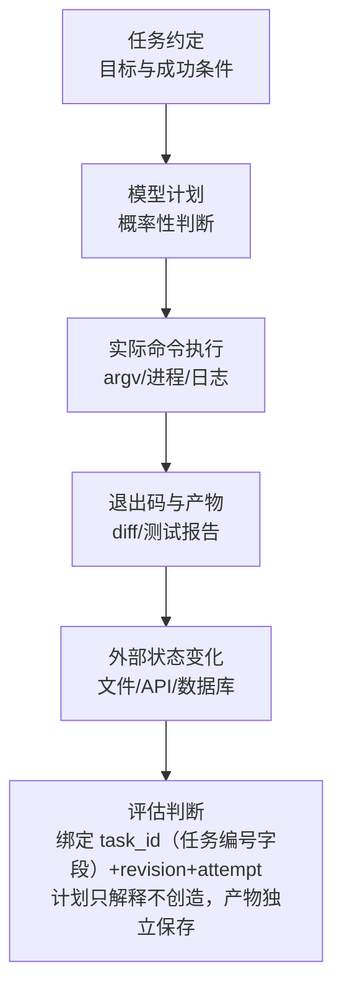
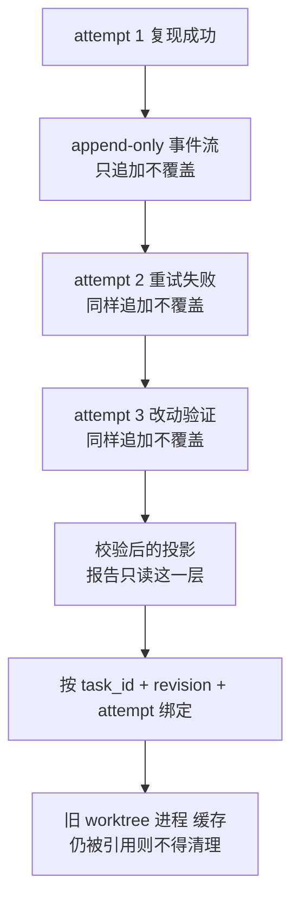

# Agent评估系统的设计约定

本文讲清 Agent（能自主调用工具完成任务的程序）评估系统怎么设计，读完你能照着搭出**可复核、可回归（同一任务可重复运行并对比结果）的评估流程**。Agent 评估回答一个可复核的问题：**在给定任务、环境、权限和预算下，Agent 是否完成了目标，为什么成功或失败，哪一个最小改动值得验证？**

**给回答打一个高分不在它的职责内。轨迹指 Agent 执行过程中每一步动作的记录。

可以把它想成驾校路考：**考官不只看最后有没有停在车位里，还要看中途有没有压线、有没有系安全带、熄火几次**；**路考按固定的几项扣分点打分**。**只看终点，学员可以靠一次运气过关**。

这个比方只对应到「过程也算分」这一点，之后就不像了——**路考的扣分项目是固定的几条，Agent 的轨迹评分要为每条路径单独定义什么叫走对了**。

## 要解决的问题是什么：评估的责任边界在哪

模型的判断与系统的放行是两件事：**模型说「这个测试不适用」只是主张，系统按策略核验后放行才是事实**。这套「**主张先核验再放行**」的分层机制在容器编排系统里是最成熟的一手实现：**Kubernetes API Server 把每个请求依次送过认证（谁在请求）、鉴权（允许它做什么）、准入控制（这个对象本身能否被接受）三道关卡，任何一道拒绝请求即终止，全部通过才落到存储**。Agent 评估系统把同一结构搬到任务执行域：**模型结论是待验证的主张，运行时证据是核验依据，评估判断是最终放行决定**。下图是 Kubernetes 官方的请求处理三阶段图：

模型负责理解项目、选择工具、提出方案、分析失败和生成改进候选。评估运行时（实际执行并记录评估过程的程序）负责**采集并保存每次运行的任务输入、命令、退出码、stdout/stderr、进程关系、文件差异、测试结果、产物和时间线**——**它是独立于模型的执行记录程序**。**模型可以解释证据，不能创造证据**。

评估接回起点的反馈环（把评估结果送回起点、用来改进下一轮输入的闭环）：**数据与工具准备、Agent 创建、部署、评估、管理与反，而不是流水线的末端终点馈五个阶段首尾相连**，评估的产物回流去修正输入与配置——**这一步接不上，前四个阶段的产物就只是记录，不构成改进**：


*图源：InfoQ《AI Agent 工程化实践》，https://www.infoq.cn/ 。*

本页解决的核心问题是：**如何把概率性的 Agent 判断变成可复核、可比较、可回归的工程结论**——像把口头诊断变成带化验单的病历；这个比方只对应『结论须有独立证据支撑才采信』这一点，其余环节并不像病历。核心机制是**把模型结论与独立运行证据分层，再用任务约定把二者绑定到同一项目版本和执行代次（同一任务每次重复运行的次序编号，即下文的任务代际）**；实施时**先采集不可篡改轨迹，再生成维度化评估**；**轨迹以只追加方式存储（新结果写成新记录、旧记录不删不改）**，所以**此前确认的成功不会被后到的失败覆盖**，代价是**需要存储、清理和隐私治理**；边界是**评估系统不能替业务定义正确性**，必须由任务夹具（固化下来的测试场景，含输入、验收标准与预期行为）或人工给出验收标准；**验证看证据链是否完整、重放是否一致**，以及改动在保留集（留出暂不改动的任务集合）和故障样本（已确认失败的任务实例）上的回归结果。**模型说「测试不适用」说得再流畅，也只是文字输出，不是那件事真的发生过——所以两类话的采信标准必须不同**。

因此，模型陈述与运行证据这两类事实必须分开，各管一段：

| 层 | 允许回答 | 不能回答 |
| --- | --- | --- |
| Agent 结论 | 「我判断这个测试不适用」「建议切换依赖源」 | 「命令已经执行」「代码已经覆盖」 |
| 运行时证据 | 命令是否存在、退出码、日志、产物、提交和任务代际 | 业务上哪个方案更有价值 |


*图源：Kubernetes 官方文档「Controlling Access to the Kubernetes API」，https://kubernetes.io/docs/concepts/security/controlling-access/ 。*

## 评估最少需要哪些输入？

- **任务**：**目标、输入、成功条件、失败条件、允许副作用、预算和截止时间**。
- **项目画像**：**仓库、提交、构建系统、语言/运行时、依赖源、环境变量和凭据范围**。
- **隔离上下文**：**独立 worktree（Git 工作副本，互不干扰的代码目录）、运行目录、进程组、缓存命名空间和任务 ID**。
- **评估口径**：**任务类型与该类型专属的判定维度**；**不要把检索、代码修复和业务操作用同一张表**。

## 一次动作要留下哪些轨迹和证据？

每个动作都要能回到以下链路，从任务到证据逐段可查：

```text
任务约定 → 模型计划 → 实际命令 → 进程/日志 → 退出码 → 文件或外部状态 → 测试/复现 → 评估判断
```

证据链上每一段的产物与流向，模型结论与运行时证据各归各位，见下图：



一份合格的证据包至少包含下面五项：

1. `task_id`、项目提交、revision（项目版本号）和任务代际；
2. 实际执行的 argv（命令行参数，凭据已脱敏）、cwd、环境摘要和开始/结束时间；
3. stdout、stderr、退出码、超时、子进程和资源回收结果；
4. 代码 diff、构建/测试报告、数据库或 API 状态、生成文件和引用来源；
5. 失败分类：编译、依赖/网络、权限、资源、产品未触发、断言不成立或观察缺失；
6. 结论、置信度、支持它的证据、反例、成本和下一次回归任务。

## 一次成功为什么不能被后续失败覆盖？

「成功事实不可覆盖」在数据上是什么形状——多次 attempt 的结果只追加不覆盖，报告读的是投影那一层：



**事件流只追加、投影只读（投影：从只追加事件流汇总出的只读报告层），成功事实不会被后续失败抹掉**。报告通过 **task_id（任务编号字段）、revision、attempt 三个维度**定位到对应的 worktree 和缓存；**只要还有任务引用这些资源，就不能清理它们**，否则**旧任务的结果无法复现，历史结论无法验证**。

**一次重试失败不能抹掉此前已经确认的复现或成功**。状态应当是 **append-only 事件流（只追加不覆盖：新事实写成新记录，旧记录永不修改删除）**，**报告读取经过校验的投影**；同一个任务的结果按 **`task_id + project_revision + attempt` 绑定**。**旧任务不能清理仍被新任务引用的 worktree、进程或缓存**。

## 不同任务各按哪些维度评估？

不同任务走的**不是同一条评估路径**。按任务类型**分开排队（同类任务先进先出、依次处理）**，各自按自己的维度评估——**各类任务互不影响，大批量同类任务只在自己那条队里等待，高优先级的任务不会被拖住**。


| 任务 | 必须看 | 常见误判 |
| --- | --- | --- |
| 功能交付 | 验收条件、diff、构建、测试、产物 | 只看模型总结或单个命令成功 |
| 缺陷修复 | 先复现、根因、最小改动、回归 | 测试变绿但没有证明原缺陷被触发 |
| RAG（检索增强生成：先从资料库检索相关内容，再据此生成回答）问答 | 召回（从知识库取出候选段落）、重排（把候选按相关性重新排序）、引用、拒答、时效、权限、生成质量 | 只看最终答案相似度 |
| 业务操作 | 工具授权、审批、幂等（同一操作执行多次与执行一次效果相同）、副作用、恢复 | 把工具调用记录当作业务状态已改变 |
| 多 Agent 协作 | 委托、所有权、交接、协议、跨系统失败 | 只统计最终文本，不看责任链 |
| 长期运行 | 成本、延迟、错误率、漂移、告警、回滚（把系统恢复到上一个可用版本）、人工接管 | 用一次离线样本推断线上 SLO（服务级别目标，对外的可用性与性能承诺指标） |

## 它和别的评估知识是什么关系？

本页是评估系统的**约定层**，规定**输入、证据、状态和改进报告如何绑定**；它**不替代具体评测方法**。[[工程知识/AI 系统工程：从模型能力到生产能力/质量与运营/Agent评测必须覆盖轨迹而不只看最终答案]] 负责**把最终结果与中间轨迹分开**，回答「是否以允许的方式完成」；[[工程知识/AI 系统工程：从模型能力到生产能力/质量与运营/RAG评测要分离检索质量与生成质量]] 负责**把召回、排序、引用和生成分别度量**，回答「证据链的哪一段失效」；[[工程知识/AI 系统工程：从模型能力到生产能力/质量与运营/可观测性必须能重建一次决策]] 负责**让评估输入可被重放**，回答「这次分数能否回到真实运行」。三者的分工是：**约定定义要保存什么，轨迹说明发生了什么，专项指标解释为什么变化**。

**如果一个评估结果无法定位到任务夹具、代码/模型/工具版本和原始证据，它只能作为探索性反馈，不能进入发布门禁或知识库结论**。

## 一条改进建议要写清哪些字段？

每条建议都要写清：**观察到的问题 → 作用机制 → 最小改动 → 预期改变的指标 → 反例/风险 → 成本 → 回归任务 → 置信度**。**论文、基准或 README（项目自述文件，说明怎么用）只支持「值得尝试」；支持「当前有效」的证据来自目标系统的重复运行与真实产物**。**Anthropic 把「生成改进与评审改进接成反馈环」画成标准工作模式——生成器给出方案，评估器按评分标准打回或通过，循环直至被接受**；模型评审（由模型担任评审程序，按证据包打分或放行）是把上述反馈环接到评估运行时上：**评审程序读取本轮证据包并生成改进建议，下一轮按新建议重新执行，于是每次运行的证据成为下一轮改进的输入**：


*图源：Anthropic 工程博客《Building effective agents》，官方博客配图。*

## 按什么顺序实现？

**先实现任务夹具和不可篡改 Trace（分布式追踪，跨服务记录同一次请求的调用链），再实现 worktree/进程/凭据隔离与证据投影；然后接入模型评审、维度化报告和任务关系图谱（记录任务之间依赖与来源关系的图）**。`packages/agent-foundation` 提供**与模型和框架无关的**进程监督、JSONL（JSON Lines，每行一个 JSON 对象的文本格式） transcript（记录运行过程的文件，JSONL 格式，一行一条事件）、RAG 上下文、记忆窗口、checkpoint（检查点，可随时存取的进度标记）和恢复原语；**它不替应用决定正确性**。

## 什么变化出现时该复查这一页？

当 **Agent 框架、工具协议、评估 API、任务夹具格式、模型 tracing、供应商安全策略或部署边界变化**时复查。**若只改变页面样式，不改变证据约定，无需重写本页**。

相关（学习侧）：[[工程知识/AI 系统工程：从模型能力到生产能力/质量与运营/学习活动需要结果、轨迹与迁移证据]] —— 评估结论如何转化为可迁移的学习证据