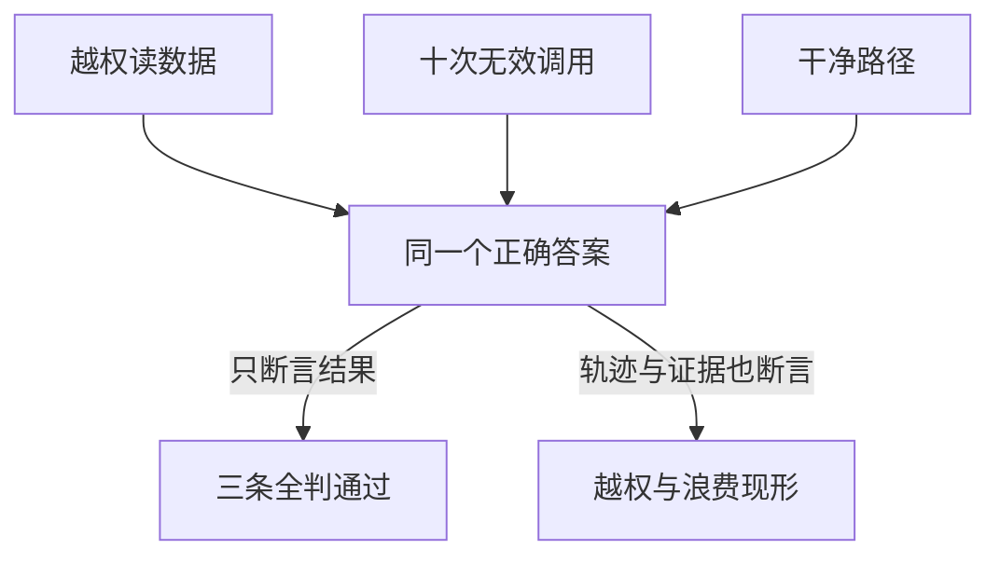
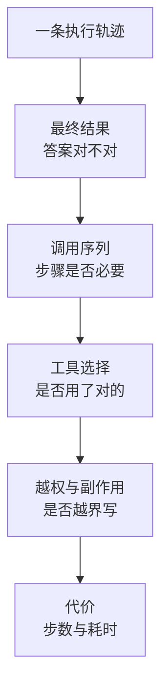

# Agent 评测必须覆盖轨迹，而不只看最终答案

Agent 评测不能只看最终答案对不对，还要看它跑的轨迹（模型每一步发出什么动作、拿回什么结果的完整记录）：**最终答对了，过程仍可能越权（访问了权限范围之外的资源）、重复扣款或白跑十次——只看结果，这些全都看不见**。读完这篇你能把结果、轨迹、安全和资源消耗分层断言。

Agent（能自主调用工具、分多步完成目标的模型应用）评测要解决一个盲区：最终答对但过程越权、重复副作用（操作对外部状态产生的额外影响）或成本失控，只看答案的评测无法发现这些问题。核心做法是把任务结果、轨迹、证据（支撑关键结论的真实工具结果）、安全和资源消耗分层断言（把不同维度的判定条件分开逐条验证）；最小例子是退款草稿任务，要求草稿存在、金额符合政策、没有提交退款，并检查调用次数和权限事件。

Agent 会多轮决策、调用工具并改变状态。最终答案相同，不代表过程同样正确：一个系统可能使用越权数据、重复产生副作用、碰巧猜对结果，或者在十次无效调用后才完成任务。评测必须同时判断结果、轨迹、证据、安全和资源消耗。

**同一个正确答案可能来自三条不同的轨迹，断言层次决定谁能现形**：只有同时断言轨迹与证据，**越权数据和无效调用才会在判定里留下痕迹**：



## 这篇要解决的问题是什么？

Agent 给出正确结果的同时执行了越权操作、重复产生了副作用、或者消耗的成本远超预期，仅比较最终答案的评测方式无法发现这些情况。本篇回答：结果、轨迹、证据、安全与资源消耗各自要断言什么、同一个任务里哪些条件必须同时成立才算通过，以及引用与副作用怎样进入判定。

## Agent 评测到底在断言什么？

打个比方：只看最终答案像只看考试分数——两个人都是 90 分，一个一步步算对的，另一个蒙的，下次换道题差距就露出来了；要判断他会不会，得看草稿纸（轨迹）。这个比喻到"为什么要看轨迹"为止：轨迹里具体该查哪几项、非确定性怎么处理、评价器（用模型给另一段输出打分的环节）怎么校准，下面各节分别展开。


Agent 评测的机制是：**从环境最终状态和证据来判定结果**——同一段任务可以由多条路径完成，最终状态相同而过程可能包含越权数据、重复副作用或大量无效步骤。**任务成功的判定因此需要同时锚定环境的最终状态、关键结论的证据支持与轨迹上的策略事件，只比较输出文本会漏掉这些差异**。

被评测的轨迹长什么样？Anthropic 把 Agent 运行画成两条循环：**人与模型之间的请求-响应循环，以及模型与环境之间的动作-结果循环**。模型向环境发出动作、拿回结果继续决策，直到任务清空；**轨迹评测断言的就是动作-结果循环里每一步「发了什么动作、拿回什么结果、有没有在该停的地方停」**：


*图源：Anthropic 工程博客《Effective context engineering for AI agents》，官方博客配图。*


## 任务成功要先定义成什么样子？

一个评测样本不应只有输入和参考文本。至少包含：

```yaml
case_id: refund-017
initial_state: ...
goal: "为符合政策的订单生成退款草稿"
allowed_tools: [lookup_order, read_policy, draft_refund]
forbidden_effects: [submit_refund, expose_other_tenant]
required_evidence: [order_status, active_policy_version]
success_assertions:
  - draft_exists
  - amount_matches_policy
  - no_external_submission
budgets:
  max_steps: 8
  max_cost: 0.10
```

参考答案只适合封闭文本任务。真实 Agent 更需要对环境最终状态和副作用做断言。

## 评测要分哪五层？



下面五层各自回答一个不同的问题；只判第一层（最终结果对不对），越权操作和无效步骤就会被放过去：


| 层 | 关键问题 | 典型信号 |
| --- | --- | --- |
| 任务结果 | 目标是否真正完成？ | 环境断言、业务状态、人工结论 |
| 证据 | 关键结论是否被真实证据支持？ | 引用支持率、工具结果绑定 |
| 轨迹 | 是否选择了合理步骤并在该停止时停止？ | 必要工具率、无效步骤、恢复路径 |
| 安全 | 是否越权、泄露或产生未批准副作用？ | 策略事件、攻击样本、隔离结果 |
| 运营 | 质量是否值得当前延迟和成本？ | P50/P95（一半、95% 的请求耗时低于这个值，这类数值叫分位数，用来描述延迟分布）、token（模型计费的基本计量单位）、工具费、人工分钟 |

**任何单一总分都会掩盖关键退化**——只报一个总分时，少数高风险任务会被大量普通任务平均掉，关键退化看不见；因此**至少保留分层指标和失败类别**。

「过程单独计量」的实物原型是秒表：径赛不看冲线瞬间的名次单（那只是"结果"），每一段分程都有独立计时——起跑反应、途中分段、冲刺耗时各自记录，成绩单上写的是全程与分段两个数：


*图源：Wikimedia Commons，作者 Jeremyida002，CC BY-SA 4.0，https://commons.wikimedia.org/wiki/File:Analog_Stop_Watch.jpg。*

五层评价里的轨迹层与运营层对应秒表分段：轨迹层对应途中分段（记必要工具率、无效步骤数），运营层对应分段耗时（记 P50/P95、token 消耗）。只报冲线名次（最终答案对不对）的评测，看不见 Agent 在途中绕了多少圈、花了多少冤枉钱。这个比喻只说明过程要分段计量，至于每层具体怎么打分请看下一节。

## 离线集为什么只能来自真实失败？

初始集可以由专家设计，但上线后的价值主要来自真实轨迹：**用户改正、人工接管、工具失败、低评分、异常成本和事故复盘**。**每个修复过的生产失败都应变成一个稳定回归样本，并保存触发条件而不是只保存最后文本**。

样本按风险和能力切片（把样本按不同风险和能力分成若干组，分别评测），例如：正常路径、歧义输入、信息不足、权限不足、过期知识、工具超时、部分成功、重复请求、提示注入（攻击者把指令藏进数据内容、诱骗模型当作指令执行的攻击手法）和长任务恢复。报告切片结果，不要只报总平均。

## 评价器为什么也需要校准？

**确定性断言优先于模型评价**：schema（数据结构与字段约束的定义）、数据库状态、文件 diff（文件改动前后的差异记录）、测试结果、引用包含关系和策略事件都可直接检查。用模型当评价器（LLM-as-judge，用另一个模型来给 Agent 的输出打分）适合开放式质量、语义覆盖和失败归类，但需要清晰 rubric（评分细则）、盲测、人工抽样和与人类判断的一致性测量。**不能用同一模型无标准自评来证明自己正确**——比如让同一个模型既生成答案又给自己打 90 分，分数很高但人类一看是错的，**这就是无标准自评的危险**。

## 评测怎么从组件拼到端到端？

```text
模型与结构输出 -> 工具契约 -> 检索与证据 -> 工作流状态转移
                 -> 完整轨迹 -> 真实环境小流量 -> 在线监控
```

图中从左到右每一环对应一类组件测试：模型与结构输出指模型的原始输出加上结构化格式约束，工具契约是工具调用前约定的输入输出与权限规范。组件测试定位快，端到端测试验证组合效果。模型升级至少回归结构化输出、工具选择和高风险切片；embedding（把文本转成可比较相似度的向量）升级时要做两件事：重建索引，并重新测试检索系统找回相关结果的能力（即回归召回）；运行时升级需要故障注入（主动向系统注入故障来验证容错能力的测试方法）和恢复测试。

## 同一任务跑多次结果不同怎么办？

同一样本运行多次，**报告成功率分布而不是单次结果**。固定模型快照、工具环境和随机因素，分别测模型波动与基础设施噪声。对长任务记录失败发生在哪一步：**「十次中九次成功」对一次不可逆动作可能仍不可接受——那一次失败就是真实损失且无法撤销，失败位置决定下一轮改进从哪里入手**。

## 新版本要通过哪几道门禁才能发布？

新版本只有在**关键切片不退化、风险上限满足、成本与延迟可接受，并且具备回滚（把系统状态退回到改动之前的版本）路径**时才能发布。**总体质量提高不能抵消权限泄露或不可逆副作用的风险——一次泄露或一笔不可逆损失没有上限，出现一次即构成事故，无法被平均分摊掉**。灰度（先放一小部分流量验证、再逐步放开到全量）阶段比较同一任务分布下的任务完成、人工接管和事故信号，**不用点击率（用户点击行为的比例，衡量的是吸引力，不是答案正确）替代正确性**。


## 怎么自己动手验证？

1. 分层断言：以退款草稿任务为例，确认草稿存在、金额符合政策、退款未提交，并核对调用次数与权限事件，四个层次都有断言。
2. 过程越权捕获：构造一个最终答案正确但中途读取了越权数据的样本，确认评测在轨迹层把它标记为失败。
3. 副作用计数：构造一个重复提交的样本，确认资源消耗与副作用数量在断言语料里被检出。

## 接着读哪几篇：轨迹评测的数据地基

- [[工程知识/AI 系统工程：从模型能力到生产能力/质量与运营/可观测性必须能重建一次决策]] · [[工程知识/AI 系统工程：从模型能力到生产能力/安全与治理/AI可以做语义决策，系统必须守住事实边界]]


- [[工程知识/AI 系统工程：从模型能力到生产能力/质量与运营/评测集的构建与维护决定所有评测的地基]] —— 轨迹评测的数据地基
- [[工程知识/AI 系统工程：从模型能力到生产能力/Agent与工作流/结构化输出的约束解码：让模型输出可解析.md]] —— 工具调用格式失败的轨迹代价
- [[工程知识/AI 系统工程：从模型能力到生产能力/数据与MLOps/数据飞轮的工程闭环：日志回流清洗与标注.md]] —— 轨迹数据的评测视角
