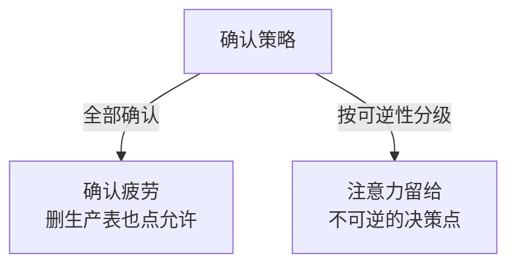
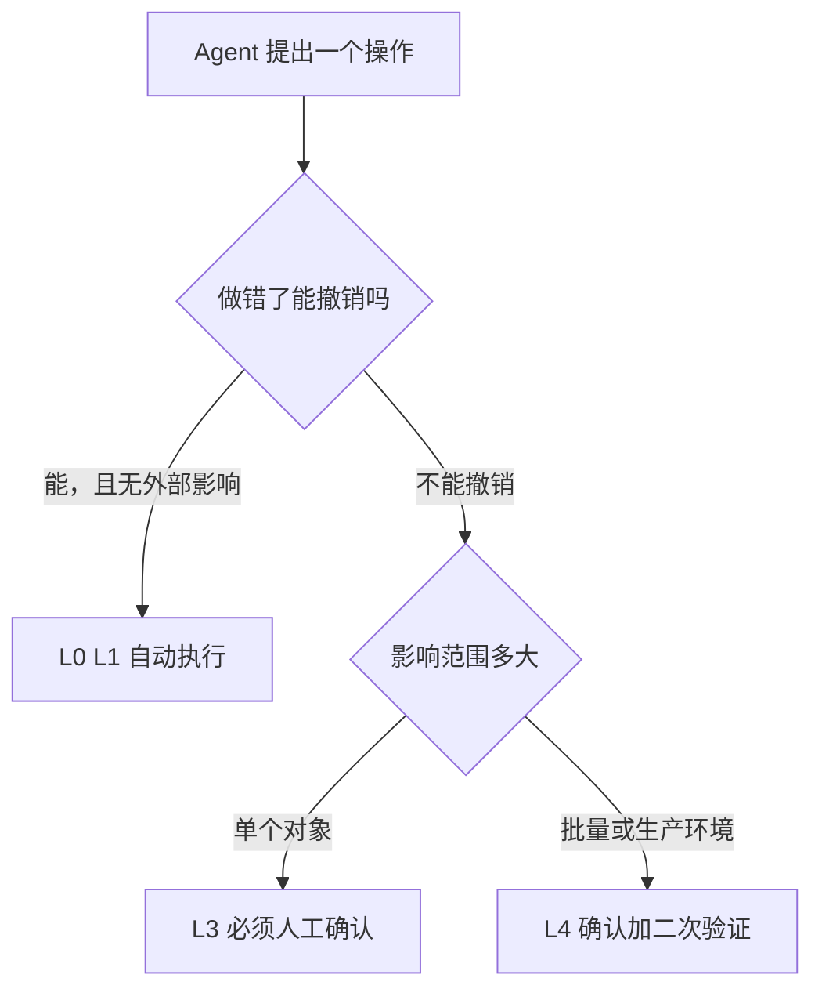

# 人在环路要设在不可逆的决策点

## 要解决的问题：哪些操作属于不可逆

Agent 执行的操作里有一部分无法事后修正。若全部要求人工确认，确认疲劳（连续点太多次允许之后开始机械点击，不再阅读内容）会让**危险操作被无意识放行**；若不设确认，误操作直接造成损失。本篇回答：哪些操作属于不可逆、风险分级依据什么、确认之后参数被改动如何发现，以及怎样给已经确认的操作留出撤销空间。可以把它想成发工资前的复核：数字算错了还能改，钱打出去就追不回来了，所以复核要卡在打款之前而不是之后。这个比方到「卡在打款之前」为止：打款错了还能走退款流程，删库、发公告、下单这类动作没有对应的回退机制，一旦执行只能靠补偿动作兜底，而补偿本身也可能失败。

## 它在本质上是怎么做到的？

人的注意力（模型为每个词分配权重、聚焦上下文中最相关部分的机制）像电池电量，**总量有限**：确认点的数量上升时，每次确认分到的判断力就下降，走到真正危险的操作时电量已经见底。这个比方只到「总量有限、用一点少一点」为止——注意力不像电池能插线充电，充分休息才能恢复，几秒钟内补不回来。

因此要**把确认设在不可逆的位置**，让有限的注意力集中在无法事后修正的操作上。风险等级由**操作类型和影响范围**共同决定：操作类型决定能否撤销这一根本属性，影响范围决定同一操作在不同量级下的危险程度，两者交叉才得到具体级别。

为什么判据不能交给模型？因为模型会受到提示注入（攻击者把指令藏进数据内容、诱骗模型当作指令执行的攻击手法）的影响——攻击者把指令藏在模型会读到的文本里，如网页内容、邮件正文、工具返回结果，诱导模型把危险操作当成安全操作。

若让模型自己临场判断操作是否危险，它就可能**被这种输入操纵**，把危险操作判定为安全而放行，所以**判据必须由代码固定，不能交给运行时模型**。

## 这件事发生在什么场景：每个操作都要确认，等于没用

一个 Agent 每执行一步都弹窗："要读取 a.go，允许吗？"用户点了 30 次"允许"之后就开始**机械点同意，不再看内容**。

第 31 次弹的是"要删除生产数据库的表"，用户**照样点了允许**。

**问题出在确认的密度：确认点铺得太密，确认本身失去意义。** 人的注意力是有限资源，把它浪费在只读操作上，**真正危险的时刻就没有注意力了**。门口保安是同一个处境。进出的每个人都要查证件（每步都确认），查到第 30 个已经机械挥手（断开连接的四次确认过程），第 31 个闯进来的正是要偷东西的——比喻到「高频确认让人麻木」为止：保安还能靠脸生熟来减负，Agent 只能靠分级把确认点收敛到不可逆的位置。

两种确认策略，注意力花的位置不同：



## 方案怎么按可逆性分级？

核心原则：**只在不可逆或有外部副作用（操作对外部状态产生的额外影响）的操作上要人工确认。**这就是同一个分级思想在操作权限上的用法——确认强度跟着可逆性走，下面用一个医院处置的分级来展开。

### 分级模型怎么把操作分成五级？

医院处置环节与五级一一对应，同一个思想在操作权限上就是确认强度跟着可逆性走：量体温、问诊（只读检查）护士直接做，对应 L0（只读）；开常规药按医嘱执行（可逆操作），对应 L1（可逆写）；用抗生素前要核对皮试结果（副作用可补偿的加一道记录），对应 L2（有副作用但可补偿）；手术必须患者本人签字（不可逆），对应 L3（不可逆）；器官切除还要家属共同签字加术前讨论，对应 L4（高风险不可逆）。比喻到医院按风险决定谁签字为止：医院各级都有人盯着，出了错有人担责；分级系统里 L0 到 L2 全程没有人在场，出了错只能靠事后记录兜，因此 **L3/L4 的确认必须写进代码**，不能留给人临场判断。

| 级别 | 特征 | 处理 |
| --- | --- | --- |
| L0 只读 | 读文件、查询、搜索 | **自动执行**，事后可查 |
| L1 可逆写 | 改本地文件、写临时数据 | **自动执行**，支持回滚（把系统恢复到上一个可用版本） |
| L2 有副作用但可补偿 | 发通知、调外部 API | **自动执行 + 记录**，异常时人工介入 |
| L3 不可逆 | 删除数据、发布、转账、改生产配置 | **必须人工确认** |
| L4 高风险不可逆 | 批量删除、生产变更、资金操作 | **确认 + 二次验证（如输入确认短语）** |

运维操作控制台的做法和这个分级模型同构（运维控制台就是这套分级在真实系统里的样子）：生产环境的每一类操作都有对应的控制台与权限通道——只读监控大屏谁都能看（对应 L0-L2 自动执行），例行发布走流水线自动执行，唯有删库、扩容生产集群这类操作必须从堡垒机登录——堡垒机是专用于隔离并登录生产环境的跳板服务器——并且要双人复核、留下操作录像（对应 L3/L4 确认）。**分级模型把有限的人工确认预算全部花在不可逆操作上。**这个比方只到「高危操作单独走审批通道」为止——运维控制台靠组织流程保障，本文靠代码判定，控制台本身不能替代分级的判断标准。


*图源：Wikimedia Commons，Derrick Coetzee，CC0 1.0，https://commons.wikimedia.org/wiki/File:CInternet_network_server_rack.jpg。*

——阿波罗登月时代的任务控制厅把这件事做到了极致：飞控主任 Kranz 手里的发射/不发射否决权就是整个任务的 L4 确认点，遥测监视从不打扰任何人，唯有跨过不可逆边界那一勾才要求全员对着话筒报 GO（放行决定）/NO-GO（不通过：评审节点终止项目的决定）；这个比方只到「不可逆决策由专人集中把关」为止。

**判断标准：如果这个操作做错了，能撤销吗？** 能撤销或副作用可补偿的自动执行（补偿动作就是它的事后撤销），完全不能撤销的要确认。

把上表变成判断路径，五个级别的分流位置是这样：



第一个分岔是"能不能撤销"，第二个是"影响多大"——两个问题都不需要模型在运行时自己判断：「能不能撤销」由操作类型决定，「影响多大」按这个工具设计上最多能影响多少东西来估，取可能的最大值，两者都可以**固定写进执行引擎的代码里**。这也是这套分级能机械执行的前提：**判据是操作的属性，不是模型的临场评估**。

**这套分级在代码里怎么实现？**写进执行引擎里就是「中断点」（执行引擎里的暂停位置：普通暂停可以自动恢复，中断点必须等外部信号如人工批准才能继续执行）。LangGraph 官方文档的界面截图就是它的实现示例：节点是执行引擎里的一个处理单元，对应代码中的一个函数或一次调用，流程图上用箭头代表下一步走向；截图里图停在调用模型的那一步（`call_model` 节点）等待放行，面板上以勾选项区分 Interrupt Before（执行前暂停）与 Interrupt After（执行后暂停）——L3/L4 的确认就挂在这个位置，图不越过断点，操作就不会发生：


*图源：[LangGraph 官方文档 Human-in-the-loop](https://langchain-ai.github.io/langgraph/concepts/human_in_the_loop/)，LangChain，MIT。*

### L3/L4 的确认怎样才算有效？

分布式系统里有一个专门的问题：怎么保证到达后端服务的每个请求都先经过校验。Gatekeeper（守门人）模式就是解决这个问题的方案之一，它把请求的处理拆成两段——守门人对外暴露访问入口（端点）、校验并清理请求，通过之后才交给通过校验后被信任、负责执行真正操作的主机（受信主机）。Agent 的确认机制与它结构相同：**确认环节是守门人，模型的执行动作是受信主机**，不可逆的操作必须先过守门人这一关。区别在于分布式系统的守门人是自动校验程序，这里的守门人是人的判断。


*图源：[Microsoft Learn《Gatekeeper 模式》](https://learn.microsoft.com/zh-cn/azure/architecture/patterns/gatekeeper)，CC BY 4.0。*

确认怎样才算有效？**有效的确认需要满足两个条件。**一是拒绝之后事情是否真的停下来：**被拒的操作必须中止**，就像限流（超过请求上限后直接拒绝新请求）超过阈值后真的把请求拦下，**不能只记一笔日志**；Gatekeeper 模式要求的正是这一点。

二是**确认前用户拿到的信息是否充分**：「信息充分」指告诉用户具体是什么、影响范围有多大、能不能撤销。

无效确认：`要删除 1000 条记录，确定吗？[是][否]`

有效确认：告诉用户**具体是什么**、**影响范围**、**怎么撤销**：

```
将删除生产库 orders 表中 1,248 条 2023 年之前的记录。

影响：
  - 数据不可恢复（未配置备份）
  - 关联的 order_items 表有 3,102 条会被级联删除

如果你确认，请输入 DELETE 1248 继续。
```

要点：**要用户主动输入内容，而不是点按钮**。点按钮时手会自动点下去，不会真看内容；**输入短语则迫使用户真的读**。

### 为什么确认要设在"计划"层而非"动作"层？

更好的做法：**先让 Agent 给出完整计划，人工批准计划，然后自动执行。**装修开工前的图纸会审是同一个道理**：逐步确认对应工人每步来问，批准计划对应开工前审图。工人每砌一面墙都来问一遍，业主会烦到乱点头；开工前把图纸整体过一遍，哪里要改一次说清，之后工人按图施工，只在涉及承重墙（不可逆操作）时再停下来确认。比喻到「审图代替盯人」为止：图纸审完施工方不能改图，Agent 批准后参数还可能被运行时改动，所以才有 params_hash（参数哈希字段）绑定这道保险。批准时把参数算成哈希值，执行前再算一次比对，不一致就退回重新确认，从而拦住"批准删 10 条、实际删 1 万条"。

```
Agent：我计划执行以下操作：
  1. 读取 config.yaml
  2. 修改 db.host 为 new-host.internal
  3. 重启 api 服务
  4. 验证健康检查
  批准后我会自动执行，其中第 3 步会短暂中断服务（约 10 秒）。

[批准执行]  [修改计划]  [取消]
```

**这比逐步确认高效得多**，而且人工能看到全貌——避免"批准了 5 步之后发现方向就错了"。但计划必须写得足够清楚，否则审批人看不懂就会退化成机械点批准。

## 效果从哪儿来，要付什么代价？

分级确认的收益与代价，机场安检的分工是同一个账（行李过机对应低风险自动放行，开箱搜身对应高风险人工确认）：行李过机、液体抽查自动完成（L0-L2 自动执行），开箱查验与搜身只在仪器报警时发生（确认集中在可疑点），安检口吞吐量反而更大。代价是报警规则要有人维护——规则定松了（L3 误判成 L2）危险品就过了安检，定严了又回到每件开箱的低效。这个比方到「规则质量决定分级质量」为止：安检规则的对手是会变着花样藏东西的人，Agent 分级的对手是自己不断新增的工具，两者都要持续修订。

**收益**

- **确认重新有效**：打断只发生在真正危险的时刻，注意力集中
- **确认次数按分级收敛**：只读和可逆操作自动执行，逐条确认从流程里消失
- **可审计**：每次 L3 确认都记录"谁批的、批了什么、什么时候"

**代价**

- **分级要准确**：把 L3 误判成 L2，就会出事故——L2 是自动执行只记录的级别，误判后危险操作不经确认直接运行。**这个分类必须由人来定，不能让模型判断**
- **计划批准可能被跳过**：用户看都不看就点批准。需要在计划里**突出风险项**，而不是埋在一堆步骤里
- **不可逆操作难以完全枚举**：新加的工具可能引入新的不可逆操作，需要持续维护分级表

## 从什么地方开始做？

先给自家工具清点危险级别，道理和仓库入库先贴标签一致：每批货先标易燃、易碎、普通（标注可逆性），易燃品单独入库上锁（先堵 L3/L4），其余按普通流程走。比喻到「贴标签定流程」为止：仓库标签贴错顶多错放位置，分级表标错会把删除数据库的工具当成只读工具放行，所以标注完要复查。

**第一步：列出所有工具，标注可逆性**

| 工具 | 分级 | 说明 |
| --- | --- | --- |
| read_file | L0 | 无副作用 |
| write_file | L1 | 有 Git（分布式版本控制系统） 可回滚 |
| run_tests | L1 | 只改临时目录 |
| send_email | L2 | 不可撤回但影响有限 |
| delete_database | L3 | 高影响 |
| deploy_production | L4 | 不可逆 |

**第二步：从最危险的开始设卡**

不要一次给所有工具分级。**先把 L3/L4 堵住**，这些是会造成真实损失的。

**第三步：实现"计划-批准-执行"三段式**

对涉及 L3 的任务，执行方式改为：

```
1. Agent 生成计划（只含描述，不执行）
2. 人工批准/修改
3. Agent 按计划执行，遇 L3 再次确认
```

**第四步：记录所有确认**

```json
{
  "action": "delete_orders",
  "level": "L3",
  "approved_by": "user_8821",
  "approved_at": "2026-09-15T10:23:00Z",
  "params_hash": "a3f2...",
  "affected_rows": 1248
}
```

**参数变了要重新确认**——用 `params_hash` 绑定，防止"批准了删 10 条，实际删了 10000 条"。

**第五步：给"撤销"留窗口**

对 L3 操作，不要立即执行，而是**延迟执行 + 可撤销窗口**：

```
已排入执行队列，5 分钟后执行。在此期间可以撤销。
```

这比"确认对话框"更有效——人往往在事后才意识到做错了。

## 常见错误有哪些？

**错误 1：所有操作都要确认**

前面那个案例：确认疲劳导致真正的危险操作被机械放行。**过度确认比不确认更危险。**

**错误 2：用"确定吗？"做确认**

没有具体信息，用户只能凭感觉点。**必须给出影响范围。**

**错误 3：让模型判断操作是否危险**

模型可能判断错误，而且它可能被提示注入影响（原因见「它在本质上是怎么做到的？」一节）。**分级必须是代码里的硬编码规则。**

**错误 4：确认后参数可以变**

用户批准了 A 操作，执行时参数被改成了 B。**必须用参数哈希（把任意长度数据压成固定长度指纹、不可逆）绑定确认结果。**

**错误 5：忽略"批量的量级"**

删除 1 条和删除 100 万条，危险程度完全不同。**分级要考虑影响范围，不只是操作类型。

## 审批材料够不够用，怎么验证？

审批点的有效性要演练对账——预演不可逆动作的触发路径，确认审批人拿到的材料足以判断（影响面、可撤销性、候选方案），拿演练里对不上的环节补审批材料模板。贷款审批的演练是同一个做法，映射是信贷材料对应审批人判断所需的影响面与可撤销性信息、案例回放对应拿历史演练补审批材料模板：信贷员拿到一套材料（收入证明、征信报告、抵押物清单）决定放不放款（不可逆决策），银行定期拿历史案例回放（演练对账），发现「当时要是知道这笔贷款还有对外担保」这类信息缺口，就把它加进材料清单——这个比方只到用历史案例补审批材料这一步：贷款有征信系统兜底查漏，Agent 的审批材料没有外部系统可查，缺口只能在演练里自己暴露。

## 怎么验证分级和确认真的生效？

最小验证：构造一次涉及不可逆操作的执行，在批准之后修改其中一个参数再放行，断言系统因参数哈希不匹配而重新请求确认；再构造一次批量删除，把影响行数从 10 条改成 10000 条，断言风险等级随之上升并触发更强的确认。

撤销窗口验证：对排在延迟队列中的操作发起撤销，断言操作未被执行且撤销记录入审计。

## 这套说法在哪儿会失效？

- 确认频次与确认质量互为代价**：确认点过密时，人会失去判断力，危险操作反而更容易被放行。
- **风险分级不能交给模型判断**：分级规则需要写在代码里（原因见「错误 3」）。
- **确认只覆盖参数确定的操作**：操作的影响范围本身无法事先枚举时，确认对话框给不出可判断的信息。
- **撤销窗口需要操作本身可撤销**：已经发出的通知、已经扣减的库存无法通过延迟队列撤回，这类操作要在执行前完成确认。
- **人工确认不消除模型判断错误：模型把不该执行的操作描述得合理时，人看到的是被加工过的信息。

## 接着读哪几篇：同在AI 系统工程里的相邻问题

- [[工程知识/AI 系统工程：从模型能力到生产能力/Agent与工作流/模型负责判断，运行时负责执行语义]] · [[工程知识/AI 系统工程：从模型能力到生产能力/Agent与工作流/工具是受约束的能力，不是提示词里的函数名]]
