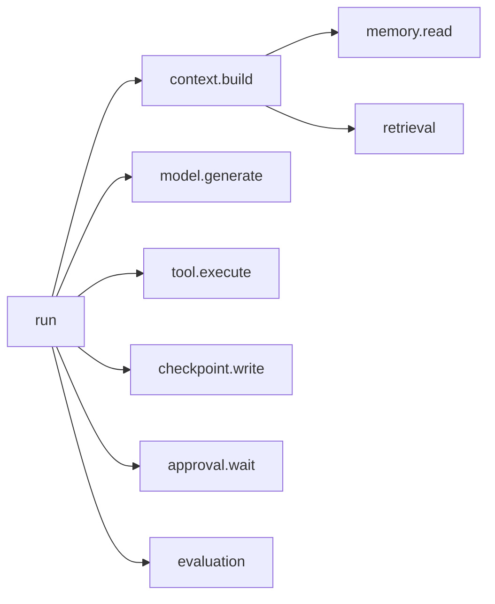
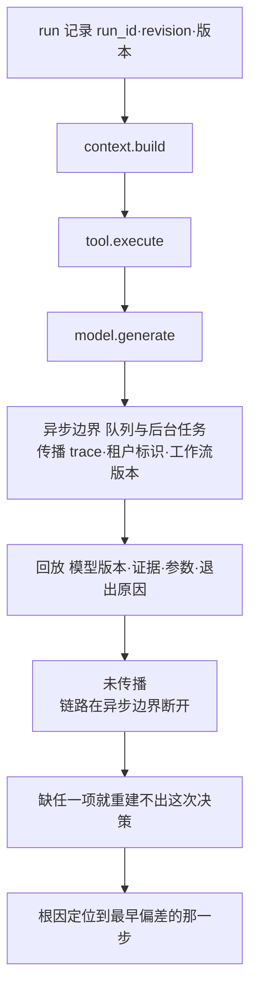

# 可观测性必须能重建一次决策

**这篇讲可观测性为什么必须能重建一次决策。只看最终回答，出问题时没法知道模型当时看了什么、调了什么、状态在哪一步变了。读完你能用稳定标识把一次执行串起来事后回放，从而定位失败根因、对账验收。**

可观测性解决的是只看到最终回答的问题：动作、证据、状态变化都没留下记录，追问为什么时没有可查的来源，所以不知道模型看了什么、调用了什么、状态何时改变。核心机制是把 run（一次完整执行）、context（组装给模型的输入）、model（模型调用）、retrieval（检索，按问题找出相关材料）、tool（工具调用）、checkpoint（状态保存点）和 evaluation（评价，对输出做质量或合规判定）用稳定 ID 串联；最小例子是回放一次失败请求，重建当时的模型版本、证据、工具参数和退出原因。

**Agent（按指令自主调用模型与工具完成任务的程序）的日志不能只记录用户输入和最终回答。要定位一次失败，必须能重建：当时的目标和版本是什么，模型看到了什么，为什么选择这个动作，工具实际做了什么，状态如何变化，最终判定由哪些证据支持。**

## 要解决的问题：一次决策涉及哪些对象

只看到最终回答的问题让上述追问都无法回答。本篇回答：一次决策涉及哪些对象、这些对象通过什么标识串联、回放需要保存哪些字段，以及缺少哪些记录时根因判定无法完成。

## Trace 由哪几层组成，每层用什么 ID 串起来？

打个比方：可观测性像飞机上的黑匣子——事后能把"当时飞行员看到了什么、按了哪几个键、按什么顺序"完整回放一遍，而不是看仪表盘现在指哪儿。比喻到"要能回放"为止：具体要存哪些字段、采样（只采集一部分数据以控制记录开销）怎么取舍、成本怎么控，见下文各节。

重建一次决策，前提是**每一次状态变化都按顺序留了记录**，当前状态能由记录重放出来。这正是事件溯源的结构——不存「当前状态」本身，而是按时间存每一次状态变更事件，任何时刻的状态都能由事件序列重放算出。具体字段看正文。

trace（一次请求从收到到给出回答的完整执行记录）从一次 run 出发，按下面的层次展开，每一层都有稳定的 ID 与之对应。`tool.execute` 层包含对外的请求或进程调用，`context.build` 层包含 `memory.read` 与 `retrieval`：

**层次之外还有两条规则：一个逻辑操作即使内部重试多次，也应保留共同父级，并记录每次尝试；跨队列和后台任务要传播 trace、run、租户标识和 workflow version（工作流版本号，标识这次执行用的是哪一版流程定义），避免链路在异步边界（消息队列、后台任务这类不经同步调用衔接的位置）断开。**

这棵层次树落到真实工具界面上的形态是瀑布图——每个 span（一次操作留下的计时记录，记下开始时刻、结束时刻和父子关系）一根按时长定宽的横条、父子层级缩进排列。OpenTelemetry（可观测性数据采集的开放标准）官方的示例链路（client → api → authN/payment/dispatch）就是重建一次决策时的阅读现场：哪一步先发生、每步多久、谁在等谁，横条的嵌套关系直接可读：

*图源：OpenTelemetry 官方文档，CC BY 4.0，https://opentelemetry.io/docs/concepts/observability-primer/.本篇主命题在这张图上的含义：从 client 的整条横条开始，逐层展开子横条，任何一步的耗时、顺序、嵌套关系都能在事后回放——Agent 的 run→context.build→tool.execute 展开到界面里就是这个形状。*

这套机制在真实查询界面里的样子：Jaeger（分布式链路追踪系统）的 trace 详情页上，左栏是 span 的父子树——frontend → adservice → featureflagservice 逐级缩进，右栏是每根 span 的耗时横条，页首一行摆着 Trace ID（`e324bce`）、起始时间、总耗时与 span 总数——凭这一个 ID 就能把这次请求的全部记录调回来逐层回看，这正是「用稳定标识把一次执行串起来」的实现现场：

*图源：Dash0《What is Jaeger Tracing?》知识页中的 Jaeger UI 截图（https://www.dash0.com/knowledge/what-is-jaeger-tracing ，演示数据来自 OpenTelemetry Demo 应用）。Agent 执行记录落到这类界面后，「重建一次决策」就是从搜索页按 trace ID 进入这一屏。*

## 一次决策至少要记录哪些字段，为什么按标准约定取？

这些字段不是拍脑袋列的清单。OpenTelemetry 的 GenAI 语义约定（OpenTelemetry 针对生成式 AI 场景规定的一套字段命名与结构标准）把 Agent 执行记录做成了行业标准：`create_agent`、`invoke_agent`、`execute_tool` 三类 span，各代表一次操作，创建、调用与执行工具，各带规定属性，属性是键值对形式的字段。约定覆盖 agent.id、agent.name、provider.name、request.model、usage.input/output_tokens（token 是模型处理文本的计量单位，一次切一小段，费用与上下文长度都按它计算）与 conversation.id 等，任何符合约定的后端都能渲染和查询这棵 span 树。记录引用时按约定取字段，重建决策的证据链天然可移植：

*图源：[OpenTelemetry《Semantic Conventions for GenAI agent and framework spans》](https://opentelemetry.io/docs/specs/semconv/gen-ai/gen-ai-agent-spans/)，Apache 2.0，文档引用。*

| 对象 | 至少记录 |
| --- | --- |
| 运行 | run_id、主体、目标资源、revision、工作流版本、开始/结束状态 |
| 模型调用 | provider、模型快照、输入上下文版本、输出类型、token、延迟、错误 |
| 检索 | query、索引 / embedding（文本转向量）/ reranker（对候选结果重排序）版本、过滤条件、候选和最终证据引用 |
| 工具 | 工具 / schema（工具的接口与参数定义）版本、参数哈希、权限判定、幂等（同一操作执行多次与执行一次效果相同）键（同一操作重复执行结果不变的保障标识）、真实结果引用 |
| 状态 | checkpoint、事件序号、任务代际、恢复和取消原因 |
| 评价 | evaluator 版本、样本/规则、分项结果和人工修改 |

**自然语言理由可以记录，但它是模型输出，可能事后才生成、与实际调用的参数和拿到的证据对不上，所以它不是隐藏思维的真实解释，不能当依据，要以上述字段为准。**

这些记录从应用流向查询界面的整条通路由 OpenTelemetry 的组件架构承担：应用侧的 SDK（软件开发工具包）自动在代码里埋点（在代码里插入统计上报语句、收集用户行为数据）采集数据（这一步叫插桩），生成 span，经 OTLP（OpenTelemetry 定义的遥测数据传输协议）送到 Collector（接收、处理并导出遥测数据的中心组件），Collector 按接收、处理、导出三段把数据分发给 Prometheus（开源的时序数据库与监控系统，常用来存指标和出告警）、Jaeger、各类日志后端——约定层管「记什么字段」，这条架构通路管「字段怎么到达能查询的地方」，两者合起来才是完整的证据链：

*图源：OpenTelemetry 官方文档《What is OpenTelemetry?》，CC BY 4.0，https://opentelemetry.io/docs/what-is-opentelemetry/（instrumentation 插桩 / collector 采集器 / OTLP 遥测传输协议）。Agent 的 run、context、tool 各层记录正是沿这条通路进后端——Collector 断了，约定再标准也到不了查询界面。*

## 记录完整内容和保护隐私怎么兼顾？

稳定标识串起来的各层中间，最容易断的一环在异步边界——trace、租户标识与工作流版本有没有跟着传播，决定回放能否成立：

链路完整只保证「能顺着 ID 找到任何一步」，不保证每一步记了什么内容（提示词、检索片段、工具结果）——内容清单本身看下一节。下一节的分歧正在这里。

完整提示词（发给模型的输入指令与背景信息）、检索片段和工具结果最有助于调试，也最可能包含个人数据、代码和凭据。这里的取舍像医院管病历：诊断要靠完整记录，但姓名和身份证号要先遮掉再给无关的人看，需要时再按权限调阅。这个比喻到「遮个人信息、按权限调阅」为止，具体字段与存储方式看正文。默认记录结构和引用，内容按风险脱敏（遮盖敏感字段的部分内容、保留可辨识形态）、采样或存入受控对象存储；trace 里保存内容哈希（把任意长度数据压成固定长度指纹、不可逆）与访问引用。测试环境可以更完整，生产环境要有保留期限、访问审计和用户删除传播。

OpenTelemetry 的 GenAI 语义约定仍在演进，适合用来统一 provider、模型、token（模型处理文本的最小单位，约相当于一个词或半个词）、检索和工具 span；应用自己的 run、workflow、租户标识和业务结果应放在稳定的内部 schema，再在适配层映射到标准，避免标准字段变化污染业务数据。

## 哪些指标下降时分别该往哪一层去查？

- 任务成功率下降：按模型、工作流版本、工具、租户和失败类型切片（按某个维度分组对比，找出哪一组拉低了整体）；
- P95（95% 的请求耗时都低于这个值，即最慢 5% 请求的耗时门槛）上升：按模型、检索、排队、工具和人工等待切片，看各占多少；
- 成本上升：看步数、重试、上下文长度和高价模型路由；
- 工具错误上升：区分参数、权限、依赖、超时和冲突；
- 引用支持下降：分解召回、重排（布局或尺寸变化触发重新计算排版）、上下文选择和生成使用；
- 人工接管上升：区分合理升级与系统能力退化。

只采集 token 和延迟，无法解释为什么 Agent 失败；只保存全部文本，又无法稳定聚合和保护隐私。两者需要同时设计。

## 怎么把线上轨迹变成可复用的工程改进？

一次完整请求要能逐级看到每一步：进入、查询、写出、返回，每步带自己的耗时与结果。能重放到这个粒度，才能把线上问题对回具体环节。

*图源：Microsoft Learn 中文文档，CC BY 4.0，https://learn.microsoft.com/zh-cn/azure/architecture/patterns/event-sourcing。*

把可能揭示系统性问题的高价值轨迹挑出来：同一类失败反复出现、或影响多个租户的轨迹优先入选。挑出来的轨迹进入失败分类队列排队分析——失败按原因归类（模型能力不足、检索失败、工具出错、流程设计不当），逐类给出改法。

脱敏后作为离线评测样本，用于下次模型或流程改动的对比测试；脱敏的常见做法是用哈希值替换真实身份信息、去掉姓名等字段、把具体数值泛化成区间。修复可能发生在任务定义、上下文、检索、工具、控制流、运行时或模型层；必须根据 trace 定位最早出现偏差的位置，避免一律改提示词。

修复上线后，取同一类执行的新 trace 与修复前的 trace 对比，确认原来的偏差在记录里消失，并监控是否产生新的成本或安全退化。

相关（约定层）：[[工程知识/AI 系统工程：从模型能力到生产能力/质量与运营/Agent评估系统的设计约定]] —— 重放所需的任务夹具与证据包格式

可观测性要与回放重建对账——事先约定验收标准：仅凭记录必须能还原当时的模型版本、检索证据、工具参数与退出原因，任一项还原不出就无法重建这次决策。

## 怎么自己动手验证记录是否完整？

1. 回放重建：取一次失败请求，仅凭记录重建当时的模型版本、检索到的证据、工具参数与退出原因，四项与预期一致全部还原才算记录完整。
2. 链路完整：沿稳定 ID 逐层核对 run、context、model、retrieval、tool、checkpoint 与 evaluation 的关联，每一步都带自己的 ID 与序号，逐层比对预期与实际，最先对不上的那一层就是最早出现偏差的位置；任何一层缺记录或对不上关联，都算断链。
3. 状态变化可查：确认状态何时被谁改动记录在案，改动时间与决策时间对得上。

## 效果从哪儿来，要付什么代价？

按稳定标识把运行、上下文、模型、检索、工具与状态串起来，换来的是失败请求可以回放到当时的输入条件，根因能定位到最早出现偏差的那一步。代价是**采集面扩大后内容中可能包含个人数据与凭据**，需要在结构记录与内容脱敏之间取得平衡，并为保留期限与删除传播建立流程。

## 接着读哪几篇相邻文章？

- [[工程知识/AI 系统工程：从模型能力到生产能力/质量与运营/Agent评测必须覆盖轨迹而不只看最终答案]] · [[工程知识/性能工程：从用户等待到资源瓶颈/观测与诊断/性能问题定位]]
