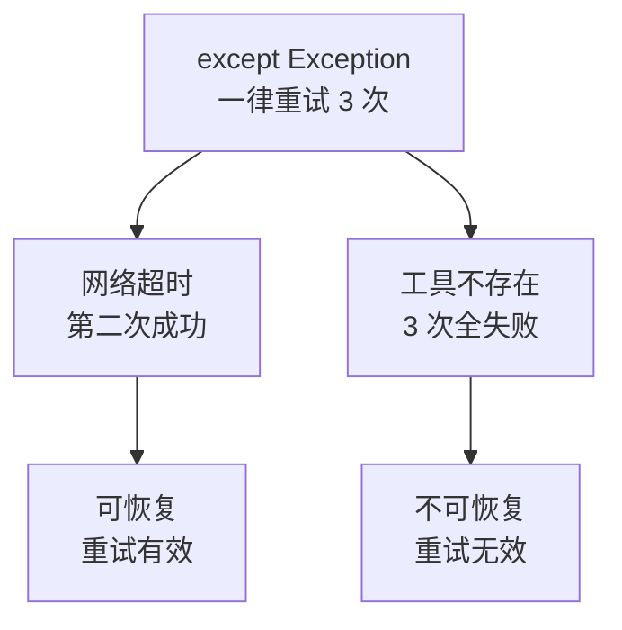
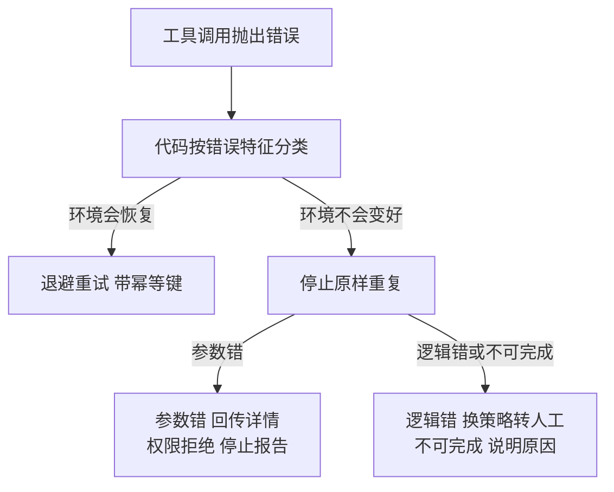
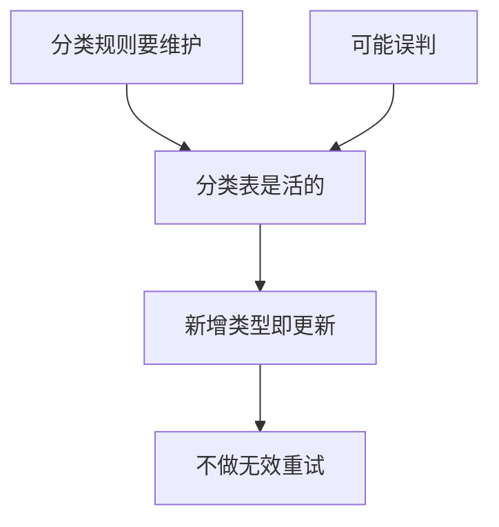

# 失败要分类才能对症下药

读完你能给每类错误配上对应的恢复动作，并写进代码规则。**失败分类解决的是**把超时、参数错误、权限拒绝和任务本身不可完成都当成“再试一次”时，系统**既浪费预算又掩盖根因**的问题。做法是由运行时按可恢复性把错误映射到**退避、修正（改动输入参数后再执行）、重读（把错误详情交回模型重新尝试）、停止或人工接管**。

收益是**只有会自行恢复的一类才适合重试**，浪费的预算被省下。

边界是分类规则必须随工具和依赖演进，模糊错误不能被模型随意解释。最小验证是对每一类故障注入（主动向系统注入故障来验证容错能力的测试方法）一次，检查重试次数、最终状态和给用户的恢复信息都符合策略。可以把它想成医生问诊：发烧、过敏、骨折的处理方式完全不同，一律开退烧药只会把骨折耽误掉。这个比方只到「不同病因不同治法」这一步。不同的是，医生能靠病人自述和体检缩小范围，而分布式系统里连「哪个环节出错」都要靠日志反推，所以这里的分类比问诊更难。

## 按哪些维度把失败分类？

一次调用失败之后，系统能做的动作其实只有有限的几种：再试一次、换个参数、换个工具、停下来报告、或者交给人工。难点在于**失败的原因决定了该用哪一种**，而失败发生时能拿到的往往只有一条错误消息。把超时、参数错误、权限拒绝、工具不存在和任务本身不可完成统统按「再试一次」处理，会同时造成两种损失：预算被无效重试消耗，**真正的根因被重试的噪音盖住**。本篇要解决的问题是：按什么维度把失败分类、每类对应哪个恢复动作、以及**分类必须落在代码里而不是交给模型判断**。

## 它是怎么做到的，本质是什么？

分类可行的前提是**失败的可恢复性是一个客观属性**：同一类错误在不同调用方身上表现一致，超时终会自己好转、参数错永远不变，所以**可恢复性由错误特征决定，与谁在处理无关**。超时可能自己好转，参数错误不会；权限拒绝重试一万次也是拒绝，而工具不存在要先分清是调用方写错了名字（改参数）还是环境里确实没装（阻塞）。

把这三类分开看，恢复动作就**不再是猜测**：能自行恢复的用退避重试，需要改输入的重读或修正，环境缺位的停下来报告，任务不可完成的交给人工。分类规则因此是一张**从错误特征到恢复动作的映射表**，它必须**随工具和依赖一起演进**——新工具会引入新的错误特征，旧规则覆盖不到就会退回「再试一次」。

## 怎么自己动手验证

最小验证是对每一类故障各注入一次，逐项检查三个量：重试次数是否符合该类策略、最终状态是否落在预期的终态、给用户的恢复信息是否指明了下一步。五类中有任何一类退回「重试到底」，就说明**该类的特征没有真正进入分类规则**。

## 所有失败都用"重试"处理会带来什么？

一个 Agent 的错误处理如果只有一种，写出来就是：

```python
except Exception as e:
    retry()   # 重试
```

把五种失败类型分别交给这套统一重试，结果是：

- 工具不存在 → 重试 3 次，每次都失败，浪费 3 次调用
- 参数格式错 → 重试，还是同样的错
- 网络超时 → 重试，这次成功了（**唯一有效的场景**）
- 权限不足 → 重试 3 次被拒 3 次，还触发了安全告警
- 任务不可能完成 → 重试 3 次，然后报一个模糊的错误

**用一种策略处理所有失败，意味着大部分场景都用错了策略。**



图：单一重试策略在五类失败上的真实结局——只有瞬时故障一类能靠重复执行变好，其余四类分别浪费调用、重复同样的错、触发告警、把根因拖到最后一次才暴露。

## 怎么按"能否通过重试解决"给失败分类？

### 有哪五类失败

分类的意义在于不同类的失败要走不同的路：能重试的走重试；有些失败重试无效且已经产生改动，要撤销的走补偿事务（每一步都配一个反向操作，整体失败时按倒序逐个撤销，把已发生的改动退回去）。


*图源：Microsoft Learn 中文文档，CC BY 4.0，https://learn.microsoft.com/zh-cn/azure/architecture/patterns/compensating-transaction。*


| 类型 | 特征 | 正确策略 | 重试？ |
| --- | --- | --- | --- |
| **瞬时故障** | 超时、503、限流（限制单位时间内放行的请求数量）、连接重置 | 退避重试 | 直接重试 |
| **输入错误** | 参数格式错、类型不对、缺必填 | 修正参数后重试 | 改了参数才行 |
| **逻辑错误** | 模型选错工具、推理错误 | 换个策略，或给模型反馈让它改 | 原样重试无效 |
| **环境阻塞** | 权限不足、依赖缺失、网络不通 | **立即停止**，报告需要什么 | 不可重试 |
| **任务不可完成** | 需求本身矛盾、信息不存在 | **立即停止**，说明原因 | 不可重试 |

同一句"调用失败"落到哪条路径，**由错误特征决定，不由模型猜测**：



「按错误特征分类」这个节点是整张图的分流依据：分类发生在代码里，**只有环境会自行恢复的一类能靠重复执行变好**，其余四类各走各路——参数错回传详情让模型改、权限拒绝停止并报告、逻辑错误换策略、任务不可完成停下说明原因。

### 每一类怎么识别

**瞬时故障**靠错误类型判断，识别代码长这样：

```python
TRANSIENT = {
    "timeout", "connection reset", "503", "429",
    "temporarily unavailable", "too many requests",
}
```

处理：指数退避（每次重试的间隔按倍数拉长）+ 抖动（在退避间隔上叠加随机量，避免多个客户端同时重试）+ 幂等（同一操作执行多次与执行一次效果相同）键（随请求带上一个唯一标识，服务端据此识别重复请求而不重复执行）——像占线时隔一会儿再拨、各家错开时间、每次拨打都带工单号防止重复接通。这个比方只对应三个动作的直观感受，具体间隔倍数和随机范围仍按工具参数配置。

「等待一小段时间再试、间隔逐次拉长」的标准形态，Microsoft Learn 的 Retry 模式官方图直接画了出来：应用对托管服务连续两次请求各收到 500，第二次等待的间隔比第一次长，第三次请求成功返回 200——瞬时故障分类正确时，重试就停在这一格：


*图源：同上（Microsoft Learn 中文文档），CC BY 4.0。*

**输入错误**靠 schema 校验（按工具声明的参数结构逐项检查），校验代码长这样：

```python
try:
    validate(params, tool.input_schema)
except ValidationError as e:
    # 把校验错误返回给模型，让它自己修正
    return ToolResult(error=f"参数错误：{e}。请检查后重试。")
```

**关键：把具体错误告诉模型，让它自己改。** **模型修正参数的能力很强，前提是知道错在哪**。

**逻辑错误**看不出来，它的识别依据**在结果里**：工具调用返回成功，问题却没解决——比如文件改了、测试还是失败。判断动作发生在调用之后：

处理：**不要重试同样的动作**。应该：
- 记录"试过这个，没用"
- 换个角度（换个文件、换个方法）
- 连续 N 次无效 → 停止——见 [[工程知识/AI 系统工程：从模型能力到生产能力/Agent与工作流/模型负责判断，运行时负责执行语义]]

**环境阻塞**靠错误特征判断，识别代码是：

```python
BLOCKING = {
    "permission denied", "authentication failed",
    "no such host", "command not found",
    "disk quota exceeded", "connection refused",
}
```

这类错误在真实终端里的样子是清楚的错误前缀与退出码（程序结束运行时返回给调用方的数字，用来表明结束原因）——以 Linux 手册页里 su(1) 对认证失败的退出码约定为例，认证失败返回 1，shell 据此判定终态（流程结束后不再变化的状态）**而不是再试一次**。分类规则读的正是这类机器可判定的特征（错误字符串、退出码），各发行版手册在 [man7.org](https://man7.org/linux/man-pages/man1/su.1.html) 有原文：


*图源：man7.org Linux man-pages su(1) 手册页实拍，man-pages 项目以 GPL 许可证发布，https://man7.org/linux/man-pages/man1/su.1.html。*

**这类错误重试一万次也没用**，因为环境不会自己变好。正确做法：

```
停止 → 报告"需要安装 X"或"需要 Y 权限" → 等人工介入
```

**任务不可完成** —— 最难识别。特征：

- 多次尝试后信息仍然矛盾
- 需求里包含不可能的条件（"在不重启的情况下升级内核版本"）
- 引用的资源根本不存在

处理：**明确说明为什么不可能，而不是硬做**。

### 怎么把分类写进代码

分类写进代码之后，还要决定处理顺序。优先级队列（消息按优先级分池，消费者先取高优先级的池，低优先级在空闲时才处理）提供了一个现成的顺序结构——这里只借用它「高优先级先处理」的思路，不要求真的部署一套队列。失败处理也遵循同样的优先级原则：**环境阻塞和任务不可完成要立即停止报告**，优先级高于其他类别的自动恢复尝试。


*图源：同上（Microsoft Learn 中文文档），CC BY 4.0。*


```python
def classify(error: Exception) -> FailureType:
    msg = str(error).lower()
    if any(t in msg for t in TRANSIENT):
        return FailureType.TRANSIENT
    if any(t in msg for t in BLOCKING):
        return FailureType.BLOCKING
    if isinstance(error, ValidationError):
        return FailureType.INPUT
    return FailureType.LOGIC
```

**分类必须是代码里的规则，不是让模型判断。**打个比方：分类规则像路口的红绿灯，停走由信号灯决定，司机不必自己判断该不该过——这里只到「判定权在代码、不在模型」这一步，信号灯怎么排布（规则怎么设计）看前文的映射表。


## 效果从哪儿来，要付什么代价？

**收益**

- **成本下降**：不再对不可恢复的错误做无效重试
- **恢复率提升**：瞬时故障被正确识别并重试
- **报告质量提升**：失败时能说清"需要什么"，而不是"失败了"
- **安全**：权限错误不再被反复触发

**代价**

- **分类规则要维护**：新增工具、新的错误类型都要更新分类表
- **可能误判**：某个错误既像瞬时又像阻塞。**不确定的按瞬时处理**（重试有上限，代价可控）
- **逻辑错误最难识别**："返回成功但没用"需要任务层面的判据

三类代价指向同一件事：**分类表是活的**，新增工具和新错误类型都要更新它，否则旧规则覆盖不到，系统就会退回一律重试。维护流程见下图：



代价与收益的主要对应关系是：分类规则要维护 ↔ 不再对不可恢复错误做无效重试；可能误判 ↔ 兜底规则让误判代价可控，浪费的预算被省下。分类规则维护得好，重试才不会浪费在不可恢复的错误上；"不确定的按瞬时处理"这条兜底规则（拿不准时统一按瞬时处理、靠重试上限控制代价的保底条款）之所以成立，正是因为重试有上限、代价可控。最后一条最难——"返回成功但没用"这类逻辑错误不产生任何异常，**只能靠任务层面的判据识别**，这也是分类表覆盖不到的缺口。

## 从哪几步做起？

**第一步：收集实际的失败**

跑一周，把所有 `except` 捕获到的错误记录下来。**看真实分布**——实际项目中常见的情形是**错误集中在少数几种上**，具体比例依项目而定。

**第二步：先处理最高频的两类**

不要一次设计完整的分类体系。**先处理 TOP（顶部的） 2**，通常是超时（瞬时）和参数错误。

**第三步：把分类表写成常量，放在显眼的地方**

```python
TRANSIENT_ERRORS = [...]
BLOCKING_ERRORS = [...]
```

**让添加新工具时自然会想到更新它。**

**第四步：给每种类型配不同的处理路径**

```python
if type == TRANSIENT: retry_with_backoff()
elif type == INPUT:   return_error_to_model()
elif type == BLOCKING: stop_and_report()
elif type == LOGIC:   change_strategy()
```

**第五步：统计各类失败的占比**

如果 `BLOCKING` 占比很高 → 环境问题，不是 Agent 问题，因为这类错误的根因在环境配置，**重试策略改不好它**。
如果 `LOGIC` 占比高 → 根因在提示词（发给模型的输入指令与背景信息）或工具描述，**改进方向就是提示设计**。
**这个分布本身是最重要的诊断信号。**

## 有哪些常见错误

**错误 1：catch-all + 重试**

`except Exception: retry()` —— 前面说的所有问题都来自这里。**至少要区分可重试和不可重试。**

**错误 2：把错误详情藏起来**

返回给模型 `"工具调用失败"`，模型不知道原因，**只能盲目重试**。**错误详情必须传回模型**，它修正的能力比想象中强。

**错误 3：对 BLOCKING 错误重试**

权限不足重试 5 次 → 触发安全告警、浪费预算、日志充满噪音。

**错误 4：把"返回成功但没用"当成功**

工具执行成功了，但任务没进展。**要在任务层面判断进展，不只是工具层面。**

**错误 5：分类逻辑依赖模型判断**

提示词写"如果错误不可恢复就停止"——模型判断不了。**用代码规则分类。**

相关：[[工程知识/AI 系统工程：从模型能力到生产能力/Agent与工作流/模型负责判断，运行时负责执行语义]] · [[工程知识/AI 系统工程：从模型能力到生产能力/质量与运营/成本控制要从上下文和重试两头下手]]

相关：[[工程知识/软件构建：让变化可以理解、验证与交付/测试与交付/AI 做前端与设计：可验证的打磨回路]]

相关（失败分类的一个具体分支）：[[工程知识/后端系统：在并发、失败与变化中维持服务/服务设计/一路会话只能有一个回复归属：多客户端接入时的所有者绑定]] —— 等待回复的请求超时后就地报错，属于调用方必须处理的失败分支

**分类策略的验证要与逐类注入对账**：预写权限拒绝与任务不可完成两类直接停止、超时类才进入退避，实测不可恢复类被反复重试，与预期对不上。
