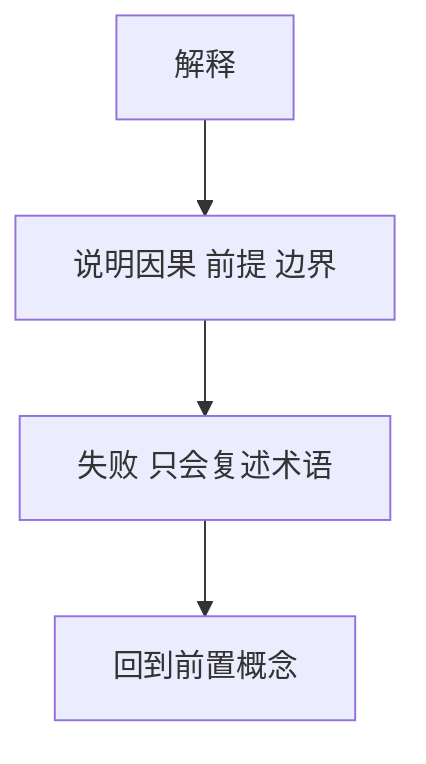
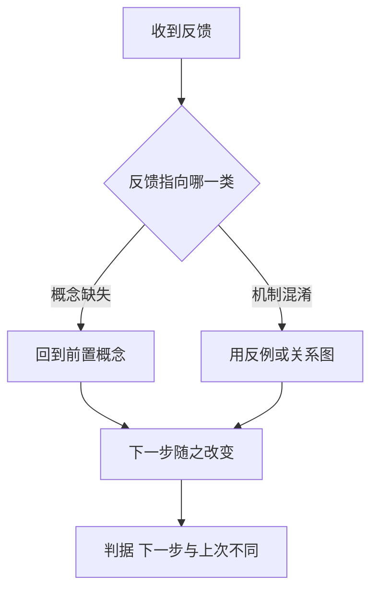
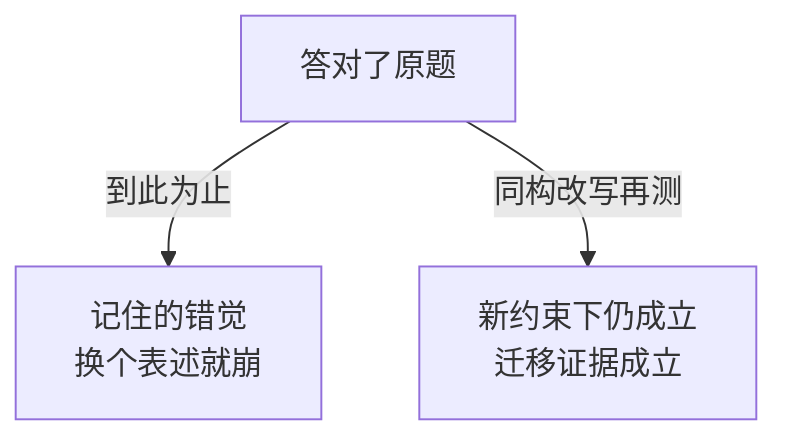

# 学习活动需要结果、轨迹与迁移证据

**看过内容、生成摘要、答对原题，这三件都不能单独证明学会。**读完这篇你能把结果、操作轨迹和迁移分开记录，让学习留下可检查的证据。

核心机制是**把结果、操作轨迹、解释和新约束下的迁移分开记录。分开记录后，哪一层拿不出对应证据就说明没真正掌握，从而挡住只看结果的错觉。**最小例子是先预测 RAG（检索增强生成：先从资料库里找出相关片段，再让模型照着这些片段回答）召回结果，再运行一个小实验，最后改变权限或数据版本重新判断。

读完一页内容、生成一段摘要或答对一道原题，都不能单独证明学会。可用的学习活动必须让学习者解释机制、预测结果、完成操作，并在新情境中迁移；系统则保存这些行为和反馈，作为下一次复习与知识更新的证据。

## 读过材料为何会被当成已经掌握

这一节要解决的问题是：读过材料之后被当成已经掌握，换一个条件就无法独立完成同类任务。本篇回答：结果、操作轨迹、解释与新条件下的迁移各自记录什么、四类记录怎样共同构成掌握的证据，以及预测与实测之间的差距怎样作为下一步的依据。

## 一次学习活动最少要约定什么

打个比方：判断一个人学会了没有，只看他这次考了几分不够（结果），还要看他解题时卡在哪几步（轨迹），以及换一道没见过的题还行不行（迁移）。这个比喻到"三类证据都要"为止：各自怎么采集、怎么权衡采集成本，要看正文。


```yaml
objective: "能解释重排（对召回结果再次排序）为何改变 RAG 的有效召回"
prerequisites:
  - "理解倒排索引（按关键词建立反向列表的检索方式）与向量召回（按语义相似度取片段）的差异"
evidence:
  - "至少引用一个可核验来源"
activity: "先预测 top-k（取前 k 个召回结果）的变化，再比较两种排序结果"
feedback: "指出错误发生在召回、排序还是证据解释"
transfer: "把方法迁移到权限过滤或时效性场景"
source_revision: "2026-09-03"
```

约定先定义结果，再选择讲解、图谱、模拟、代码、测验或项目形式。形式可以变化，证据要求不能省略。

## 学习证据为什么要分四层

四层证据要能分别取到，前提是**不同的证据在不同的环节产出**。管道与过滤器（软件工程里把复杂流程切成一段段独立处理、前一段的输出接后一段的输入的常见写法）给的就是这个结构：处理拆成一串独立的过滤器，数据依次流过，每个只做一件事——每两个过滤器之间都是一个可以取样观察的点。这个比喻只说明证据要在不同环节分别取样；每层记什么、怎么判定，以正文表格为准。


| 层 | 观察什么 | 常见失败 |
| --- | --- | --- |
| 解释 | 能否用自己的话说明因果、前提和边界 | 复述术语但说不出为什么 |
| 预测 | 在看到结果前能否预测方向和代价 | 只会事后解释 |
| 操作 | 能否完成最小实验、代码或配置 | 懂概念却无法执行 |
| 迁移 | 能否在不同数据、约束或故障下复用 | 只会套原题模板 |

四层从"说得出"到"换条件还能用"一层层收紧，没有并列的可选余地——每上一层都多一道更难造假的约束：解释能背，预测难编，操作要真做，迁移跨分布才成立：



**四层里最难造假的是预测：它要求学习者在看到结果之前给出方向和代价，事后解释总能自圆其说，事前预测会立刻暴露机制是否真的理解。迁移是唯一能跨输入分布成立的一层：迁移要求换一种说法或另一批数据仍能做对，而记住只是背住原题的模样，一换表述就崩；所以只有迁移层能暴露这种记住错觉。**四层的常见失败各对应一种重建动作：解释层补前置概念，预测层用反例或关系图纠正机制混淆，操作层把实验缩小并保存日志，迁移层增加相邻场景。**重复做同一道题不会自动消除任何一层的错误。**

## 反馈怎么改变下一步

**反馈不只是给分。先定位错误类型，再决定重建哪一层：**



「反馈改变下一步」作为系统结构长什么样，Anthropic 的 Agent 指南把它画成 Evaluator-Optimizer 工作流：LLM Call Generator（大语言模型调用节点）产出 Solution 交给 Evaluator，Evaluator 判定 Accepted 才放行到 Out，Rejected 就连着 Feedback 打回重来——反馈的价值在回路里，没有打回通道的评分只是记录，有打回通道评分才变成下一步的依据。学习活动的反馈约定就是给这个过程接上打回通道：


*图源：[Anthropic《Building Effective Agents》](https://www.anthropic.com/engineering/building-effective-agents)，Anthropic 版权，文档引用（取自 [Stanford CS329T 课件转录页](https://web.stanford.edu/class/cs329t/slides/Lecture%203%20--%20CS%20329T%20Fall%202025.pdf)）。*

四种错误类型各自重建一层：缺基础就回到前置概念，机制混淆就用反例或关系图，操作失败就缩小实验并保存日志，迁移失败就增加相邻场景。这张图真正要说的是判据——如果做完反馈之后下一步还是重复做同一道题，说明反馈只起到了打分的作用——重复原题不碰薄弱层，薄弱层的错误原样保留，下一步实质未变。重复做同一题不会自动消除错误。

## 学习评测与 Agent 评测怎么共用边界

学习活动也应沿用 [[工程知识/AI 系统工程：从模型能力到生产能力/质量与运营/Agent评测必须覆盖轨迹而不只看最终答案]] 的原则：结果要能断言，轨迹要可回放，引用要能绑定来源，越权（访问了权限范围之外的资源）和副作用（操作对外部状态产生的额外影响）要被拒绝。模型可以生成解释和反馈，但不能自评为「已掌握」——模型既写答案又判答案，两个动作出自同一来源，没有外部标准能反驳它，于是倾向于把自己的输出判为正确，这就是自我确认偏差（只信自己产出的结论）；掌握状态需要回答、实验或迁移任务的真实记录。

## 复习为什么要主动触发

复习优先级由三件事共同决定：上次活动的错误或不确定性、主题本身的变化速度、以及近期是否出现新的应用场景。主题更新时，只重做受影响的解释和迁移任务；稳定主题则按遗忘风险安排间隔复习（每隔一段时间主动重做一遍，而非考前突击）。

沙漏是最古老的间隔提醒器：上半仓的沙漏完，翻一次面就是一次复习触发点——间隔复习的调度器做的是同一件事，只是沙的流速按"主题变化速度 × 遗忘风险"调节，主题更新快的沙漏流速快，翻面的间隔就该短。这个比喻只说明「翻面＝一次复习触发点」；沙漏物理上沙量固定、必然漏完，而调度器的复习周期可以随新内容出现而重置，两者在这里分开，调节规则就是引号里的那个乘式：


*图源：Wikimedia Commons，S Sepp，CC BY-SA 3.0，https://commons.wikimedia.org/wiki/File:Wooden_hourglass_3.jpg。*

## 还有哪些文档与本篇相关

- [[工程知识/AI 系统工程：从模型能力到生产能力/Agent与工作流/Agent学习工具把资料变成可验证学习循环]]
- 学习与复习方法（方法层文档）
- 知识演化机制（方法层文档）

## 真实案例里三类证据缺失会发生什么？

只有结果证据的评估（"答对了"）在 Agent 域的实录——任务最终成功，但轨迹里绕了六轮、烧了十倍 token（模型处理文本的最小单位，约相当于一个词或半个词）、中间两次差点不可逆操作；结果对，但过程绕了六轮、不可复制，说明成功靠偶然而非稳定机制；一旦题目换成另一种说法或另一批数据（即换个输入分布），没有机制支撑就会失败。轨迹证据的采集形态见 [[工程知识/AI 系统工程：从模型能力到生产能力/Agent与工作流/反思要有外部锚点.md]]——每轮动作的观察、决策、依据记下来，复盘时锚点式回放，绕路与侥幸才能被看见。迁移证据的实录形态：换一个词表述同一个任务、题目结构不变（同构改写，即换说法不换骨架）再测一遍，结果崩掉的说明学的是表面模式，迁移证据是区分"记住"与"会了"的唯一判据——这与 [[工程知识/AI 系统工程：从模型能力到生产能力/质量与运营/离线评测与在线评测回答不同问题.md]] 的分层同构：离线结果证据筛可用，在线迁移证据验可靠，两道门都要过。

记住与会了的分界，是一条可执行的判据链：



学习效果要与三类行为对账——预写预测、操作与迁移三种行为都有记录，答对原题但迁移失败与预期对不上，不能算学会。

## 怎么自己动手验证

1. 三段证据：先让学习者预测 RAG 召回结果，再运行一个小实验，最后改变权限或数据版本重新判断，确认预测、操作与迁移三种行为都被记录。
2. 迁移判定：在新约束下重问同一问题，确认答对原题但迁移失败的样本被区别对待。
3. 复习衔接：把上述记录作为下一次复习与知识更新的依据，确认复习内容引用的是这些行为而不是阅读量。

