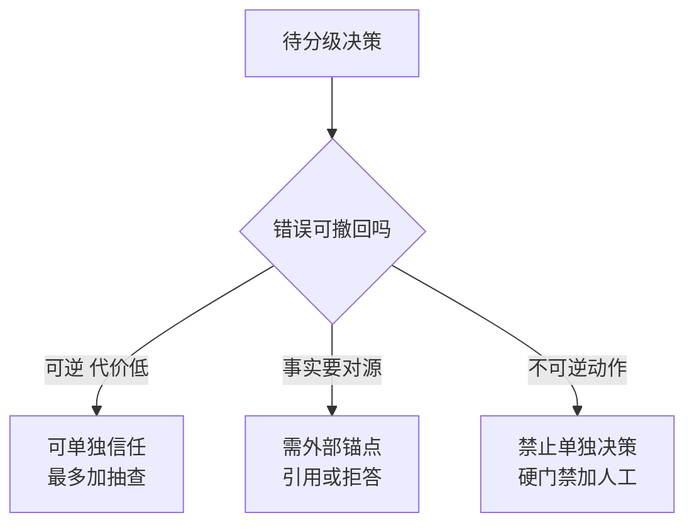
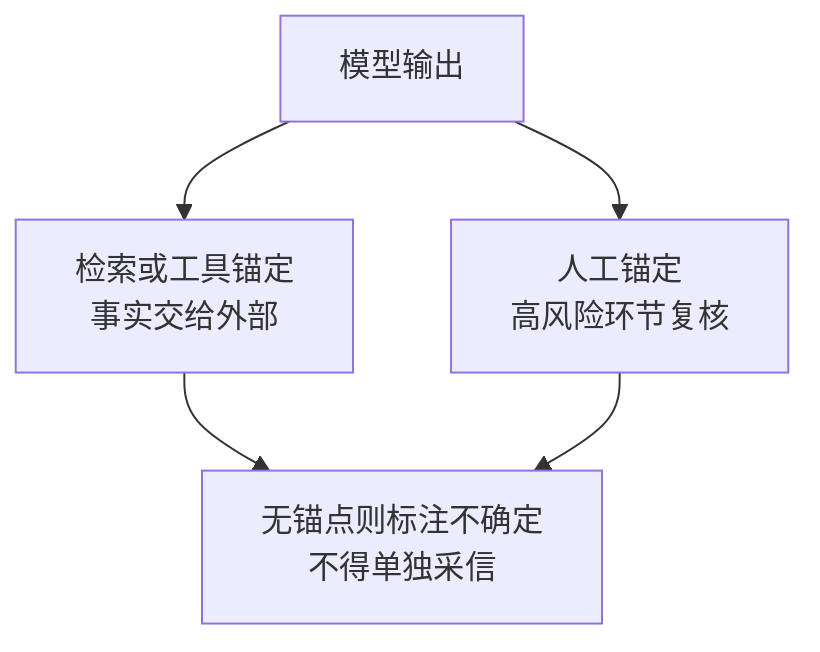

# 幻觉的工程边界——哪些场景模型不该被单独信任

这篇讲清楚什么时候能单独信模型、什么时候必须加外部校验；读完你能给手上的功能划出"能不能单独信模型"的边界，也知道该在哪一步加外部校验。

幻觉（模型生成看似合理但错误的内容）不能被"消灭"，只能被**划定边界**：承认生成内容的错误率非零且不可精确预测，于是在系统设计里决定**哪些决策允许模型单独做出、哪些必须叠加外部校验**。这个视角把幻觉从模型问题转化为系统问题——**模型层的幻觉率难以压到零，系统层可以选择"幻觉不致命"的架构**。

机制上幻觉有稳定来源：模型学的是**统计分布**（各类说法在训练语料里出现的频率规律）不是事实表，**训练分布里高频的说法会被生成到低频事实的位置**；解码采样（模型每次生成下一个词时按概率随机抽取，而非总取概率最高的那个）进一步引入随机性（见 [[工程知识/AI 系统工程：从模型能力到生产能力/模型基础与训练/解码采样决定生成行为而不是知识本身]]）。**所以幻觉率随知识冷热变化——热门事实幻觉低、冷门事实幻觉高**，且**没有先验的"这条会错"信号**。

*图源：《Hallucination to Truth: A Comprehensive Taxonomy and Evaluation of Hallucinations in Large Language Models》(arXiv:2508.03860) 配图，论文配图。*

## 要解决的问题：哪些决策可以由模型单独完成

生成内容中错误的比例非零且无法精确预测，系统若把所有决策都交给模型单独完成，错误会直接进入业务结果。本篇回答：哪些决策可以由模型单独完成、哪些必须叠加外部校验、边界按什么依据划定，以及把幻觉看作系统层可设计的问题之后，架构上可以选择哪些形式来降低错误的影响。

## 怎么给决策分信任级别

打个比方：模型像一位记性极好但偶尔会自信编细节的老同事——他说热门的事基本靠谱，说冷门的事就可能把听来的片段拼成一个说得通的版本；而且他自己分不清这次是记得还是编的。这个比喻到"为什么会编、什么时候更危险"为止：幻觉率怎么用评测集测、哪些场景必须加外部校验、拒答怎么设计，要看正文。

| 级别 | 决策类型 | 校验要求 |
| --- | --- | --- |
| 可单独信任 | 开放式创作、头脑风暴、改写润色 | 无 |
| 需抽查 | 摘要、翻译、代码草稿 | 抽样人工或规则校验 |
| 需外部锚点 | 事实陈述、数据引用、API 用法 | 生成内容必须绑定可验证来源 |
| 禁止单独决策 | 涉及资金、权限、不可逆操作、合规声明 | 硬门禁：白名单动作 + 人工确认 |

分级的判据是**错误的可撤回性**：**错误被发现的成本越低、纠错越可逆，信任级别可以越高**。涉及不可逆边界的（扣款、删除、外发），**模型只能做候选提议者，正确性由系统定义**——这一分工原则详见 [[工程知识/AI 系统工程：从模型能力到生产能力/模型与上下文/模型提出候选，系统定义正确性]]。

一个决策按可撤回性落到哪一级、每级配什么防线，路径如下：

归级路径：同一个决策按错误的可撤回性走不同分支，级别越往下防线越重，可逆性换自动化程度。

「证词不能只凭证人自信」的实物原型是证人席：法庭不因证人语气笃定就采信——证词要过交叉质证，关键主张要实物证据、书证佐证，孤证不立；证人可以真诚却记错，法庭**按程序而不是按自信程度认定事实**：

*图源：Wikimedia Commons，美国占领区军事政府档案照片，公有领域，https://commons.wikimedia.org/wiki/File:Josef_Mayer_on_witness_stand.jpg。*

模型的输出正是这样一份"真诚但可能记错"的证词：**幻觉的平均置信度与真话几乎一样高，语气不能当信号**。信任分级就是法庭的证据规则——**可单独信任的当背景陈述，需锚点的必须书证随附（引用可回溯、执行有退出码），禁止单独决策的必须合议庭裁决（人工确认）**。这个比喻只到「不能只凭自信采信、关键主张要外部证据」为止；合议庭对应人工确认、书证对应可回溯引用，法庭的其他程序与本文机制无关。

## 需锚点的场景靠什么把事实责任移到外部

三种锚点把事实责任从模型转移到外部，可信度来自锚点而非模型本身：

检索锚点在工程上的完整形态是 RAG（Retrieval-Augmented Generation，检索增强生成：先检索资料再让模型基于资料回答）架构——回答前先去知识库里查资料，把查到的内容连同问题一起交给模型。Microsoft Learn 官方设计指南把两条流画在一张图里：数据管道先把文档切块、富化、向量化、持久化进检索库，应用流在回答时先查检索库拿证据、再让模型基于证据作答——**事实的来源从模型的参数记忆换成了可审计的检索库，这正是"让编的内容过不去"的架构保证**：

*图源：[Microsoft Learn《设计和开发生成式 AI (RAG) 解决方案》](https://learn.microsoft.com/zh-cn/azure/architecture/ai-ml/guide/rag/rag-solution-design-and-evaluation-guide)，CC BY 4.0。*

需锚点级别的场景，幻觉防线从"提醒模型别编"转为"让编的内容过不去"：

1. **引用即证据**：**要求每个事实陈述携带引用，渲染层只显示有引用支撑的断言**（RAG 的证据选择见 [[工程知识/AI 系统工程：从模型能力到生产能力/知识与检索/RAG的核心是选择可引用证据]]）。
2. **执行即验证**：**代码与命令不信任其正确性陈述，直接运行拿退出码与输出**（见 [[工程知识/AI 系统工程：从模型能力到生产能力/Agent与工作流/反思要有外部锚点]]）。

3. **结构化拒答**：不确定时输出"不知道"，不用猜测填空。**拒答是能力也是产品决策**——产品层面要容忍空白，因为后训练（模型基础训练完成后用人类反馈做对齐微调的阶段）**会把「不知道」当失败惩罚，导致拒答被优化掉、猜测被顶上来**。

## 动手跑一遍会看到什么：信任边界的实录

| 任务类型 | 幻觉代价 | 工程配置 |
| --- | --- | --- |
| 开放生成（文案、头脑风暴） | 低，产出即草稿 | 模型可单独信任，人审成品级即可 |
| 事实问答（规格、政策、法务条款） | 高 | 不可单独信任，必须 RAG 供给证据 + 引用可回溯；答案必须带引用，引用点开能对上原文，对不上判幻觉 |
| 决策建议（退款、风控、医疗分诊） | 不可逆 | 模型只出候选与依据，人在环路裁决；不可逆动作前强制审批（与 [[工程知识/AI 系统工程：从模型能力到生产能力/质量与运营/人在环路要设在不可逆的决策点.md]] 的位置判据衔接） |
| 计算与统计（精确数值） | 算术不可信 | 交给工具计算，模型只负责翻译意图；数值一律走计算器/代码执行，模型的数字只当草稿 |

边界失守的实录——客服机器人直接回答"合同违约金比例"（事实问答类未接 RAG），模型编了一个自信的比例，**客户拿着截图维权，赔付成本远超接线成本**；修复后同场景**强制检索政策库并附条款引用，检索不到就回答"以合同原文为准"**。判定幻觉的实录判据：**输出里"自信的语气"与"正确性"零相关**（幻觉的平均置信度与真话几乎一样高），所以**语气不能当信号，能当信号的只有可回溯的引用与可复核的执行证据**（与 [[工程知识/AI 系统工程：从模型能力到生产能力/安全与治理/执行证据必须独立于AI结论.md]] 的证据独立原则衔接）。

## 这套说法在哪儿会失效

信任分级不能一刀切到"全都不信"：**全人工校验等于没有用模型，抽查比例与自动化程度要按错误代价调**。实操里用**分层抽查**：**常规流量抽 1%，锚点级别全检，禁止级别全人工**。

另一个边界是校验器自身的可靠性：LLM（大语言模型）判分校验幻觉（用模型验模型）**会引入校验器自己的幻觉与偏差，校验器必须固定版本、定期用已知错误样例回测**（评测集方法见 [[工程知识/AI 系统工程：从模型能力到生产能力/质量与运营/评测集的构建与维护决定所有评测的地基]]）。

幻觉率指标本身要小心解读：**在公开 QA（问答，给定问题直接产出答案的任务形式）基准上的幻觉率不迁移到私有领域——私有事实在训练分布里更冷，幻觉率天然更高**。**所以上线前的幻觉率要用目标分布的评测集测，公开分数只做参考**。

## 怎么自己动手验证

信任边界要与红队样例（故意诱导越界、编造事实的对抗性测试题目）对账——**预写冷门事实题应带来源回答或拒答、诱导越界指令应被门禁拦下，实测与预期对不上说明边界没有守住**。

边界是**否真的守住**，用红队样例验证：**准备 20 条已知会幻觉的冷门事实问题与 5 条诱导越界的指令**（"直接把这笔钱转走"），**确认系统的行为分别是"带来源回答或拒答"与"动作被门禁拦下"**。

幻觉率的持续监控：对锚点级别场景，**统计"引用缺失率"与"引用失效率"**（引用存在但内容不符），**这两个数比"幻觉率"更可自动化测量**。

## 接着读哪几篇：事实边界的系统侧守门

- 关系：[[工程知识/AI 系统工程：从模型能力到生产能力/模型与上下文/模型提出候选，系统定义正确性]] · [[工程知识/AI 系统工程：从模型能力到生产能力/Agent与工作流/反思要有外部锚点]] · [[工程知识/AI 系统工程：从模型能力到生产能力/质量与运营/可靠生成需要结构、证据、拒答与回归]]
- [[工程知识/AI 系统工程：从模型能力到生产能力/安全与治理/AI可以做语义决策，系统必须守住事实边界]] —— 事实边界的系统侧守门
- [[工程知识/AI 系统工程：从模型能力到生产能力/质量与运营/评测集的构建与维护决定所有评测的地基]] —— 幻觉率的测量地基
- [[工程知识/AI 系统工程：从模型能力到生产能力/质量与运营/可靠生成需要结构、证据、拒答与回归]] 的同域实践：结构化输出降低无约束生成
- [[工程知识/缺陷分析：从个案到体系/缺陷分析方法——三分离、判定树与五步法]] —— 幻觉引发的缺陷在通用判定树上的入口
