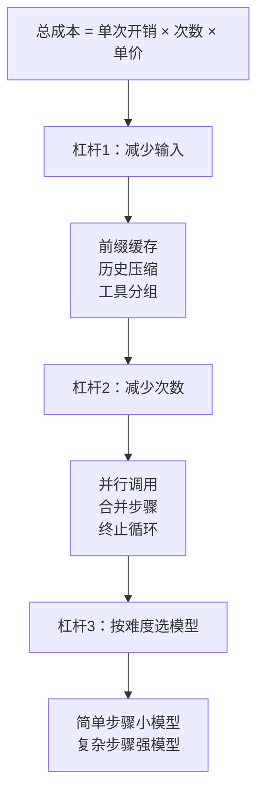
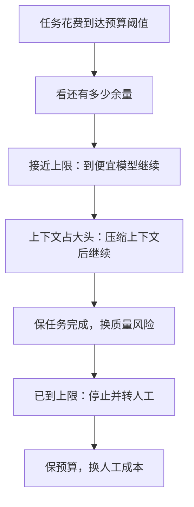
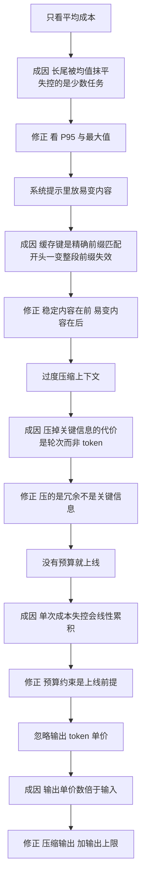

# 成本控制要从上下文和重试两头下手

Agent（能自主调用工具完成多步任务的程序）在真实长任务里会**突然失去预算边界**。读完这篇你能测出每一步的开销，并用缓存和预算把 P95 与最坏成本管控住。先测量每步输入、输出、缓存命中和重试，再用上下文选择、稳定前缀缓存、只读结果复用（相同查询直接取上次模型返回的结果，不再发起一次调用）和可计算预算**减少无效调用**；收益是能控制 P95（95% 的任务成本都低于这条线，比平均值更能反映失控的长尾开销）和最坏成本，代价是**缓存失效、模型路由和质量回归都必须被持续评测**。

最小验证是在同一批真实任务上比较优化前后的完成率、P95 成本和 P95 延迟，而不是只报一次平均 token（模型计费与计数的最小单位，中文里大致几个字到十几个字对应一个 token）。

## 要解决的问题：每一步的输入输出与缓存命中与重试怎样分别测量

演示阶段成本可控的 Agent 进入长任务之后，输入重复累积、失败重试叠加、上下文不断增长，**花费在预算之外，且无法预估最坏情况**。本篇回答：每一步的输入输出与缓存命中与重试怎样分别测量、上下文的取舍与后端结果的复用各自能压缩哪一部分开销、预算怎样写成可计算的表达式，以及优化之后质量回归用什么来盯。

## 这件事发生在什么场景：POC 很成功，上线后账单失控

POC（Proof of Concept，概念验证）是只验证可行性、不承担真实流量的原型。

内部 POC 阶段，单次任务成本 0.15 美元，每天 20 次，月成本 90 美元——完全可接受。

一个公开案例的上线前后对比说明了这个坑：单次任务平均成本从 POC 阶段的 0.15 美元涨到 1.8 美元，月成本 3.2 万元。

账单翻十倍有三个原因叠加：

1. **上下文变长**：真实任务对话轮次从 POC 阶段的 5 轮涨到 20 轮，而每轮都带上完整的系统提示 + 20 个工具定义 + 历史
2. **重试变多**：真实环境有更多失败，每次失败都重跑整条链路
3. **长尾（少数请求耗时远高于其余大部分）任务**：5% 的任务消耗了 40% 的成本——那些陷入循环的任务

POC 的成本不能外推到生产，因为生产里有**少数任务占用大量成本的长尾**，POC 没有，只看平均会**低估最坏情况**。


来源：[稀土掘金《图解Transformer：为什么GPT、Claude、DeepSeek都用同一个架构？》](https://juejin.cn/post/7668503904926236723)（CC 4.0 BY-SA）


## 方案是什么：成本 = 单次 token × 调用次数

```
总成本 = Σ(每次调用的输入 token + 输出 token) × 单价
```

成本公式里能动的只有**三个杠杆**：**减少每次的输入、减少调用次数、用更便宜的模型**。第四节的预算约束不改变这三项，它是在杠杆之外**给花费封顶的执行手段**。



图：三个杠杆各作用于成本公式的哪一项，互不重叠，组合使用才覆盖完整公式。

### 杠杆 1：怎么减少每次调用的输入（效果最大）

每次调用都要重新发送系统提示 + 工具定义 + 历史。这部分在很多调用里是**完全重复的**。

**Prompt Caching**：把不变的前缀缓存起来，**后续调用只付 10% 的价格**。

```
系统提示 + 工具定义（8000 token，缓存）
+ 对话历史（增长中，部分可缓存）
+ 本轮新内容
```

要求：**把稳定的内容放在前面**，变化的内容放在后面。**缓存是按前缀匹配的，顺序变了缓存就失效**。命中与失效的形态在 Anthropic 官方的缓存时间线图里画得很直白——前缀相同的部分走 Cache Read（缓存读，约标准输入价十分之一），新增部分触发 Cache Write，前缀一变整个缓存写重来：


*图源：Anthropic 官方文档《Prompt caching》配图 prompt-cache-mixed-ttl（https://docs.anthropic.com/en/docs/build-with-claude/prompt-caching）。上排：混合 TTL（Time To Live，存活时间：到期后自动失效或删除） 下首个请求命中 1 小时缓存（1h hit），后续新增段各自写缓存（1h miss / 5m miss）；中排：前缀全部变动的请求序列，命中归零（A is zero），每条都全额重写；下排：前缀稳定的序列，三次全部命中 5 分钟缓存（5m hit）——正文说的"稳定内容在前，易变内容在后"对应的就是上排与下排的差别。英文标签对照：Cache Read=缓存读取，Cache Write=缓存写入，1h/5m=1 小时/5 分钟两档 TTL（存活时间），hit=命中，miss=未命中，Rest of the prompt=提示词（发给模型的输入指令与背景信息）的其余部分。*

| 方法 | 效果 | 代价 |
| --- | --- | --- |
| 精简系统提示 | 直接减少每次输入 | 可能损失质量，要测 |
| 工具分组加载 | 20 个工具 → 只注入 5 个 | 需要路由逻辑 |
| 对话历史压缩 | 见上下文工程 | 可能丢信息 |
| **引用代替全文** | 大文件内容用路径引用 | 需要时能展开 |

### 杠杆 2：怎么减少调用次数

每次调用都有固定开销（系统提示 + 工具定义）。**减少轮次比减少每轮 token 更有效。**

- **一次提取多个字段**，而不是每个字段调一次
- **合并独立操作**：批量读文件而不是一个个读
- **允许并行**：独立的工具调用放在同一轮（多数 API 支持一次返回多个 tool_use）
- **终止循环**：见 [[工程知识/AI 系统工程：从模型能力到生产能力/Agent与工作流/模型负责判断，运行时负责执行语义]]——**循环是最大的成本黑洞**

### 杠杆 3：怎么按难度选模型

**不是每步都需要最强的模型**，按步骤类型挑选：

| 步骤类型 | 模型选择 |
| --- | --- |
| 分类、路由、格式判断 | **小模型/便宜模型** |
| 信息提取（结构化） | 小模型通常够用 |
| 复杂推理、规划、写代码 | 强模型 |
| 总结、润色 | 小模型 |

**路由模式**：先用一个便宜模型判断任务难度，**难的给强模型**。

**实际效果**：混合策略常能省 60-80% 的成本，质量下降很小——因为**大部分步骤并不需要最强模型**。

### 杠杆 4：怎么设预算硬约束

```go
type Budget struct {
    MaxCostPerTask   float64   // 单任务上限
    MaxCostPerSession float64  // 单会话上限
    MaxCostPerDay    float64   // 日上限
}
```

超限时的处理不是简单报错，流程见下图：



图：超限后的三条处理路径与各自的交换——前两条保完成率、押上质量风险，第三条保预算、押上人工成本。

1. 降级（压力过大时关闭次要功能，保住主流程）到更便宜的模型继续
2. 压缩上下文后继续
3. 停止并转人工

**在接近预算时提前告警**（比如 80%），让上层有机会决策。

## 效果从哪儿来，要付什么代价

**收益**

- **成本可预测**：有了预算约束，最坏情况已知
- **成本常能降一个量级**：缓存削减大部分重复输入、减少轮次削减重复计费、路由把强模型用量降到少数步骤，三个杠杆相乘才接近十倍
- **倒逼设计优化**：看成本分布能发现设计问题（比如某个工具返回过大）

**代价**

- **缓存需要精心设计**：前缀必须稳定。哪怕在前面加个时间戳，缓存就全失效了
- **模型路由增加复杂度**：要判断什么时候用大模型，且可能误判
- **降级影响质量**：超预算时降级，任务可能失败。**要权衡是省钱还是保质量**
- **监控成本本身有成本**：记录每次调用的 token 和费用，本身也是工程量

## 从什么地方做

先找出压力集中在哪一段。整体扩容是最贵的做法，按段伸缩要便宜得多：只给压力大的那段单独增加实例，其余段落保持原样。


*图源：Microsoft Learn 中文文档，CC BY 4.0，https://learn.microsoft.com/zh-cn/azure/architecture/patterns/pipes-and-filters。*

这张图对成本控制的含义是：按段扩容管理的是部署实例的费用，与管控 token 费用的缓存、预算杠杆不是一回事；但两者的共同点是成本与压力不均匀分布，先量出各段的压力再决定加哪里，比按整体峰值配资源省得多。这与杠杆 1 减少输入是同一件事的两个方向——一个减总量，一个改分布。


**第一步：先测量，别猜**

先把观测口径立起来，每次调用记录这些字段：

```json
{"task_id（任务编号字段）": "...", "step": 7, "model": "...",
 "input_tokens": 12400, "output_tokens": 380,
 "cached_tokens": 8200, "cost": 0.042, "latency_ms": 1820}
```

**没有这个数据，所有优化都在凭感觉下注。**

**第二步：看成本分布，找长尾**

按 task_id（任务编号字段）聚合，排序。**通常会发现 5% 的任务占 40%+ 的成本。** 先优化这些（多半是循环或超长上下文）。

**第三步：上 Prompt Caching**

把系统提示和工具定义固定在最前面，前缀因此保持稳定。这一步改动小、见效快。

**第四步：找出"重复输入"**

系统提示 + 工具定义 × 调用次数 = 多少？**如果这个数字超过总成本的 50%，说明轮次太多——重复前缀每多一轮就多支出一次，它占比高正说明轮次而非单次输入是成本大头。**

**第五步：加预算约束和告警**

单任务上限 + 日上限 + 80% 预警。**上线前必须有，否则一次失控就能吃掉一个月预算。**

## 常见错误有哪些，分别踩了收费结构的哪一条

**错误 1：只看平均成本**

平均值掩盖长尾。**要看 P95 和最大值**——失控的往往是少数任务。

**错误 2：在系统提示里放动态内容**

"今天是 2026-09-15" 放在提示词开头 → 每天缓存失效（缓存里的数据过期或不一致、需要回源加载）一次。如果放在结尾，只影响最后一段。

**错误 3：为了省钱过度压缩上下文**

把关键信息也压掉了，导致模型判断错误，反而要更多轮次重试。**省了 token，亏了轮次。**

**错误 4：没有预算就上线**

POC 阶段没设上限，上线后一个无限循环任务烧掉几千美元。**预算约束是上线的前提。**

**错误 5：忽略输出 token 的单价**

输出 token 的单价高于输入（各家价目页上输入输出常差数倍，量级以在用模型的价目页为准）。**压缩输出**（"不要解释你的推理过程，直接输出结果"）能省不少。

五条错误都能追溯到收费结构本身，对应关系见下图：



收费结构里有三条能直接换算成钱。输出单价普遍是输入的 3 到 5 倍——[大模型 Token 定义解析：输入 Token 与输出 Token 的计费差异](https://www.qiqicto.com/infor/7834.html) 给出的对照表里，GPT-4o 是 2.50 对 10.00、Claude Sonnet 4.5 是 3.00 对 15.00、o1 是 15.00 对 60.00，成因是输出要逐 token 自回归（模型一次只生成一个词，再把这个词接入输入继续生成下一个），每生成一个新 token 都把之前的全部重新跑一次前向（模型对整段输入计算一遍得到输出）。缓存读取则是另一个方向**：同一份表里 Sonnet 4.5 的缓存读仅 0.30，约是标准输入价的十分之一——所以**让前缀保持稳定就能长期吃到这个折扣，这正是错误 2 要求稳定内容在前的原因。这两条加起来解释了错误 2 与错误 5——把日期这类易变内容放在提示词开头，等于每天让整段前缀缓存失效一次；而"压缩输出"省的是单价最贵的那一端。

错误 3 是唯一不能从价目表里读出来的：把关键信息一起压掉之后，省下的是 token，亏掉的是轮次，重试一轮的输入往往超过当初省下的量。

## 怎么自己动手验证

1. 分布对照：在同一批真实任务上比较优化前后的完成率、P95 成本与 P95 延迟，确认结论不来自单次平均 token。
2. 逐项记账：统计每一步的输入、输出、缓存命中与重试次数，确认成本下降落在预期的项上。
3. 质量回归：优化后重跑质量评测，确认完成率没有因为缓存失效或模型路由而下降。

## 它是怎么做到的，本质是什么

打个比方：成本像出租车计价——后备箱塞的东西越多，起步价越高（上下文长度），而且每绕一圈都要重新按这段路算钱（重试重复计费）。想省钱，要么少带行李，要么少绕路。这个比喻到"钱花在哪两处"为止：缓存怎么复用、重试怎么退避、哪些场景该降级，要看正文。


成本控制的机制层：每次调用的费用由送入的 token、产生的 token 与调用次数共同决定，稳定的系统提示与工具定义在每一轮重复发送，失败重试又把整条链路重放一次。上下文的选择决定单次开销，步骤数与重试策略决定次数，两者的乘积在长任务里随轮次线性累积。

## 接着读哪几篇：评测与成本的预算平衡
[[工程知识/AI 系统工程：从模型能力到生产能力/质量与运营/算力供给形态决定成本结构：按需、预留与可回收份额的取舍.md]]
[[工程知识/AI 系统工程：从模型能力到生产能力/质量与运营/成本要对账才能被治理：记账粒度、预算归属与超支信号.md]]

- [[工程知识/AI 系统工程：从模型能力到生产能力/模型与上下文/上下文工程是在有限预算内构造决策现场]] · [[工程知识/AI 系统工程：从模型能力到生产能力/Agent与工作流/模型负责判断，运行时负责执行语义]]


- [[工程知识/AI 系统工程：从模型能力到生产能力/质量与运营/评测集的构建与维护：从场景采样到难度分层.md]] —— 评测与成本的预算平衡
