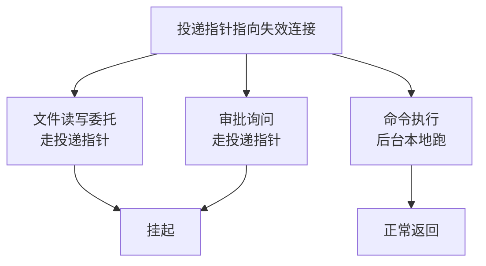
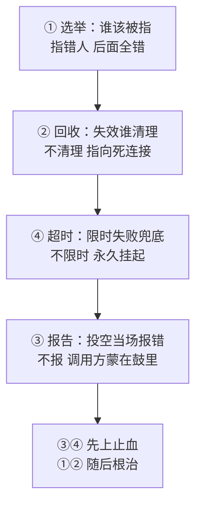

# 投递指针的选举与失效：连接注册表的四个健壮性缺陷

这篇讲连接注册表的四个健壮性缺陷：选举、回收、报错、超时各坏在哪一步。维护「谁现在负责应答」的那个组件叫注册表，它记录着一个指向当前对端的**投递指针**——一次转发是否发往有效连接，**就看这个指针**。

AI 客户端（指代用户跑 AI 编码助手这类工具的前端程序）把审批、选项题、文件读写委托给替身窗口（真正执行这些操作的后端程序），消息中间件把消息投给消费者，网关（负责转发客户端连接的中间层）把连接迁移给新后端，都是这个模式。**指针本身可靠不可靠，决定了整个转发链路会不会毫无征兆地永久挂起**。
读完这篇你能判断一次转发卡住是指针没选对还是没失效，也知道该给注册表补哪道检查。

指针有四个常见的健壮性缺陷，任何一个都足以让后续所有投递彻底失效，而且**失败往往静默到无法察觉**。它们是「选举 + 转发」这类结构的通病，独立于具体产品的实现质量：**谁当选、谁负责清理、投递失败报不报、等多久算超时**，四问答错一题**就是永久挂起**。

## 投递指针怎么会变成单点：要解决的问题

先把形状说成一件事：投递指针像小区门卫桌上的"住户快递代收登记簿"——门卫只看登记簿上写的"3 栋 502 王某"就投件，不打电话确认王某是否还住这儿。簿子没更新（指针失效）、两本簿子写的门牌不一致（多副本不一致）、换门卫时簿子交接丢了（选举间隙）、王某一户代收全楼快递（指针成了单点，全体住户的包裹都被一个人经手），前两类毛病都会让包裹投进空屋，而且寄件人只看到"已投递"。这个登记簿比喻只覆盖指针选错人和失效两类形状；静默丢弃、无超时是投递环节的另两类毛病，比喻管不到，下面单独讲。

一个「转发给对端」的系统，**最安静的失败方式**是：指针指向了一个已经失效的连接，但没人知道，于是**每一次投递都发往空处，调用方无限等待**，日志里只有一条 warn。用户看到的只是**一个永远转圈的界面**。

这类故障难查，因为：

- 它不报错——投递「发出去了」，只是没人应答。
- 它不自愈——**指针不会自己发现指错了人**。
- 它影响面大——指针一旦错，之后**每一类**投递全废，不止一种请求。

## 四个缺陷各坏在哪一步

*图示：ZooKeeper 的层次命名空间——注册项挂成一棵树，查找沿路径走。图源：Apache ZooKeeper 官方文档《Data Model》，Apache-2.0，https://zookeeper.apache.org/doc/current/zookeeperProgrammers.html。注册表看着就是这棵树，但树上的节点是有生命周期的：下面四个缺陷，全出在"节点什么时候消失、谁有权宣布它消失"这件事上。*

| # | 缺陷 | 后果 | 应有的行为 |
| --- | --- | --- | --- |
| 1 | 收件人指针「最后登记者当选」，且不归还 | 任何第三方连接挂接都会架空原窗口 | 指针要有归属策略（判定谁才是真正的服务窗口）；原窗口活动时归还给它 |
| 2 | 连接终止后指针不回收 | 后续所有投递指向失效连接 | 连接关闭时清理指针，回退到存活的上一任 |
| 3 | 投递失败静默丢弃（只记 warn 日志） | 工具调用无限等待，用户只看到卡住 | 当场报错给调用方：「投递失败：客户端已断开」 |
| 4 | 投递无超时 | 挂起没有兜底 | 可配置超时，超时后调用失败并说明原因 |

### 缺陷 1：为什么最后登记者当选还不归还

选举规则是「谁最后 connect 上来，指针就指向谁」，而且指过去之后不再归还。后果是任何一个后来者——哪怕是一个连初始化握手都没做的裸连接——建立了连接，就**把真正在干活的原窗口架空了**。所有本该发给原窗口的投递，**全被这个冒名者截走**。

「先到先得」至少要求先完成注册，「最后登记者当选」连「做过 initialize」都不要求，**connect 本身就足以当选**。**归属策略缺失让选举退化成了纯粹的时序竞争**。

正确做法：指针选举要有归属判据（是不是真正的服务窗口、有没有完成握手），并且**原窗口重新活跃时要归还**指针，而不是谁后连谁赢。

### 缺陷 2：连接终止后指针为什么不回收

**连接关闭时不清理指针**。指针继续指着那个已经关闭的连接，之后每一次投递都发往它，**全部落空**。这是缺陷 1 的慢性版本——这里只说它发生方式是慢慢累积，后果同样是投递全废：指针没有被别人抢走，只是**持有者退出了没人接管**。

正确做法：连接关闭事件必须触发指针清理，回退到上一个仍存活的连接；没有存活连接时指针置空，**投递直接失败而不是发往失效连接**。健康检查只能提供有时效的失败证据——见 [[工程知识/后端系统：在并发、失败与变化中维持服务/分布式可靠性/健康检查只能提供有时效的失败证据]]——所以**清理要靠连接关闭这个确定性事件**，而不是定期探活——**探活有误判窗口，连接关闭事件是操作系统层面确定性到达的信号**。

### 缺陷 3：投递失败为什么会静默丢弃

这是四个里最毒的一个。投递发出去、对端不应答或已断开，系统不报错，只在日志里记一条 warn，然后**调用方就一直等**。**静默丢弃把「明确的失败」变成了「无限的等待」**——调用方无从知道自己已经被放弃，也无法重试或改道。

它的杀伤力在于影响面：文件读写的执行委托（fs/read_text_file、fs/write_text_file）和审批询问走的是**同一条投递指针**。所以指针失效之后，不止审批丢，**连读写工具本身都直接挂起**——命令执行不受影响（后台本地跑，不走窗口），表现为**「读写全挂、命令正常」**这种诡异的部分失效。部分失效的形态如下：

为什么故障表现是部分失效：走指针的两类委托全部挂起，不走指针的一类照常工作，同一个会话里同时出现挂起与正常，**排障时容易误判成工具本身的 bug**。

正确做法：投递失败必须**当场报错给调用方**，明确说「投递失败：客户端已断开」，让调用方决定重试、降级（主动牺牲部分功能或精度，保住核心链路）还是终止。绝不允许吞掉失败只记日志。

### 缺陷 4：投递为什么没有超时

即使选举、回收、报错三层都正常工作，只要没有超时，一次投空仍然能让调用永久挂起——前三层都不管「等多久」，**这个缺口只有超时能填**。**超时是最后一道兜底**：给每次投递一个明确的时限，到点就判定失败并说明原因。

这种分层超时不是拍脑袋定的，早有系统性的预算分配方法，见 [[工程知识/后端系统：在并发、失败与变化中维持服务/分布式可靠性/超时的层次设计：连接、读写与整链路的预算分配]]——超时必须是可配置的、分层的（连接、读写、整链路各有预算），而且超时要真正触发失败，不能形同虚设。

来源：[博客园《解密 Raft 算法》三种身份一图](https://www.cnblogs.com/traditional/p/12588733.html)（CC 4.0 BY-SA）

来源：[博客园《解密 Raft 算法》多数派当选一图](https://www.cnblogs.com/traditional/p/12588733.html)（CC 4.0 BY-SA）

## 四个缺陷怎么互相放大：关系

它们是一条防线上的四层，缺一层就多一类挂起：

链的走向是 ①→②→③→④：前一层漏掉的交给下一层兜。回收只清理已断开的连接；选举选错但连接仍存活时，回收层兜不住，**要靠超时层和报告层兜底**。

- 选举（缺陷 1）：谁该被指。指错了人，后面全错。
- 回收（缺陷 2）：失效之后谁清理。不清理，指针就指向已经不存在的连接。
- 报告（缺陷 3）：投空了报不报。不报，调用方蒙在鼓里。
- 超时（缺陷 4）：等多久算完。不限时，永久挂起。

其中缺陷 3、4 是**止血层**：即使选举和回收一时修不好，只要投递失败能报错、有超时兜底，**至少不会永久挂起**，用户能看到失败而不是一个转圈。所以修复优先级上，3、4 先上，1、2 随后根治。

## 收益从哪来、付什么价：效果与代价

**收益**

- 投递失败时立即报错并说明原因，不再无声挂起。
- 指针随连接生命周期正确回收，不会长期指向失效连接。
- 超时兜底让最坏情况也有界，便于定位和恢复。

**代价与边界**

- **报错会改变调用方行为**：以前挂着等，现在会失败。**调用方必须有处理失败的分支**，否则只是把「挂起」换成「崩在上游」。因此报错要和幂等（同一请求重复提交结果一致）、重试策略一起设计（见 [[工程知识/AI 系统工程：从模型能力到生产能力/质量与运营/失败要分类才能对症下药]]）。
- **回收要绑定确定性事件**：靠探活回收会有时效盲区，**靠连接关闭事件回收才干净**。
- **归属策略可能误伤**：判断「谁是真正的服务窗口」要有可靠判据，**判据太松等于没判**。

## 动手时从哪儿开始

1. **先加超时和报错（缺陷 3、4）**：这是止血，**改动小、收益立竿见影**。给投递设可配置超时，失败就地抛错给调用方。

2. **再补回收（缺陷 2）**：在连接关闭事件上清理指针，回退到存活上一任。这一步消除「指向失效连接」的慢性故障。

3. **最后改选举（缺陷 1）**：给指针加归属判据和归还逻辑。这步最复杂，但前两步做完后，即使选举偶尔失手，**也不会再永久挂起**。

4. **用故障注入（主动向系统注入故障来验证容错能力的测试方法）验证**：分别模拟「冒名连接挂接」「对端中途断开」「投递时对端已终止」「对端永不响应」四种情况，检查是否都能在规定时间内失败并给出可读原因。

相关（同类模式）：[[工程知识/AI 系统工程：从模型能力到生产能力/质量与运营/AI 客户端会话需要守护：审批、委托与断线的接管层]] —— 投递指针正是守护所接管的那条通道

相关（同层机制）：[[工程知识/后端系统：在并发、失败与变化中维持服务/服务设计/一路会话只能有一个回复归属：多客户端接入时的所有者绑定]] —— 指针槽位为什么只有一个位置，以及能力声明如何参与归属判定
[[工程知识/缺陷分析：从个案到体系/稳定性/订阅者断线之后路由指向谁：请求被静默丢弃的识别]] —— 指针指向已删除的连接之后，请求在传递中被丢弃的识别方法

相关（同一条通道的两端）：[[工程知识/AI 系统工程：从模型能力到生产能力/生态与选型/编辑器与编码代理的通信通道：能力协商与连接归属]] —— 交互协议这条通道的连接归属，与投递指针共用同一套槽位规则

选举与失效要与网络分区演练对账——对注册表注入脑裂（双主）、指针丢失、失效连接误判三类故障，实测的指针归属与投递连续性与设计对账，对不上的缺陷补 fencing token 或租约（带过期时间的临时授权，过期即失效）超时（前者让旧持有者的写入被新主拒绝，后者让持有指针超过时限即失效）。

## 想自己验一遍怎么动手：验证

1. 当选唯一：同时启动两个候选对端，确认同一时刻只有一个持有投递指针，**另一个的写入被拒绝**。
2. 终止清理：直接终止持有指针的对端且不通知，确认指针在连接关闭事件触发后的一个确定窗口内被清理并重新选举，投递不再发往已终止的连接。
3. 投空报错：让指针指向不存在的对端，确认**投递明确报错而不是无限等待**。
4. 超时兑现：让对端故意不响应，确认调用方在约定时限内超时返回并留下可识别的失败记录。

## 接着读哪几篇：同在AI 系统工程里的相邻问题

- [[工程知识/后端系统：在并发、失败与变化中维持服务/分布式可靠性/超时的层次设计：连接、读写与整链路的预算分配]] · [[工程知识/后端系统：在并发、失败与变化中维持服务/分布式可靠性/健康检查只能提供有时效的失败证据]]
