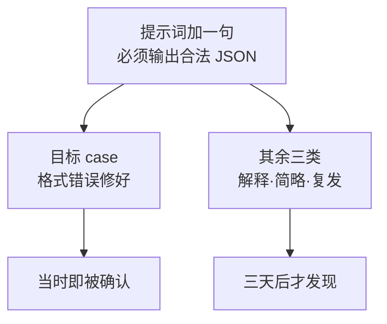
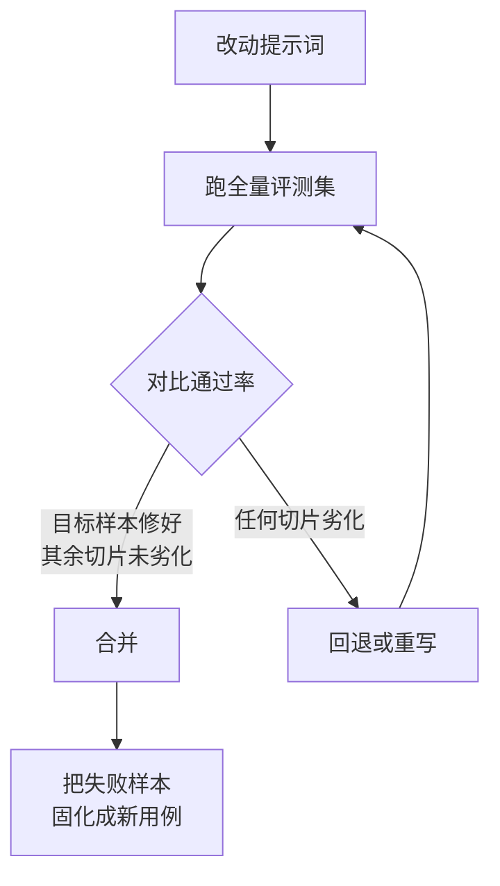
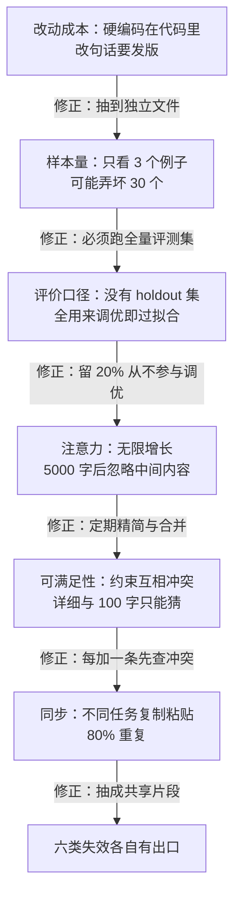

# 提示词是代码，要版本化和回归测试

改一句提示词修好一个案例，可能**同时在别的任务上悄悄改坏了模型行为**。读完这篇你能把提示词放进版本库（记录每次改动的系统，可查谁何时为何改、可回退），并配上回归测试（每次改动后自动重跑旧用例，确认没改坏过去修好的功能），让改动可追溯、可回滚（把系统状态退回到改动之前的版本）。

提示词版本化解决的是改一句规则修复一个案例，却在其他任务中静默改变模型行为而无人察觉的问题——因为**没有任何环节在改动后比对全部任务的结果**，坏掉的行为要等线上出问题才被发现。把提示词、工具描述和示例放入可审查版本库，并用来自真实失败的评测集比较改动前后结果；收益是**可以追溯、回滚和阻止回归**；代价是评测集需要维护，且**不能只对已知样本调优到高分**，否则遇到没见过的样本仍会失效。

最小验证是在一次提示词变更的 CI（持续集成，每次改动自动跑检查与测试的流程）中同时运行目标坏样本、稳定样本和保留集（从评测集中划出、从不参与调优的样本，专用来检验是否过拟合），并记录每个切片（按任务类型或样本类别分组的子集）的变化。

## 不把提示词管起来，一次改动会带来什么风险？

这一节要解决的问题是：为了修一个案例改动了一句规则，其他任务上的模型行为随之改变，**且没有人在改动时察觉**，直到线上表现出现偏差才回溯。本篇回答：提示词、工具描述与示例怎样纳入可审查的版本记录、评测集从哪里来、一次改动需要同时观察哪些切片，以及怎样避免评测集只针对已知样本调优。

## 改好一个 case 会连累哪些其他任务？

一个 Agent 的生产环境出了个问题：某类输入会输出格式错误的 JSON。工程师在系统提示里加了一段：

```
重要：输出必须是合法 JSON，不要包含任何解释性文字。
```

这个 case 修好了。但三天后发现：

- 代码解释能力下降了（因为"不要解释"被模型理解得太宽）
- 某些任务开始输出过于简略
- 之前调好的一个边界 case 又坏了

**没有测试，所以不知道改坏了什么。** 而这个提示词已经在生产跑了三天。



图：为什么一句修复会带着三个静默回归——改动作用于全部任务的输入，目标修复当时可见，副作用（操作对外部状态产生的额外影响）在各任务里各自潜伏，没有全量评测就没有任何环节能提前拦截。

## 怎样把提示词当代码一样管理？

先把形状说成一件事：把提示词当代码管理，就像管理一台自动售货机的补货规则，四件事一一对应（版本化对应留底、评测集对应假硬币、全量评测对应试出货、结构化组织对应分区）：① 版本化是给每次改规则留底——改坏了知道改回哪一版；② 评测集是摆一排固定价格的假硬币——硬币面值固定对应判据固定，投币该出货的必须出货；③ 全量评测是改规则后把所有格子都试出货一遍——只试一个格子，别的格子可能卡住了；④ 结构化组织是给售货机分层分区——饮料零食分开放，改饮料区不碰零食区。这个比喻到「零食区」为止——现实里对应的四件事各自有工具与指标，下面逐条展开成五步（第五步是动手顺序，不在比喻内）。

### 1. 版本化

提示词必须**存在文件里、进 git（版本管理工具，记录每次改动并支持回退）**，不能停留在聊天记录或口头约定里：

把指令做成可追溯的版本载体，这件事比 git 老得多。下图是一叠 1970 年代的穿孔卡片程序叠：每张卡片一行指令，卡片叠的顺序就是程序版本，叠顶上用红笔写着作业名与版本标记——改一行就换一张卡，旧叠留着随时回滚，这就是最早的"提示词版本管理"。


> 图：穿孔卡片程序叠（顶部红笔标注 SORT 与作业参数），来自 [Wikimedia Commons](https://commons.wikimedia.org/wiki/File:Punched_card_program_deck.agr.jpg)，CC BY-SA 3.0，摄影 Arnold Reinhold。

- 硬编码在代码里（改一次要发版）
- 存在数据库/配置中心（没有 diff 即改动前后的逐行差异，也没有 review 即他人审查）
- 存在某人的草稿里（无法追溯）

```
prompts/
  system.md
  tools/
    search.md
  tasks/
    bug_fix.md
    code_review.md
```

**好处**：能看到"谁在什么时候为什么改了哪句话"，能回滚。

### 怎么建评测集：回归测试的前提

做法是同一套题重考：输入与判据预先定好，改动之后原样重跑，成绩才可比——临时出题永远证明不了「没退步」。评测集的思路与 [[工程知识/AI 系统工程：从模型能力到生产能力/质量与运营/Agent评测必须覆盖轨迹而不只看最终答案]] 一致——都要预先写好输入与判据，只是这里针对提示词改写。

```yaml
- id: json_output_001
  input: "提取这封邮件里的人物信息"
  expect:
    output_is_valid_json: true
    has_fields: ["name", "email"]

- id: explain_code_001
  input: "这段代码做什么？"
  expect:
    min_length: 100          # 不能被"不要解释"影响
    mentions: ["循环", "边界"]

- id: edge_case_042
  input: "<之前坏过的那个 case>"
  expect:
    output_is_valid_json: true
```

**关键：每个曾经出过的问题都固化成一条用例。** 这样改提示词时，之前修过的不会被改坏。

开源评测框架 Promptfoo 的红队模块（主动构造攻击性输入来暴露模型薄弱点的评测）把这个思路画成了组件图，思路是持续产出攻击向量（用来试探模型漏洞的对抗性输入）、逐条试探、汇总结果。左侧 Configuration 用应用信息与 YAML（用缩进表示层级结构的配置文件格式） 配置生成动态测试，YAML 是一种用缩进表示层级的配置文件格式。

Plugins（定义攻击手法的模块，如越狱、角色扮演）与 Strategies（对已有攻击做变形的策略）两类组件负责产出攻击向量与变形策略。Probe 即一条具体的攻击试探，逐条发起。

右侧 Targets（被测对象）接住 HTTP API、直连模型、浏览器等不同形态的被测对象，最后 Evaluation 分析响应并产出报告。用例从哪里来、打到哪些目标、结果怎么分析，一张图看全：


*图源：Promptfoo 官方文档，https://www.promptfoo.dev/docs/red-team/architecture/。*

### 为什么改动前必须跑全量评测

```
改提示词 → 跑评测集 → 对比通过率 → 合并或回退
```

对比的是**所有用例**，不只是你关心的那个。这正是前面那个案例缺失的：**改之前不知道会弄坏什么**。



图：一次改动从提交到合并的完整关口——全量对比拦截静默回归，被拦的改动回退重写，合并后新失败样本固化成用例，评测集随之滚动增长。这个"改动、评估、记录、再迭代"的循环是业界的标准工作形态，Google Cloud 官方的生成式 AI 应用文档把它画成了实验周期：


*图源：Google Cloud 架构中心《部署和运行生成式 AI 应用》，CC BY 4.0，https://docs.cloud.google.com/architecture/deploy-operate-generative-ai-applications。*

图中链组件（由提示词、数据准备、模型调用等步骤组成的处理流程）的每次变更都要经过 Evaluate 环节，并把结果记录成实验日志，日志再驱动下一轮迭代；提示词模板就是链组件的一部分，走的是同一条闭环。没有 Evaluate 挡在变更后面，链的组合方式稍一变动，行为就**静默漂移**：改动后不跑对比就没有信号提示行为已变，下一次改动又建立在已偏移的行为之上，**偏差逐步累积**。

把这个闭环放大到时序层面：另有一类评测叫红队评测，主动构造对抗性输入来暴露模型的薄弱点。Promptfoo 官方文档把一次完整的红队评测画成三个阶段：Phase 1（初始生成阶段）先按配置批量造出一批初始攻击样本，Phase 2（迭代试探阶段）对每个没打穿的试探继续变形再试，直到试探成功或预算耗尽，Phase 3（汇总报告阶段）把各条试探的响应汇总分析成一份报告——「生成、评估、记录、再迭代」在工业级工具里就是这条流水线：


*图源：同上（Promptfoo 官方文档）。*

### 长提示词该怎么结构化组织？

好比一份正式公文：抬头写发文对象（角色）、正文写事项（任务）、附件里给样例（示例）、末尾列出硬性要求（约束）——各归其位，办文的人才不会漏看。长提示词要有结构，且**各部分职责清晰**，按下面的骨架组织：比喻到「公文分段」为止，每段怎么写见下方骨架与原则表。

```markdown
# 角色
你是代码审查助手。

# 任务
审查给定的代码变更，指出问题。

# 输出格式
<必须严格遵守>
输出 JSON：{"issues": [{"severity": "...", "line": 0, "desc": "..."}]}
</必须严格遵守>

# 约束
- 只报告真实问题，不要为了凑数编造
- 严重程度只能从 critical/major/minor 中选
- 不确定的标记为 uncertain，不要猜测

# 示例
输入：...
输出：...
```

写提示词要守下面几个原则：

| 原则 | 原因 |
| --- | --- |
| 关键约束放开头和结尾 | 中间位置注意力最弱 |
| 输出格式用明确分隔符包裹 | 让它和普通指令区分开 |
| 给 1-2 个示例 | 比描述有效得多 |
| 约束要可验证 | "简洁"不可验证，"不超过 100 字"可验证 |

### 怎么用测试代替"感觉更好"

改动前后各跑一遍评测集，**不只看通过率总分**，还要看长度、延迟等副作用指标——总分涨了但副作用恶化，**也算失败**。改提示词后**不要凭感觉判断**。**跑评测集看数字**：判断逻辑见下例。

```
改动前：通过 78/100
改动后：通过 82/100，但 explain_code 类的平均长度从 180 降到 60
       → 通过率涨了，但副作用是解释变短
       → 判断：可接受吗？
```

**数字让取舍可讨论。**

## 版本化和回归测试能带来什么收益，又要付出什么代价？

**收益**

- **改坏能被发现**：评测集拦住回归
- **可追溯**：知道每句话为什么在那里（看 git blame 和对应的 issue）
- **可协作**：版本库记录每次改动且冲突可见，多人改同一个提示词不会互相覆盖
- **可回滚**：出问题能快速回到上一版

**代价**

- **建评测集有成本**：100 条用例 + 判据是实打实的工作
- **评测集可能过拟合（模型把训练数据的噪声也记住、在新数据上表现变差的现象）**：为刷分优化，只针对已知样本调优，**遇到没见过的样本仍会失效**，实际效果没提升。**留 holdout 集**（从评测集中划出一部分从不参与调优，专用来检验是否过拟合）
- **部分质量难自动化**：文风、有用性这类需要人判断
- **提示词变化的影响面广**：一句话可能影响所有任务，**评测要覆盖全面**

## 要从哪一步开始动手做？

**第一步：先把提示词从代码里抽出来**

存成 `.md` 文件，进 git。**不需要额外工具或权限，用现有的 git 就能做，立刻能开始。**

**第二步：建 20 条评测用例**

**来自真实的失败案例**。**不用 100 条，20 条已经能拦住大部分回归。**

**第三步：给每条写判据**

优先级：**可执行断言 > 结构化字段检查 > 模型评分（用另一个模型按标准打分，需要外部锚点） > 人工**。

```python
# 最好：可执行
assert json.loads(output)["issues"]

# 其次：字段检查
assert len(output.split()) < 200

# 再次：模型评分（要外部锚点）
assert judge(output, rubric) > 0.8
```

**第四步：每次改动都跑**

接入 CI。**改了 prompts/ 目录就触发评测**，通过率下降就阻止合并。

**第五步：把每次线上问题变成新用例**

修复一个线上问题时，**先写一条用例复现它，再改提示词**。**这样问题不会复发。**

## 把提示词管起来时常犯哪些错误？

**错误 1：提示词硬编码在代码里**

改一句话要发版，导致没人敢改，或者偷偷改测试环境。**抽到文件。**

**错误 2：改完只看几个例子**

"我试了 3 个 case 都好了" —— 可能弄坏了 30 个。**必须跑全量。**

**错误 3：提示词无限增长**

每次出问题就追加一段约束，半年后 5000 字，**模型开始忽略中间的内容**——模型读长文本时**开头和结尾记得更牢、中间最弱**，夹在中间的约束最容易被漏看。**定期精简，合并重复约束。**

**错误 4：约束之间互相冲突**

「输出要详细」与「不超过 100 字」同时存在时，**模型只能猜**。**每加一条约束，检查是否和已有的冲突。**

**错误 5：没有 holdout 集**

所有用例都用来调优 → 过拟合。**留 20% 从不看。**

**错误 6：不同任务的提示词复制粘贴**

`bug_fix.md` 和 `code_review.md` 有 80% 重复内容，改一处忘另一处。**用共享片段（include/partial）。**

六条错误的失败方式并不一样，分成三组看更清楚，见下表：



错误 1、2、5 是一组，都出在反馈链路上：硬编码让改动成本高到没人敢动，只看几个例子让"修好了"的判断建立在 3 个样本上，没有 holdout 集则让全部用例都参与了调优——三条叠起来的后果是提示词长期不改进，**偶尔改一次还不知道改坏了什么**。错误 3、4、6 出在提示词本身的结构上：无限增长让模型开始忽略中间的内容，约束互相冲突让模型只能猜你的优先级，复制粘贴则让**同一份内容散落在多个文件里改不动**。六条的修正动作都很短（抽到文件、跑全量、留 20%、定期精简、检查冲突、用共享片段），代价**主要在纪律而不在工具**。

相关（约定层）：[[工程知识/AI 系统工程：从模型能力到生产能力/质量与运营/Agent评估系统的设计约定]] —— 回归证据如何与任务版本绑定

提示词改动要与切片对照对账——预写修好目标坏样本的同时保留集不应劣化，只盯目标样本而放过保留集劣化，与预期对不上。

## 怎么自己动手验证

1. 切片对照：在一次提示词变更的流水线里同时运行目标坏样本、稳定样本与保留集，确认三类样本各自的前后变化都被记录。
2. 回归拦截：构造一次修好目标案例却损坏其他任务的改动，确认门禁（改动合入前自动跑评测、不达标就阻止合并的关卡）以保留集的变化拦下这次提交。
3. 版本可回退：确认这三类输入都在版本库中，改动可追溯、可还原。

## 它是怎么做到的，本质是什么

提示词的机制层：提示词、工具描述与示例共同构成模型每次决策的输入，改动其中一句会**同时影响所有经过这段输入的任务**——例如同一句「输出 JSON」既给代码审查任务用、也给邮件提取任务用，改了这句两个任务都受影响。**影响范围由输入决定而不由改动者的意图决定**——同一段提示词是所有任务的公共输入，改一句会同时进入每个任务的上下文，所以影响面由「哪些任务都读这段输入」决定，与改动者只想修哪个任务无关；一次改动是否只修好目标案例，**要在一组覆盖不同任务的样本上重新运行才能看出来**。

## 还有哪些相邻问题值得接着读？

- [[工程知识/AI 系统工程：从模型能力到生产能力/质量与运营/Agent评测必须覆盖轨迹而不只看最终答案]] · [[工程知识/AI 系统工程：从模型能力到生产能力/模型与上下文/上下文工程是在有限预算内构造决策现场]]
