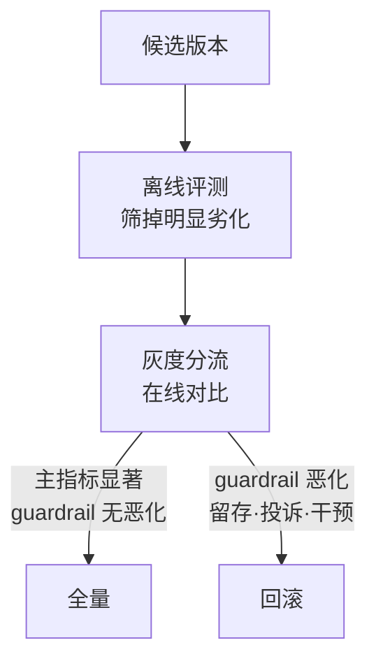
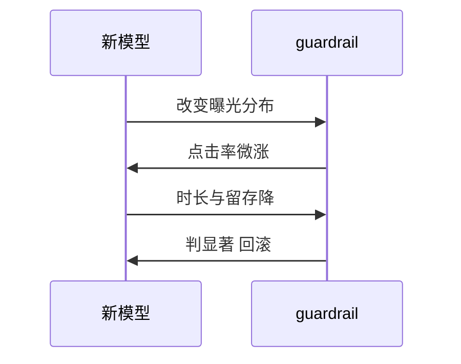

# 离线评测与在线评测回答不同问题

**模型升级离线分数涨了，上线后关键指标反而跌了——两边都没说谎，它们回答的根本不是同一个问题**。要解决的问题：**离线评测度量模型能力，在线评测度量系统能力**；**把两者当同一把尺子，会在 AI 系统与推荐系统里反复导致严重决策错误**，比如上线后指标反而下跌。分清两把尺子的分工，评测体系才立得起来。读完你能判断一次模型升级该信离线还是在线结论，**不再拿离线分数替上线拍板**。

## 离线评测和在线评测各回答什么问题？

离线评测量的是「这个版本在已知样本上有没有更好」。它跑在固定数据集上，分数只取决于**模型与测试集**，不随上线后的用户行为变化——这是它能快速比较多个候选版本的原因，也是它看不见线上真实表现的原因。


*图源：Label Studio 中文站，CC BY 4.0，https://labelstudio.com.cn/learningcenter/offline-evaluation-vs-online-evaluation-when-to-use-each。*


| 维度 | 离线评测 | 在线评测 |
| --- | --- | --- |
| 回答 | 模型在这个分布上能力如何 | 系统在真实流量下表现如何 |
| 优势 | 快、可重复、可控变量 | 真实分布、真实反馈、真实延迟 |
| 盲区 | 分布漂移、延迟与成本、反馈效应 | 慢、贵、伦理与分流噪声（随机分流不匀、用户自然波动等造成的指标干扰） |
| 典型 | 评测集打分、基准回归 | A/B 分流、代理指标对比（用易测的间接指标代替难直接测的目标，如用点击代替满意） |

**离线的盲区有三：评测集分布与线上分布漂移**——线上真实数据分布和评测集分布逐渐不一致的现象，详见[[工程知识/AI 系统工程：从模型能力到生产能力/质量与运营/评测集的构建与维护决定所有评测的地基]] 讲怎么控；**延迟与成本不进分数但进用户体验与账单；反馈效应（用户看到结果后行为改变）离线完全测不到**。**在线的盲区是慢与贵：一个结论要等完整的分流周期，且只能比较有限个候选**。

## 离线筛选、在线裁决，两道门怎么衔接？

打个比方：离线评测像驾校的科目二，在线评测像真正上路——桩考过了不代表能在雨天夜里开山路，但也不能因为要上路就不考桩。两个都要，问的不是同一件事。这个比喻到"两者互补"为止：各自怎么搭、指标怎么选、怎么互相印证，要看正文。

**在线评测量的是「这个变化是否真的改善了用户结果」**。**真实用户的交互会回流进系统，模型在真实分布上的表现才被测得到**。这个反馈环是离线评测结构上不具备的，也正因为有了它，**在线分数与离线分数经常对不上**。


*图源：同上（Label Studio 中文站），CC BY 4.0。*

标准流程：**离线评测筛掉明显劣化的候选 → 灰度分流（先放少量真实流量给新版本、再逐步扩大到全量的发布方式）在线对比 → 指标显著才全量**。**两处衔接是事故高发：离线领先的候选在线掉队（分布外泛化差），在线领先的候选长期反噬（短期点击、长期留存）**。反噬的检测靠 guardrail 指标（护栏指标，像道路护栏一样防止系统越界的底线指标）：**点击率主指标之外同时监控留存、投诉率、人工干预率，任何一项显著恶化即回滚（把系统状态退回到改动之前的版本）**。



## 同一模型的两张成绩单，动手跑一遍会看到什么？


「上线后改变曝光分布」这一步是离线永远测不到的：离线测试集本身就是旧曝光分布的产物，用户行为改变后回流的信号只落在 guardrail 指标上：



**反馈效应只能由在线捕捉——离线测不到用户看到结果后的行为改变，分数停留在旧分布；在线反映了这种改变，所以两张成绩单才会打架：AUC（Area Under Curve，ROC 曲线下面积：分类模型质量指标）涨、CTR（Click-Through Rate，点击率）涨，而停留与留存跌**。

一个排序模型，离线与在线各算一次，两张单子会打架：

```python
# 离线：固定测试集上的 AUC
#   测试集 = 昨天的曝光点击日志，按曝光抽样
#   结果：AUC（衡量排序质量的常用指标，数值越高排序越准）= 0.82（比线上模型高 0.01）

# 在线：A/B 实验的真实指标
#   对照组 = 线上模型，实验组 = 新模型
#   结果：CTR +0.3%，但人均停留时长 -1.2%，七日留存 -0.4%

# 打架的解释：离线测试集来自旧模型的曝光分布（点击了才会被记录），
# 新模型在离线里学的是"旧曝光分布下的排序"，上线后改变了曝光分布，
# 长尾内容曝光变多 → 单次点击率微涨，用户探索成本变高 → 长尾内容变多让用户更难找到想看的，刷新与失望增多 → 时长与留存跌
```

跑一遍的收获：**离线指标只能证明"在旧分布上排序更好"，分布偏移（曝光即反馈）只有在线能看见**。**AUC 涨 0.01 与 CTR 涨 0.3% 之间没有换算公式，任何"离线涨 X 则在线涨 Y"的承诺都是编造**。

## 在线实验的最小样本要多少，这些量在什么数量级？

离线分数提升不等于**线上结果变好**——**两件事的分布结构不同：离线是固定样本上的条件分布，在线是用户行为参与之后的结果**。**承认这个差距，才不会拿离线分数替在线结论做决策**。


*图源：同上（Label Studio 中文站），CC BY 4.0。*


在线实验的最小样本量由效应大小（要检出的指标相对变化幅度，越大越容易检出）倒推：**要检出 CTR 相对变化 1%（基线 5% → 5.05%），在 95% 置信（重复实验 100 次约 95 次结论正确）、80% 功效（真实差异存在时约 80% 的概率能检测出来）下，每组约需 77 万次曝光**（比例检验的标准样本量公式）；**检出 0.3% 的相对变化则要 800 万级**。**样本不足的实验会给出"看起来涨了"的噪声——先算最小样本，再看实验跑了多少，这一步在任何"涨跌"结论之前**。

## 离线指标有没有预测力，怎么自己动手验证？

离线指标要与在线结果对账——**预写历史实验结果与对应离线分数的相关性应显著，相关性与预期不符（相关性低）说明离线指标没有预测力，先修离线再谈上线**。

- 离线-在线相关性校准：历史 A/B 结果与对应离线分数的相关性分析，**相关性低说明离线指标没有预测力，先修离线（换指标或换评测集）再谈上线**。
- 分流一致性检验：同一实验重复运行，对照组间差异应不显著（SRM 检验，样本比例偏差检验：确认各实验组曝光量是否符合设定分流比例），否则**分流有偏**。
- 灰度期监控：核心指标与 guardrail 的置信区间（按样本估计真实值时的误差范围）随样本量收敛过程，**不提前关实验**。

## 这套说法在哪些场景会失效？

- 在线评测需要流量代价，低流量长尾（少数请求耗时远高于其余大部分）场景永远凑不够样本：退化为离线评测 + 专家评审 + 灰度观察，决策依据要明说降级（主动牺牲部分功能或精度，保住核心链路）了。
- A/B 的伦理与合规边界：用户分层、可退出机制、数据留存策略，属于治理问题——见 [[工程知识/AI 系统工程：从模型能力到生产能力/安全与治理/沙箱限制能力，策略限制行为]]。
- 多个实验同时跑的交互效应（多个实验同时运行互相干扰，导致结果难以分开解读）：分层正交实验设计是独立方法论，本文不展开。

## 同在 AI 系统工程里的相邻问题，接着读哪几篇？

- [[工程知识/AI 系统工程：从模型能力到生产能力/质量与运营/评测集的构建与维护决定所有评测的地基]]：离线评测的地基，本文讲它与在线的分工
- [[工程知识/AI 系统工程：从模型能力到生产能力/质量与运营/Agent评测必须覆盖轨迹而不只看最终答案]]：离线评测内部的轨迹维度
- [[工程知识/软件构建：让变化可以理解、验证与交付/测试与交付/发布门禁必须绑定真实证据]]：在线评测结果如何进发布门禁
