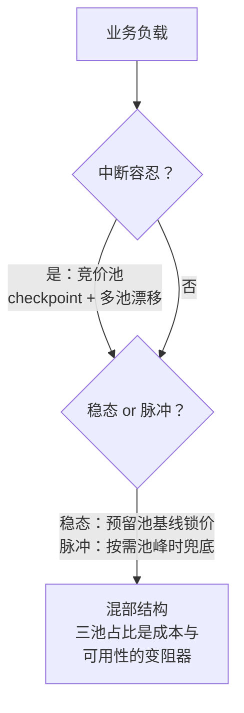

# 算力供给形态决定成本结构：按需、预留与可回收份额的取舍

**算力采购的三种形态（按需、预留/包年、可回收/竞价）是同一资源的三种定价合同：价格差 3-10 倍，可中断性与容量保证的差别更大——形态选择把「成本结构」从财务问题变成架构问题。** 读完你能回答：三类形态的定价与风险矩阵、业务负载怎么分档入座、混部结构的容灾怎么设计、份额化怎么把利用率变成采购议价力。

## 要解决的问题

GPU 算力的单位成本是 CPU 的数十倍，**采购形态的差价被放大成结构性差距：同样的 1000 卡时需求，全按需采购的成本可以是「预留打底 + 按需补峰 + 竞价跑批」混部结构的 2-3 倍**。反过来，全竞价采购把生产服务挂在「随时被回收」的合同上——**成本最优与可用性最优是两个方向，形态选择就是给每类负载配上它配得起的合同条款。**

## 机制：定价矩阵与负载分档

### 三类形态的合同条款

| 形态 | 价格 | 容量保证 | 可中断性 | 适配负载 |
| --- | --- | --- | --- | --- |
| 按需（on-demand） | 基准价 1.0 | 强（随时可得） | 不中断 | 流量峰值兜底、突发扩容 |
| 预留/包年（reserved） | 0.3-0.6 | 强（合同期锁定） | 不中断 | 稳态基线负载 |
| 可回收/竞价（spot/preemptible） | 0.1-0.4 | 无（市场波动） | 随时回收（通常提前 30s-2min 通知） | 可 checkpoint 的批任务、离线推理 |

价格数字随市场波动，**结构比例是稳定的：基线负载买预留（便宜且有保证），峰值溢出按需兜底（贵但只在峰时付），可中断负载全走竞价（最便宜且中断无所谓）**。

### 负载分档的三个判据

负载入座按三问：**中断容忍**（任务被打断后能否从 checkpoint 恢复？**训练作业与离线批处理可以，在线服务不行**）；**容量刚性**（缺一小时算力是否直接违约？**SLO 承诺的服务刚性高**）；**时长可预测**（基线还是脉冲？**基线买预留，脉冲按需/竞价**）。三问的答案把负载分成四档：

```text
稳态基线（在线服务常态流量）   → 预留
峰值与突发（促销、活动）        → 按需
可中断批处理（训练、离线推理）  → 竞价 + checkpoint
研发实验（失败重跑无损失）      → 竞价
```

### 混部结构的容灾设计

竞价实例被回收是常态不是事故，**架构要把它当设计输入**：**checkpoint 频率 ≤ 回收通知时长**（提前 30 秒通知就 30 秒内能存档）；**多池供给**（竞价池被回收时任务迁移到预留池的空隙，按需池兜底）；**供给感知调度**（监控竞价市场价格与容量水位，价格飙升时任务主动迁移而非被驱逐）。混部的可用性公式：**可用性 = 各池 SLA 的加权组合，竞价池占比越高整体可用性越低——占比是成本与可用性的滑动变阻器，按业务的实际中断代价定**。

### 份额化与采购的联动

[[工程知识/AI 系统工程：从模型能力到生产能力/推理服务与平台/GPU分片把整卡切成可分配份额：份额粒度、装箱与隔离的三笔账]] 的份额化把单卡利用率从 30% 提到 70%，**同样的业务量所需的「整卡数」减半——利用率是采购量的除数**。**份额化程度越高，基线负载的预留采购量越准（浪费的预留越少），竞价池的切分粒度越细（回收时的迁移单位越小）**。**采购与份额化不是两个决策，是一张账的两层**。



## 案例：份额账在采购层的回声

[[工程知识/AI 系统工程：从模型能力到生产能力/推理服务与平台/GPU分片把整卡切成可分配份额：份额粒度、装箱与隔离的三笔账]] 的装箱与份额账直接决定本篇的采购量核算：**份额化后的「等效卡时」与裸卡时的换算比是预算的核心参数**。[[工程知识/后端系统：在并发、失败与变化中维持服务/基础设施/requests与limits各管一段：调度装箱、QoS判定与节点压力驱逐顺序]] 是同一结构在容器层的镜像：**requests/limits 是合同条款，QoS 驱逐顺序是回收优先级——任何共享资源的采购与分配都长着同一张脸：合同条款 × 可中断性 × 优先级梯度。** [[工程知识/性能工程：从用户等待到资源瓶颈/操作系统与运行时/内存回收与OOM把内存压力变成延迟与终止的分配问题]] 的 watermark 分级也是同构：**压力分级决定谁先被回收，与竞价池的回收优先级设计同源**。

## 怎么测

- **中断演练**：人为回收竞价池实例，**验证 checkpoint 恢复时长、迁移完成时间与任务级 SLA 未破**。
- **容量峰值演练**：模拟预留池容量不足，**验证按需池的扩容时延与成本（账单要演练，不只算理论）**。
- **利用率对账**：月度核算预留池实际利用率（**低于 60% 说明基线高估，下期采购调减**）、竞价池任务完成率与重跑成本。
- **回收通知合规**：**验证平台给的回收通知时长与 checkpoint 频率匹配，通知短于存档时间的任务改池**。

## 哪些认识一看就错

- **「竞价实例不靠谱不能用」——它是合同条款的一种，不靠谱的是「把不容中断的负载放上去」；配 checkpoint 与多池容灾后，批处理负载的性价比无出其右**。
- **「预留买得越多越省」——预留是固定成本承诺，基线高估的部分是纯浪费；按月度利用率对账动态校准预留量**。
- **「成本优化是一次性项目」——市场价格、业务负载、模型形态都在漂移；形态配比是季度对账的滚动决策，不是立项一次的架构**。
- **「混部架构太复杂不值」——成本结构差距是 2-3 倍量级，复杂度的代价是一次性搭建；不混部的团队实际上在为峰值按需全价买单**。

## 效果从哪来、要付什么代价

**负载分档让每类算力需求配到配得起的合同，混部容灾把「中断风险」从事故变成可演练的常态，份额化把利用率变成采购量的除数**。代价是**架构复杂度：checkpoint 机制、多池调度、供给感知迁移、成本对账体系——每项都是真实工程**。**收益按单位推理/训练成本结算：成熟混部结构对全按需结构的成本差稳定在 50-70%，且这个差距随 GPU 单价上升而扩大**。形态决策的检验标准也简单：**每个负载都知道自己在哪个池、为什么在哪个池，账单按池对得上。**

关系：[[工程知识/AI 系统工程：从模型能力到生产能力/推理服务与平台/GPU分片把整卡切成可分配份额：份额粒度、装箱与隔离的三笔账]] —— 份额化是采购量的除数，两层一张账。[[工程知识/后端系统：在并发、失败与变化中维持服务/基础设施/requests与limits各管一段：调度装箱、QoS判定与节点压力驱逐顺序]] —— 容器层的同构：合同条款与驱逐梯度。[[工程知识/性能工程：从用户等待到资源瓶颈/操作系统与运行时/内存回收与OOM把内存压力变成延迟与终止的分配问题]] —— 压力分级与回收优先级的同源结构。
