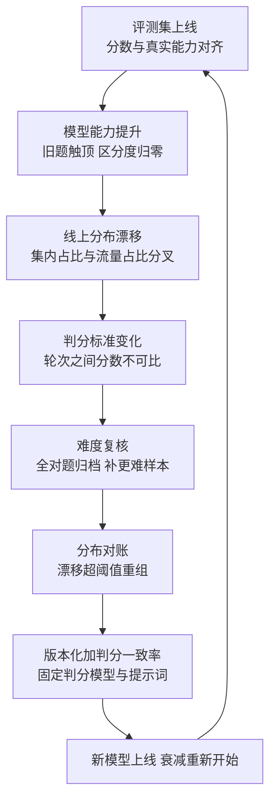
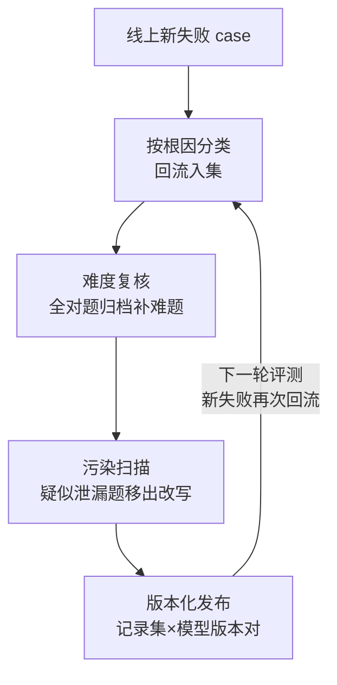

# 评测集的构建与维护决定所有评测的地基

评测集为什么是所有 AI 评测的地基？**因为上层所有评测的分数都建立在评测集的抽样代表性和判分客观性上，这两者一坏，分数就失去意义**。读完你能自己搭出不会腐烂的评测集，也知道**分数漂移该靠什么发现**。**地基烂掉的样子是：评测分数照常输出、趋势照常画，却不再代表真实能力，失效方式很隐蔽——正因为隐蔽，本文讲它怎么建、怎么维护**。

Agent 评测——见 [[工程知识/AI 系统工程：从模型能力到生产能力/质量与运营/Agent评测必须覆盖轨迹而不只看最终答案]]——与 RAG（检索增强生成，先从外部资料里检索再让模型据此回答）评测——见 [[工程知识/AI 系统工程：从模型能力到生产能力/质量与运营/RAG评测要分离检索质量与生成质量]]——都消费评测集——评测集本身怎么建、怎么不腐烂，这是所有评测要先解决的问题。

核心机制是**抽样代表性（抽出的题要像真实流量一样覆盖各种情况）+ 判分客观性（好坏有统一、可重复的标准）**，**两者都随时间衰减**：**抽样代表性面临两种衰减——模型能力变化让旧题目失去区分度（天花板效应：题太容易，强弱模型都做对，分数分不出差距）、业务分布漂移让旧样本不再代表当前流量；判分客观性面临一种衰减——标注标准不一致让分数不可比**。所以**评测集的属性里"维护"与"构建"同权重**。

## 要解决的问题：评测集的样本从哪里来

评测分数照常输出、趋势照常绘制，但评分所依据的样本与当前真实场景已经脱节，所有上层评测因此失效且不易察觉。本篇回答：评测集的样本从哪里来、怎样防止只覆盖容易收集到的情况、过期与污染样本怎样识别和替换，以及新增能力对应的样本如何补入。

## 构建评测集要做哪四个决策

打个比方：评测集像一把尺子——尺子本身刻度不准，量出来的数再好看也是错的；而且尺子会被磨（数据泄漏进训练），要定期拿标准块校。这个比喻只说到「地基要准且要维护」。

评测集到底是什么？它是一份带着抽样设计与判分标准的测量工具。评测体系怎么分层——被测对象（模型层）、测什么（能力层）、怎么测（方法层）、用什么测（工具层）——上海人工智能实验室的开源评测体系 OpenCompass 司南给出了一份官方参照，评测集正是其中方法层与工具层的核心消耗品：


*图源：[OpenCompass 官方文档](https://doc.opencompass.org.cn/user_guides/framework_overview.html)（2026-09-27 取）。方法层里客观评测依赖评测集的抽样代表性、主观评测依赖判分标准的客观性——本篇讨论的正是让这两层立得住的那份地基。*

| 决策 | 选项 | 代价 |
| --- | --- | --- |
| 来源 | 真实流量抽样 / 人工构造 / 公开集改造 | 真实流量最有代表性但含隐私；人工构造可控但分布狭窄 |
| 规模 | 覆盖意图 × 难度 × 长度的组合 | 组合爆炸，每格都要有样本 |
| 判分 | 自动指标 / 规则断言 / 人工 / LLM 判分 | 自动便宜但不够准（例如答案格式正确却答非所问，准确率满分，对用户却没有用）；人工准但贵且标准漂移 |
| 防泄漏 | 题目是否进过训练数据 | 泄漏题测的是记忆，分数虚高 |

防泄漏是 AI 评测特有的一环：**评测题进过预训练（模型从大规模语料中学习基础能力的阶段）或后训练（在预训练基础上用指令数据或人类反馈进一步调整的阶段）数据，模型"背过答案"，分数测的是记忆而非能力**。公开基准（MMLU（多任务语言理解基准：跨学科选择题评测）类）**全量公开、必然被训练集吸收，所以公开榜分数与自建集分数要分开看——自建集的价值就在没有进过任何训练管道**。泄漏不是理论担忧，实测分布里看得见：**对一批公开测试题逐题统计它在训练语料中的重合比例，泄漏集中在两个极端——要么完全没见过（0%），要么整题都在训练集里（100%）**：


*图源：[The Vulnerability of Language Model Benchmarks（arXiv 2412.03597）Figure 4](https://arxiv.org/abs/2412.03597)。横轴是逐题泄漏百分比，纵轴是样本频次；测试集一侧右缘 100% 处的 64 个样本即"整题背过"，左侧 0-30% 的散布是近似重复。*

分布设计上，**分层比规模重要：1000 题全来自简单意图，区分度——题目分辨强弱模型的能力，用通过率乘以（1 减通过率）衡量——低于 300 题覆盖"简单 50% / 中等 30% / 困难 20%"**。**分层维度至少包含意图类别（用户请求的业务目的分类，如问答、改写、下单）、输入长度、语言、是否带干扰项（刻意混入的误导信息，考验模型会不会被带偏）**。

## 判分怎么保持客观

判分是评测集腐烂最快的部分。三种判分方式的稳定性排序：**规则断言 > 参考答案比对 > LLM（大语言模型）判分**。**LLM 判分有位置偏差（答案排在前面或后面会影响打分）与长度偏差（倾向给长答案高分）**，**使用时必须固定判分模型版本与提示词（发给模型的输入指令与背景信息），并把判分模型本身的判定一致率（同题重判两次，结果一致的比例）测出来——一致率低于 95% 的 LLM 判分不能用于回归门禁（每次改动后自动跑的通过线，不达标就拦住发布）**。

规则断言的写法来自**业务不变量（不管实现怎么变都必须成立的约束，例如金额必须等于期望值、退出码必须为 0）**：**输出 JSON 必须能解析、引用的文件必须存在、命令的退出码必须为 0、金额计算必须等于期望值**。这与缺陷分析里的不变量思想同源——见 [[工程知识/缺陷分析：从个案到体系/正确性/静默失真的检测靠对账与不变量而不是报错]]：**把"好"定义成可检查的谓词（可以直接判断真假的陈述），而不是靠印象打分**。

## 维护要做哪三个动作

三种衰减分别是：模型能力提升让旧题触顶、线上分布漂移让样本失去代表性、判分标准变化让分数不可比。上面三个动作分别接住这三种衰减，衰减在每次模型上线时重新开始。与其等分数失真再补救，不如把三个动作排进固定节奏。


三条衰减各自从哪一刻开始、分别由哪个动作接住——这种一一对应在后面的动作列表里是看不出来的：



这三个动作看起来像定期巡查（每隔一段时间重复做的检查），实际**每个都针对一种具体的衰减机制：模型能力提升对应难度复核、线上分布漂移对应分布对账、判分标准变化对应版本化（版本化时固定判分一致率来核对口径）**。也正因如此，**它们要排进固定节奏，而不是出了问题才想起**。**衰减在每次模型上线时重新开始，维护循环的速度必须跟得上能力上升的速度——模型能力升得越快，旧题越容易触顶、线上分布漂移得越快，维护节奏跟不上，失真就会更早出现**。

1. **版本化**：评测集与模型版本分开版本化，每次评测记录"模型版本 × 评测集版本"对，分数才可比。数据集的版本治理方式和模型版本一样，都要记录来源、时间、变更内容，见 [[工程知识/AI 系统工程：从模型能力到生产能力/数据与MLOps/数据集、特征与模型版本必须可追溯]]。
2. **难度复核**：定期跑头部模型，全对的那部分题目已无区分度，归档并补充更难样本。区分度按"通过率 × (1-通过率)"算，接近 0 的题（全对或全错）没有信息量。
3. **污染扫描**：新模型上线前，用评测题在模型上做成员推断式抽查（把题目原文给模型续写，能续写出后文即判为疑似训练数据泄漏），疑似题移出或改写。

三个动作合起来构成评测集的维护循环：



评测集怎样保持不腐烂：新失败持续流入、无区分度题与泄漏题持续流出，每一轮发布都带着版本对，分数才在轮次之间可比。

「难度复核」不是理论要求——公开基准的饱和已经把这条曲线画了出来。GLUE（自然语言理解基准测试集）、SuperGLUE、MMLU、GSM8K（小学数学应用题基准：检验模型的分步推理）、HumanEval 五个基准的历年最好成绩全部弯向 100% 上限：SuperGLUE 在 2021 年就被模型越过人类专家线，MMLU 从 2020 年 GPT-3 的 43.9% 涨到 2024 年的 92% 以上，GSM8K 与 HumanEval 也先后触顶。

**曲线挤进顶部区间后，第一名与第十五名之间的差距落进测量噪声里，差距小到被随机波动淹没，排名靠模型运气而非真实能力，基准因此失效——这正是评测集要靠难度复核持续补难题、防止全对题堆积的原因**：


*图源：[When the Test Stops Telling the Truth（Reshmi Ghosh）](https://reshmighosh.github.io/blog/when-the-test-stops-telling-the-truth) Figure 1。原始分数来自各基准官方榜单；阴影带是顶部拥挤区，虚线是 100% 上限，点线是 MMLU/SuperGLUE 的人类专家线（89.8）。*

## 动手跑一遍会看到什么：评测集的账

```text
一个客服 Agent 评测集的构成账（通用骨架）：

  来源分层        条数占比   例子
  生产真实样本    60%       线上真实问答抽样（含失败 case 回流）
  边界构造样本    25%       对抗改写、多轮追问、方言/错别字
  能力边界样本    15%       该答不答（拒答类）、超范围类

  维护节奏：
  每周：把线上新失败 case 按根因分类回流入集（把答错或引发投诉的样本重新纳入评测集，30% 淘汰替换）
  每月：查污染（是否已泄漏进提示词/训练数据，泄漏即作废重写）
  每季：分布对账（评测集的意图分布与线上流量分布对比，漂移超 20% 重组）

  地基属性：**评测集的偏差 = 所有评测结论的系统性偏差**
集里没有的题型，模型再差也测不出来；集里过度集中的题型，分数虚高
```

评测集静态的实录——**上线时的评测集半年未更新，每次迭代分数都涨，真实投诉率同步上涨（评测集测的能力与线上用户要的能力已经分叉，分数是旧地图上的好成绩）**；**建立失败 case 回流机制后，评测集的分布重新追上线上分布，评测开始反映真实能力——分数高代表真答得好、投诉自然少，分数与投诉率因此负相关（符合预期）**。污染的实录——**评测样本被顺手写进了提示词示例，模型"背答案"拿了高分，换一批同分布新样本立刻现形；防污染的纪律是评测集与开发环境物理隔离、样本带指纹定期全网查重**。评测的两面性见 [[工程知识/AI 系统工程：从模型能力到生产能力/质量与运营/离线评测与在线评测回答不同问题.md]]（离线地基与在线验证的分工）、轨迹证据的采集见 [[工程知识/AI 系统工程：从模型能力到生产能力/质量与运营/学习活动需要结果、轨迹与迁移证据.md]]。

## 这套说法在哪儿会失效

**评测集分数天然测"分布内"能力（只反映抽样分布覆盖的情况，分布外的表现测不出来），分布外的泛化只能靠新场景的持续抽样发现——所以评测集要有"未知区"：定期放入少量真实新流量样本，人工判分后观察分数，这是发现能力盲区的唯一途径**。

**评测集不能证明"没有问题"，只能证明"测过的地方没问题"**。把评测分数当成全面能力证明，和把单元测试（针对最小代码单元的自动化测试）覆盖了多少代码行当成质量证明是同一类错误——**两者都错在拿「测过的那部分」当「全部」：评测集没覆盖的题型、单测（针对最小可测单元的自动化测试）没覆盖的代码路径，出了问题照样发现不了**。

## 怎么自己动手验证

评测集质量要与判分一致率对账——预写同一批题让判分模型判两次的一致率不低于百分之九十五，低于此值要换用规则断言或人工校准集。

评测集健康度的一次性体检：**随机抽 50 题，检查分层是否仍然覆盖当前业务分布、判分标准是否与一年前一致、是否存在全对题目。通过率 100% 的题目占比超过 20% 即该扩难度**。

判分稳定性实验：**同一批题让 LLM 判分模型判两次（顺序打乱），统计判定一致率。低于 95% 则改用规则断言或引入人工校准集**。

## 接着读哪几篇：消费评测集的评估系统约定

- 关系：[[工程知识/AI 系统工程：从模型能力到生产能力/质量与运营/Agent评测必须覆盖轨迹而不只看最终答案]] · [[工程知识/AI 系统工程：从模型能力到生产能力/质量与运营/RAG评测要分离检索质量与生成质量]] · [[工程知识/AI 系统工程：从模型能力到生产能力/数据与MLOps/数据集、特征与模型版本必须可追溯]]
- [[工程知识/AI 系统工程：从模型能力到生产能力/质量与运营/Agent评估系统的设计约定]] —— 消费评测集的评估系统约定
- [[工程知识/AI 系统工程：从模型能力到生产能力/安全与治理/模型与数据供应链需要可验证来源]] —— 防泄漏的数据侧防线
- [[工程知识/缺陷分析：从个案到体系/正确性/静默失真的检测靠对账与不变量而不是报错]] —— 规则断言的不变量来源
- [[工程知识/AI 系统工程：从模型能力到生产能力/质量与运营/提示词是代码要版本化和回归测试]] —— 评测集上的回归测试（改动后重跑旧用例、确认没有破坏既有功能）实践
- [[工程知识/AI 系统工程：从模型能力到生产能力/质量与运营/离线评测与在线评测回答不同问题]] —— 评测集在离线侧的角色与在线侧的边界
