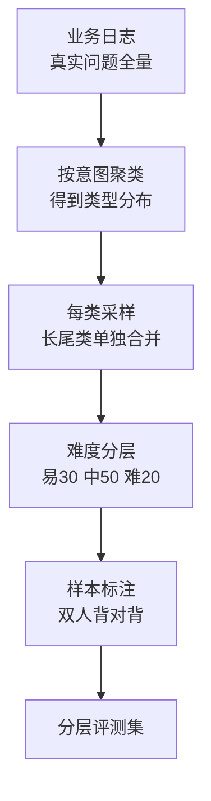
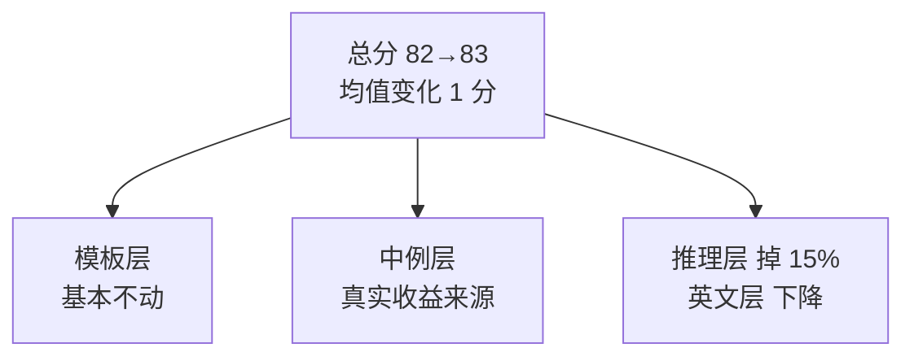

# 评测集的构建与维护：从场景采样到难度分层

## 要解决的问题

本文讲如何构建并维护一套评测集，读完你能按业务流量采样、做难度分层、防污染防过拟合（模型把训练数据的噪声也记住、在新数据上表现变差的现象），让每次模型改动都有可比对的数字。

模型选型、量化[[工程知识/AI 系统工程：从模型能力到生产能力/推理服务与平台/模型量化的精度经济学：位宽精度与显存的三角.md]]、提示词（发给模型的输入指令与背景信息）迭代、Agent 配置——**每个决策都要回答“这个改动让效果变好还是变差”**。拍脑袋不行，单点试几个 case 也不行——**几个样本的随机波动就可能盖过真实改动，看单点判断不了好坏，必须成集统计**。

评测集要解决的问题是**把“效果好坏”变成可重复测量的工程对象**：**场景覆盖、难度分层、防污染、防过拟合，让每次改动都有可比对的数字**。**这是 AI 系统的回归测试（改动后重跑旧用例、确认没有破坏既有功能）**：**每次改动后重跑固定用例，确认没把原来能用的弄坏**；传统软件的这层思想见 [[工程知识/缺陷分析：从个案到体系/复现与回归/从复现到回归——让证据走完一圈.md]]，**评测是它在模型时代的形态**。评测的覆盖面要与系统的链路阶段对应，每一阶段都有自己的设计问题与对应的评估关口：


*图源：Microsoft Learn《Design and develop a RAG solution》，CC BY 4.0，https://learn.microsoft.com/en-us/azure/architecture/ai-ml/guide/rag/rag-solution-design-and-evaluation-guide。*

这张微软官方的 RAG 架构图在每个阶段旁标注了设计时必须回答的问题——**准备阶段问测试数据与查询从哪来、分块阶段问怎么切、检索阶段问怎么搜、评估阶段问每步怎么测**。**评测集的构建正对应图中"准备"与"评估"两栏：测试媒体与测试查询的采样决定评测的代表性，后续的难度分层与防污染都建立在这个覆盖面之上**。

## 一套评测集怎么从场景长出来：机制

先把形状说成一件事：评测集像驾校的科目考试题库——考的不能只是教练练过的那几条路（公开 benchmark 被厂商刷穿），得按真实路况配比：市区拥堵多少、高速多少、窄巷会车多少（场景采样逼近真实负载）；还得分级：坡道起步是难的、直线行驶是易的，只报总分看不出学员到底卡在哪（难度分层）；学员互相通风报信背答案等于白考（防污染）；题目用一年不变，大家都会了，也测不出水平（轮换维护）。这个比喻到"分级配比"为止——驾考有标准答案可判分，模型输出常是概率的、质量是模糊的，判分环节要多一套统计与校准的功夫，这是本篇与驾考分岔的地方。

**场景采样为什么要从业务出发而不是从模型出发？****评测集的第一原则是代表性：场景分布逼近真实负载**。采样路径：**业务日志聚类（真实问题的类型分布）→ 每类采样 → 样本标注（期望输出或评分标准）**。反面模式：拿公开 benchmark 当自家电评测——MMLU（多任务语言理解基准：跨学科选择题评测）测多领域知识问答、HumanEval 测代码生成，都属于学术基准——**分布不匹配（学术题 ≠ 业务任务）**，**过拟合公开榜——厂商为了让自家模型冲榜，会专门针对这些公开题训练调优，所以公开榜分数不能代表你的业务表现**（见后文污染段）。采样路径的完整形态：



图：样本从原始流量到可评测集合的加工路径——聚类保住类型分布，长尾（少数请求耗时远高于其余大部分）单独合并防采样偏差变成盲区，标注一致率不达标先修标准。

**难度分层为什么能避免均值淹没信号？全库均分 82 → 83 看不出任何问题**。分层维度：**按任务难度（模板任务/知识任务/推理任务）、按长度（短/长上下文）、按语言（中/英）、按领域（通用/垂直）**。**改动的效果在分层的切片上显形**：例如**量化可能在推理层掉 15% 但模板层不动；提示词改动可能让中文层提升、英文层下降**。**分层把均值的变化分解到可归因的维度**：



图：均值为什么淹没信号——一个 1 分的总分变化，分解到切片后四个层各自走完全不同的方向，决策要看的是切片而非总分。

**防污染为什么要求数据在模型训练截止线之前？评测集若含模型训练数据（或近似变体），分数虚高（模型见过答案）**。防御：**时间戳过滤（样本创建时间 < 模型知识截止）、去重（与训练语料的 n-gram 连续词片段重叠检测）、变体生成（同一知识点改写多问法）**。**污染检测的常用信号：模型对训练截止后事件的评测分数显著低于截止前**。**截止后的事件模型只能靠泛化能力作答，分数偏低是正常知识衰减；若截止后事件的分数反而异常高，说明模型背过答案，即存在污染**。

**防过拟合为什么要让评测集与开发集分离？迭代提示词/配置时反复看同一评测集，等于在评测集上“训练”（隐式过拟合）——评测集像期末试卷、开发集像平时作业，总做同一张期末卷，等于把答案背进了考试，所以两者要物理分开**。这个比喻到「把答案背进考试」为止，工程上的对应做法是下一句的开发集与评测集分离。**工程规程：开发集（调参用，可反复看）与评测集（只测不改，最终验收）物理分离；评测集定期轮换（问题变体）**。**这与机器学习的 train/dev/test 分离是同一原则，只是对象从参数变成提示词与配置**。评测产品把这个分离做成了界面上的固定环节——Azure OpenAI 的评估页里，每次评估都要先选定测试文件与测试条件再运行，**评估对象与开发调试对象在产品层面分开**：


*图源：[Microsoft Learn《Azure OpenAI 评估》](https://learn.microsoft.com/zh-cn/azure/ai-foundry/openai/how-to/evaluations)，Microsoft 版权，文档引用。*

## 这套方法的来源与投入代价是什么？

模型输出是概率的、正确是模糊的，判分前先把两个最常用的指标看清楚：查准率问「挑出来的里面有多少是对的」，查全率问「该挑的里面挑出了多少」——两个数在文氏图（用两个相交圆圈表示集合关系的示意图）上就是两个方向的比值：


*图源：Wikimedia Commons《Precision and recall》，CC BY-SA 4.0，https://commons.wikimedia.org/wiki/File:Precisionrecall.svg。*

软件测试的测试金字塔（单元测试多、上层测试少的分层思想）与回归测试思想是直接源头（1970s 软件工程），LLM（大语言模型）时代的新变量是**模型输出是概率的**（同一输入多次运行结果不同，要统计显著性）与**“正确”是模糊的**（开放生成的质量无唯一标准答案，要 LLM 评审或人工）。HELM（2022，Stanford）确立多维评测框架，lm-evaluation-harness（EleutherAI）把公开 benchmark 的执行标准化。**业务侧的评测集构建（从日志采样）是 2024 年后 Agent 应用潮的实践结晶**。

HELM 的公开评测集长什么样可以直接看：Stanford 的 HELM Lite 页面把 91 个模型排在一个榜单上，核心场景固定为十个（NarrativeQA、MMLU、MATH（竞赛数学题基准）、LegalBench 等），主指标是 Mean win rate（平均胜率，即与其他模型两两对打胜出的比例）——场景采样与指标定义都摊在界面上：


*图源：Stanford CRFM HELM Lite 官方页面，https://crfm.stanford.edu/helm/lite/latest/，页面截图。图上榜单是「公开 benchmark 横向筛」的实物：十个场景的采样结构、统一的 win rate 指标、模型版本日期全部公开——正文说的横向筛与纵向决策的分界，就落在这张公开榜单与自建评测集之间。*

**难度分层把“均值信号”分成“归因切片”**。**一个总分无法回答“改动好在哪、坏在哪”，分层切片让每个维度成为可独立观测的信号通道**：**量化决策看推理层（量化对推理伤害最大，见量化篇的验证段）、长上下文决策看长度层、多语言决策看语言层**。**评测集从“分数牌”变成“诊断面板”**。代价：**构建成本是持续的——场景分布漂移（业务变化，评测集半年就旧）、标注成本（期望输出的标注是人工或 LLM 辅助，LLM 标注的偏差要抽检）、维护负担（轮换与去污染不是一次性）**。**评测集的预算通常是系统总预算的 5-10%（Agent 系统更高，低于这个数，决策质量靠运气）**。

## 哪些地方会误用？

- **公开 benchmark 只能横向筛，不能纵向决策**。**选模型时用公开榜粗筛（前 10 名候选），最终选型要在自建评测集上定（分布匹配）**。**公开榜分数与业务分数的相关性弱（分布不匹配 + 榜单过拟合），相关性要定期实测**。
- **LLM 评审的偏差要校准**。用强模型评弱模型是常见做法（GPT-4 评 7B），但 **LLM 评审有系统性偏差：偏好长答案、偏好自己家族的风格、位置偏差（先出现的选项得到更高分）**。校准：**人工抽检（每类场景抽 5%，比照人工分与 LLM 分）、双评审（两个不同家族模型交叉）、位置随机化**。**无校准的 LLM 评审分数不可用于决策**。
- **统计显著性不是可选项**。同一配置跑 3 次均分差 1 分，**无法区分“真提升”与“采样方差”**。**显著性检验是分数比较的前提——反复从结果里重采样算分数浮动范围，或用多次运行的置信区间（按样本估计真实值时的误差范围），总之不把单次均值当定论，报告要带区间不只带均值**。
- **Agent 评测要覆盖轨迹不只是结果**[[工程知识/AI 系统工程：从模型能力到生产能力/质量与运营/Agent评测必须覆盖轨迹而不只看最终答案.md]]。**结果对但轨迹错（绕路、侥幸成功）的 Agent 下次不保证对**。**轨迹评测的成本高（每步的观察与判断都要评），但漏掉的轨迹错误会在生产放大**。

## 怎么自己动手验证这套方法？

- **分层信号实验**：同一评测集按难度/长度/语言切片，量化前后对比各层分数。预期：**推理层下降显著、模板层不动——分层让均值 1 分的变化显形为切片 15 分的变化**。**分层诊断的直接证据**。
- **污染检测实验**：模型对评测集中“训练截止前 vs 截止后”知识点的分数对比。预期：**若截止前分数异常高（超过知识自然衰减解释），污染嫌疑；时间戳过滤后重测，分数下降即确认**。**污染的存在性验证**。
- **LLM 评审校准实验**：每类场景抽 5% 样本人工打分，与 LLM 评审分对比。预期：**一致率 80%+ 可用，低于则要修评审提示词或换评审模型**。**校准曲线是 LLM 评审可用性的门槛证据**。

## 评测集的账怎么算：可运行示例与案例回流

```text
一个业务评测集的分层推演（通用形态）：

  场景采样：从真实流量抽样 2000 条 → 按意图聚类 → 取前 10 类各 150 条
    + 长尾类合并 500 条（采样偏差会直接变成评测盲区）
  难度分层：易（模板可答）30%、中（需推理）50%、难（易混淆/多跳）20%
    难例来源：线上 badcase（用户实际答错或投诉的真实案例）回流 + 边界样本人工构造
  标注质量：双人背对背标注，一致率 < 90% 说明标准没写清，先修标准再标
  维护节奏：每月回流线上新badcase 3-5%；每季度淘汰过时样本
    （模型升级后旧易例全对 → 区分度归零，即题目再也分不出模型好坏，评测集也要跟着换血）
  防泄漏：评测集绝不进训练数据；LLM 生成样本要查重去污染
```

**采样偏差的实录——评测集全从中高活跃用户抽样，上线后低活跃用户场景失败率是评测场景的四到五倍（行为分布不同，模型在长尾表达上没见过）；改全量分层抽样后评测与线上的差距收敛到一点二倍上下**。**区分度衰退的实录——模型季度升级后评测分数从 78 涨到 96，团队以为逼近上限，按难度分层一看：易例全对、难例原封不动（总分掩盖了结构）；改按层报告后，升级只在中例有真实收益**。**badcase 回流的实录——线上投诉只修个案不回流，同类问题每季度重复出现；建立"每个确认 badcase 进评测集再修"的规则后，同类回归被评测挡住**。评测地基的分层设计见 [[工程知识/AI 系统工程：从模型能力到生产能力/质量与运营/评测集的构建与维护决定所有评测的地基.md]]、轨迹层评测见 [[工程知识/AI 系统工程：从模型能力到生产能力/质量与运营/Agent评测必须覆盖轨迹而不只看最终答案.md]]。

## 接着读哪几篇：轨迹评测的专项展开

- [[工程知识/AI 系统工程：从模型能力到生产能力/质量与运营/Agent评测必须覆盖轨迹而不只看最终答案.md]] —— 轨迹评测的专项展开
- [[工程知识/缺陷分析：从个案到体系/复现与回归/从复现到回归——让证据走完一圈.md]] —— 复现证据回归到评测的循环思想
- [[工程知识/AI 系统工程：从模型能力到生产能力/质量与运营/成本控制要从上下文和重试两头下手.md]] —— 评测与成本的预算平衡
- [[工程知识/AI 系统工程：从模型能力到生产能力/Agent与工作流/结构化输出的约束解码：让模型输出可解析.md]] —— 语义层校验的评测依据
- [[工程知识/AI 系统工程：从模型能力到生产能力/数据与MLOps/数据飞轮的工程闭环：日志回流清洗与标注.md]] —— 飞轮效果验收的评测基础
- [[工程知识/AI 系统工程：从模型能力到生产能力/安全与治理/红队测试与越狱防御：提示注入的攻防工程.md]] —— 安全评测集的构建同源
