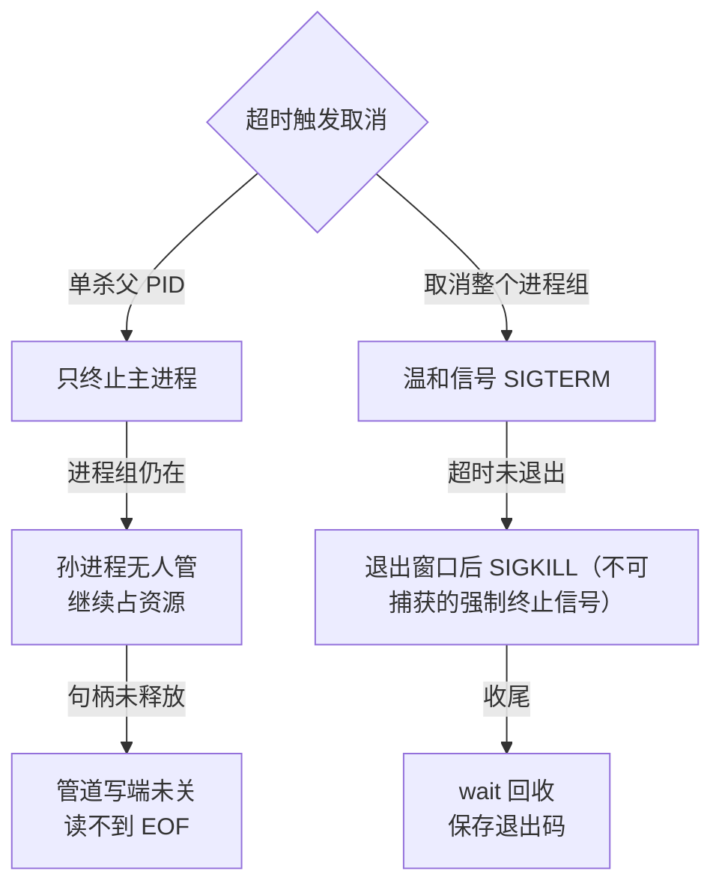
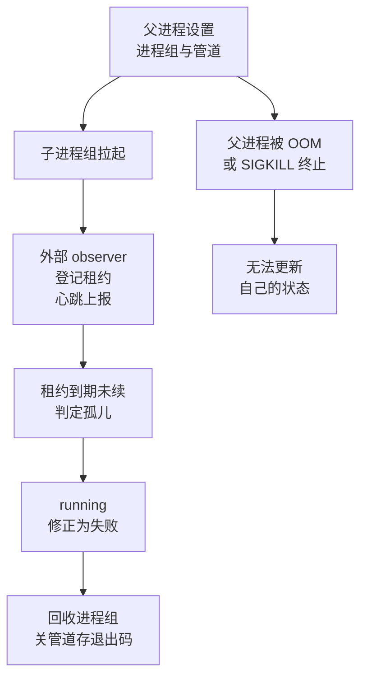

# 任务生命周期必须覆盖进程、日志、超时与清理

**长任务最怕"看似完成、实际泄漏或失联"：超时留下孙进程（子进程再派生出的下级进程）和临时资源，最后变成 fd 耗尽或无法判断的假成功**。读完这篇你能**把进程、日志、超时和清理绑成一个可回收的生命周期**。可以把它想成租一间会议室：进门登记（启动）、离开时要还钥匙、关投影、擦白板（清理），忘了关投影它就会一直亮到第二天。这个比方到「用完要还」为止。**会议室空着最多浪费电费，进程没被回收则会一直占着内存和文件描述符（进程打开文件的编号句柄），攒到一定数量整个服务都起不来**。

**核心做法是把进程组、日志、状态、超时和清理租约（带有效期的占用凭证，持有者需定期续期，过期即视为放弃）绑定到 task generation（把资源绑定到这一次任务实例的代际标识），并用进程组、退出码、产物和资源计数验证**；代价是**需要 observer**（独立于父进程之外的外部监视者，负责心跳与租约续期）和持久化状态，边界是**它不能替业务判断结果正确**。

**长任务系统最难的部分，是确保进程、文件描述符、日志、超时和清理在父进程异常时仍有明确归属**；启动一条命令只占其中最简单的一段。

## 要解决的问题：任务的归属关系怎样确立

长任务看起来已经结束，实际留下了未被回收的子进程、管道与临时资源，或者超时之后仍在对同一份数据重复执行，表现为描述符耗尽、重复写入与无法判断的假成功。本篇回答：任务的归属关系怎样确立、进程组与日志与状态与超时与清理各自绑定在什么标识上、回收路径由谁负责，以及判定任务结束要核对哪些记录。

## 这套模型是什么样

一次 task/run 要绑定的资源有下面几类：

- 进程组、容器或 cgroup（Linux 的控制组机制：给一组进程划出 CPU、内存等资源上限）
- stdin/stdout/stderr 管道
- 已打开的文件、socket、锁
- 超时、取消信号、退出状态
- 产物与清理租约

fd。文件描述符是进程内指向 open file description 的整数句柄；文件、管道、socket、eventfd（事件通知的文件描述符） 都会占用 fd。

`fork`（复制出子进程的系统调用）后子进程继承描述符，`exec`（用新程序替换进程映像的系统调用）时只有设置 close-on-exec（描述符带此标志时，在执行新程序之际自动关闭）的描述符会关闭。**fd 泄漏的影响超出打开文件本身：pipe、socket、subprocess 会以 `EMFILE` 失败（进程打开文件描述符达到上限时的报错）**。


来源：[腾讯云开发者社区《30 张图揭开「内存管理」的迷雾，瞬间豁然开朗》](https://cloud.tencent.cn/developer/article/2671629)（CC 4.0 BY-SA）


再一处图源：[稀土掘金《深度解析 Raft 分布式一致性协议》](https://juejin.cn/post/6907151199141625870)（CC 4.0 BY-SA）


## 生命周期的哪些环节必须显式处理

- **启动时设置工作目录、环境、资源上限、进程组和输出管道**。
- **不需继承的 fd 使用 `O_CLOEXEC`/`FD_CLOEXEC`，避免锁和 socket 被子进程意外保活**。
- **父进程关闭自己不使用的 pipe 端，否则读取端可能永远收不到 EOF（End Of File，写端全部关闭后读取端才会收到的结束标志）**。
- **取消/超时先向进程组发温和信号，留出退出窗口，再强制终止；单杀父 PID（process identifier，操作系统给进程分配的编号）会留下孙进程**。
- **回收子进程并保存 wait status；不 `wait` 会留下 zombie，丢失退出原因**。

一套任务从拉起到回收的全链条，集装箱码头是实物原型：龙门吊把箱子放进格位、堆场记录每个箱子的位置、提箱按计划走、空箱要按租约归还——任何一个环节没有登记，箱子就会堆在码头无人认领。这个比方到「资源进场要登记、出场要还」为止；码头丢箱只是丢货，进程未登记会拖垮整个服务：


*图源：Wikimedia Commons，作者 Phil Champion，CC BY-SA 2.0，https://commons.wikimedia.org/wiki/File:Cranes_and_shipping_containers_at_Victoria_Terminal_3_(Belfast_Container_Terminal)_-_geograph.org.uk_-_6231570.jpg。*

任务系统里的进程、管道、临时文件与清理租约就是那些箱子：**每个资源从进场就要有格位登记，出场时按租约核对归还**。「看似完成、实际泄漏」的根源从来都在**登记簿缺页**；工具只是把登记簿换成了**进程组、observer 与租约**。

超时后按哪种范围取消，结局差在孙进程的归属，两条路径分岔见下面这张图：



- **任务外部 observer 监测 heartbeat、进程树和租约；父进程被 OOM/SIGKILL 时不能依赖它自己更新状态**。

## fd 与并发容量的账怎么算


父进程自己被 OOM（Out Of Memory，内存耗尽后被系统强制终止进程） 或 SIGKILL（不可捕获的强制终止信号） 之后，谁来更新任务状态、谁来收尾——这条时序给出的就是归属关系：



**状态与回收都挂在外部 observer 的租约上，fd 与并发容量才有可数的边界**：**observer 用租约把每个任务占用的进程与管道登记成可计数项，到期未续即回收，fd 因而有了按任务可算的上限**。

粗略容量不是「每个子进程 3 个 fd」。实际还包括捕获 stdout/stderr 的 pipe、网络连接、日志、临时文件、watcher 和框架内部句柄（程序持有的资源引用标识）。上线前观察：

```bash
ulimit -n
ls -1 /proc/<pid>/fd | wc -l
lsof -p <pid>
cat /proc/<pid>/limits
```

**容量估算以高水位（队列或资源的当前占用程度）和泄漏趋势为准，避免在达到限制后才重试**；**无界重试会同时加剧 fd、进程和端口耗尽——每次重试都会新开进程、管道与连接，未设上限时这些资源叠加累积，于是同时耗尽 fd、进程与端口**。

## 失败分几类、各自怎么应对

| 现象 | 证据 | 处理 |
| --- | --- | --- |
| `Too many open files` | **fd 数随任务单调增长、`EMFILE`** | **找未关闭路径；上下文管理；并发上限** |
| 命令超时但进程仍在 | **孙进程不属于同一可控 group** | **建立 process group/cgroup；组级取消** |
| stdout 读取卡住 | **pipe 写端仍被某个继承进程持有** | **关闭无用 fd；检查进程树** |
| 状态永远 running | **主进程终止，内部超时/心跳一起停止** | **外部 lease/observer 纠正孤儿状态** |
| 清理破坏其他任务 | **资源没有 owner/generation/引用计数** | **绑定 task generation；清理前检查租约** |

## 框架必须替任务采集哪些事实？

**AI 可以决定执行何种构建、测试或诊断命令，但框架必须采集真实 argv、cwd、pid/process group、退出码、信号、stdout/stderr 和产物**；**并以 task/attempt/revision 绑定这些事实**。详细边界见 [[工程知识/AI 系统工程：从模型能力到生产能力/安全与治理/执行证据必须独立于AI结论]]。


任务生命周期的机制与本质：把后台任务看成一个微型系统——**进程是它的身体（起了要有收），日志是它的记忆（出事要能回放），超时是它的心跳（卡了要有判定），清理是它的遗嘱（退场要还资源）**；
**本质问题是任务在异常路径上的每一步都有人负责——正常路径人人都会写，生命周期治理管的全是异常路径**。


## 怎么自己动手验证

1. 描述符泄漏：让同一任务循环拉起带 stdout 管道的子进程，用 `ls -1 /proc/<pid>/fd | wc -l` 跟踪数量，**预期在高水位附近振荡；若单调增长，按未关闭的 pipe、socket 与临时文件逐类排查**。
2. 超时取消：构造一条会 fork 孙进程的命令并触发超时，**预期整个进程组收到信号后退出**，用 `ps -o pid,ppid,pgid` **确认没有遗留孙进程**；**只按父 PID 终止的对照实现应留下可观察的孤儿**。
3. 管道阻塞：父进程保留 pipe 写端不关闭，**预期读取端在子进程结束后仍收不到 EOF**；**关闭无用描述符后读取正常结束**。
4. 状态无响应：用 `SIGKILL` 终止主进程，**预期外部 observer 依据租约与心跳把任务状态修正为失败，而不是长期停留在 running**。
5. 回收核对：**退出后子进程已被 `wait` 回收且无 zombie，退出码与产物路径写入任务记录，清理动作绑定的 generation 与当前任务一致**。

## 接着读哪几篇：周期任务的完成纪律与工作量守恒监控

- [[工程知识/后端系统：在并发、失败与变化中维持服务/任务与并发/后台任务不能依赖终端会话维持生命周期]]、[[工程知识/后端系统：在并发、失败与变化中维持服务/分布式可靠性/健康检查只能提供有时效的失败证据]]、[[工程知识/软件构建：让变化可以理解、验证与交付/测试与交付/测试策略从风险选择证据]]、[[工程知识/缺陷分析：从个案到体系/资源与容量/周期任务只进不出的集合：清理动作自己也要被清理]] —— 周期任务的完成纪律与工作量守恒监控。
