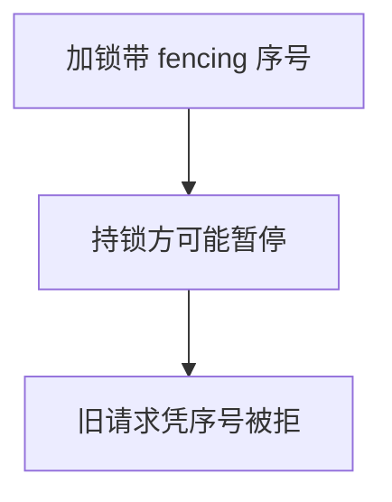
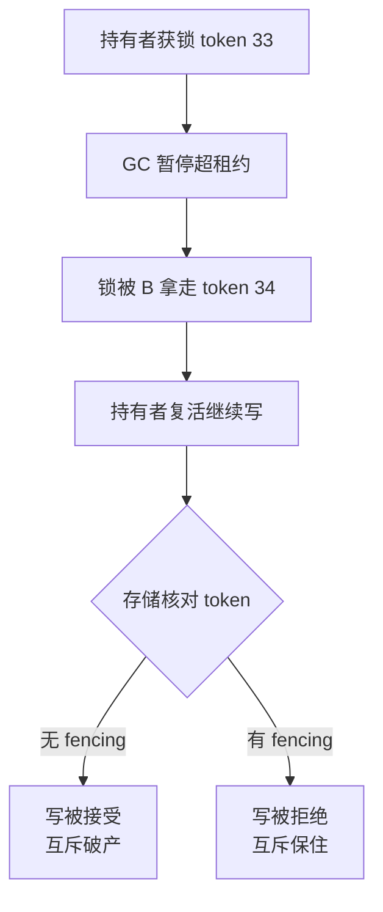
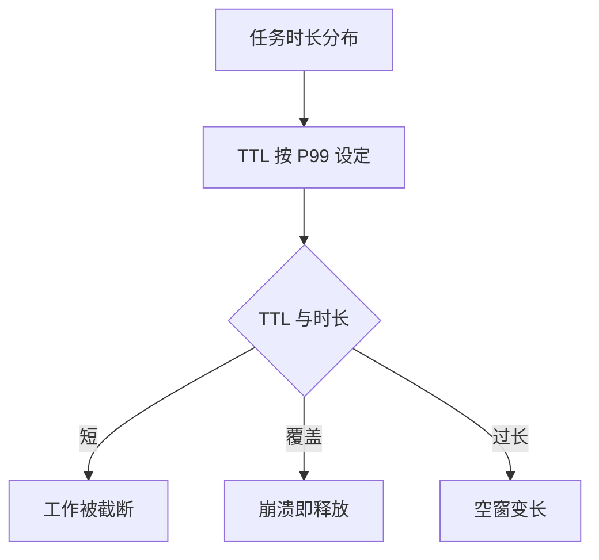

# 分布式锁的正确与错误用法：fencing与租约

## 跨机器的互斥为什么难：要解决的问题

fencing 与租约解决的是同一个问题的两面：
读完这篇你能判断一次跨机器互斥该加锁、加序号还是加租约，也知道进程暂停时会漏在哪一步。

多实例服务共享资源（一份数据、一个外部调用配额、一个任务队列）需要互斥，单机锁（mutex）管不到跨进程。分布式锁要解决的问题是**跨机器的互斥怎么做才正确**——这里的「正确」要求极高：**进程暂停（如 GC，即垃圾回收，运行时自动回收不再被引用的内存；或虚拟机被冻结）、时钟漂移、网络分区都会让「我持有锁」的信念过期**。Martin Kleppmann 与 Redis（内存键值数据库，常当缓存与排行榜用） 作者 antirez 的著名论战（2016）把争点摆到了台面上：**Redlock 算法（antirez 提出的多 Redis 实例多数派加锁算法）在主从（一台主节点负责写入、其他从节点同步数据的部署形态）切换下不安全**，多数「分布式锁」用法其实是「减少低效的 efficiency 锁（效率锁，只求少浪费、偶尔失效也无妨）」，不是「保证正确性的 correctness 锁（正确性锁，必须绝对互斥）」。**分清这两类是本文的核心**。

## 效率锁与正确性锁差在哪：机制

先把形状说成一件事：分布式锁像公共浴室的门闩——效率锁是"提示牌"——门上挂"使用中"，有人无视牌子进去，也就是多洗一次，没人受伤；正确性锁是"门闩本身"——两个人同时进去就是事故，牌子不够，门必须物理锁上。麻烦在于远程门闩没法"物理锁上"：你以为自己闩着，服务端可能已经把门判给了别人（GC 暂停、时钟漂移、网络分区都能让"我还拿着"过期）。fencing token 就是门卡上的取号纸条：进门前对一下号，号过期了门卫（下游资源）拒绝放行。正式定义：fencing token 是锁服务每次授锁时附带的单调递增编号，资源方凭它判断写请求是否过期。这个比喻到"对号"为止——现实里下游要不要验号、租约多长、共识系统怎么选，正是两类锁的实现分野，下面展开。

**效率锁和正确性锁怎么分？**
- **效率锁（efficiency lock）**：**目标是避免重复劳动（两个实例都跑同一个定时任务，浪费但不出错）**。**锁偶尔失效可接受（多跑一次幂等任务无害）**。**实现要求低：单 Redis 实例的 SET NX EX 够用**——这条命令在键不存在时才写入并设置过期时间。
- **正确性锁（correctness lock）**：**目标是互斥必须绝对成立（两个实例同时写同一行数据 = 腐败）**。**锁失效不可接受**。**实现要求高：fencing token + 下游验证，或共识系统（ZooKeeper/etcd：分布式键值存储，Kubernetes 用它存集群状态）+ fencing**。

**租约（lease）：锁的到期设计**。持有者可能崩溃（crash 后锁永不释放 = 永久互斥），租约解决：**锁带 TTL（Time To Live，数据的存活时间，到期作废），到期自动释放，持有者在 TTL 内续租**。代价：**持有者在 TTL 内完成工作的假设可能破产——GC 暂停/网络延迟让「租约还剩 1 秒」的工作做了 3 秒，锁已被别人拿走，原持有者的写操作变成带外写（out-of-band write，即在锁保护之外、未经互斥许可就发生的写入——这是 Kleppmann 论证的核心风险）**。

分布式锁的运行载体是一组协调服务节点：锁状态在远端集群上，持有者的"我以为我还拿着"与锁服务端的真实状态可以分叉。协调服务像前台寄存柜——你以为柜门还归你，前台其实已把格子判给别人；这个比方到「格子被重新分配」为止，柜子不会自己续期，分布式锁靠租约与 fencing 序号补上这道验证。锁服务集群自己也跑在会掉电、会分区的机器上——协调者的承诺没有特殊地位：

*图源：Wikimedia Commons，David Monniaux，CC BY-SA 3.0，https://commons.wikimedia.org/wiki/File:Rack-mount_servers.jpg。*

挂锁是互斥最古老的实物：一把锁只配一把钥匙。分布式锁偏没有"实物"可攥在手里——你攥着的只是对远端状态的一份可能过期的信念。这个比方到「钥匙」为止；现实里锁的状态不在你手上，而在远端集群里。

**正确性锁靠什么兜底？fencing token。**锁服务每次授锁发单调递增的 token（33、34、35…），**资源方（数据库/存储）只接受比已见过最大 token 更新的写**。即使持有者暂停后「复活」，**它的 token（33）已过期（存储见过 34），写被拒**。**fencing 把「锁的正确性」从锁服务移到资源方——存储必须参与验证，只靠锁服务的承诺不够**。

持有者暂停复活的两种结局分岔见下面这张图：

**租约这一层要调的是三个方向之间的取舍：TTL 短于任务 P99（百分之九十九的请求耗时上限，即绝大多数任务的最长耗时）、覆盖 P99 且能续租、远超 P99，三条分支分别通向互斥频繁破产、崩溃时自动释放、以及崩溃后长期无人可用**。

TTL 调好只是让持有者不会平白丢锁。**锁服务本身可不可信是另一层问题：换成共识系统也消不掉暂停复活——它是进程被 GC 或操作系统冻结后恢复的物理事实，任何锁服务都无法感知客户端是否已恢复，所以共识只解决脑裂，etcd（分布式键值存储：基于 Raft 共识，常用于服务发现与配置共享）不解决复活**。

**用 ZooKeeper/etcd 怎么加锁？**基于共识系统：**客户端会话（session）在 ZooKeeper 上建临时顺序节点，最小序号者获锁；会话断（crash/网络）节点自动删除，锁释放**。**共识系统保证线性一致**（任意时刻所有读都能看到最新一次写的结果，就像只有一份数据副本在按顺序处理请求，因此不会出现脑裂），**比 Redis 主从可靠**。「只有一份副本」这个比方只到「读到的都是最新一次写」为止，顺序节点怎么生成、会话断了锁怎么释放要看正文。**但仍要 fencing：ZooKeeper（分布式协调服务，管配置、选主与分布式锁）的会话超时后客户端可能还在跑（暂停复活问题同样存在），存储侧验证不可省**。

来源：[博客园《解密 Raft（一种以易于理解著称的共识算法：靠领导者与日志复制达成多数派一致） 算法》日志进度一图](https://www.cnblogs.com/traditional/p/12588733.html)（CC 4.0 BY-SA）

再一处图源：[博客园《解密 Raft 算法》初始状态一图](https://www.cnblogs.com/traditional/p/12588733.html)（CC 4.0 BY-SA）

## 这场论战到底争出了什么？

分布式锁的工程史就是「用不安全的组件搭安全结构」的尝试史。Redis SETNX 锁（2011+——SETNX 即 SET if Not eXists，键不存在才设置，与 SET NX 同一语义）因简单普及，Redlock（antirez 2014）试图多实例多数派抗主从切换。Kleppmann 在 2016 用进程暂停与时钟漂移两个模型批评并证明 Redlock 不满足正确性，论战以「Redlock 可作效率锁、正确性要 fencing」收场。Chubby（Google，2006 论文）是工程师视角的经典（粗粒度锁 + 会话 + sequencing token），ZooKeeper 的 recipes 继承其思想。

**fencing token 把正确性责任从锁服务移交给存储**。**锁服务（无论 Redis 还是 ZooKeeper）对「持有者此刻是否还在跑」永远无法保证（暂停复活是物理世界的事实），唯一能拦住过期写的是看到写请求的一方（存储）**。**单调 token + 存储侧「只接受更新 token」的规则，把互斥的正确性锚定在数据的安全防线（存储的事务与验证），这种保证无法由易错的协调服务提供**。**移交的深层意义：分布式系统的正确性要由「数据存放处」的防线承担，「协调处」的承诺承担不了这一职责**。代价：**fencing 要求存储配合（数据库要存 token 或支持条件写），不支持 token 验证的存储（多数外部 API：第三方支付、对象存储）做不了完整 fencing——外部 API 不提供「仅当 token 更大才接受写」的条件写入口，存储侧无法拦截过期写，因此这类场景的正确性锁只能靠「可补偿设计」（幂等键、对账）**，可参考幂等（同一操作执行多次与执行一次效果相同）设计（[[工程知识/数据系统：在并发与故障中保存事实/数据管道与流处理/数据编排要保证依赖、重试与幂等.md]]）。**三节点起步的共识集群运维较重，对只想要效率锁的团队属于过度投入——效率锁场景用 Redis 单点足够**；**租约 TTL 的调优是持续工程（太短 = 正常工作被截断，太长 = 崩溃后长时间无人可用），按任务时长分布 P99 × 安全系数设置**。

## 有了 fencing 还缺哪些东西：边界

- **先问「锁失效会怎样」再选实现**。**答案「浪费但不坏」 → 效率锁，Redis SETNX TTL 即可**。**答案「数据腐败」 → 正确性锁，fencing 或共识系统 + fencing，或干脆改设计（把互斥需求消掉：单队列消费、数据库唯一约束、幂等设计）**。
- **「用 ZK 就安全」是错觉，会话复活问题依旧**。**ZK 解决脑裂（锁不会被两人同时持有），不解决持有者暂停后过期写（那是 fencing 的活）**。**正确性锁的完整形态：共识锁服务 + fencing token + 存储验证**。
- **第三方 API 场景的正确性靠幂等不靠锁**。外部支付、发短信等不可 fencing 的资源，**分布式锁只是「减少并发」的软手段，唯一性由幂等键保证（业务侧唯一 ID，下游去重）**。**锁 + 幂等双保险，不要单押锁**。
- **看门狗续租不是安全机制**。Redisson 的看门狗（自动续租）让锁「看起来一直有效」，**但它延长的是失效概率不是消除（暂停复活时看门狗同样暂停）**。**看门狗优化效率锁的可用性，对正确性锁无补**。

## 锁真的互斥了吗：验证

- **暂停复活实验**：持锁进程注入长 GC 暂停（或 SIGSTOP），暂停期间锁被他人获取，恢复后原进程继续写。预期：**无 fencing 时写成功（带外写发生，互斥破产的实证）；有 fencing 时写被拒**。**fencing 必要性的直接证据**。
- **主从切换实验**：Redis 主从切换窗口（failover 期间），两个客户端先后获锁。预期：**Redlock/单 Redis 出现双持锁（切换窗口的不安全窗口暴露），ZK 无此问题**。**实现可靠性的分界实证**。
- **TTL 与任务时长失配实验**：TTL 10s、任务 P99 15s 的负载，观测锁过期后并发进入。预期：**TTL < 任务时长时互斥频繁破产（租约假设的边界）**，**TTL 设置要按任务分布调**。

## 接着读哪几篇：锁失效的兜底：幂等设计

- [[工程知识/数据系统：在并发与故障中保存事实/数据管道与流处理/数据编排要保证依赖、重试与幂等.md]] —— 锁失效的兜底：幂等设计
- [[工程知识/后端系统：在并发、失败与变化中维持服务/任务与并发/队列和流系统用时间与容量换取解耦.md]] —— 消解互斥需求的替代结构
- [[工程知识/缺陷分析：从个案到体系/并发/案例三：并发两面——写回调卡死与心跳竞态.md]] —— 并发时序病理的案例解剖
- [[工程知识/性能工程：从用户等待到资源瓶颈/处理器与内存/无锁数据结构的证据门槛：CAS与内存序.md]] —— 单机 CAS 与分布式锁是互斥+fencing 的两个尺度
- [[工程知识/缺陷分析：从个案到体系/并发/时间型缺陷的判定树：过期竞态与时钟依赖.md]] —— 租约失效是时间缺陷最大族，fencing 是结构解
