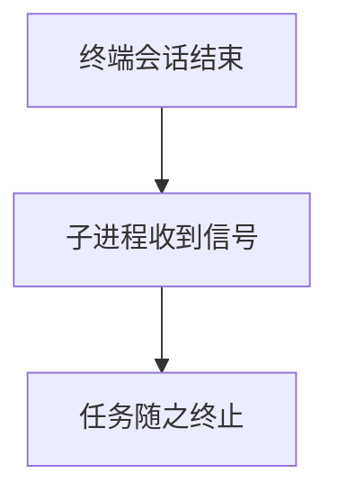
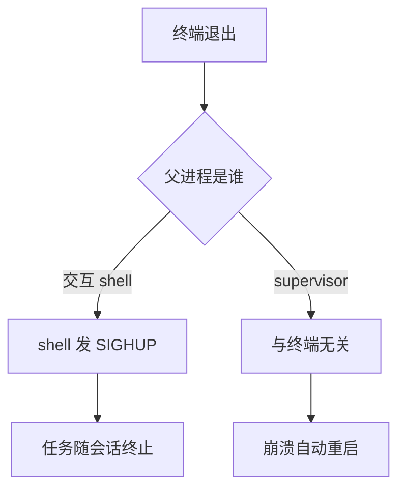
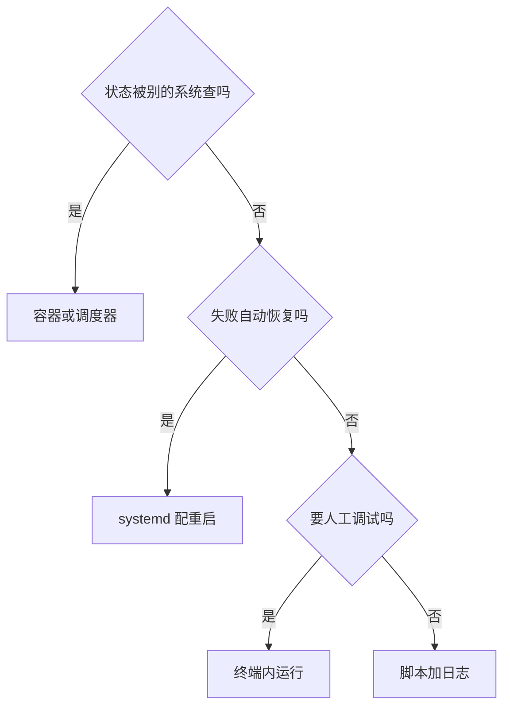

# 后台任务不能依赖终端会话维持生命周期

本文讲后台任务为什么不能依赖终端会话维持生命周期：**终端一断，任务就失去监督**。**核心机制是把任务交给拥有重启、日志、资源和状态语义的 supervisor（常驻监督进程，负责拉起、看管和重启任务）或 job runtime（任务运行环境，统一管理任务的启动、状态与重试）**；读完你能判断一个任务该用哪档托管，并知道验收时要构造哪几类中断。

收益是**生命周期可观察、可恢复**，代价是**增加部署和运维组件**，边界是**进程托管不等于业务幂等**（idempotency：同一操作执行多次与执行一次效果相同，重放也不会出错）或结果正确——重启会重放任务，若任务本身不是幂等的，重放就会重复扣款或重复写入，所以进程托管管不了业务正确性。用断开会话、杀父进程、重复提交和磁盘满实验验证恢复与清理。

命令末尾加 `&` **只把 job 放到 shell 后台，不自动解决终端关闭、日志、退出码、重启、资源上限和状态恢复**。

## 要解决的问题：任务的生命周期应当交给哪一类组件



会话生命周期决定任务生命周期，对照见下图：


**终端断开、会话退出或父进程结束时，后台任务失去监督，运行状态无法查询，失败之后也没有重启路径**——**因为这些任务以终端会话为父进程，会话结束会向它们发信号并带走整条进程树**，断开后运行状态和重启路径都不再有人接管。本篇回答：任务的生命周期应当交给哪一类组件、这类组件提供哪些保证、它们不提供哪些保证，以及验收恢复能力需要构造哪几种中断场景。

## 机制的边界在哪儿

打个比方：后台任务像寄养在别人家的孩子——你一走（终端关掉），那家人如果按你的存在安排他的吃住，孩子就没人管了；正确的做法是给他落到稳定的监护体系里（托管），和你在不在场无关。这个比喻到"为什么要脱离"为止：setsid、systemd（Linux 的服务管理器）、容器托管各自怎么做，要看正文。


| 方式 | 适用 | 不提供 |
| --- | --- | --- |
| `cmd &` / shell job control | 当前交互会话短任务 | 脱离终端、重启、集中日志 |
| `nohup cmd >run.log 2>&1 &` | 一次性、允许人工检查的简单任务 | 监督重启、资源隔离、可靠状态 |
| tmux（终端复用器，一个终端开多会话）/screen | 人工交互、调试和会话重连 | 生产服务管理和自动恢复 |
| systemd/supervisor | 单机长期服务 | 跨机调度、业务幂等 |
| container/job scheduler | 可声明资源和重试的批处理 | 应用级正确性、证据和补偿 |

表格之外的机制：终端退出时任务死活，由父进程是谁决定，判定路径见下图：



讨论「任务的状态」时，参照系是操作系统的进程状态机。**一个进程从创建到终止要走五态：新建（New）经准入进入就绪队列，被调度后运行，等待事件时转入阻塞队列，事件到达回到就绪，最后释放退出**：


*进程五状态与转换路径（图源：Wikimedia Commons，MrDrBob 绘，CC BY-SA 3.0）*

「运行状态无法查询」指的是**托管层丢失了对这条状态路径的可见性**——进程停在就绪、运行还是阻塞，失败时停在哪一态，无人能答；**supervisor 提供的正是把这条路径重新纳入监督的观测与恢复手段**。

「监督」的具体形态，OpenSSH 的特权分离架构是教科书样本——监听进程只管接连接，认证与用户会话分别交给不同权限的子进程，每个进程的职责边界与失败影响都被结构性限定：


*图源：Wikimedia Commons《OpenSSH-Privilege-Separation.svg》，公有领域，https://commons.wikimedia.org/wiki/File:OpenSSH-Privilege-Separation.svg。*

## 启动前该记录哪些东西？

- 可复现命令、cwd、环境/配置版本和代码 revision；
- stdin/stdout/stderr 去向，日志轮转和敏感信息规则；
- pid/process group、启动时间、owner 和 task ID；
- timeout、取消、退出码和产物路径；
- CPU/内存/磁盘/网络上限与并发预算。

## 安全的一次性模式是什么样

```bash
nohup ./run-job --config config.yaml >run.log 2>&1 &
job_pid=$!
printf '%s\n' "$job_pid" >run.pid
```

这只适合低风险临时任务。**PID（进程编号）可能复用，`run.pid` 不是身份保证**；**停止前还应核对启动时间、命令、cwd 和任务代际**。**不要使用宽泛 `pkill -f` 或未确认的 PID 杀进程**。

把任务交给 supervisor 之后，接手约定写在什么地方，systemd 官方手册 `systemd.unit(5)` 给出了权威形态：`foo.service.wants/`、`foo.service.requires/` 目录下的符号链接被自动并入对应类型的依赖，`[Install]` 段加 `enable` 命令生成这些链接——**任务与监督者的关系是声明式的文件系统事实**，**监督重启、日志归集、资源上限都从这套约定里长出来**，这是 `cmd &` 与 `nohup` 不具备的接手语义：

![systemd.unit(5) 官方手册：foo.service.wants/ 与 foo.service.requires/ 目录下的符号链接自动并入对应类型依赖，[Install] 段与 enable 命令生成符号链接，drop-in 目录 foo.service.d/ 追加配置](/static/figures/systemd-unit-wants-requires-doc.png)

*图源：[systemd.unit(5) — Freedesktop 官方手册（man.archlinux.org 镜像）](https://man.archlinux.org/man/systemd.unit.5.en)，CC BY-SA 4.0+，文档引用。*

## 任务怎么取消和清理？

**长任务应建立独立 process group/cgroup（Linux 的控制组机制：给一组进程划出 CPU、内存等资源上限），先发送可处理的终止信号，等待宽限期，再强制终止整个组**——**把任务圈进同一个组，才能用一条信号整体收掉它下面繁衍出的所有子进程，否则只杀父进程会留下孤儿进程（父进程先退出、由 1 号进程接管收养的进程）继续占用资源**；随后回收子进程、保存退出状态、关闭 fd（文件描述符，即进程打开的文件或管道句柄）、完成/回滚（把系统状态退回到改动之前的版本）临时产物。详细机制见 [[工程知识/后端系统：在并发、失败与变化中维持服务/任务与并发/任务生命周期必须覆盖进程、日志、超时与清理]]。

## 不同任务该选哪一档托管？


托管档位按三问逐层收敛——状态要不要被别的系统查、失败要不要自愈、是不是人工交互：



托管成本逐档递增，按最低够用的那档选——超出需求的那一档只带来额外的运维面，可靠性没有增加。

**选型按三个问题走：任务运行多久、失败后是否自动恢复、状态是否被其他系统查询**。交互调试对应 tmux；跑一夜的一次性脚本对应 nohup 加日志重定向；**随宿主存活的常驻服务交给 systemd 或 supervisor 并配置重启策略**；**需要跨机调度与重试语义的批处理（把多个请求合并成一批同时计算、提高硬件利用率）交给 job scheduler**。**托管成本逐档递增，按需求最低档选择，超出需求的高档组件带来的是额外运维面**。

**看完本篇应能做的判断：给一个具体任务指出它该用哪一档托管，验收时构造哪几类中断（断开连接、杀父进程、重复提交、资源耗尽），并说出每档托管不提供的保证**——这部分保证缺失时要**靠任务自身的幂等与清理纪律补足**。

## 生产环境怎么验收？

- [ ] **进程退出、OOM（Out Of Memory，内存耗尽：系统或容器内存不够，内核把进程杀掉）、宿主重启和网络中断都有明确状态**。
- [ ] **任务可查询、取消、限时，日志与产物绑定 task/attempt/revision**。
- [ ] **重试写操作幂等；后一次失败不覆盖已确认成功事实**。
- [ ] **清理只作用于自己拥有且租约失效的资源（lease：带过期时间的"使用权凭证"，过期后别人可以安全接管）**。
- [ ] **外部 observer 检测孤儿任务，不依赖主进程自报**。


## 怎么自己动手验证

1. 会话脱离：用 supervisor 或 `nohup` 启动任务后关闭终端与 SSH（加密的远程登录协议）连接，**预期任务继续运行、日志按轮转规则写入文件**；**以 `cmd &` 启动的对照任务应随会话结束收到 SIGHUP（终端挂断信号：会话退出时发给由它启动的进程的通知）而终止**。
2. 父进程退出：对托管任务发送 `SIGKILL` 强制结束父进程，**预期 supervisor 按重启策略拉起新实例，并在日志中记录退出原因与重启次数**；用 `ps -o pid,ppid,pgid,lstart -p <pid>` **核对新实例的进程组与启动时间，确认它属于新一代**。

3. 重复提交：**在任务仍在运行时提交同一任务，预期被去重或拒绝，不应出现两个实例写同一份产物**。
4. 资源耗尽：把输出目录所在文件系统写满或收紧磁盘配额，**预期任务以明确退出码结束、日志记录失败原因，清理动作只回收自己拥有的临时产物**。

5. 断言锚点：断开连接、杀掉父进程、重复提交、资源耗尽四类中断都有可查询的最终状态与退出记录，孤儿任务能被外部 observer 发现。

## 接着读哪几篇：同在后端系统里的相邻问题

- [[工程知识/AI 系统工程：从模型能力到生产能力/安全与治理/执行证据必须独立于AI结论]]、[[工程知识/后端系统：在并发、失败与变化中维持服务/分布式可靠性/租约必须配合FencingToken阻止过期持有者]]、[[工程知识/后端系统：在并发、失败与变化中维持服务/基础设施/Kubernetes管理资源状态，不管理业务正确性]]、[[工程知识/后端系统：在并发、失败与变化中维持服务/任务与并发/后台任务的守护链：进程托管与会话脱离是可靠性的底线配置]]。
