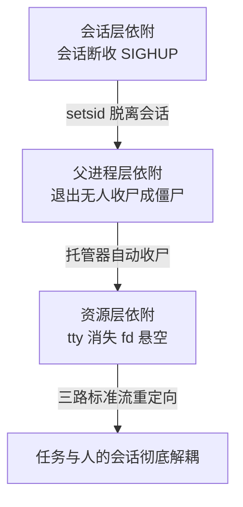
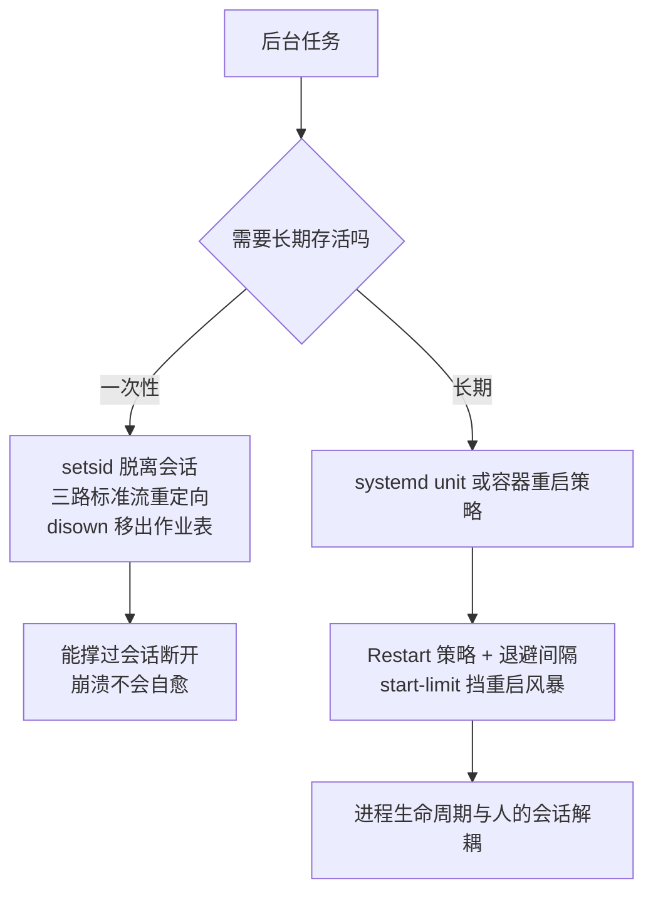

# 后台任务的守护链：进程托管与会话脱离是可靠性的底线配置

你在终端里起的后台任务，**关掉窗口就可能一起没了**。读完这一页你能**把任务从人的会话上摘下来**：交给 systemd（系统服务管理器）或容器托管、用 setsid（新建会话）与 nohup（忽略挂断信号）正确脱离、把日志写到该去的地方。

> **要点**：后台任务依附在终端会话或交互式 shell 下，**会话一断任务就没了**——**可靠性的底线是进程托管（systemd/容器重启策略）+ 会话脱离（setsid/nohup 的正确组合）+ 日志重定向**，三项缺一，任务的生命周期就挂在了人的会话上。

## 要解决的问题是什么

"在服务器上跑个长任务"有一类经典事故：**任务通过 SSH（加密的远程登录协议）起在交互会话里，运维下班断开连接，任务随会话终止**——数据迁移跑到一半停了，批量回填无人知晓，第二天发现"任务消失了"。本库后端域"后台任务不能依赖终端会话维持生命周期"已从 SIGHUP（终端挂断信号，会话终止时内核向控制进程发出）信号机制的角度解剖过根因；本篇把防线体系按"守护链"展开：一个能长期存活的后台任务，从进程托管、会话脱离到日志归属的三层底线配置，每一层的失守形态不同，配齐三层才构成完整守护。

## 任务到底挂在哪几层依附上：三层机制

先把形状说成一件事：一个后台任务像被临时托付的孩子——他现在跟着三个"看护人"过日子：跟着哪个房间住（会话层，SIGHUP：终端关闭时发出，同一会话的进程随之退出）、跟着哪个家长上户口（父进程层，父进程退出后没人收尸就成僵尸）、靠谁管吃住（资源层，标准输出与工作目录都还指着那个会话的东西）。脱离就是让孩子过户到稳定的监护体系（systemd 或容器托管）：换房间（setsid 建新会话）、换户口（被 init 收养、有收尸方）、自带口粮（标准流重定向到文件）。

这个比喻到"过户"为止——这只是帮助建立形状的类比，实际对应的是会话进程组、init 收养、标准流这三层技术关系；守护链的每一层失守形态不同，要逐层配置并逐层验收，下面展开。比喻里的换房间、换户口、自带口粮，分别对应下文的会话层、父进程层、资源层依附。

守护链的职责划分可以参照调度、代理、监督三者：调度负责发起，代理负责执行，监督负责看状态并介入。三者分开，任务才不会随着某一环的退出而丢失**。这是守护链的职责切分视角；下文的三层依附（会话层/父进程层/资源层）则是失效分析视角——前者回答「谁负责哪件事」，后者回答**「任务会挂在哪」。


*图源：Microsoft Learn 中文文档，CC BY 4.0，https://learn.microsoft.com/zh-cn/azure/architecture/patterns/scheduler-agent-Supervisor（进程守护工具，崩溃自动拉起）。*

一个交互式启动的进程，生命周期挂在三层依附关系上，每层断开都有对应的失效方式：

**会话层依附（SIGHUP）**：交互 shell 启动的子进程挂在会话的进程组里，会话终止时内核向控制进程发 SIGHUP，默认动作是终止**。`nohup` 忽略 SIGHUP，`setsid` 干脆让进程脱离控制终端——两个工具解决的同一层问题，**语义有别：nohup 保留会话关系只免疫信号，setsid 建立新会话彻底脱离。**只免疫信号不脱离终端的进程，仍会在终端关闭路径上遇到两类收尾行为**（tty——终端设备）驱动行缓冲的刷新异常；后台作业收到 SIGHUP 后写半截日志，生产守护进程（后台长期运行的进程）的标准做法是 setsid 完整脱离。

**父进程层依附（僵尸与孤儿）**：父进程退出后子进程被 init 收养，这一步无害；有害的形态是**父进程活着但不管子进程**——子进程退出后成僵尸，占着进程表项。托管的进程树要有收尸方（systemd 对它起的服务自动收尸，容器运行时对 PID 1（进程编号 1）有专门约定），自行编写的管理脚本要么显式 wait 收子进程，要么用双 fork（复制出子进程的系统调用） 让守护进程脱离原会话、被 init 收养——第一次 fork 让子进程离开原会话，第二次 fork 确保它不会被重新绑定到控制终端，从而彻底成为孤儿被 init 收养。

**资源层依附（文件描述符与工作目录）**：进程的 stdout/stderr 指向的 tty（终端设备的抽象表示）随会话消失，后续写日志失败或写进已删除的文件；工作目录被卸载时进程在悬空目录里继续跑。底线配置是启动时重定向三路标准流（标准输入/输出/错误，即 stdin/stdout/stderr）到文件或日志系统、工作目录切到持久路径——**这两步不做，进程无法输出日志也无法感知输入**。

三层的对应关系决定了守护链的检查顺序：进程还活着吗（托管层看进程表与 unit 状态）→ 活着但还在干活吗（日志层看日志文件是否在涨、指标是否在跳）→ 干活的输出去哪了（重定向层看 fd 指向的是文件还是已消失的终端）。逐层排查能快速把"任务消失了"这类事故定位到具体层。

三层依附各在什么环节失守、底线配置是什么，按下面这张图逐层看：




来源：[小林coding《进程、线程基础知识》](https://www.xiaolincoding.com/os/4_process/process_base.html)


## 守护链怎么配：修复与防线

崩在重试上的循环怎么设中断条件？应用内的调用级重试和托管器的 start-limit 退避是同一个思路的两个层面：都在失败累积到阈值后停止，等冷却再试探。托管器管进程级重启退避，应用内重试管调用级退避，两层都防无界放大——否则重试会把故障放大。


守护链的配置有两套——任务要不要长期存活，决定它落在托管器的重启策略上还是落在一次性三件套上：



两套配置的分水岭在「崩溃后要不要自己起来」**：一次性任务接受不自愈，长期任务必须**把重启策略与退避一起配齐。

**第一优先用进程托管器**：systemd unit 是生产环境的标准答案——Restart 策略（on-failure/always）、自动收尸、日志进 journald（systemd 自带的日志系统）、开机自启，四件事一个 unit 文件全解决。容器环境的等价物是重启策略与存活探针（向系统注入的检测点或检测请求）。托管器把子进程的生命周期建模为一张状态机：Supervisor 官方文档的子进程状态转换图画出了七个状态与自动重启路径——EXITED 之后按 autorestart 策略回到 STARTING，启动过快进 BACKOFF（指数退避：每次等待时间翻倍）退避重试，重试耗尽落 FATAL 等人工介入，「崩溃后要不要自己起来」在托管器里是可配置的状态语义：


*图源：Supervisor 官方文档《Subprocesses》（https://supervisord.org/subprocess.html，官方文档配图）。托管器把「重启策略」实现为状态机语义，人只配策略，状态转换由托管器执行。***手写 nohup 脚本只用于一次性任务**，需要"长期"二字的任务一律托管。托管换来的收益是进程生命周期与人的会话彻底解耦、故障自愈有退避；代价是 unit 文件本身成为要维护的配置，且托管器的行为（依赖顺序、启动超时）需要团队理解——因为进程自愈与解耦带来的可用性收益覆盖了 unit 文件维护成本，代价通过验收清单消化。

**一次性任务的最小守护配置**：确实只能手动起的任务（临时修复脚本），最小配置三项：`setsid` 脱离会话、标准流重定向到文件、`disown` 把作业从 shell 的作业表移出，使它不再收到 shell 退出时的清理——这三项能撑过会话断开，但没有重启能力，任务崩溃不会自愈，所以只配一次性。

**日志的归属先于任务的启动**：重定向目标用带轮转的日志路径或 journald，裸重定向到固定文件会在长任务下写出巨型文件——日志方案在启动命令里一起定，事后补救要重启任务。

**托管配置的验收**：systemd unit 上线前跑一遍验收——kill 进程确认自动重启、断开会话确认无感知、查看 journald 确认日志已写入。**没有验收的托管配置与没有托管一样不可信**。

## 这条链管不到什么：边界

三条边界防止防线走形。

**重启策略要配退避**：Restart=always 对立刻崩溃的任务会形成重启风暴（崩溃循环打满日志）——systemd 的 start-limit 与退避间隔是配套项，"无限重启"的正确形态是"带退避的无限重启"。

**托管不替代任务内的幂等（同一个操作执行一次和执行多次的结果相同，重复执行不会产生额外副作用）**：进程被重启后从哪继续，是任务自身的检查点（定期保存进度、故障后从最近一次保存处恢复）设计（本库正确性域"可恢复批处理的幂等与断点续跑"讨论）——托管保证进程活着，幂等保证活着的进程重复执行不产生副作用，两层互补不可互替。

**setsid 与容器环境的关系**：容器内 PID 1（容器内一号进程，即 init，由运行时托管）由运行时管理，任务不应再自行 daemonize（运行时以 PID 1 的退出作为容器结束的标志：进程自行 daemonize 脱离前台后，PID 1 退出，容器随之销毁）——容器的重启策略承担托管职责，进程内再 setsid 反而让容器认为主进程退出**。**环境的托管模型决定进程的守护形态。

## 怎么验收三层都配齐了：验证

可复现的验证路径：

1. 托管验收：systemd unit 启动任务 → kill -9 主进程 → 确认按策略自动重启且退避生效（连续 kill 触发 start-limit）；
2. 会话验收：SSH 会话内起 setsid 任务 → 断开会话 → 重连确认任务存活、日志持续写入；
3. 日志验收：journald 或重定向文件里能看到任务的输出与错误，轮转配置生效；
4. 断言锚点：**长期任务在托管器里有 unit、重启有策略有退避、日志有归属有三路重定向**；三者缺任一即不满足上线标准。

```text
托管断言 = kill 后自动重启，风暴有退避
会话断言 = 会话断开任务存活
日志断言 = 三路标准流有归属，轮转生效
```

进程托管、会话脱离、日志归属三项是后台任务的最低可靠性配置，它们保证的是"任务有机会跑完"**，任务能不能跑对是幂等与检查点的事，**两层都在才算可靠。验证时预期与实际的对照规则提前写明：kill 后预期自动重启且连续 kill 触发退避，对不上（不重启或风暴式重启）即托管策略与 start-limit 配置有误；会话断开后任务预期存活、日志持续，对不上（任务消失或日志停更）即会话脱离不完整，按三层依附逐层排查。

## 接着读哪几篇：守护链管"活着"

- [[工程知识/后端系统：在并发、失败与变化中维持服务/任务与并发/后台任务不能依赖终端会话维持生命周期]] —— 根因篇：SIGHUP 与会话生命周期的信号机制
- [[工程知识/后端系统：在并发、失败与变化中维持服务/服务设计/优雅停机的完成语义：排空连接与任务交接]] —— 守护链管"活着"，停机语义管"退场"，同一生命周期的两端
- [[工程知识/缺陷分析：从个案到体系/稳定性/失败转移的最后一站：找不到去向的失败要留在原地报错]] —— 任务存活后的失败处理纪律，与守护链同属后台任务可靠性
- [[工程知识/软件构建：让变化可以理解、验证与交付/开发工具/词汇即接口：Linux与容器命令的词源与设计]] —— setsid/nohup/disown 等命令的设计语义
- [[工程知识/性能工程：从用户等待到资源瓶颈/观测与诊断/监控体系按四个问题分层：坏了没、坏了哪、为什么坏、会再坏吗.md]] —— 托管与守护产生的信号进四层监控体系
- [[工程知识/性能工程：从用户等待到资源瓶颈/操作系统与运行时/fd 泄漏先用 lsof 对账：每类套接字都有名有姓才算干净]] —— 守护链的 fd 继承与对账细节