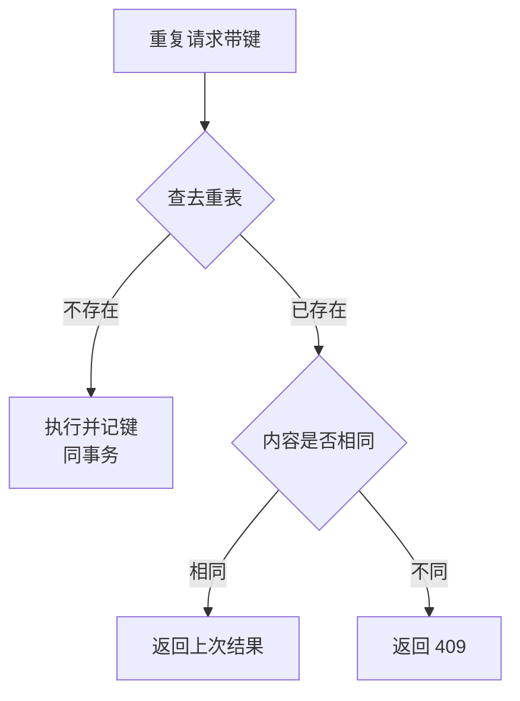
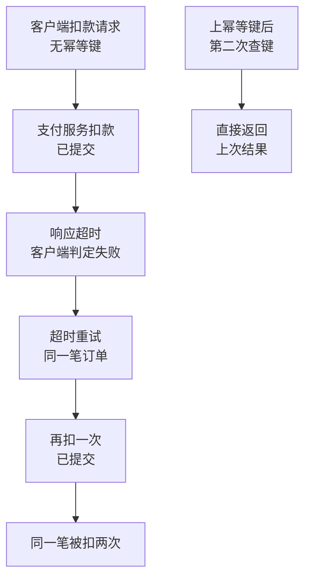

# 幂等性的完整谱系：从操作语义到删除接口的天然陷阱

## 为什么要先弄清楚幂等：重试为什么会带来重复执行？

分布式系统里重试是家常便饭：超时后重发、消息队列（生产者写入、消费者读取的缓冲中间层） at-least-once 投递（至少送达一次，因此同一条消息可能被送两次）、用户双击提交。重试引发的问题只有一个：**同一操作被执行两次**。

幂等性（同一操作执行一次与重复多次，对系统状态的影响相同）要解决的问题就是**让重复执行产生与一次执行相同的效果**。一次远程调用的行为约定——包括是否重试、重试几次、重复执行是否安全——称为调用语义，**超时、重试与幂等（同一操作执行一次和执行多次结果相同）共同定义调用语义**（见 [[工程知识/后端系统：在并发、失败与变化中维持服务/分布式可靠性/超时、重试与幂等共同定义调用语义.md]]），本文把其中"幂等"一角展开成完整谱系。

读完你能判断哪些接口需要增加幂等键（请求自带唯一标识，重复提交只生效一次）、如何为删除接口避开 404 引发的反复重试，以及为什么键与业务必须写入同一事务。

## 幂等分哪两层：操作语义与接口设计

先用一个比喻勾勒出大致的样子：幂等像电梯按钮——电梯的上/下呼叫是状态型操作，按一次和按三次，最终召唤的都是同一部电梯、停在同一层（操作语义层的天然属性；这个比喻只说明重复操作结果不变，不代表所有操作都天然如此）；再像挂号取号机——你丢了小票再取一次号，机器认出"这个身份证今天取过号"，把原小票重新打给你，不会给你排两个队（接口设计层：靠唯一键把重复变重放；这个比喻只说明靠唯一标识去重，实际键的生成方与存储方式需另行设计）。这个比喻到"取号机"为止——现实里键的生成方、存储事务边界、过期策略都是设计决策，下面分层展开。

"幂等"在两个层次被使用，**混用会带来设计错误**。

**操作语义层**（数学定义）：f(f(x)) = f(x)，**一次执行与多次执行效果相同。这是属性，不是实现**。HTTP 方法里，**POST（提交数据创建资源）创建订单天然不幂等，PUT（以完整内容替换目标资源）全量更新天然幂等**。RFC 9110（IETF 发布的 HTTP 语义标准文档）对 HTTP 方法幂等性的定义就在这一层。

**接口设计层**（工程实现）：**通过给操作附加唯一键（idempotency key，幂等键，用于标识一次操作的唯一编号），把天然不幂等的操作变成幂等的**。Stripe 的做法是代表：客户端生成 UUID（通用唯一识别码，一段几乎不会重复的随机字符串），服务端记住"这个键已处理过，结果是 X"，**重复请求直接返回上次结果**。

键在真实链路里挡住的正是响应丢失那一段。下面这张时序是幂等键的标准用法：你的服务端先为这次业务动作生成并落库一个键，再带着这个键调用支付方接口；网络超时导致响应丢失时，重试携带的是同一个键，支付方查出这个键见过，直接返回第一次的支付单，不再产生新的扣款，服务端随后才把这一笔记为成功。


*图示：幂等键在响应丢失场景下的重试时序，你的服务、数据库与支付 API 三方交互。图源：clixo.sh《Stripe Idempotency（幂等性：同一请求重复发送结果不变） Keys: How They Work and When You Must Use Them》，https://clixo.sh/blog/stripe-idempotency-keys-deep-dive，技术博客公开材料。*

两层的关系是：**键是外部世界给操作盖的章，不是操作本身的属性**——这个比喻只说明键是外加的标识，不等于实现；**键何时生效、何时过期仍是设计决策**。使用键时要遵守的规则：**第一次请求带键，服务端把键与处理结果在同一事务里写入数据库，重复请求查键直接返回**。**键与业务操作必须在同一事务边界内，否则崩溃后键未持久化，重试时去重表查不到该键，服务端会当作新请求再次执行业务操作**。

带键请求到达服务端后会被判成哪三种情况？如下图。



## 为什么 GET/PUT/DELETE幂等而 POST 不幂等？

| 接口 | 天然幂等 | 机制 | 重试后的风险 |
| --- | --- | --- | --- |
| GET/PUT/DELETE | 是 | 语义本身保证 | 无 |
| POST 创建 | 否 | 两次创建两个实体 | 重复下单 |
| POST 执行命令 | 否 | 两次执行两次副作用 | 重复扣款 |
| 带幂等键的 POST | 工程上靠附加键实现 | 键去重 | 键过期后重试二次执行 |

这张表的本质：**幂等是接口语义的属性，不取决于重试几次**。**天然幂等接口（PUT）不需要键，天然不幂等接口（POST 创建）必须有键**。这也解释了 DELETE（HTTP 删除资源的请求方法） 为什么幂等：**删除不存在的资源返回 404，删除已删除的资源还是 404，效果与执行一次相同**。**接口设计层通过键来判断请求是否重复（键判重）**，在云厂商官方实现里已经是标准组件，AWS Lambda Powertools（AWS：Amazon Web Services 亚马逊云服务；Lambda 是其函数计算服务，Powertools 是配套工具库）的官方文档用两张执行链路图展示了键第一次到达与重试到达时的差别：


*图：首次执行，键不存在，业务逻辑执行后把键与结果写入 DynamoDB 幂等表（来源：[AWS Lambda Powertools 官方文档](https://docs.powertools.aws.dev/lambda/python/latest/utilities/idempotency/)，MIT-0 许可）。*


*图：重试到达，条件写入失败直接返回，业务逻辑没有再次执行（来源同上）。两张图对照就是"键与结果同事务"在生产级实现里的样子：判重发生在业务执行之前，重试的代价只是一次缓存查询。*

## 幂等键的思想从哪来、要付出什么代价？

幂等键的思想背景是**用确定性替换随机性**。**没有键时，服务端面对重复请求只能猜（重发还是新请求）；有键时，判断变成确定性查询（这个键见过没有）**——像门卫查工牌，查到工牌即放行熟人，查不到就按生客登记。**它替代的两种更早做法：客户端手动确认（用户体验差）与服务端启发式去重（按请求体匹配，误判率高）**。

**关键在于键与结果同事务写入：去重表和业务表在同一事务里写，"记住键"与"完成业务"要么都完成，要么都不做，不会出现只记住键但业务没完成的状态**。代价：**每笔写操作多一次键查表与键写入**；去重表（记录已处理键与对应结果的表）按业务量增长，**键不能无限保留，过期窗口必须与业务重试窗口期匹配，这是持续的维护成本**。

## 幂等的账怎么算：可运行示例与案例回流

```text
幂等谱系与实现（通用形态）：

天然幂等：SET status = 'paid'（覆盖写，重复执行结果不变）
条件幂等：INSERT ... ON CONFLICT (external_id) DO NOTHING（业务键去重）
非幂等：UPDATE balance = balance - 100（重复执行扣两次）

转账接口的完整幂等：
  客户端生成 idempotency_key → 服务端建表存储
  收到请求：key 已存在 → 返回上次结果（不重复执行）
            key 不存在 → 执行 + 记录结果（与业务同库同事务）
  请求体哈希一起存：同 key 不同内容 → 返回 409（调用方 bug）

删除接口的天然陷阱：
  DELETE /orders/42 第一次返回 200（删除成功）
重试返回 404（资源已不存在）→ 客户端把 404 当失败再重试 → 无限循环
  修复：删除接口幂等化（已删除时返回 204 或带 deleted 标记的 200）
```

支付超时后重试为什么会扣两次——响应丢失的那一段时序里，服务端已经提交而客户端判定失败：



图上第二次提交的位置就是幂等键要堵的点：键与结果同事务写入，重复请求查键直接返回，重试才天然安全。

**下面是非幂等扣款加网络重试的实录：支付超时后客户端重试，同笔订单扣两次款（无幂等键，服务端各执行一次），双倍扣款引发客诉，客诉要走退款与对账流程，这些人工与沟通成本长期累积，远超一次性开发幂等键的投入；上幂等键后重试天然安全**。**删除 404 的实录——同步客户端把 404 当错误抛给用户（提示删除失败但订单明明没了），修成幂等语义后消失**。幂等与重试的配对纪律见 [[工程知识/后端系统：在并发、失败与变化中维持服务/分布式可靠性/重试的正确姿势：退避、抖动与重试预算.md]]（**非幂等操作禁止自动重试**），与消息投递的衔接见 [[工程知识/后端系统：在并发、失败与变化中维持服务/分布式可靠性/消息投递与业务提交需要显式的一致性边界.md]]（**at-least-once 必然带重复，消费端幂等是标配**）。

## 这套做法在哪儿会失效：边界

- **键的过期窗口是设计坑**。**Stripe 键保留 24 小时，窗口外重试同一键会被当新请求**。**支付类敏感业务要自定窗口，并配合对账兜底**（见 [[工程知识/缺陷分析：从个案到体系/正确性/静默失真的检测靠对账与不变量而不是报错.md]]）。
- **并发重试的竞态（多个执行流争抢资源、结果取决于时序）**。**两个同键请求并发到达，都在写入前去重表查询，此时双方都还没把键写进去，所以都查不到对方，于是都执行业务操作**。**要配唯一索引或分布式锁兜底**，锁的正确用法见 [[工程知识/后端系统：在并发、失败与变化中维持服务/分布式可靠性/租约必须配合FencingToken阻止过期持有者.md]]。
- **DELETE 幂等有前提**：**删除无副作用（操作对外部状态产生的额外影响）**。若删除触发退款、级联清空子资源，**幂等性不再成立，DELETE 退化为需加键的普通操作**。
- **异步消息怎么接同一套幂等？** 做法是**把消息的去重标识当作幂等键，消费端用同一套去重表逻辑判重**：**at-least-once 投递下去重表与幂等键结构相同，键直接复用消息的 dedup id（消息去重标识）或业务键**。

## 如何自己动手验证幂等是否生效？

- **重复请求验证**：同一键连发两次，**预期第二次返回第一次的结果且业务表只多一条记录**。对不上就停下查：键写入的事务边界是**否完整、并发兜底是否生效**。
- **窗口外重试验证**：键过期后重试按新请求处理，**预期对账环节能发现并修正双执行**。
- **重放验证**：旧键重放被去重表拦截，**预期拦截有日志可查**。

## 幂等在调用语义三元组里处于什么位置？

- [[工程知识/后端系统：在并发、失败与变化中维持服务/分布式可靠性/超时、重试与幂等共同定义调用语义.md]] —— 幂等在调用语义三元组里的位置
- [[工程知识/后端系统：在并发、失败与变化中维持服务/分布式可靠性/Saga把长事务变成补偿链，代价是**失去隔离性.md]] —— 补偿操作要求幂等**，谱系是其前置
- [[工程知识/数据系统：在并发与故障中保存事实/事务与存储/事务隔离决定并发读写能观察到什么.md]] —— 并发同键请求的隔离问题
- [[工程知识/后端系统：在并发、失败与变化中维持服务/分布式可靠性/重试的正确姿势：退避、抖动与重试预算.md]] —— 重试安全的前置条件
- [[工程知识/后端系统：在并发、失败与变化中维持服务/服务设计/HTTP语义的分层：方法、状态码与头部的约定角色.md]] —— 方法幂等语义的谱系展开
- [[工程知识/后端系统：在并发、失败与变化中维持服务/服务设计/批量与单条接口的取舍分界：按调用方节律与平台职责定边界.md]] —— 批量重试场景的幂等键约定与部分失败明细
