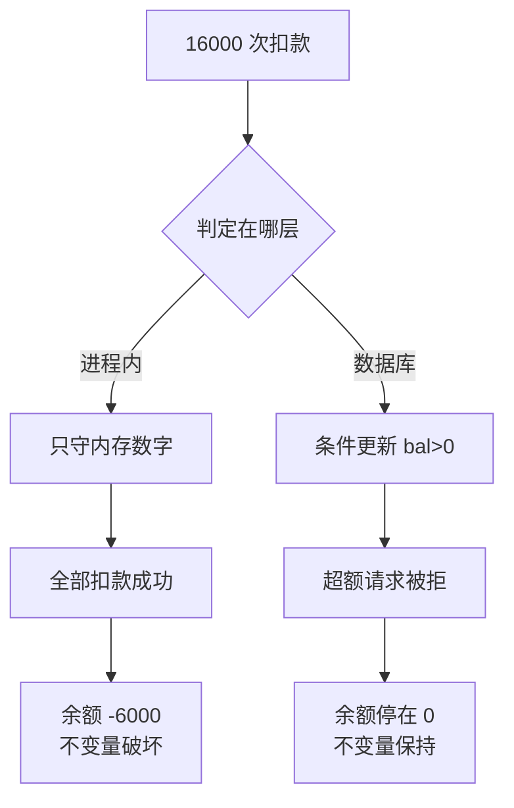
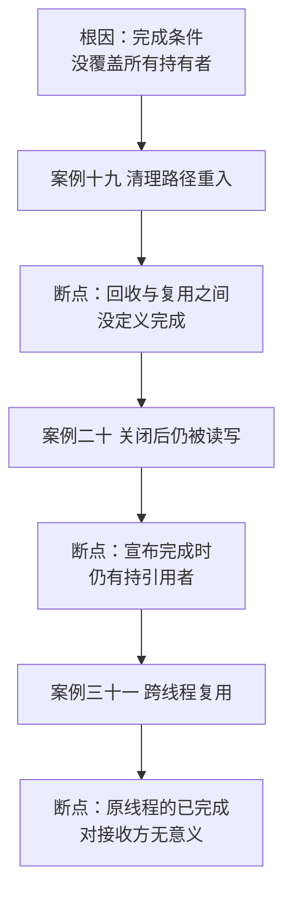

# 并发控制先定义共享状态和完成条件

**并发问题的核心在于：多个执行单元同时读写状态时，哪些不变量必须保持、谁拥有状态、何时算完成；加锁只是工具选择，排在这些问题之后**。**读完这篇你能先写清共享状态和完成条件再选工具，也知道互斥锁（同一时刻只允许一个执行流持有的锁）、事务和租约各自管到哪一步**。**可选的工具有六类，每类管一种范围**。加锁通常指其中的互斥锁，是最常见的一类：

- 互斥锁（同一时刻只允许一个执行单元进入被保护区域）。
- 原子操作（不可打断的单一读写）。
- 消息传递（不共享内存，靠收发消息交换数据）。
- 事务（一组数据库操作要么全部生效要么全部不生效）。
- 版本号（数据带上递增编号，写入时校验编号防覆盖）。
- 租约（lease，带到期时间的占用凭证，到期后自动释放，持有者崩溃也不会永久占用）。

**它们的保护范围不同，不能互换**。

**例如「扣减库存并创建订单」不是把两个函数分别加锁就完成了：锁只覆盖单进程内存时，进程崩溃、重复请求或另一个服务写入仍会破坏库存不为负的约束**。**先写出共享状态、所有者和提交点，再选择锁、CAS（Compare-And-Swap，比较并交换，一条 CPU 指令完成「值没变过就写入」的原子操作）、事务或事件，才能知道保护范围是否覆盖真正的副作用（操作对外部状态产生的额外影响）**。

## 要解决的问题：哪些不变量必须始终保持是什么

**多个执行单元同时读写同一份状态时，把问题直接归结为加锁，加完之后仍然出现不一致，或者出现新的死锁（多个执行流互相等待对方释放资源）与性能下降**。**本篇回答：哪些不变量必须始终保持、状态归谁所有、什么条件下算完成、互斥与原子操作与消息传递与事务与版本号与租约各自适用于哪个范围**。

读完这一篇，你能在写第一行并发代码之前先想清楚共享状态归谁管、什么状态才算做完。

**共享状态可以想成一间只有一个白板的办公室：谁都能改白板上的字，两拨人同时写就会互相覆盖**。**想避免混乱，要么规定"一次只许一个人进来写"（互斥），要么让每个人只改自己那一小块（划分所有权）**。这个比喻到"完成条件"为止——**白板的问题只在于怎么写不冲突，而程序里还多一问：写到什么程度才算这件事做完了，这一问靠锁解决不了，得由业务自己定义**。

## 三条路径分别适合什么情况

**划分好共享状态之后，还要决定并发单元之间怎么交接。用队列连接比直接共享内存容易推理：每个单元只面对自己的输入队列，交接点显式可见**。

**交接点显式化的直接好处是可观测——队列长度本身就是积压的度量，不用另外埋点（在代码里插入统计上报语句、收集用户行为数据）**。**代价是多一次入队出队的开销**，交接频繁时这笔开销不能忽略。


| 场景 | 机制 | 需要验证 |
| --- | --- | --- |
| 同一进程短临界区 | mutex/atomic | 锁顺序、内存可见性、持有时间 |
| 生产者与消费者 | channel/queue | 容量、阻塞、取消、关闭和背压（下游处理不过来时把压力传回上游减速） |

**上表里"阻塞"这一项值得单独展开：并发问题里最常见的误判，是把等待当成忙碌**。**线程状态可以分成运行（正在占 CPU）、就绪（排队等 CPU）、等待（在睡眠或等 I/O）几类，这是 Brendan Gregg 提出的经典划分，任何"看起来很忙"的进程都可以先按这个划分检查它到底在运行还是在等待**：

**这张图对上表的用处在于：等待时间不在 CPU 采样（只采集一部分数据以控制记录开销）里，只看 CPU 指标会漏掉整类问题**。
| 跨进程共享状态 | 数据库事务/锁 | 隔离、死锁、恢复和唯一约束 |
| 跨主机长任务 | lease + fencing | 过期持有者不能继续写 |
| 可重放事件 | 版本/状态机 | 重复、乱序和旧事件被拒绝 |

**线程安全（单个数据结构在多线程下读写不会算错、不会崩）只说明某个数据结构不会发生未定义竞争，不说明业务操作原子；异步函数也可能在 await 前后被其他任务插入**。**取消、超时、异常和资源释放必须沿并发边界传播**。

并发单元之间的交接方式不止锁一种。Disruptor（环形缓冲区上做无锁生产消费，追求极低延迟）、Actor（每个单元独占自己的状态，只靠收发消息通信）与协程（在一个线程里交替执行多个任务，切换由程序控制）是三种常见的并发模型，各自的取舍见下图；该图出自美团技术团队的线程池（预先建好一组线程反复取用、避免频繁创建销毁）实践文章，帮助对比交接方式的选择空间：


来源：[美团技术团队《Java线程池实现原理及其在美团业务中的实践》](https://tech.meituan.com/2020/04/02/java-pooling-pratice-in-meituan.html)（CC 4.0 BY-SA）

**要理解进程内锁为什么只覆盖单进程，先看线程与进程共享了什么。下图里同一进程的多个线程共享代码、数据与打开的文件——正因为它们共享堆上的数据，才需要锁；而进程之间不共享这些，进程内锁自然管不到别的进程**：


来源：[小林coding《进程、线程基础知识》](https://www.xiaolincoding.com/os/4_process/process_base.html)


## 三种实现实测差在哪里

**判断并发控制是否到位，不能只看"有没有加锁"，要看业务不变量是否被守住**。**下面三种实现对同一组请求操作同一余额（初始 10000，8 线程各扣 2000 次，共 16000 次请求，Python 3.9.6）**：

| 实现 | 最终余额 | 成功扣款 | 算术一致 | 业务不变量（余额 ≥ 0） |
| --- | --- | --- | --- | --- |
| 无保护 | -6000 | 16000 | 是 | **破坏** |
| 进程内锁 | -6000 | 16000 | 是 | **破坏** |
| 数据库条件更新 | 0 | 10000 | 是 | 保持 |

**前两种的余额与扣款次数完全对得上——算术层面没有竞争，竞态（多个执行流争抢资源、结果取决于时序）测试如果只断言"余额 == 初始 - 扣款次数"会通过**。**但余额被扣到 -6000，说明它们保护的是内存里的数字，不是"余额不能为负"这条业务约束**。**第三种把约束写进 `WHERE bal > 0`，超额请求被拒绝（`rowcount = 0`），余额停在 0，成功扣款恰好 10000 次**。

判定在哪一层，结局就在哪一层分岔，下图展示这两条路径：



**代价也真实：数据库条件更新耗时 293ms，进程内锁 2.4ms，相差约两个数量级**。**这组数字说明选择落在保护范围与延迟的交换上——数据库条件更新要把状态交给持久化引擎，多出的几百毫秒就是跨进程保护带来的往返代价，于是安全性与延迟成了交换关系**，安全性数字之外还要看延迟预算。

复现脚本（每线程独立连接；SQLite（嵌入式的单文件关系数据库）连接在多线程间共享会段错误，这类崩溃发生在锁保护范围之外，说明副作用在锁管不到的地方）：

```python
import sqlite3, threading, os

DB = "/tmp/acct.db"
ITER, WORKERS, START = 2000, 8, 10000

def setup():
    if os.path.exists(DB):
        os.remove(DB)
    c = sqlite3.connect(DB)
    c.execute("PRAGMA journal_mode=WAL")
    c.execute("CREATE TABLE acct(id INT PRIMARY KEY, bal INT)")
    c.execute("INSERT INTO acct VALUES(1, ?)", (START,))
    c.commit(); c.close()

def worker(times, lk):
    con = sqlite3.connect(DB, timeout=30)
    for _ in range(ITER):
        cur = con.execute("UPDATE acct SET bal=bal-1 WHERE id=1 AND bal>0")
        if cur.rowcount:
            with lk:
                times.append(1)
        con.commit()
    con.close()

setup()
times, lk = [], threading.Lock()
ts = [threading.Thread(target=worker, args=(times, lk)) for _ in range(WORKERS)]
[t.start() for t in ts]; [t.join() for t in ts]
print("成功扣款:", len(times), "总请求:", ITER * WORKERS)
# 期望：成功扣款 = 10000，总请求 = 16000
```

## 容易踩哪些并发错误？

- **检查后使用 TOCTOU（Time-Of-Check to Time-Of-Use，检查与使用之间对象被调包的竞态）：状态在检查与动作之间已经变化**。
- **锁保护内存却没有保护外部副作用，释放后仍可能重复提交——上面的 -6000 就属于这一类，且它通过了算术一致性断言**。
- **无界线程池、队列或 future 把过载变成内存和延迟事故**。
- **只测无竞争成功路径，不测取消、超时、进程暂停和恢复**。
- **用"算术一致"代替"业务不变量成立"，把竞态测试写成恒真断言**。

## 它失效的时候长什么样

**真正的共享状态常常不在加锁的位置上**。[[工程知识/缺陷分析：从个案到体系/并发/案例十九：在回调里改自己——清理路径的重入与回收后复用]] 里，**对象被回收后回调仍在同一条清理路径上重入，锁保护的是对象内部的字段，而失效发生在生命周期的交界处——回收与复用之间没有定义完成条件**。

**三个案例共用一条根因（完成条件没有覆盖所有持有者），断点各在一处**：



**路口堵死给"时序竞争无仲裁"提供了最直观的画面：每个方向的车都只按自己的路权假设往前走，没有任何一方在出发前确认交叉方向的放行状态，结果是谁也过不去、谁也退不出**。**并发单元各自持有锁与等待目标时是同一个局面——每个单元的行为局部看都合理，合起来把共享资源困成一个结**。**解法也同构：红绿灯是外加的仲裁（由第三方投票打破平局、决定归属的机制）者（全局排序），环岛是收敛的交接规则（统一的锁序），总之放行权不能由各方自行假定**。这个比喻只说明缺少仲裁会让局部合理的动作合起来卡死，不涵盖具体该选哪种锁序或仲裁实现：


*图源：Wikimedia Commons，Yoichi Okamoto（美国国家档案与记录管理局），公有领域，https://commons.wikimedia.org/wiki/File:BLOCKED_INTERSECTION_CAUSES_INSTANT_TRAFFIC_JAM_-_NARA_-_546652.jpg。*

## 这套说法在哪儿会失效

**这套判断的前提是：能够明确指出共享状态的所有者和提交点**。**在以下情况它不再直接适用——状态所有者本身在多副本间漂移（此时先解决归属，见 [[工程知识/后端系统：在并发、失败与变化中维持服务/分布式可靠性/一致性模型与共识解决不同问题]]）；副作用发生在无法参与事务的外部系统，此时需要幂等（同一操作执行多次与执行一次效果相同）与对账，不需要更强的一致性；幂等指同一操作执行一次和执行多次结果相同；以及完成条件依赖 wall-clock 时间（墙上时钟，指日历钟表显示的真实流逝时间，区别于记录操作顺序的逻辑时钟）而非状态版本（此时 [[工程知识/后端系统：在并发、失败与变化中维持服务/分布式可靠性/时间顺序与因果必须显式建模]] 是前置）**。

## 怎么自己动手验证

**并发结论要与不变量对账——预写重复提交、竞态读写与取消场景下余额守恒应成立，实测出现重复扣款或资源未释放，与预期对不上**。

**为不变量写并发测试和故障注入（故意制造崩溃、超时、延迟来检验系统行为）：重复提交、竞态读写、锁顺序反转、队列满、消费者崩溃、取消时资源释放、旧版本写入**。对长任务结合 [[工程知识/后端系统：在并发、失败与变化中维持服务/分布式可靠性/租约必须配合FencingToken阻止过期持有者]]。

**最小实验：让两个 worker 同时读取同一余额并各自扣款，分别用无保护、进程内锁、数据库条件更新三种实现；在 worker 被杀和请求重试后检查余额、扣款次数和审计记录。若只有数据库条件更新仍能保持不变量，说明真正的共享状态不在进程锁范围内**。

**断言要写成业务约束（`assert bal >= 0`），别写成算术恒等式（`assert bal == START - times`）**。

## 接着读哪几篇：跨主机长任务的完成条件

- 关系：[[工程知识/缺陷分析：从个案到体系/并发/案例十九：在回调里改自己——清理路径的重入与回收后复用]] · [[工程知识/缺陷分析：从个案到体系/并发/案例二十：关闭之后还有人在用——生命周期的时序竞态]] · [[工程知识/缺陷分析：从个案到体系/并发/案例三十一：回收之后还在飞——跨线程复用可回收对象]]
- [[工程知识/后端系统：在并发、失败与变化中维持服务/分布式可靠性/租约必须配合FencingToken阻止过期持有者]] —— 跨主机长任务的完成条件
- [[工程知识/后端系统：在并发、失败与变化中维持服务/分布式可靠性/时间顺序与因果必须显式建模]] —— 完成条件依赖时间时的前置
- [[工程知识/后端系统：在并发、失败与变化中维持服务/分布式可靠性/一致性模型与共识解决不同问题]] —— 所有者漂移时先解决归属
- [[工程知识/软件构建：让变化可以理解、验证与交付/语言与运行时/内存模型决定并发读写何时可见]] —— 锁之下的可见性基础
- [[工程知识/后端系统：在并发、失败与变化中维持服务/任务与并发/限流熔断与隔离控制故障半径]] —— 无界并发的另一半后果
- [[工程知识/缺陷分析：从个案到体系/并发/回调必须回到属主线程：完成通知的线程归属纪律]] —— 属主串行域纪律在回调场景的展开
- [[工程知识/AI 系统工程：从模型能力到生产能力/模型与上下文/跨会话状态的一致性先于记忆的长度]] —— 记忆层的同构问题


- [[工程知识/缺陷分析：从个案到体系/并发/案例二十：关闭之后还有人在用——生命周期的时序竞态]] 是同一个骨架的另一断点：**关闭流程宣布完成，但仍有持引用者继续读写**。**两例共同的机制是完成条件没有覆盖所有持有者，锁的粒度再细也拦不住，因为锁的对象不是争用的对象**。
- [[工程知识/缺陷分析：从个案到体系/并发/案例三十一：回收之后还在飞——跨线程复用可回收对象]] 进一步说明：**跨线程传递后，原线程的"已完成"对接收方没有意义，完成条件必须定义在共享状态的归属层，而不是单个执行单元的视角**。
