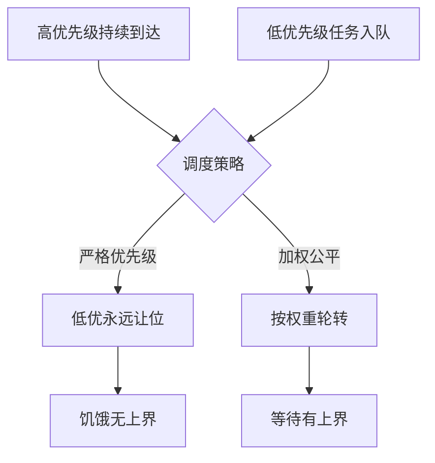
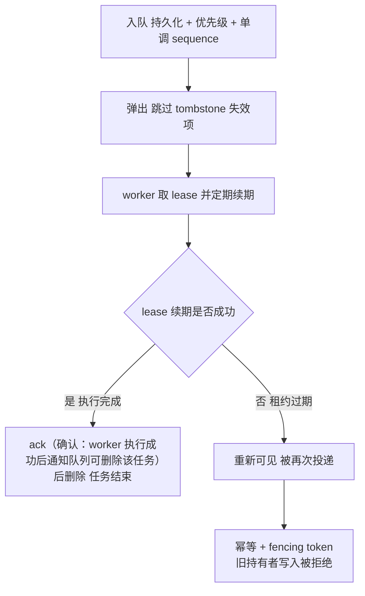

# 调度必须同时处理优先级、公平与背压

## 为什么只做优先级不够，还要同时处理公平和背压？

**先用一个比喻勾勒出大致的样子：任务调度像医院急诊分诊——优先级是"谁最危急先看"（分诊台的一条规矩）；公平是"同级病人按挂号顺序来，不能让熟人插队"（不然同级的普通病人永远轮不上）；背压是"候诊区满了就得挂限号"（继续放人进来，走廊爆炸，所有人都看不上病）**。**只做优先级的队列像只按病情分诊、不管候诊区大小的医院：危急病人多了，普通病人饿一整天；没有限号，人满为患时连危急病人都挤不进门**。

**这个比喻到"限号"为止——现实里还有取消、持久化、多节点认领这些医院没有的麻烦（医院里病人不会在候诊中途被取消或换个医院重排，而任务会在执行中被取消、会在重启后丢状态、还会被多台机器重复认领），下面逐段展开**。

**优先级之外，投入生产的任务队列还会出现五种情况：低优先级任务长期饥饿（参与者长期抢不到资源、一直被推迟）、同优先级任务顺序不定、取消之后仍在执行、重启之后状态丢失、多节点之间重复认领**。**要解决的就是这五种情况：这正是调度器要把优先级、公平与背压放在一起设计的原因——三者缺一，上面某种情况就会失控**。**本篇回答这题到底在解决什么：优先级之外还需要处理哪些情况、公平与老化怎样实现、取消与持久化与背压各自由哪一段承担，以及背压从哪里传回上游**。

**堆解决的是“快速取出当前最小/最大优先级”，调度系统还要解决相同优先级、并发、饥饿、取消、持久化和多节点归属**。**读完这篇你能判断一个队列该补公平、补取消还是补背压，也知道只做优先级会漏掉什么**。

**同一个优先级队列在低负载时看起来足够，但在高优先级持续到达时，低优先级任务可能永远不被执行；无界队列则不拒绝任何入队，积压持续上涨占用内存，最终内存耗尽或任务被系统终止**。**调度器承诺的对象是“谁在什么资源和截止时间内获得一次执行机会”，因此优先级、公平和背压必须一起设计**。

## 堆能保证哪些、保证不了哪些：数据结构边界

**二叉堆（一种父节点永远优于子节点的完全二叉树）的插入和弹出通常为 `O(log n)`，查看堆顶为 `O(1)`**。**Python `heapq` 是 min-heap（最小堆，堆顶永远是最小元素），不是线程安全队列，也不会自动给不可比较对象稳定排序**。

```python
from dataclasses import dataclass, field
from itertools import count
import heapq

seq = count()
queue = []

@dataclass(order=True)
class Entry:
    priority: int
    sequence: int
    task_id: str = field(compare=False)

heapq.heappush(queue, Entry(priority=10, sequence=next(seq), task_id="t1"))
```

**`sequence` 既避免同优先级时比较 task 对象，也提供稳定 FIFO（先进先出，先排队的先被处理） tie-break（同优先级时按先进先出顺序决出先后）**。**进入堆后不要原地修改参与比较的字段；更新优先级通常采用新 entry + 旧 entry tombstone（把旧项标记为失效，弹出时跳过），弹出时跳过失效项**。

## 只有一个堆为什么不够：从堆到调度器

| 问题 | 仅靠 heap 能否解决 | 工程机制 |
| --- | --- | --- |
| 同优先级稳定顺序 | 否 | 单调 sequence/timestamp |
| 多线程安全 | 否 | 锁或 `queue.PriorityQueue` |
| 任务取消/改优先级 | 否 | entry id、tombstone、版本 |
| 低优先级饥饿 | 否 | aging、公平队列、配额 |
| 多租户隔离 | 否 | 按租户分队列（tenant queue）、并发/资源配额 |
| 进程崩溃恢复 | 否 | 持久队列、lease（租约：worker 定期续期，过期即视为放弃）、visibility timeout（取出后隐藏一段时间，超时未确认则重新可见） |
| 多节点重复执行 | 否 | owner（归属标记）、attempt（尝试次数）、幂等、fencing token（单调递增的令牌，旧持有者的写入被拒绝） |
| 远程命令生命周期 | 否 | 超时、日志回收与进程清理随任务一起登记，见 [[工程知识/后端系统：在并发、失败与变化中维持服务/任务与并发/任务生命周期必须覆盖进程、日志、超时与清理]] |

## 谁先跑由哪些因素决定：调度策略

**优先级最简单的做法是所有人进同一条队列，按优先级出队**。**实现成本低，但低优先级任务在高优先级不断到来时会被一直压在后面——这就是饿死**。


*图源同上（Microsoft Learn 中文文档，CC BY 4.0）。*


- **Strict priority**（严格优先级，永远先执行高优先级）**延迟敏感任务最优，但可能让低优先级永久饥饿**。
- **Deadline/EDF**（最早截止时间优先，谁快到期先跑谁）**适合有明确截止时间的任务，但需要可预测执行时间和超载策略**。

**高优先级持续到达时，两种策略的结局分岔见下面这张图**：




## 低优先级饿死怎么办：公平与老化

**要避免饿死，就把每个优先级拆成独立队列，消费者先取高优先级队列，取空了才降一级**。**这样低优先级至少在上一层级清空时有机会被处理**。


*图源：Microsoft Learn 中文文档（CC BY 4.0），多级反馈队列示意。*

**老化是把等待时间折算进有效优先级：`effective = base_priority - f(wait_time)`**。**它解决的是严格优先级下低优先级任务的无界等待，代价是每轮调度都要重算有效优先级**；**堆靠比较字段维持「父节点优于子节点」的次序，直接改一个节点的比较字段可能让父节点不再优于子节点，整个堆序被破坏，所以只能新建一个按新优先级参与排序的 entry，并把旧 entry 标成 tombstone 让调度时跳过它**。

**加权公平队列（weighted fair queuing，WFQ：按权重分配带宽的公平排队）走另一条路：给每个租户或类别一个虚拟完成时间，每次调度取虚拟时间最小的，权重决定虚拟时间推进的快慢**。**两者的取舍在于——aging 保留优先级语义，实现简单但公平性只有统计意义；WFQ 给出确定性的带宽分配，但需要为每个类别维护虚拟时钟，且对突发流量的响应不如严格优先级**。

**公平调度与有界容量的实物原型是摩天轮：轿厢数量固定、游客按队列分批进入，轮体匀速转动——每个轿厢都会轮到最高点，队伍再长也只会在地面排队等待，没有人能挤占别人的轿厢，也没有人能把队伍排到天上去**：


*图源：Wikimedia Commons，作者 Jebulon，CC0，https://commons.wikimedia.org/wiki/File:Gondola_Riesenrad.jpg。*

摩天轮同时给出了三要素的完整形状：轮转本身是公平（每个轿厢平等获得乘客），检票放行是背压（地面容量就是队列上界，满了就停止放行），轿厢数固定是资源预算（不因为排队人多就凭空加轿厢）。无界队列的调度器缺的正是地面那道检票口——积压不进地面、直接上天（即队列无容量上限，任务无限堆积），直到 OOM（内存耗尽，进程被系统杀死）。

## 队列满了信号往哪传：背压的回传

**再进一步，给每个优先级配专属的消费者池。高优先级永远有自己的算力，不会被低优先级挤占；代价是总的资源要按优先级预先切分，低优先级的池闲着也不能借给高优先级用**。


*图源：Microsoft Learn 中文文档，CC BY 4.0，https://learn.microsoft.com/zh-cn/azure/architecture/patterns/priority-queue。*

**优先级与公平决定「谁先跑」，背压决定「进不来的时候谁被告知」**。**三者缺一，队列就会用内存把问题藏起来：无界队列在下游变慢时不拒绝任何入队，积压持续上涨占用内存，最终内存耗尽触发 OOM，或任务迟迟得不到执行错过截止时间，deadline 大面积违约，此时调度器再公平也没有意义**。**背压的回传路径有三段，缺任何一段都会让上游继续盲目投递**：

1. **拒绝——入队前用准入控制（admission control：先校验队列长度与资源配额，超限直接拒绝）检查，超限直接拒绝并让调用方退避**。
2. **降速——队列接近预设水位（容量上限阈值）时向生产者发信号，让其降速而不是等超时**。
3. **按能力取——下游 worker 按自身处理能力主动拉取，而不是由上游按固定速率推送**。**这三段的取舍取决于上游能否承受拒绝或降速：能承受就在入队前拒绝**，不能承受就让生产者降速；**如果上游既不能拒绝入队、又不能主动降速，就只能由下游按处理能力拉取，避免上游盲目推送造成积压**。

**生产级流系统把「降速」做成了显式协议**。**Flink（流式计算引擎）的 credit-based 反压里，下游 TaskManager 持续向上游汇报 credit（可用的缓冲区配额），不等缓冲区爆掉才反映问题，上游按 credit 决定发多少数据，并把 backlog（积压量）随数据带回——全程无丢包（数据包在网络传输途中丢失）、无超时猜测**：


*图源：阿里云开发者社区《咱们从头到尾讲一次 Flink 网络流控和反压剖析》（Flink 团队文章），CC BY 4.0，https://developer.aliyun.com/article/776833。*

**credit 的本质就是给生产者的准入信号：缓冲区空闲多，credit 高，上游全速发送；下游处理变慢，缓冲区填满，credit 降到零，上游停止发送——背压不需要丢数据也不需要超时，只需要把「队列还剩多少」这个事实如实回传，这正好是上面三段回传路径里「降速」一段在真实系统里的完整实现**。

## 调度器做对了怎么验证：如何证明没有退化

**一次任务从入队到确认，中间要过墓碑（删除标记，压实合并时才真正清除数据）跳过、租约（带过期时间的临时授权，过期即失效）续期与重复投递三道考验，幂等与 fencing token 就挂在最后那道分岔上**：



**重复投递是设计前提，所以幂等与 fencing token 必须和租约一起实现，验证清单里的 worker 终止与 lease 过期两项测的正是这条支路**。

优先级是业务策略，不应由调用方任意填写。服务端根据身份、任务类型、deadline 和配额计算或约束，避免高优先级滥用。

**调度策略要与指标对账**。**预期标准有两条：高优先级持续到达时，低优先级的最大等待时间仍有上界；重复投递保持幂等（同一操作执行一次与执行多次结果相同）**。**回归信号是一条：实测等待时间随负载无界增长，说明公平或背压机制没有生效（即发生性能退化，表现比预期差）**。

- 相同优先级的稳定顺序、取消和改优先级；
- 大量高优先级流量下的低优先级最大等待时间；
- worker 终止、lease 过期和重复投递的幂等性；
- 队列长度、等待时间分位数（把耗时排序后取某个百分比位置的值、如 P99）、执行时间、丢弃/取消/重试率；
- 多租户资源上限与优先级权限。


## 做全了换来什么、要付什么：效果与代价

**把优先级、公平与背压放在一起设计，换来的是低优先级任务的等待时间有上界，取消与改优先级能在执行前生效，队列积压会被拒绝而不是转换成内存占用**。**代价是调度器需要维护老化或配额逻辑**，并发场景下的锁与墓碑记录增加实现复杂度，**多节点投放还要引入所有权与重复执行的防护**。

## 接着读哪几篇：同在后端系统里的相邻问题

- [[工程知识/后端系统：在并发、失败与变化中维持服务/基础设施/基础设施选型先比较责任边界与故障模型]]、[[工程知识/后端系统：在并发、失败与变化中维持服务/分布式可靠性/部分失败决定分布式系统的设计]]、[[工程知识/AI 系统工程：从模型能力到生产能力/安全与治理/执行证据必须独立于AI结论]]。
