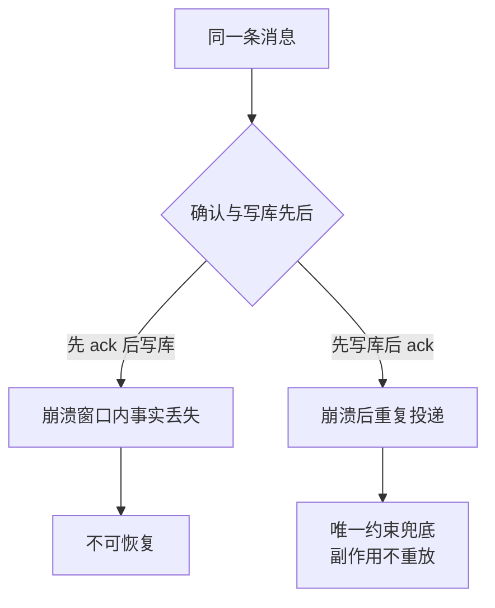
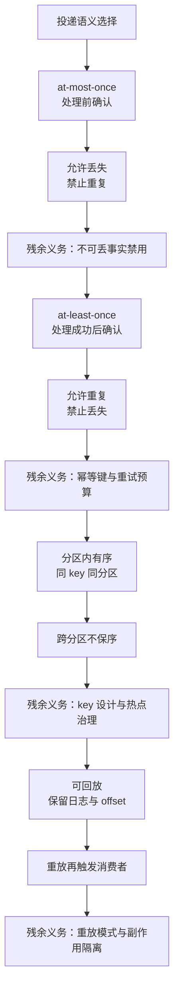

# 队列和流系统用时间与容量换取解耦

订单接口在高峰期不能等通知、积分和搜索索引全部完成，但「把消息发进队列」也不等于**订单已经完成**。生产上最常见的事故是：**订单事务提交后进程在发布事件前退出，通知永远不会发生**；**消费者写入成功后确认丢失，重投又发了一次优惠券**；或者**消费者先确认再写库，进程退出后业务事实直接丢失**——这题到底在解决什么：**发进队列之后，「完成」二字该由谁、在哪个环节说了算**。

本文讲队列与流系统如何用时间和容量换取解耦：**队列把时间换成解耦，也把完成条件从一次函数调用变成一条可恢复的状态机**（每一步都有记录、崩溃后能接着上次进度恢复的机制）。**读完你能判断一次投递到底算不算完成，也知道事务与确认该按什么顺序才不丢不重**。

## 完成状态从一次调用变成哪些新麻烦？

把消息发进队列并不等于**业务完成：上面三种事故分别对应「事件未发出、确认丢失、确认与业务顺序颠倒」三个环节**。本篇回答：**完成状态从一次调用变成什么、生产与消费两端各自在什么位置留下状态、重复与丢失分别在哪个环节产生，以及怎样核对一条消息最终产生了哪些事实**。

## 先看一个事故长什么样

| 时间点 | 代码做了什么 | 故障 | 最终结果 |
| --- | --- | --- | --- |
| T1 | 写入订单数据库 | 事务提交成功 | 订单存在 |
| T2 | 发布 `OrderCreated` | 进程在发布前崩溃 | 通知、积分都不知道订单存在 |
| T3 | 消费者扣库存并返回成功 | ack 在网络中丢失（ack：消费者向服务端回执已处理的确认信号） | 同一订单被再次扣库存 |
| T4 | 消费者收到消息立即 ack | ack 后进程退出 | 业务写入从未发生 |

这四个时间点对应**四个不同的确认**：**数据库提交、生产者确认、消费者确认、业务事实提交**。**把它们混成一个「已处理」状态，系统就无法解释丢失、重复和补偿**。

## 队列和流系统分别解决哪些问题

先把形状说成一件事：任务队列像医院叫号机——一张号只叫一个窗口，办完作废（ack 后删除），叫了没人应可以重新发号（重投）；流像广播电台的节目录音库——库存着每期节目，听众各记自己听到第几期（offset），新听众可以从第一期补听（回放），老听众可以重听某一期（重放）。叫号机省纸，录音库占仓库；选哪个取决于你要"办一次"还是"多人各自听、随时重听"。这个比喻到"重听"为止——现实里两者的存储模型与代价，下面展开。

**流与队列的差别在存储模型上最直观**：Kafka（分布式消息队列，靠日志追加支撑高吞吐订阅）这类分布式流平台**把消息按分区顺序追加，多个消费者各自持有 offset**（消费位点：记录在分区上读到哪一条的序号），**互不干扰，同一份数据可以被反复读取**。


*图源：[Apache Kafka 官方文档](https://kafka.apache.org/documentation/#intro_ecosystem)。*

| 选择 | 适合的问题 | 主要语义 | 代价 |
| --- | --- | --- | --- |
| **任务队列** | 一项工作只需要一个消费者完成 | ack 后消息可删除，失败可重投 | 重放和多组独立消费通常较弱 |
| **持久化日志/流** | 多个消费者各自读取、审计或重建状态 | 消费者保存 offset，可回放 | 分区、重平衡（消费者增减时分区在消费组里重新分配的过程）、保留周期和存储成本 |
| **同步调用** | 需要立即返回确定结果 | 调用链内完成 | 峰值和依赖故障直接传递 |

**队列适合「生成一张缩略图」这类一次性工作；流适合「订单事件同时供库存、风控（识别并拦截欺诈与异常行为的风险控制）、分析读取」**。Kafka 的 offset、RabbitMQ 的 publisher confirm 和 consumer acknowledgement（发布确认与消费确认，两端各自回执消息已收到）**都只描述各自协议边界，不能自动替代业务事务**。产品名称里写着 durable（持久：写入后不因重启丢失）或 exactly-once（精确一次语义：效果上只执行一次），也**不代表你的数据库副作用（操作对外部状态产生的额外影响）天然只执行一次**。

## 怎么理解队列：先写清完成条件

### 1. 怎么定义业务事实和幂等键

动手的次序是先把不变量写下来，再去选 broker：

```text
同一个 order_id 的库存扣减最多成功一次
同一个 payment_id 的退款最多成功一次
同一个 event_id 可以被重复投递，但重复处理不能重复副作用
```

  **幂等（同一个操作执行一次和执行多次的结果相同，重复执行不会产生额外副作用）键（让同一笔操作重复执行只生效一次的标识）必须进入业务存储的唯一约束或去重表，不能只放在进程内存里**。**进程重启、消费者扩容和重放都会让内存状态消失**。财务报销的单号是现成的对照：**同一张发票号在报销系统里只能报一次，第二次提交直接被数据库拒绝**——规矩写在系统里（唯一约束），不是记在某个办事员脑子里（内存），**办事员换人、休假（重启、扩容）规矩都还在**。

### 2. 怎么用 outbox 连接数据库和消息

**写库和发消息分属两个系统，中间任何一次崩溃都会留下库里有而消息没发的状态，而这个状态无法靠重试消除，只能让两者共用同一个提交记录**。**不要在一个函数里「先写库，再直接 publish」**：

```text
同一数据库事务：订单状态 + outbox（发件箱表：把待发事件先写进数据库，再由独立 worker 发布）(event_id, payload, status=pending)
事务提交后：outbox worker 发布事件
收到 publisher confirm（发布者确认，broker 收到消息后回执）：标记 sent
发布失败：按退避重试，超过预算进入人工可见的死信（多次处理失败后单独存放、等待人工处理的消息）
```

这样**允许事件重复发布，但不会因为进程在两个动作之间退出而静默丢失**。**消费者仍然必须幂等**，因为 **worker 可能在收到确认前崩溃，重启后会再次发布同一个 `event_id`**。挂号信的回执是同一套流程：**信先登记进发件台账（outbox），邮递员投出后拿回回执才在台账上销号（confirm）**——回执没回来之前，台账上的信就算待发，邮递员摔一跤（崩溃），接班的人照台账重发一遍；**收件人按信上编号去重，重投的信不开两遍箱**。比喻到"台账加回执"为止：worker 怎么实现、死信怎么处理，看上面流程。

### 3. 怎么把消费者顺序固定下来

**消费者侧的推荐执行顺序如下面几步**：

1. 解析和校验 schema、版本和租户边界。
2. 用 `event_id` 或业务幂等键抢占去重记录。
3. 在同一事务里写业务事实和处理状态。
4. 事务提交成功后再 ack 或提交 offset。
5. 失败时区分可重试错误、不可重试错误和毒消息。

「先 ack 再写库」换来的只是短暂吞吐，代价是**不可恢复的丢失**；「写库后 ack」换来的是**可能重复，因此必须配唯一键、幂等更新或状态机条件更新**。柜面收单是同一先后问题：**客户递单子，柜员先在自己系统里登账、再给客户回执联**——先给回执后登账，**系统一断电，客户手里有回执、系统里没记录，这笔业务就丢了**；先登账后给回执，**最坏是登了账回执没送出，重打一份就行，账不会错**。

同一条消息，确认与写库的先后决定崩溃窗口里丢什么，两条路径下面这张图：



## 为什么投递语义不是业务语义

| 语义 | 怎么得到 | 允许发生什么 | 仍需自己保证 |
| --- | --- | --- | --- |
| **at-most-once** | 处理前确认 | 丢消息，不重复 | 不能用于不可丢的事实 |
| **at-least-once** | 处理成功后确认 | 重复投递 | 幂等副作用、去重和重试预算 |
| **分区内有序** | 相同 key 固定到同一分区 | 分区间乱序 | key 设计、热点和重平衡 |
| **可回放** | 保留日志和 offset | 重放会再次触发消费者 | 重放模式、幂等和副作用隔离 |

「exactly-once」最多是**某个 broker（消息代理，即 Kafka、RabbitMQ 这类服务端进程）、生产者、消费者和事务边界内的协议保证**；**跨数据库、邮件、支付和外部 API 仍需要幂等键、对账或补偿**。RabbitMQ（开源消息中间件）有两种回执。**publisher confirms（生产者确认）表示 broker 收到后回执；consumer acknowledgements（消费者确认）表示处理完再回执**。**两者彼此独立，也都不涉及下游业务是否完成**。

把四种投递语义按确认时点与残余义务摆开，选择就变成一次对照：



## 分区、顺序和扩容怎么互相牵制

**同一个订单、账户或设备的事件需要有序时，把业务 key 作为分区键**；**随机 UUID（Universally Unique Identifier，通用唯一标识符：128 位随机 ID） 当分区键会打散同实体事件，有序要求随即落空**。**分区数限制同一消费组（一组消费者共同订阅一个主题、分区分配给组内成员消费）的最大并行度**，**热点（访问集中在少数键或节点上的现象） key 会让一个分区成为瓶颈**，即使集群总 CPU 还有余量。

车管所按车牌尾号分窗口是同一安排：同一辆车的业务固定走同一个窗口（同 key 同分区），排队先后有保证；尾号随机分窗，同一辆车两次业务可能走两个窗口，谁先谁后就乱了；而尾号"8888"扎堆的城市，那个窗口排到天黑，别的窗口空着——总人力再多也使不上。

扩容前要先回答三个问题：

- 新增分区后，旧 key 是否会迁移并改变顺序？
- 消费者重平衡时，未提交 offset 会不会重复处理？
- schema 是否能让旧消费者读取新事件、让新消费者读取旧事件？

事件必须带 **`event_type`、`event_version`、`event_id`、发生时间、租户或聚合 key**。字段只增不删并**不能自动保证兼容：新消费者可能要求新增字段**，或**字段类型已变化，旧消费者读取时会解析失败**，所以**真正上线前要用旧消费者读取新样本做回归**。老版本办公软件打开新格式文档是同一件事：**文件头里写着格式版本号（event_version），新字段它可以忽略，但类型变了它就报错打不开**——**升级前先拿旧软件把新格式的样例文件挨个打开试一遍，别等全员升完才发现打不开历史归档**。

## 堆积怎么换算成时间：容量和背压

**背压（下游处理不过来时，把压力向上游传导让它减速的机制）的本质是时间换安全：让上游按下游能承受的速率发送**，**用排队等待时间换取不被瞬时流量压垮**。**队列夹在调用方与服务之间，把突发流量摊平成服务能承受的稳定速率**：


*图源：Microsoft Learn 中文文档，CC BY 4.0，https://learn.microsoft.com/zh-cn/azure/architecture/patterns/queue-based-load-leveling。*

摊平之后，**处理方按自身能力消费，突发被吸收而不是直接压垮服务**：


*图源：同上（Microsoft Learn 中文文档），CC BY 4.0。*

这两张图说明了**为什么「堆积换算成时间」是对的判据**。**队列长度本身没有意义，长度除以消费速率才是业务要等的时间**。**消费速率由处理方能力决定，突发只改变队列长度，不改变这个速率**。银行大厅的叫号屏是同一个换算：**屏幕上"前方 100 人"本身没有意义，除以每个柜台的办件速度，才是"还要等 40 分钟"**——大厅里多摆几张椅子（队列容量）**改变的是能容纳多少人等，不改变办事速度**；**想让客人早走，要么开新窗口（扩容处理方），要么劝退一波（限流）**。

**队列长度的工程含义是库存时间**：**积压 100,000 条、消费者稳定处理 500 条/秒时，理论清空时间至少是 200 秒**，还没算新流量、重试和下游抖动（性能指标不稳定的起伏）。**应同时限制**：

- **broker 队列长度、消息 TTL**（time to live，消息的存活时长，过期即丢弃）、单条消息大小；
- **consumer 并发、连接数、prefetch 数**（消费者提前取回但尚未确认的消息条数）；
- **重试次数、退避上限、死信容量**；
- **下游写入 QPS（每秒请求数）和单租户配额**。

优先监控**最老消息年龄**、有效处理速率、处理 p99（99 分位耗时）、重试率、死信（多次失败后被单独存放的消息）数、发布确认延迟（发出消息到收到 broker 回执的时间）和 in-flight 数（指已取出、正在处理但尚未确认的消息条数，同一个消费者身上它通常等于 prefetch 设定值减去已确认数）。**只看 queue length 可能漏掉「长度没变但处理时间翻倍」的故障**。

**背压的顺序应是：入队前先做一道是否放行的检查**（admission control，准入控制）→ **队列设容量上限**（有界队列）→ **超过上限就快速失败或降级**（主动牺牲部分功能或精度，保住核心链路） → **重试要有记录可查**（可观测重试）。**无界内存队列不拒绝入队，生产者快于消费者时消息在进程内存中无限堆积，最终进程因内存耗尽被系统杀死**OOM（Out Of Memory，内存耗尽后被系统强制终止进程），**broker 的容量问题就这样转移到了调用方进程**。

## 死信和重放的边界怎么定

**毒消息不能无限重试：达到次数或时间预算后进入死信，记录最后错误、schema 版本、消费者版本和原始 `event_id`**。**重放前先修复根因、选择隔离队列，并保证已成功的业务状态不会被再次推进**；**不要把死信一键倒回主队列，否则会重新制造同一波故障**。

**解耦的代价还要与消费能力对账：入队速率与消费速率各测一条曲线**。**队列积压增速为正，就是在借未来的容量**。两者对不上（消费追不上生产）时，**要么扩消费者、要么限流**（控制单位时间放进来的请求数量，超过配额就拒绝）入队；**积压上限与丢弃策略要在事前写清**。

## 怎么用故障注入验证投递语义？

| 注入点 | 应观察什么 | 通过条件 |
| --- | --- | --- |
| 数据库提交后、发布前崩溃 | outbox 是否留下待发布事件 | 事件最终可发布，订单不丢 |
| publish 后、confirm 前崩溃 | 同一 event 是否重发 | 消费者副作用只成功一次 |
| 业务提交后、ack 前崩溃 | 消费次数和唯一约束 | 重投不重复扣款/扣库存 |
| ack 后、业务提交前崩溃 | 是否出现事实缺失 | 该模式应被测试禁止 |
| 单分区消费者变慢 | 最老消息年龄、热点分区 | 背压和告警先于 OOM |
| schema 升级、旧消费者在线 | 解析错误和回滚（把系统恢复到上一个可用版本） | 新事件可被旧消费者安全忽略或处理 |

关系：[[工程知识/后端系统：在并发、失败与变化中维持服务/分布式可靠性/消息投递与业务提交需要显式的一致性边界]] · [[工程知识/后端系统：在并发、失败与变化中维持服务/分布式可靠性/超时、重试与幂等共同定义调用语义]] · [[工程知识/后端系统：在并发、失败与变化中维持服务/任务与并发/调度必须同时处理优先级、公平与背压]]
- [[工程知识/软件构建：让变化可以理解、验证与交付/测试与交付/接口约定测试的适用边界：消费者驱动与提供者验证.md]] —— 异步约定之外的行为保障
- [[工程知识/后端系统：在并发、失败与变化中维持服务/任务与并发/分布式锁的正确与错误用法：fencing与租约.md]] —— 消解互斥需求的替代结构
- [[工程知识/后端系统：在并发、失败与变化中维持服务/服务设计/事件驱动架构的解耦代价：最终一致与可追溯性.md]] —— 队列机制的展开

